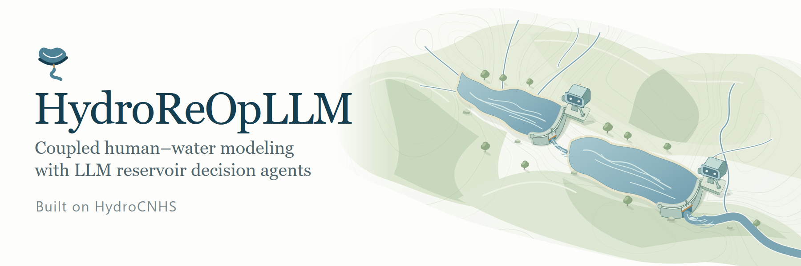
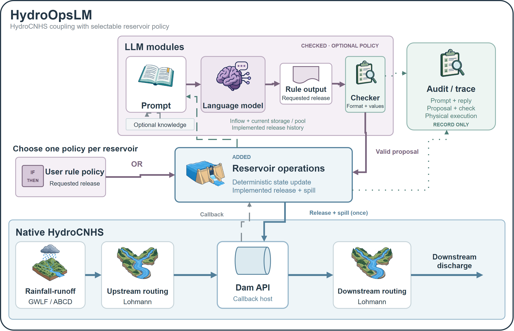

# HydroOpsLM

[English](README.md) | [繁體中文](README.zh-TW.md)



**HydroOpsLM** is a Python framework for studying language-model reservoir
decisions inside coupled hydrological simulations. It connects configurable
decision methods to the existing Dam API in
[HydroCNHS](https://github.com/cylin928/HydroCNHS), which remains the native
hydrology, routing, parameter, calibration and validation foundation.



## Install

Use Python 3.12 and a complete checkout:

```powershell
python -m venv .venv
.venv\Scripts\Activate.ps1
python -m pip install -e . -c environment/requirements-bundled.txt
```

For the local LLM walkthrough, also install
[Ollama](https://ollama.com/) and make `gemma3:4b` available locally. The
repository does not download or start the model for you.

## Run the example

Follow the [FE Walter walkthrough](examples/fe_walter/README.md) to compare a
custom rule-based policy, zero-shot prompting and decision-knowledge prompting
through the same HydroCNHS simulation path. The walkthrough covers configuration,
preflight checks, execution, verification and decision-trace inspection.

## Documentation and citation

[User manual](docs/README.md) · [Tutorials](tutorials/README.md) ·
[Native HydroCNHS setup](docs/HYDROLOGY_SETUP.md) ·
[Official HydroCNHS documentation](https://cylin928.github.io/HydroCNHS/)

HydroOpsLM adds reservoir-decision integration to HydroCNHS. Please credit the
original project separately:

Lin, C. Y., Yang, Y. C. E., & Wi, S. (2022).
[HydroCNHS: A Python Package of Hydrological Model for Coupled Natural Human Systems](https://doi.org/10.1061/(ASCE)WR.1943-5452.0001630).
*Journal of Water Resources Planning and Management*, 148(12), 6022005.

[Project inventory](docs/PROJECT_INVENTORY.md) ·
[Technical note](paper/technical_note.md) ·
[HTML documentation build](docs/BUILDING.md) ·
[Upstream source and license](third_party/hydrocnhs/SOURCE.json)
