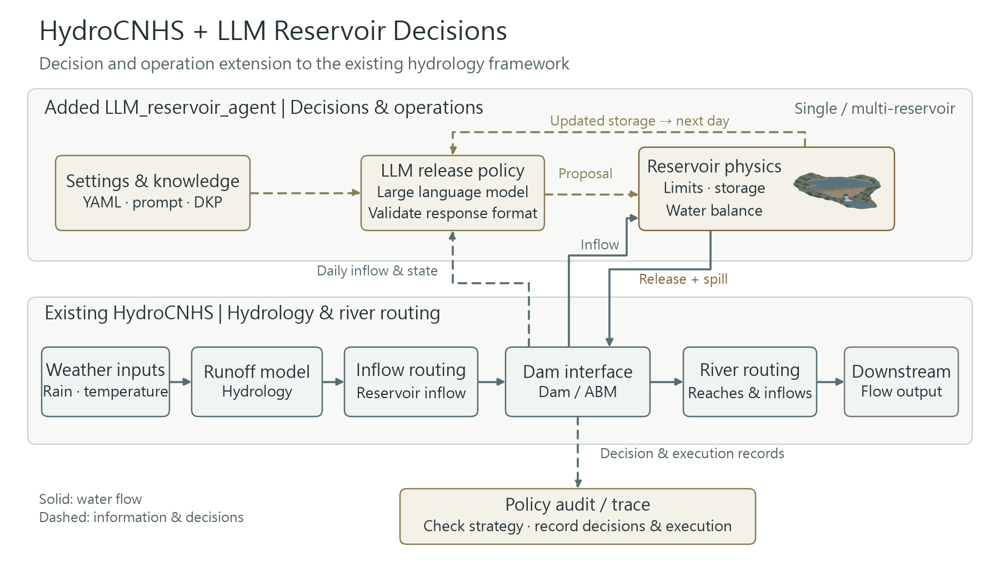

# LLM Reservoir Agent

[English](README.md) | [繁體中文](README.zh-TW.md)

Complete HydroCNHS + configurable LLM reservoir agents for daily experiments.
HydroCNHS provides hydrology and routing. Each agent requests a release; the physical solver updates storage, limits release and calculates spill.
The YAML runner uses supplied daily inflows. It does not rerun GWLF/ABCD or change calibrated parameters.

Native HydroCNHS supports catchment area, hydrological/routing parameters and calibration tools. These use the native model configuration and Python API; the reservoir YAML runner is not a one-command calibration/validation workflow. See [Hydrology setup and C&V](docs/HYDROLOGY_SETUP.md).



## Examples and prompts

Choose a general-purpose example for your own design, or an Anik V3.7 reference example to inspect the original strategy.

| Example | Settings / walkthrough | Prompt to read | What it uses |
|---|---|---|---|
| General-purpose reservoir agent | [YAML](experiments/fe_walter.yaml) · [User guide](docs/USER_GUIDE.md) | [Editable template](prompts/daily_release.txt) · [Optional DKP template](prompts/daily_dkp_release.txt) | Your own prompt/knowledge; the supplied YAML uses fixed offline release |
| Anik V3.7 — FE Walter zero-shot | [YAML](examples/fe_walter/zero_shot/experiment.yaml) · [Walkthrough](examples/fe_walter/zero_shot/README.md) | [Runtime system prompt](prompts/fe_walter_reference/zeroshot_system.txt) · [Complete original prompt snapshot](examples/fe_walter/zero_shot/prompt_preview.txt) | Original public facts and seasonal target; no DKP |
| Anik V3.7 — FE Walter DKP | [YAML](examples/fe_walter/dkp/experiment.yaml) · [Walkthrough](examples/fe_walter/dkp/README.md) | [Runtime system prompt](prompts/fe_walter_reference/dkp_system.txt) · [Complete original prompt snapshot](examples/fe_walter/dkp/prompt_preview.txt) | Original [DKP v1.2](data/anik_v3_7/DKP_FEWalter_Dam_v1.2.md) and conditional retrieval |

The top-level `prompts/daily_*.txt` files are generic templates; `prompts/fe_walter_reference/` contains the original FE Walter system instructions. Each reference snapshot includes the full system prompt, first-day state prompt and response schema; YAML reads the separate system file while daily state and DKP excerpts use the original dynamic builders. Editing the snapshot has no effect; editing system instructions requires the explicit `custom` mode. See [prompt file settings](prompts/fe_walter_reference/README.md). Both reference walkthroughs retain the original audits and use **synthetic offline replies**. Separate live YAML templates preserve those strategies at temperature 0.7; see [live preparation](docs/reference_live.md). The current reference case remains blocked for live execution. The original prompts remain in English; the walkthroughs have separate English and Traditional Chinese pages.

## 1. Install

Use Python 3.12 and a full checkout of this repository. From the repo folder:

```powershell
python -m venv .venv
.venv\Scripts\Activate.ps1
python -m pip install -e . -c environment/requirements-bundled.txt
```

## 2. Try the offline example

```powershell
python run_experiment.py check experiments/synthetic_cascade.yaml
python run_experiment.py run experiments/synthetic_cascade.yaml
python run_experiment.py verify runs/synthetic-cascade
```

This is a four-day, three-reservoir example with fixed test releases and no LLM calls. An existing output folder is never overwritten; change `run_id` and `output` for a new run.

Use the examples table above to choose a strategy. Shared original-policy options are explained in the [reference settings guide](cases/fe_walter_reference/README.md).

## 3. Set up your case

1. Prepare the reservoir network, physical parameters and initial storage in a case JSON.
2. Prepare daily local inflows as CSV: `date,node,local_inflow_cms` (m³/s). If your source is Excel, arrange these columns and export UTF-8 CSV without a BOM; `.xlsx` is not read directly. Update the CSV SHA256 in the case.
3. Copy a commented [experiment YAML](experiments/fe_walter.yaml). Set its case path, output and agents. One controlled reservoir needs one agent; a passive reservoir needs no agent.
4. Give each agent its reservoir ID, prompt, DKP files, model profile and auditors. File paths are relative to the YAML file.
5. Run `check`, then `run`, then `verify`, as above with your YAML path.

| What you edit | Where it lives |
|---|---|
| Agents, dates, model/options, output, auditor selection | `experiments/*.yaml` |
| Locations, connections, physical limits, initial state, inflow CSV/hash | Case JSON under `cases/` |
| Agent instructions | `prompt` → a UTF-8 template under `prompts/` |
| DKP / operating rules | `knowledge` → your UTF-8 files, for example under `knowledge/` |
| Optional static input | `context` or `context_file` in the agent settings |

The prompt file supplies user instructions; the backend fixes the system JSON response contract. The model proposes a release, the auditor checks the configured rules, and the solver implements a physically feasible release.

## 4. Use an LLM

For the generic `configured` strategy, choose a `models` profile, set `mode: llm`, remove the offline `release_cms`, and set `max_calls`. Run `check` first. Actual requests additionally require `--allow-network` and a live-ready case; the runner does not download models.

[Single reservoir](experiments/fe_walter.yaml) · [FE Walter / Beltzville / passive Prompton](experiments/fe_belt_prompton.yaml) · [LLM configuration example](experiments/synthetic_llm.yaml)

## 5. Read the results

Open `summary.json` for status, audit counts and balance errors; `reservoir_trajectory.csv` for releases/storage; `network_flows.csv` for downstream flow. Compact logs point to complete evidence in `raw/`. Audit PASS means the selected rules passed, not that an operating strategy was approved.

Full step-by-step setup and every option: [User guide / 完整操作手冊](docs/USER_GUIDE.md).
Research results: [Saved results](results/README.md). Advanced APIs and historical reproduction: [Advanced workflows](docs/ADVANCED_WORKFLOWS.md). Fixed HydroCNHS source and license: [Source manifest](third_party/hydrocnhs/SOURCE.json).

FE Walter with DKP strategy audit: [seven-day offline walkthrough and live-readiness gaps](cases/fe_walter_dkp_offline/README.md). It makes zero LLM calls; missing strategy inputs remain UNKNOWN.

The real three-reservoir case still has live-readiness blockers. This repository preserves its existing scientific results and original audit verdicts.
