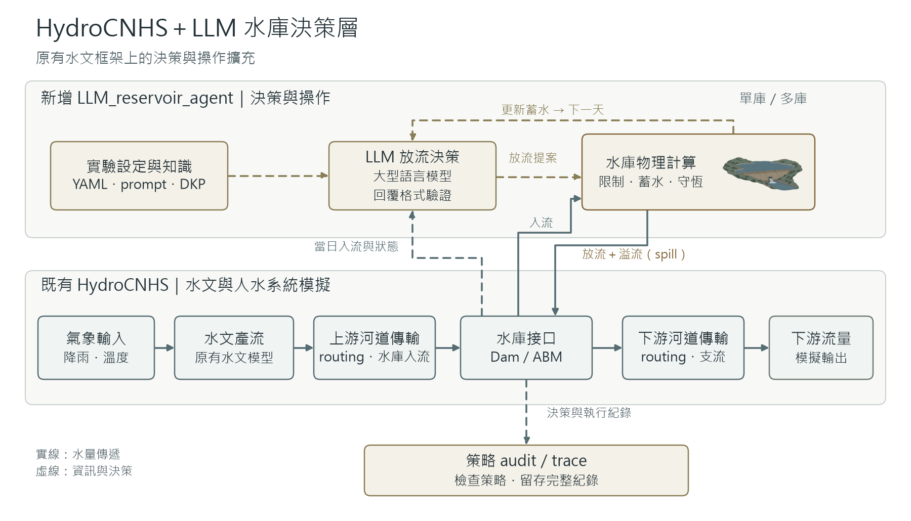

# LLM Reservoir Agent

[English](README.md) | [繁體中文](README.zh-TW.md)

完整 HydroCNHS，加上可設定的 LLM 水庫 agent，用於 daily 實驗。
HydroCNHS 負責水文與 routing；agent 提議放流，物理程式更新蓄水、限制放流並計算溢流。
YAML 執行器使用給定的 daily 入流，不重新執行 GWLF／ABCD，也不更改已校正參數。

原生 HydroCNHS 支援集水區面積、水文／routing 參數與校正工具，使用原生模型設定與 Python API；水庫 YAML 執行器尚未包成一鍵 calibration／validation 流程。詳見 [水文設定與 C&V](docs/HYDROLOGY_SETUP.md)。



## 範例與 prompt 入口

設計自己的實驗請選通用範例；查看原版策略請選 Anik V3.7 範例。

| 範例 | 設定／操作教學 | 可直接閱讀的 prompt | 使用內容 |
|---|---|---|---|
| 通用水庫 agent | [YAML](experiments/fe_walter.yaml) · [操作手冊](docs/USER_GUIDE.md) | [可修改的 template](prompts/daily_release.txt) · [選用 DKP template](prompts/daily_dkp_release.txt) | 自訂 prompt／知識檔；提供的 YAML 採固定離線放流 |
| Anik V3.7 — FE Walter zero-shot 原版 | [YAML](examples/fe_walter/zero_shot/experiment.yaml) · [操作教學](examples/fe_walter/zero_shot/README.zh-TW.md) | [執行用 system prompt](prompts/fe_walter_reference/zeroshot_system.txt) · [完整原版 prompt 快照](examples/fe_walter/zero_shot/prompt_preview.txt) | 原版公開資訊與季節目標，不使用 DKP |
| Anik V3.7 — FE Walter DKP 原版 | [YAML](examples/fe_walter/dkp/experiment.yaml) · [操作教學](examples/fe_walter/dkp/README.zh-TW.md) | [執行用 system prompt](prompts/fe_walter_reference/dkp_system.txt) · [完整原版 prompt 快照](examples/fe_walter/dkp/prompt_preview.txt) | 原版 [DKP v1.2](data/anik_v3_7/DKP_FEWalter_Dam_v1.2.md) 與依情境檢索 |

`prompts/daily_*.txt` 是通用 template；`prompts/fe_walter_reference/` 放的是原版 FE Walter system 指令。兩個原版快照均包含完整 system prompt、第一天狀態 prompt 與回覆 schema；YAML 讀取獨立 system 檔，每日狀態與 DKP 摘錄仍由原版 builder 動態產生。修改快照不影響執行；修改 system 指令須明確選 `custom` 模式，詳見 [prompt 檔設定](prompts/fe_walter_reference/README.md)。兩個原版範例保留原始 audit，目前**僅使用合成離線回覆**。原版 prompt 保留英文，操作教學提供獨立中英文頁面。

## 1. 安裝

使用 Python 3.12，完整取得此 repo，然後在 repo 目錄執行：

```powershell
python -m venv .venv
.venv\Scripts\Activate.ps1
python -m pip install -e . -c environment/requirements-bundled.txt
```

## 2. 先跑離線範例

```powershell
python run_experiment.py check experiments/synthetic_cascade.yaml
python run_experiment.py run experiments/synthetic_cascade.yaml
python run_experiment.py verify runs/synthetic-cascade
```

此範例為四天、三個水庫，使用固定測試放流，不呼叫 LLM。程式不覆寫已存在的輸出目錄；新實驗請修改 `run_id` 與 `output`。

從上方範例表選擇策略；共用的原版選項見 [原版設定教學](cases/fe_walter_reference/README.zh-TW.md)。

## 3. 設定自己的案例

1. 在 case JSON 準備水庫網路、物理參數與初始蓄水。
2. 準備 daily 局部入流 CSV：`date,node,local_inflow_cms`，單位 m³/s。若來源是 Excel，整理這三欄並匯出不含 BOM 的 UTF-8 CSV；程式不直接讀 `.xlsx`。更新 case 中的 CSV SHA256。
3. 複製有註解的 [實驗 YAML](experiments/fe_walter.yaml)，設定 case 路徑、輸出與 agents。一個受控水庫配置一個 agent；被動出口水庫不需要 agent。
4. 每個 agent 指定水庫 ID、prompt、DKP 檔、model profile 與 auditors。檔案路徑以 YAML 所在目錄為基準。
5. 使用自己的 YAML 路徑，依序執行上述 `check`、`run`、`verify`。

| 要修改的內容 | 設定位置 |
|---|---|
| Agents、日期、模型／選項、輸出、auditor 選擇 | `experiments/*.yaml` |
| 位置、連線、物理限制、初始狀態、入流 CSV／hash | `cases/` 下的 case JSON |
| Agent 指令 | `prompt` → `prompts/` 下的 UTF-8 template |
| DKP／操作規則 | `knowledge` → 自己的 UTF-8 檔，例如放在 `knowledge/` |
| 選用的靜態輸入 | Agent 設定中的 `context` 或 `context_file` |

Prompt 檔提供 user 指令；backend 固定 system JSON 回覆契約。模型提議放流，auditor 檢查所設定的規則，物理程式實施可行放流。

## 4. 使用 LLM

使用通用 `configured` 策略時，選擇 `models` profile，設定 `mode: llm`，移除離線用的 `release_cms`，並設定 `max_calls`。先執行 `check`。真實請求還需要 `--allow-network` 與已具備實驗條件的 case；執行器不下載模型。

[單水庫](experiments/fe_walter.yaml) · [FE Walter／Beltzville／被動 Prompton](experiments/fe_belt_prompton.yaml) · [LLM 設定範例](experiments/synthetic_llm.yaml)

## 5. 查看結果

`summary.json`：執行狀態、audit 統計與水量平衡誤差；`reservoir_trajectory.csv`：放流與蓄水；`network_flows.csv`：下游流量。精簡 log 指向 `raw/` 中的完整證據。Audit PASS 只表示所選規則通過，不能視為操作策略已核准。

完整操作步驟與各項設定：[User guide／完整操作手冊](docs/USER_GUIDE.md)。
研究結果：[已保存結果](results/README.md)。進階 API 與歷史重現：[進階流程](docs/ADVANCED_WORKFLOWS.md)。固定 HydroCNHS 原始碼與授權：[Source manifest](third_party/hydrocnhs/SOURCE.json)。

FE Walter 的 DKP 策略 audit：[七天離線示範與真實實驗前缺口](cases/fe_walter_dkp_offline/README.md)。此案例不呼叫 LLM；缺少策略輸入時維持 UNKNOWN。

真實三水庫案例仍有 live-readiness 缺口。Repo 保留既有科學結果與原始 audit 判定。
