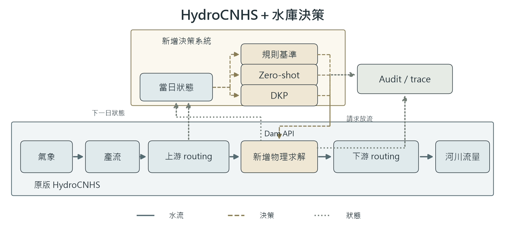

# HydroCNHS + LLM Reservoir Agent

[English](README.md) | [繁體中文](README.zh-TW.md)

以完整固定版本 HydroCNHS 為基礎的升級版，透過原有 Dam API 新增可設定的
水庫決策系統。HydroCNHS 負責產流與 routing；決策單元提出放流；共同物理程式
執行限制、更新蓄水與計算 spill。Audit／trace 保存完整因果鏈。



## FE Walter 三種方法

DKP 是 Decision Knowledge Package，以獨立文件提供操作知識。

| 方法 | 設定 | Prompt／知識 | 教學 |
|---|---|---|---|
| Hanasaki-based rule benchmark | [YAML](examples/fe_walter/benchmark/experiment.yaml) | 不用 prompt；採 flood-control 分支 | [03](tutorials/03_benchmark.ipynb) |
| Zero-shot | [YAML](examples/fe_walter/zero_shot/experiment.tutorial.yaml) | [原版 system prompt](prompts/fe_walter_reference/zeroshot_system.txt) | [04](tutorials/04_zero_shot.ipynb) |
| DKP | [YAML](examples/fe_walter/dkp/experiment.tutorial.yaml) | [原版 system prompt](prompts/fe_walter_reference/dkp_system.txt) + [DKP](data/anik_v3_7/DKP_FEWalter_Dam_v1.2.md) | [05](tutorials/05_dkp.ipynb) |

兩套 prompt 保留 Anik V3.7 文字、每日 builder、回覆 schema、檢索與原版 audit。
離線回覆是合成資料，不能證明 LLM 策略品質。另有 temperature **0.7** 的真實
LLM 設定範本；完成[真實實驗前條件](docs/LIVE_READINESS.md)前仍阻擋執行。

## 安裝與三日示範

使用 Python 3.12 與完整 repo。初次安裝依賴可能需要網路；離線實驗不呼叫模型或 provider。

```powershell
python -m venv .venv
.venv\Scripts\Activate.ps1
python -m pip install -e . -c environment/requirements-bundled.txt
python run_experiment.py check examples/fe_walter/benchmark/experiment.yaml
python run_experiment.py run examples/fe_walter/benchmark/experiment.yaml
python run_experiment.py verify runs/fe-walter-benchmark-tutorial --require-offline
```

已有輸出不會覆寫；新 run 請同時修改 `run_id`、`output`。三方法與 31 日多水庫
操作見[逐步教學](tutorials/README.zh-TW.md)。

## 自己的流域與水庫

1. 在新 case 準備每日局部入流 CSV、河網連線、物理限制與初始蓄水。
2. 複製適合的 YAML，每個受控水庫指定一個決策單元；被動出口不配置 LLM。
3. 各庫提供自己的 profile、prompt／DKP 與 versioned auditor，先離線執行 `check → run → verify`。

水庫 YAML 使用給定入流。原生 GWLF／ABCD、集水區面積、水文／routing 參數、
校正、四種耦合 API 與 sediment 工具保留於[原生 HydroCNHS 設定](docs/HYDROLOGY_SETUP.md)。
LLM 改變蓄水與下游 routed flow，不修改產流方程或已校正參數；換區域仍需自己的有效資料與規則。

查看 `summary.json`、`reservoir_trajectory.csv`、`network_flows.csv`，以及連到 `raw/`
的精簡 decision／physics／audit log。策略 FAIL／WARN／UNKNOWN 原樣保留；物理與檔案
驗收通過不代表操作策略已核准。

[設定手冊](docs/USER_GUIDE.zh-TW.md) · [盤點與原版對照](docs/PROJECT_INVENTORY.md) ·
[離線證據](results/technical_note_offline/README.md) · [Technical Note 英文初稿](paper/technical_note.md) ·
[歷史入口](archive/README.md) · [來源／授權](third_party/hydrocnhs/SOURCE.json)
