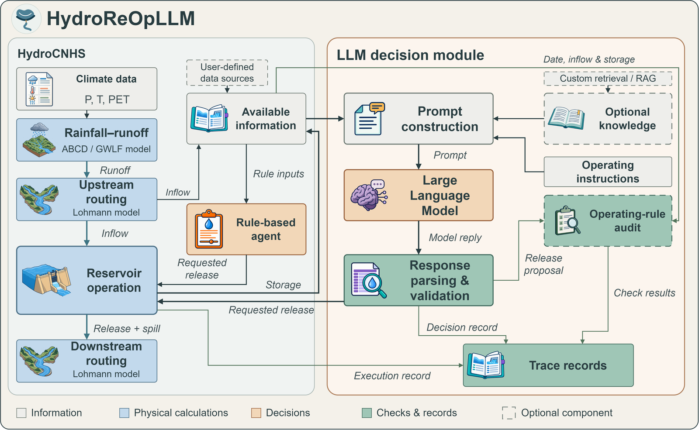

# Operator and LLM agent design

<div class="hero-band" markdown="1">

HydroReOpLLM separates **what decides** (a deterministic rule or an LLM policy) from **what conserves water** (the shared HydroCNHS `Dam` mass-balance and routing kernel). Both operator types receive the exact same `ReservoirObservation`, return a requested `ReservoirAction` in `m3/s`, and pass through identical auditors and physical bounds.

</div>

## Architectural boundary with HydroCNHS

HydroReOpLLM wraps HydroCNHS's Agent-Based Modeling (`ABM`) interface through [`examples/llm_reservoir_abm.py`](../examples/llm_reservoir_abm.py), which registers `LLMReservoirAgent` (`src/llm_reservoir_agent/agent.py`) as a HydroCNHS `DamAPI` class. When `network.py` calls `build_network_model`, each controlled reservoir receives:

- `WaterSystem.ABM`: `Modules: ["llm_reservoir_abm.py"]` and `DamAPI: ["LLMReservoirAgent"]`.
- `ABM.LLMReservoirAgent.<name>.Inputs.Links`: exactly one `-1` inlet (`inflow_node`) and one `+1` outlet (`<name>`).
- `ABM.LLMReservoirAgent.<name>.Attributes`: `Physical` (`PhysicalConfig`), `Context`, and `Policy`.

Because `LLMReservoirAgent` delegates decision making to an isolated `decide(observation)` backend while owning the `apply_transition` mass-balance step (`src/llm_reservoir_agent/physics.py`), swapping between a rule-based baseline and an LLM agent changes **only** the operator configuration—never the hydrologic routing or physical constraints.

<figure class="figure-card">
  
  <figcaption><strong>Figure 1.</strong> Conceptual closed-loop architecture: HydroCNHS routes catchment runoff into reservoir observation state; rule or LLM operators retrieve decision-time information or knowledge packages and emit structured release requests; host physics enforces operating bounds, dead storage, and spill before downstream routing.</figcaption>
</figure>

<figure class="figure-card">
  
  <figcaption><strong>Software coupling view.</strong> Exact data flow across <code>configuration.py</code>, <code>workflow.py</code>, <code>information.py</code>, <code>configured_backend.py</code> / <code>rule_based.py</code>, <code>auditor.py</code>, and the HydroCNHS host in <code>network.py</code>.</figcaption>
</figure>

<div class="pipeline-strip">
  <div class="pipeline-step"><strong>1. HydroCNHS inflow</strong>Routed inlet <code>Q_routed</code> at step <code>t</code> (m3/s)</div>
  <div class="pipeline-arrow">→</div>
  <div class="pipeline-step"><strong>2. Observation</strong><code>ReservoirObservation</code> (<code>storage_m3</code>, bounds)</div>
  <div class="pipeline-arrow">→</div>
  <div class="pipeline-step"><strong>3. Info &amp; DKP</strong><code>InformationCatalog</code> &amp; <code>context_providers</code></div>
  <div class="pipeline-arrow">→</div>
  <div class="pipeline-step"><strong>4. Prompt render</strong><code>ConfiguredBackend</code> / <code>StudyBackend</code></div>
  <div class="pipeline-arrow">→</div>
  <div class="pipeline-step"><strong>5. Decision</strong>LLM provider or deterministic rule</div>
  <div class="pipeline-arrow">→</div>
  <div class="pipeline-step"><strong>6. Parse &amp; convert</strong>Strict JSON &amp; unit conversion to <code>m3/s</code></div>
  <div class="pipeline-arrow">→</div>
  <div class="pipeline-step"><strong>7. Auditors</strong><code>AuditedBackend</code> checks bounds &amp; ranges</div>
  <div class="pipeline-arrow">→</div>
  <div class="pipeline-step"><strong>8. Physics &amp; route</strong><code>apply_transition</code> + UH downstream</div>
</div>

## Per-timestep coupling data flow

At each operation step `t` (ordered topologically across reservoirs and junctions), the runtime executes eight deterministic stages:

| Stage | Module / Class | Input | Output | Native Units & Invariant |
| --- | --- | --- | --- | --- |
| 1. Basin / upstream inflow | `network.py` / `interval_network.py` | Local `inflows.csv` + upstream `total_outflow_cms` via `unit_hydrograph` | `Q_routed[inflow_node][t]` | `m3/s` interval mean; local flow never double-counts upstream release. |
| 2. Physics observation | `agent.py` (`LLMReservoirAgent`) | Beginning `storage_m3`, `inflow_cms`, `PhysicalConfig` | `ReservoirObservation` (`reservoir-observation.v1`) | `storage_m3` in `m3`; `release_upper_bound_cms` = feasible max release in `m3/s`. |
| 3. Info & context retrieval | `information_runtime.py` / `context.py` | Causal `InformationCatalog` + lazy `context_providers` | `observation.context["decision_information"]` + `ContextValue` | `valid_time` / `available_at` / `issued_at <= clock`; read-only frozen JSON. |
| 4. Prompt formatting | `configured_backend.py` (`ConfiguredBackend`) | `PromptSpec`, `knowledge`, `previous_transition`, `completed_history` | `PromptRequest` (`messages`, `request_sha256`) | Built once per decision; retries & fallbacks reuse identical messages. |
| 5. Policy decision | `ConfiguredBackend` / `RuleBasedBackend` | `PromptRequest` or `ReservoirObservation` | Raw reply JSON or `ReservoirAction` | LLM requires `--allow-network`; rules enforce `network_calls == 0`. |
| 6. JSON parse & conversion | `contracts.py` / `response_extension` | Provider reply text or custom JSON schema | `ReservoirAction` (`reservoir-action.v1`) | Converts site units (e.g., `release_cfs * 0.028316847`) into `release_cms` (`m3/s`). |
| 7. Decision audit | `auditor.py` (`AuditedBackend`) | `reservoir-audit-input.v1` (`observation`, `action`, traces) | Diagnostic `PASS` / `WARN` / `FAIL` / `UNKNOWN` | Inspects `action` before physics; **never mutates** `release_cms`. |
| 8. Mass balance & routing | `physics.py` (`apply_transition`) | `storage_start_m3`, `inflow_cms`, `target_release_cms` | `Transition` (`controlled_release_cms`, `spill_cms`, `storage_end_m3`) | Clips to `[min, max]` & dead storage; `residual <= 1e-6 + 1e-12 * scale`; feeds `total_outflow_cms` downstream. |

## Rule-based operators and Python extensions

`src/llm_reservoir_agent/agent_configuration.py` splits operators into two explicit public methods (`type: rule_based` vs `type: llm`), plus an `mode: offline` constant-release fixture (`release_cms`) for quick pipeline smoke checks.

<div class="panel-grid panel-grid-2" markdown="1">
<div class="panel-card" markdown="1">

### `type: rule_based` (Deterministic extension)

- **Required YAML keys**: `reservoir_id`, `type: rule_based`, `rule`, optional `rule_parameters`, `auditors`, and optional `customization.information`.
- **Execution**: Always runs offline (`mode: offline`). Wrapped by `RuleBasedBackend` (`src/llm_reservoir_agent/rule_based.py`), which verifies `network_calls == 0` before and after every `decide(observation)` call and wires `no_model_transport`.
- **Forbidden fields**: Cannot declare `model_profile`, `prompt_file`, or LLM customization keys.

</div>
<div class="panel-card" markdown="1">

### `type: llm` (Model-driven operator)

- **Required YAML keys**: `reservoir_id`, `type: llm`, `model_profile`, `prompt_file`, optional `auditors`, and `customization:`.
- **Execution**: Defaults to `customization.execution: live` (`mode: llm`). Set `execution: replay` (`mode: offline`) to replay deterministic fixtures without provider calls.
- **Forbidden fields**: Cannot declare `rule` or `rule_parameters`; fallback constant `release_cms` is disallowed in `llm` mode.

</div>
</div>

### Built-in and extension Hanasaki rules

HydroReOpLLM supports the **Hanasaki** flood-control / reservoir operation formulation in two ways:

1. **Extension package (`type: rule_based` + `rule: hanasaki`)** — Used in [`examples/fe_walter/rule_based.yaml`](../examples/fe_walter/rule_based.yaml) and [`examples/fe_walter/study/rule/__init__.py`](../examples/fe_walter/study/rule/__init__.py) (`HanasakiBackend`, `policy_id = "hanasaki_flood_control"`):
   - Computes regulation ratio γ = <i>C</i> / (<i>Q&#772;</i><sub>in</sub> · <code>SECONDS_PER_YEAR</code>) and annual release coefficient <code>k_rls</code> = <i>S</i><sub>year_start</sub> / (α · <i>C</i>) refreshed on the first step of each calendar year.
   - Applies an environmental floor of 0.1 · <i>Q&#772;</i><sub>in</sub>, an operating storage ceiling α · <i>C</i>, and a minimum storage threshold 0.1 · <i>C</i>.
   - Verifies strict parity against host `apply_transition` (`physical_conflict` raises before mutating state).
   - Configured via `rule_parameters`: `purpose: flood_control`, `alpha: 0.85`, and either `inflow_statistics_file` (SHA-256 verified `reservoir-benchmark-statistics.v1` JSON with `reference_mode: pre_simulation | retrospective`) or `mean_inflow_cms`.
2. **Built-in legacy `strategy: benchmark`** — Implemented in `src/llm_reservoir_agent/benchmark.py` (`BenchmarkBackend`) and `benchmark_config.py` (`load_benchmark`), supporting daily Hanasaki release calculations with 12-month climatology and pre-simulation leakage checks (`reference_end < simulation_start`).

<div class="callout callout-info" markdown="1">

**Upstream provenance note.** The `flood_control_step` implementation in `examples/fe_walter/study/rule/__init__.py` reproduces the Hanasaki flood-control equations (`HanasakiBackend`) as formulated in Hanasaki et al. (2006) / Abeshu et al. (2023) and matches the pinned `RiverAI-Project/MOSART-Urban` reference (`scripts/verify_hanasaki_rule.py`, `THIRD_PARTY_NOTICES.md`) while keeping HydroReOpLLM's neutral SI physical kernel.

</div>

### Custom extension hook contract

Register external Python packages in top-level `extensions:` mapping `<extension_id>: path/to/__init__.py`. `src/llm_reservoir_agent/extensions.py` (`load_extension`, `extension_registry`) hashes every `.py` file under the package directory and loads it into a hash-isolated namespace `_hydroops_extension_<signature>` so edited code never reuses stale modules.

| Hook / Attribute | Required for | Signature & responsibility |
| --- | --- | --- |
| `validate_backend(...)` | Rule & LLM backend extensions | `(spec, *, base_path, runtime_root, physical, mode, days\|steps, dt_seconds, model, auditor_settings, [simulation_start]) -> (normalized_dict, file_pins)` |
| `build_backend(...)` | Rule & LLM backend extensions | `(settings, *, physical, runtime_root, mode, model, transport, [agent_id, context_providers]) -> backend_with_decide` |
| `rebase_agent(spec, *, base_path)` | Optional (recommended) | Resolves relative resource paths inside `rule_parameters` or custom fields against the declaring YAML directory (`configuration.py`). |
| `preview_backend(settings, *, physical, runtime_root)` | Optional | Returns an offline preview payload when the extension builds custom prompt messages without `prompt_file` (see `examples/fe_walter/study/__init__.py`). |
| `supported_dt_seconds` | Interval (`v3` / hourly) extensions | Tuple/list of supported integer step lengths in seconds (e.g., `(3600,)`). |
| `supports_prompt_context = True` | Prompt-aware extensions | Opts into `information` profile injection and `context_providers` callbacks. |
| `validate_context` / `build_context` / `rebase_context` | `context_providers` extensions | Validates config, returns a `ContextProvider(DecisionContext) -> ContextValue` callable, and rebases relative paths. |
| `validate_auditor` / `build_auditor` / `rebase_auditor` | Custom auditor extensions | Returns an `AuditPlugin` instance exposing `AuditSpec` (`auditor_id`, `version`, `rubric`) and `audit(context)`. |

## LLM operator YAML schema

In `hydroops-coupled-simulation.v2` (and `v1` when using `normalize_agent`), declare each agent under `agents.<agent_id>`. **Never mix** public keys (`reservoir_id`, `type`, `model_profile`, `prompt_file`, `customization`) with legacy keys (`reservoir`, `mode`, `strategy`, `model`, `prompt`) in the same agent entry.

| Field path | Type / Allowed values | Purpose & codebase mapping |
| --- | --- | --- |
| `reservoir_id` | Non-empty string | Exact reservoir key under `network.reservoirs` (1-to-1 coverage required across all `controlled` reservoirs). |
| `type` | `llm` \| `rule_based` | Selects LLM or deterministic rule pipeline (`agent_configuration.py`). |
| `model_profile` | String key in `models:` | Primary provider profile (validated by `validate_model_settings`). |
| `prompt_file` | Relative path (UTF-8 text) | User prompt template (`PromptSpec.template`); required unless `customization.backend` supplies its own prompt builder. |
| `auditors` | List of unique auditor IDs | Keys under `auditors:` wrapped around this agent via `AuditedBackend`. |
| `customization.system_prompt_file` | Relative path (UTF-8 text) | System prompt (`PromptSpec.system_template`); hashed in `content_sha256`. |
| `customization.prompt_version` | String (default `'1'`) | Human-readable template version recorded in `PromptSpec` provenance. |
| `customization.prompt_variables` | Mapping of `{identifier: JSON}` | Static variables injected into `$<identifier>` placeholders (cannot shadow built-ins). |
| `customization.context_providers` | Mapping of `{alias: {extension, config, preview}}` | Lazy runtime retrieval callbacks returning `ContextValue`; `preview` is used during offline `check`. |
| `customization.knowledge` | Mapping of `{pkg_id: path}` | Static text files (e.g., DKP manuals) hashed per file and injected as JSON into `$knowledge`. |
| `customization.context` / `context_file` | Mapping or JSON file path | Static JSON embedded inside `$observation` under `"static_context"`. Choose at most one. |
| `customization.information` | String key in `information.profiles` | Binds a causal `InformationCatalog` profile; requires `$information` in the prompt for generic LLM agents. |
| `customization.response_schema` | String (default `reservoir-action.v1`) | Non-default schemas require a registered `extensions.<response_schema>` parser (`parse_response`). |
| `customization.fallback_models` | List of profile keys in `models:` | Ordered backup profiles (excluding primary) tried on HTTP 429/5xx, timeout, connection, or JSON parse failures. |
| `customization.history_steps` | Integer `>= 0` (default `0`) | Number of consecutive committed prior transitions retained in `$completed_history`. |
| `customization.execution` | `live` (default) \| `replay` | Requires `customization.backend`. Separates LLM architecture identity from live vs offline replay execution. |
| `customization.backend` & `parameters` | Registered extension ID + mapping | Delegates execution to a registered `extensions:` package; `parameters` cannot overwrite protected agent keys. |

Example hybrid split-file declaration (from `tests/fixtures/examples/multiple_reservoirs/agents.llm.yaml`):

```yaml
operator_a:
  reservoir_id: lake_a
  type: llm
  model_profile: local
  prompt_file: prompts/operator.txt
  customization:
    system_prompt_file: prompts/system.txt
    prompt_version: '1'
    prompt_variables:
      purpose: demonstrate an independently configured operator
    context_providers:
      guidance:
        extension: local_retrieval
        config:
          documents: knowledge/guidance.json
        preview: 'Offline preview: use only the supplied state and local operating guidance.'
  auditors:
  - bounds
```

## Prompt anatomy and variable substitution

`ConfiguredBackend` (`src/llm_reservoir_agent/configured_backend.py`) renders templates using Python `string.Template` (`$placeholder` syntax). Every placeholder in both `prompt_file` and `system_prompt_file` is checked at `load_settings` time; undeclared placeholders fail immediately before any API call.

| Placeholder | Source | Structure injected at decision time |
| --- | --- | --- |
| `$observation` | `ReservoirObservation` + `context` | Canonical JSON `{"observed_hydrology": {...}, "static_context": {...}}` (`inflow_cms` in `m3/s`, `storage_m3` in `m3`). |
| `$previous_transition` | `record_transition()` | Most recent committed `{observation, action, transition}` JSON, or `null` at `timestep == 0`. |
| `$completed_history` | `history_steps` ring buffer | JSON list of the last `history_steps` consecutive committed transitions. |
| `$knowledge` | `customization.knowledge` | JSON mapping `{package_id: text}` verified by SHA-256 against `PromptSpec`. |
| `$information` | `InformationCatalog` | Selected `decision_information` snapshot from `observation.context` (requires `customization.information`). |
| `$agent_id` | Agent YAML key | JSON-encoded agent identifier string. |
| `$<custom>` | `prompt_variables` or `context_providers` | Raw string (if `available` and `str`) or canonical JSON (`null` if unavailable). |

In the **F.E. Walter** study (`examples/fe_walter/study/__init__.py` & `formatter.py`), `StudyBackend` subclasses `ConfiguredBackend` with `history_steps`-equivalent `deque(maxlen=2)` feedback and a dynamic `$study_message` callback that:
1. Converts beginning `storage_m3` via `elevation_storage.csv` into pool water level (`ft NGVD29`) and inflow into `cfs`.
2. Formats the last two committed decisions (`decided` vs `actually released`, noting dead-storage limits or spill).
3. Under `study_method: dkp`, retrieves the applicable rules from `dkp.md` (`R-RELEASE`, `R-MINNORM`, `R-ATSITE`, `R-ZONE`, plus conditional `R-PLAN` when pool exceeds seasonal target or `R-RECREATION` during April–October).

## Structured JSON output and unit conversion

Provider adapters (`src/llm_reservoir_agent/providers.py`) request native structured JSON output whenever `response_json_schema` is supplied (`format` for Ollama, `response_format.json_schema` for `openai_compatible`, `text.format` for `openai`, `output_config.format` for `anthropic`, and `generationConfig.responseJsonSchema` for `gemini`).

- **Standard contract (`reservoir-action.v1`)**: `ACTION_JSON_SCHEMA` requires strictly `{"schema_version": "reservoir-action.v1", "release_cms": <number >= 0>}` with `additionalProperties: false`.
- **Site-unit schemas (`response_schema` / `response_extension`)**: Studies operating in non-SI conventions (such as USACE `cfs` and `ft NGVD29`) supply a domain JSON schema and convert the output explicitly inside `parse_response` before returning `{"schema_version": "reservoir-action.v1", "release_cms": ...}` to the host kernel.
  - For example, `examples/fe_walter/study/response_schemas.json` requires `applicable_target_ft`, `pool_position`, `intended_storage_direction`, `release_relation_to_inflow`, (plus `operating_mode` & `rules_applied` for `dkp`), `reasoning`, and `release_cfs`. `_parse_release` converts `release_cfs * 0.028316847` into `release_cms`.
- **Strict JSON decoding**: `_strict_json` rejects duplicate JSON keys, `NaN`, `Infinity`, truncated completions (`finish_reason == "length"` / `MAX_TOKENS`), and provider refusals.

## Safety gates, physical clamping, and replay

<div class="panel-grid panel-grid-2" markdown="1">
<div class="panel-card" markdown="1">

### Gate 1: Pre-flight & budget gates (`workflow.py`)

- **Offline preview**: `reservoir-experiment check` runs `ConfiguredBackend.preview()` at `0` network calls, rendering Day-0 messages and SHA-256 request hashes.
- **Explicit opt-in**: `run` raises unless `--allow-network` is passed **and** `case.json` sets `"live_readiness": {"ready": true}` (or `data_kind: synthetic_fixture`).
- **Budget cap**: `max_calls` must cover `llm_agent_count * steps`; every primary, retry, and fallback attempt reserves an append-fsync `STARTED` record in `provider_attempts.jsonl` before sending.

</div>
<div class="panel-card" markdown="1">

### Gate 2: Auditors & physical enforcement (`auditor.py`, `physics.py`)

- **Auditors (`ConfiguredAudit`)**: `release_bounds` (`tolerance_cms`) checks `0 <= release_cms <= release_upper_bound_cms + tolerance_cms`; `field_range` checks dotted `observation.*` or `action.*` paths against `[minimum, maximum]`. Findings (`PASS`/`WARN`/`FAIL`/`UNKNOWN`) are diagnostic only and never overwrite the request.
- **Host physics (`apply_transition`)**: Clips `target_release_cms` to `[minimum_release_cms, maximum_release_cms]`, caps withdrawal to water above `dead_storage_m3`, routes excess volume above `capacity_m3` as `spill_cms`, and asserts mass-balance closure within `1e-6 + 1e-12 * scale` m3.

</div>
</div>

### Deterministic replay and crash recovery

- **Offline replay (`llm-reservoir-daily` / `RecordedResponseBackend`)**: Feeds archived release series (`recorded_llm_response`) through the exact same `run_network` host, `apply_transition`, and routing checks with `0` provider calls (`examples/fe_walter/study/replay.py`).
- **Interrupted-run resume (`reservoir-experiment resume`)**: `RecoveryTape` (`src/llm_reservoir_agent/recovery.py`) verifies unchanged source/runtime hashes, replays prior saved replies and retrieved context into a fresh `--output` directory, checks reconstructed physics step-by-step, and preserves inherited `STARTED` attempt counts against `max_calls`.
