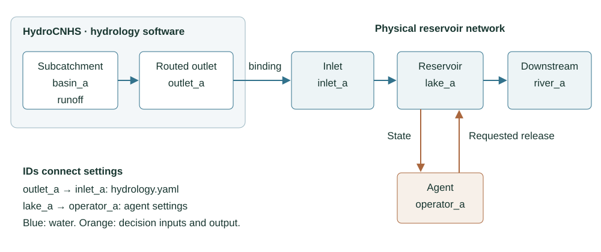

# Reservoirs and the water network

[English](BUILD_SIMULATION.md) | [繁體中文](BUILD_SIMULATION.zh-TW.md)

The physical case defines reservoir storage, release limits, and the directed
water network. These values stay the same when you compare operation methods.
Every controlled reservoir needs one matching operator in the next chapter.

Download [reservoirs.yaml](../templates/coupled/reservoirs.yaml) or browse the
[complete template folder](TEMPLATES.md).

```{literalinclude} ../templates/coupled/reservoirs.yaml
:language: yaml
```

| Field | Purpose and units | Required? | User-filled or referenced value |
|---|---|---|---|
| `schema_version` | Selects the physical case format | Required | Keep `reservoir-physical-case.v1` |
| `data_kind` | Declares the origin of local inflow | Required | Use `simulated_local_inflow` for native hydrology |
| `network.schema_version` | Selects directed network format | Required | Keep `llm-reservoir-network.v2` |
| `network.start_date` | First operation day | Required | Match `experiment.start_date` |
| `reservoirs.<id>` | Stable network reservoir ID | Required | User-defined unique key |
| `inflow_node` | Node supplying local reservoir inflow | Required | Key from `hydrology.inflow_bindings` |
| `physical.reservoir_id` | Physical record identifier | Required | Stable user identifier |
| `capacity_m3` | Maximum storage, m³ | Required | Positive study value |
| `dead_storage_m3` | Inaccessible storage, m³ | Required | Nonnegative and below capacity |
| `initial_storage_m3` | Beginning storage, m³ | Required | Between dead storage and capacity |
| `minimum_release_cms` | Lower controlled release limit, m³/s | Required | Nonnegative study value |
| `maximum_release_cms` | Upper controlled release limit, m³/s | Required | At least the minimum |
| `dt_seconds` | Decision interval, seconds | Required | `86400` for daily inputs |
| `connections` | Directed routed water paths | Required as needed | Source, target, and causal unit hydrograph |
| `unit_hydrograph` | Routing weights by lag | Required per connection | Nonnegative user values summing to one |
| `outlets` | Terminal network nodes | Required | Include every terminal node |

Node IDs connect files. `inflow_node` identifies the local water boundary for a
reservoir. A connection moves implemented reservoir outflow, including spill,
to a downstream node. For reservoirs in series, the downstream local binding
contains only additional lateral runoff; repeating upstream water in that
binding would count it twice.

Information locations are labels for what an operator may see. They do not add
water or create a connection. The current reservoir balance applies the supplied
inflow and controlled release, computes spill, and assumes zero evaporation and
seepage.



*Figure 1. HydroCNHS routes runoff to an outlet; a binding connects it to the
operation inlet. Blue arrows carry water. Orange arrows carry reservoir state
and the agent's release proposal. [Editable draw.io source](figures/reservoir-agent-mapping.drawio).*
