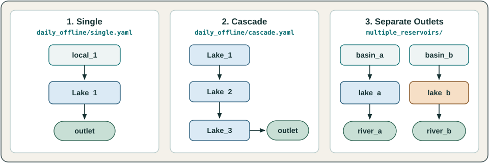

# 水庫網路

完整的合成雙水庫水系範例請見 [`examples/multiple_reservoirs`](../examples/multiple_reservoirs/README.zh-TW.md)。



- **單庫（`examples/daily_offline/single.yaml`）**：單一受控水庫 `Lake_1` 接收既定入流 `local_1` 並排往 `outlet`。
- **三庫串聯（`examples/daily_offline/cascade.yaml`）**：三座水庫依序串接（`Lake_1 → Lake_2 → Lake_3 → outlet`），含 1 日河道演算延時。
- **雙水庫各自出流（`examples/multiple_reservoirs/`）**：兩條平行獨立的集水區與水庫（`basin_a → lake_a → river_a` 與 `basin_b → lake_b → river_b`），彼此無水力串接。

系統必須滿足以下核心不變條件：

- 每個水庫鍵值、物理 `reservoir_id`、操作員指派與入流量繫結皆須唯一且彼此一致。
- 每座受控水庫皆配有一名操作員與獨立的決策歷史紀錄。
- 區域入流量不含透過連線由上游流入的水量。
- 同一來源的各條出流分配比例總和須為 1。
- 終端節點必須與 `outlets` 完全一致。
- 演算權重皆須為非負值，且總和為 1。

若採用既有入流資料，CSV 須包含所有日期與節點，並使用標頭 `date,node,local_inflow_cms`。若採用原生水文模式，則由 `inflow_bindings` 將模式流量對應至水系的各個入流節點。下游節點僅應承接額外的區域逕流。若同時重複計入上游放流量，將造成水量重複計算。

切換至 LLM 版本前，請先執行預設的規則式範例以確認設定正確。

```powershell
reservoir-experiment check examples/multiple_reservoirs/experiment.yaml
reservoir-experiment run examples/multiple_reservoirs/experiment.yaml
reservoir-experiment verify runs/independent-rivers-rule --require-offline
```

首次執行會在 `runs/independent-rivers-rule/` 建立耦合前處理結果，並將水庫操作紀錄寫入其 `operation/` 子目錄。比較各節點結果前，請先參閱[結果檢視指南](RESULTS_GUIDE.zh-TW.md)。
