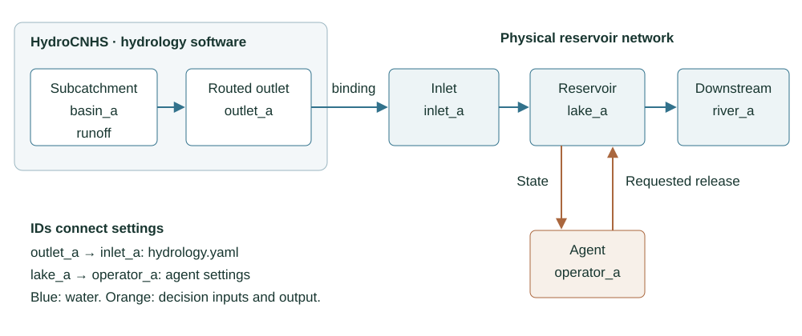

# 水庫與水流網路

[English](BUILD_SIMULATION.md) | [繁體中文](BUILD_SIMULATION.zh-TW.md)

物理案例定義水庫蓄水、放流限制與有向水流網路。比較不同操作方法時，
這些物理值應保持不變。每座受控水庫都必須在下一章指定一個 operator。

下載 [reservoirs.yaml](../templates/coupled/reservoirs.yaml)，或瀏覽
[完整模板資料夾](TEMPLATES.md)。

```{literalinclude} ../templates/coupled/reservoirs.yaml
:language: yaml
```

| 欄位 | 用途與單位 | 必要性 | 使用者填寫或參照值 |
|---|---|---|---|
| `schema_version` | 選擇物理案例格式 | 必填 | 保留 `reservoir-physical-case.v1` |
| `data_kind` | 宣告局部入流來源 | 必填 | 原生水文使用 `simulated_local_inflow` |
| `network.schema_version` | 選擇有向網路格式 | 必填 | 保留 `llm-reservoir-network.v2` |
| `network.start_date` | 第一個操作日 | 必填 | 與 `experiment.start_date` 相同 |
| `reservoirs.<id>` | 穩定的網路水庫 ID | 必填 | 使用者定義且不可重複 |
| `inflow_node` | 供應水庫局部入流的節點 | 必填 | `hydrology.inflow_bindings` 的 key |
| `physical.reservoir_id` | 物理紀錄識別碼 | 必填 | 使用者的穩定識別碼 |
| `capacity_m3` | 最大蓄水量，m³ | 必填 | 正值 |
| `dead_storage_m3` | 呆水量，m³ | 必填 | 非負且小於容量 |
| `initial_storage_m3` | 初始蓄水量，m³ | 必填 | 介於呆水量與容量之間 |
| `minimum_release_cms` | 最小控制放流，m³/s | 必填 | 非負值 |
| `maximum_release_cms` | 最大控制放流，m³/s | 必填 | 不小於最小值 |
| `dt_seconds` | 決策間隔，秒 | 必填 | 每日輸入使用 `86400` |
| `connections` | 有向水流路徑 | 視網路需要 | source、target 與因果單位歷線 |
| `unit_hydrograph` | 各延遲步的 routing 權重 | 每條連線必填 | 非負且總和為一 |
| `outlets` | 網路末端節點 | 必填 | 包含所有末端節點 |

各檔案以節點 ID 連接。`inflow_node` 指定水庫的局部水流邊界；connection
把實際水庫出流與溢流送往下游節點。串聯水庫的下游局部 binding 只能含
新增側向逕流，不能再次加入上游水量。

資訊來源的 location 只描述 operator 能看到什麼，不會新增水量或建立水流
連線。目前的水庫平衡使用提供的入流與控制放流、計算溢流，並假設蒸發與
滲漏為零。

下一章：[Rule-based 與 LLM operator](CONFIGURATION.md)。



*圖 1。明確的 ID 串接原生水流 binding、水庫物理、有向水流連線，以及每座
受控水庫的 operator。*
