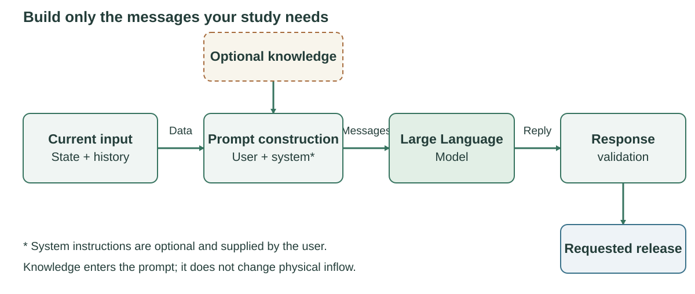

# Configure agents, prompts, and context

An **agent** is the operator assigned to one reservoir. Its method is either
`rule_based` or `llm`. Both request controlled release through the same physical
reservoir calculation. Start with the required settings, then add knowledge or
custom information when your study needs it.

On this page: [choose a rule](#make-the-first-rule-based-run) →
[switch to LLM](#switch-one-reservoir-to-an-llm) →
[build the prompt](#add-prompt-data-only-when-needed) →
[add retrieval](#add-dynamic-context-with-an-extension).

The short examples below use the generic
[`examples/multiple_reservoirs`](../examples/multiple_reservoirs/experiment.yaml)
configuration. The [FE Walter tutorial](../tutorials/fe_walter.md) applies the same
settings to the current case.

For your own study, complete HydroCNHS basin construction, parameter derivation,
and calibration/validation first. Use the
[official HydroCNHS manual and tutorials](https://cylin928.github.io/HydroCNHS/),
then follow [Build a simulation](BUILD_SIMULATION.md) to connect that accepted
model to HydroOpsLLM.

## Make the first rule-based run

The generic fixture uses one v2 entry file:

```yaml
schema_version: hydroops-coupled-simulation.v2
run_id: independent-rivers-rule
output: ../../runs/independent-rivers-rule
case: reservoirs.yaml
start_date: '2020-02-28'
end_date: '2020-03-02'
max_calls: null
hydrology: {file: hydrology.yaml}
agents: {file: agents.rule.yaml}
models: {file: models.yaml}
information: {file: information.yaml}
auditors: {file: auditors.yaml}
extensions:
  local_retrieval: extensions/__init__.py
  hanasaki: ../rules/hanasaki/__init__.py
```

Edit these files in this order:

| File | Required change for a new study |
|---|---|
| `experiment.yaml` | Set dates, output, case, and referenced section files. |
| `hydrology.yaml` | Point to the accepted HydroCNHS model and forcing; bind incremental local flow to operation nodes. |
| `reservoirs.yaml` | Define reservoir state, physical limits, connections, and exact terminal outlets. |
| `agents.rule.yaml` | Assign exactly one agent to every controlled reservoir. |
| `models.yaml` | Required by this split example; used only by LLM agents. |

A rule agent needs no model or prompt:

```yaml
operator_a:
  reservoir_id: lake_a
  type: rule_based
  rule: hanasaki
  rule_parameters:
    alpha: 0.85
    inflow_statistics_file: statistics_a.json
  auditors: [bounds]
```

`rule` is the ID of a registered rule extension. `rule_parameters` contains
settings interpreted by that extension. Hanasaki is this fixture's example
inflow-history rule; it is not a framework default. Register and test your own
module for operating curves, water supply, hydropower, or another controller.

Run the complete rule path from the repository root:

```powershell
reservoir-experiment check examples/multiple_reservoirs/experiment.yaml
reservoir-experiment prepare examples/multiple_reservoirs/experiment.yaml
reservoir-experiment run examples/multiple_reservoirs/experiment.yaml
reservoir-experiment verify runs/independent-rivers-rule/operation
```

Success means the four operation dates were written and `verify` accepted the
saved links, hashes, and water accounting. It does not validate policy quality.
Next, inspect the output as described in [Results, audit, and trace](RESULTS_GUIDE.md).

## Switch one reservoir to an LLM

After the rule run verifies the connections, the smallest general LLM agent is:

```yaml
operator_a:
  reservoir_id: lake_a
  type: llm
  model_profile: local
  prompt_file: prompts/operator.txt
```

All four keys are required for this general agent. `reservoir_id` selects the
physical reservoir. `type` selects LLM operation. `model_profile` selects a
profile ID from the model catalog. `prompt_file` is a nonempty user-instruction
template, resolved relative to this agent file.

HydroOpsLLM does not add a common system prompt. Add one only when your study
defines it explicitly:

```yaml
operator_a:
  reservoir_id: lake_a
  type: llm
  model_profile: local
  prompt_file: prompts/operator.txt
  customization:
    system_prompt_file: prompts/system.txt
```

Configure the matching `local` catalog entry in
[Model providers](MODEL_PROVIDERS.md). Then use the supplied LLM entry file:

```powershell
reservoir-experiment check examples/multiple_reservoirs/experiment.llm.yaml
reservoir-experiment prepare examples/multiple_reservoirs/experiment.llm.yaml
reservoir-experiment run examples/multiple_reservoirs/experiment.llm.yaml --allow-network
reservoir-experiment verify runs/independent-rivers-mixed/operation
```

Live `run` and unfinished decisions during `resume` require `--allow-network`.
Rule agents, checks, and replay paths do not make live requests.

## Understand catalogs, profiles, and paths

A **catalog** is a named collection shared by the experiment, such as all model
profiles or all auditors. A **profile** is one named entry in a catalog. An agent
sees a profile only when it selects that profile ID.

The top-level experiment owns shared dates, output, physical case, hydrology,
and catalogs. Each agent chooses its reservoir, method, model, prompt,
information profile, and auditors. Information visibility never creates a water
connection; only `network.connections` and `outlets` move water.

`hydrology`, `models`, `agents`, `auditors`, and `information` may be inline or
exactly `{file: path}`. A file reference cannot also contain inline values, and
the loader does not deep-merge files. Every path is relative to the file that
declares it. Missing files and reference cycles stop validation.

New work should use `hydroops-coupled-simulation.v2`. Older inline v1 files
remain accepted.

## Add prompt data only when needed

The **prompt** is the set of messages actually sent to the LLM. The user template
contains the task and places the current data. An optional system template
contains study-wide instructions. The framework replaces placeholders with values
at each decision; selecting a data source alone does not put it in the prompt.



*Figure 2. Current state and history enter the user template. Optional knowledge
or retrieval results are inserted only where the template requests them. The
provider receives the rendered messages and response schema. Validation converts
an accepted reply into a requested release; it does not assess seasonal performance.*

Both user and optional system templates use Python `string.Template` syntax.
Write `$$` for a literal dollar sign. Built-in placeholders are:

| Placeholder | Value |
|---|---|
| `$agent_id` | JSON agent ID |
| `$observation` | Protected current hydrology and static context |
| `$previous_transition` | Previous committed observation, action, and physics; `null` on day one |
| `$knowledge` | Hash-pinned full text from the agent's `knowledge` mapping |
| `$information` | Selected `decision-information.v1` snapshot; requires an information profile |

For example, a user template can say:

```text
Choose a controlled release for this daily interval.
Current reservoir state and inflow: $observation
Previous completed interval: $previous_transition
Study guidance: $guidance
Return the JSON action required by the response schema.
```

`$guidance` is a custom alias. Define it in `prompt_variables` for fixed text or
in `context_providers` for retrieval, as shown below. Remove the line when it is
not needed. The generic action uses `release_cms` in m³/s; FE Walter preserves
its own case prompt and raw response format before conversion to this action.

Add fixed values, knowledge, selected information, custom context, retry, and
fallback controls under `customization`:

```yaml
operator_a:
  reservoir_id: lake_a
  type: llm
  model_profile: openai_primary
  prompt_file: prompts/operator.txt
  customization:
    prompt_version: '1'
    prompt_variables:
      purpose: flood-season demonstration
    fallback_models: [anthropic_primary, local]
```

Prompt-variable aliases must be identifiers, cannot replace built-in names, and
must be unique across fixed and dynamic context. See [Decision information](INFORMATION.md)
for observations and forecasts available at a decision time.

## Add dynamic context with an extension

Use a context provider for study-specific retrieval or computation:

```yaml
customization:
  context_providers:
    guidance:
      extension: local_retrieval
      config: {documents: knowledge/guidance.json}
      preview: 'Offline preview used by check.'
```

`check` uses `preview`; it does not invoke the callback or access a network
source. At decision time, `build_context(config)` returns a callback. The
callback receives an immutable `DecisionContext` with `agent_id`, `observation`,
and `previous_transition`, and returns:

```python
ContextValue(
    value="selected guidance",
    provenance={
        "source_sha256": "...",
        "query": "...",
        "document_ids": ["guide-1"],
        "available_at": "2020-02-27T00:00:00Z",
    },
    available=True,
)
```

HydroOpsLLM includes a small local JSON selector, not a general vector-database
connector. Pin source bytes and retain provenance. A **source pin** records the
exact source bytes, usually with a hash, so another researcher can identify the
input used. Context and information cannot modify storage, inflow, or limits.

## Keep retry and fallback explicit

`customization.fallback_models` is an ordered list of model profile IDs and
defaults to an empty list. Each profile uses its own bounded `max_attempts`.
The provider ledger records every attempt, actual provider and model, request
hash, response metadata, and error.

Authentication and configuration errors are terminal. Audit FAIL, physical
failure, and evidence-write failure never select another model. Fallback is an
availability policy, not evidence that different models implement the same
operating policy.

## Preserve advanced backend and history semantics

`customization.backend` selects an explicitly registered extension, and
`customization.parameters` contains its backend-specific settings. An extension
that constructs its own messages may omit `prompt_file`; it must validate and
pin its prompt resources. `customization.execution: replay` is an offline test
option for custom LLM backends. The F.E. Walter extension preserves Anik's
message construction; it does not define defaults for general agents.

A rule module implements `validate_backend`, `build_backend`, and `rebase_agent`.
Its backend supplies `decide(observation)`, a `policy_id`, and `network_calls=0`.
The common engine still applies physics, routing, audits, and trace writing.

**Committed history** means completed decision days already saved to disk with
their action, physical transition, and evidence. Resume verifies this saved
prefix, skips its decisions, and can reuse captured replies. It cannot guarantee
that an external service received an in-flight request exactly once.

For reproducibility, retain the complete split configuration, source hashes,
prompts, context provenance, provider records, initial state, physics, routing,
audits, runtime, and provider identifiers. Plan storage retention before a long
run. No supplied provider profile establishes speed, cost, or decision quality.
