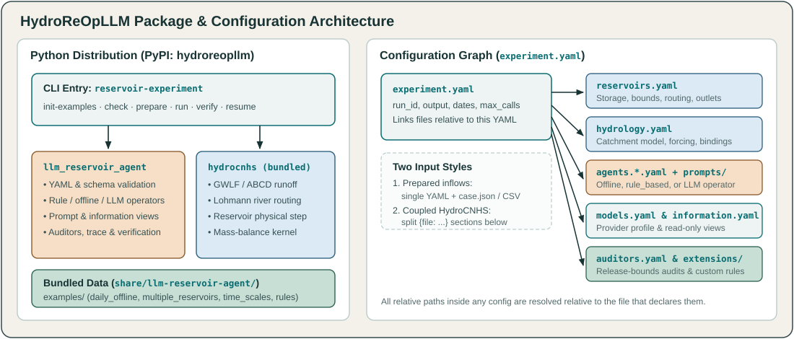

# Configuration

Every HydroReOpLLM study starts from a top-level YAML document (`experiment.yaml`) that pins the physical case, time window, hydrology inputs, operators, model profiles, auditors, and output directory. Start by copying [`examples/template/`](../examples/template/README.md) or the split-file coupled layout described here.

<figure class="figure-card">
  
  <figcaption><strong>Configuration dependency graph.</strong> Top-level <code>experiment.yaml</code> resolves section files, case definitions, prompts, knowledge packages, and Python extensions relative to each declaring file.</figcaption>
</figure>

## Schema versions and file resolution

`read_configuration` (`src/llm_reservoir_agent/configuration.py`) supports single-file (`v1`) and modular split-file (`v2`) documents:

| `schema_version` | Entry style | Modular section files (`{file: ...}`) | Primary use |
| --- | --- | --- | --- |
| `llm-reservoir-experiment.v1` | Prepared inflows | Inline sections | Generic template & F.E. Walter examples (`reservoir` + `mode` or `normalize_agent`). |
| `llm-reservoir-experiment.v2` | Prepared inflows | `models`, `agents`, `auditors`, `extensions`, `information` | Modular prepared-inflow studies; expanded cleanly into `v1` at load time. |
| `hydroops-coupled-simulation.v1` | Native HydroCNHS | Inline sections | Single-file coupled HydroCNHS + reservoir operation. |
| `hydroops-coupled-simulation.v2` | Native HydroCNHS | `hydrology`, `models`, `agents`, `auditors`, `extensions`, `information` | Recommended modular layout for multi-reservoir and hybrid Rule + LLM studies. |

- **Relative path resolution**: Every path (`case`, `output`, `prompt_file`, `system_prompt_file`, `knowledge`, `extensions`, CSV paths) resolves relative to the **declaring** YAML file.
- **Full-section replacement**: A `{file: ...}` reference replaces that entire top-level section (not a deep merge); inline keys cannot be mixed into a `{file: ...}` block.

## Top-level experiment keys

| Key | Required | Purpose & rules (`workflow.py` & `coupled.py`) |
| --- | --- | --- |
| `schema_version` | Yes | Selects `v1`/`v2` prepared or coupled schema. |
| `run_id` | Yes | Non-empty trace identifier recorded in `summary.json` and `decisions.jsonl`. |
| `output` | Yes | Unused directory path (relative to `experiment.yaml`); existing directories are rejected. |
| `case` | Yes | Path to `llm-reservoir-network-case.v1` (prepared) or `reservoir-physical-case.v1` (coupled). |
| `start_date`, `end_date` | Daily | Quoted `YYYY-MM-DD` inclusive operation dates inside the inflow/hydrology period. |
| `start_time`, `end_time`, `time` | Sub-daily | UTC timestamps (exclusive `end_time`) + `time: {simulation_step, output_step}` for `v3` interval runs. |
| `hydrology` | Coupled only | HydroCNHS model, forcing, `inflow_bindings`, `diagnostics`, or `prepared_from`. |
| `agents` | Yes | Non-empty map covering every `controlled` reservoir 1-to-1 ([Agent Design](AGENT_DESIGN.md)). |
| `models` | LLM runs | Named provider profiles ([Model Providers](MODEL_PROVIDERS.md)). |
| `auditors` | No | Named `release_bounds`, `field_range`, or extension auditors. |
| `extensions` | No | Map of `<id>: path/to/__init__.py` pinned by SHA-256 over the entire package subtree. |
| `information` | No | `v2` `{sources, profiles}` catalog (or `information_sources`/`information_profiles` in `v1`). |
| `outcome_checks` | No | Post-routing downstream flow checks (`minimum_cms`, `maximum_cms`, or dynamic info bounds). |
| `max_calls` | Recommended | Integer `>= llm_agent_count * steps` (or explicit `null` for no cap; `0` for offline/rule runs). |
| `source_dependencies` | No | Explicit `{relative_path: sha256}` integrity pins checked on load. |

## Setup order and YAML validation rules

  
<strong>1. Run &amp; dates</strong><code>run_id</code>, unused <code>output</code>, quoted dates

  
→

  
<strong>2. Hydrology / case</strong><code>inflows.csv</code> hash or <code>hydrology.yaml</code>

  
→

  
<strong>3. Network</strong>Storage, release bounds, routing UHs

  
→

  
<strong>4. Operators</strong>1 agent per controlled reservoir

  
→

  
<strong>5. Info &amp; models</strong><code>models.yaml</code>, prompts, <code>information</code>

  
→

  
<strong>6. Check offline</strong><code>reservoir-experiment check</code>

**YAML validation traps (`UniqueLoader`).** HydroReOpLLM rejects duplicate YAML mapping keys instead of silently overwriting them. Also write explicit exponent signs (`8.0e+6` or `8000000.0`) rather than `8.0e6`, which PyYAML SafeLoader parses as a string and `check` rejects.

## Operators, auditors, and outcome checks

- **Operators (`agents`)**: Choose `type: rule_based` (e.g., `rule: hanasaki`), `type: llm` (`model_profile` + `prompt_file` + `customization:`), or `mode: offline` (`release_cms` fixture). See [Operator & LLM agent design](AGENT_DESIGN.md).
- **Decision auditors (`auditors`)**: Built-in `ConfiguredAudit` types are `release_bounds` (`tolerance_cms`) and `field_range` (`path` under `observation.*` or `action.*`, `minimum`, `maximum`, `on_violation: FAIL | WARN`).
- **Downstream outcome checks (`outcome_checks`)**: Evaluated after network routing completes (`src/llm_reservoir_agent/outcome.py`) to check junction/outlet flows against static or causal information bounds.

Continue with [Reservoir networks](MULTI_RESERVOIR.md), [Time scales and units](TIME_SCALES.md), [Decision-time information](INFORMATION.md), and [Run, verify and resume](RUNNING.md).
