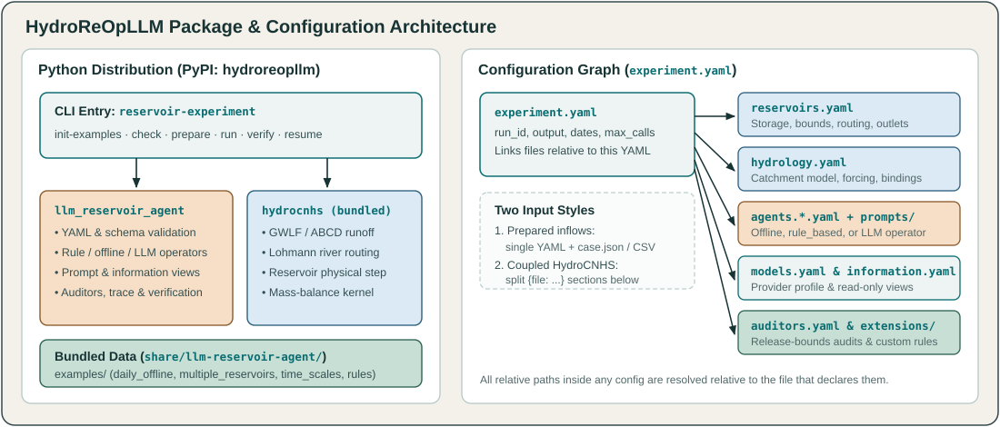

# 实验配置文件

每项模拟都从一份顶层 `experiment.yaml` 开始，将水库物理参数、操作员与模拟时间组合起来。自备入流可先参考[单一水库案例（F.E. Walter）](../examples/fe_walter/README.zh-CN.md)或[多水库串联案例](../examples/multi_reservoir/README.zh-CN.md)，耦合集水区模拟则建议采用拆分文件结构。

## 实验配置三大组成

### 组成一：流域物理与入流

定义水库库容、下泄上下限与河网连接（`case.json` 或 `reservoirs.yaml`），以及自备 `inflows.csv` 或 `hydrology.yaml`。

### 组成二：操作员、水情与模型

为每座受控水库指派规则或 LLM（`agents`），并按需挂载水情测站与预报（`information`）、模型配置（`models`）与审计器（`auditors`）。

### 组成三：时间窗口与输出

指定操作日期或时段（`start_date`/`end_date` 或 `start_time`/`end_time`）、调用上限（`max_calls`）与全新输出目录（`output`）。

<figure class="figure-card">
  
  <figcaption><strong>配置文件关联图。</strong> 每个文件一律从自身所在目录解析相对路径。</figcaption>
</figure>

## 配置版本与相对路径规则

| `schema_version` | 入流方式 | `{file: ...}` 拆分文件区段 | 适用场景 |
| --- | --- | --- | --- |
| `llm-reservoir-experiment.v1` | 自备入流 | 内联 | 单一水库 F.E. Walter 与多水库串联案例（`inflows.csv` + `case.json`）。 |
| `llm-reservoir-experiment.v2` | 自备入流 | `models`、`agents`、`auditors`、`extensions`、`information` | 分文件管理的大型自备入流研究。 |
| `hydroops-coupled-simulation.v1` | HydroCNHS 集水区模型 | 内联 | 单文件式集水区与水库耦合模拟。 |
| `hydroops-coupled-simulation.v2` | HydroCNHS 集水区模型 | `hydrology`、`models`、`agents`、`auditors`、`extensions`、`information` | 推荐用于多水库与混合流域的模块化架构。 |

- 所有路径（`case`、`output`、`prompt_file`、`knowledge`、CSV）一律相对于**声明该路径的 YAML 文件**解析。
- 每个 `{file: ...}` 引用会替换整个顶层区段，不可在同一区块内混写其他内联键值。

## 顶层实验配置字段

| 字段 | 必填 | 用途 |
| --- | --- | --- |
| `schema_version` | 是 | 指定配置格式版本（上表四选一）。 |
| `run_id` | 是 | 唯一的实验标识名称，记录于 `summary.json` 与决策日志。 |
| `output` | 是 | 尚未使用的输出目录路径（不会覆盖已有模拟结果）。 |
| `case` | 是 | 指向 `case.json` 或 `reservoirs.yaml`（自备入流案例内含 `inflows.csv` 链接）。 |
| `start_date` / `end_date` | 逐日 | 加引号的 `YYYY-MM-DD` 两端包含操作日期。 |
| `start_time` / `end_time` / `time` | 亚日 | UTC 时间戳（不含终点）搭配 `{simulation_step, output_step}`。 |
| `hydrology` | 耦合 | 连接 HydroCNHS 集水区模型、气象驱动与 `inflow_bindings`。 |
| `agents` | 是 | 为每座受控水库指派一名操作员（`rule_based`、`llm` 或 `offline`）。 |
| `models` | LLM | 具名的本地 Ollama 或云端 LLM 配置文件（见[模型服务配置](MODEL_PROVIDERS.zh-CN.md)）。 |
| `auditors` | 否 | 放流边界与数值范围诊断审计器。 |
| `extensions` | 否 | 注册自定义 Python 规则包（例如 `hanasaki`）。 |
| `information` | 否 | 不泄露未来水情的测站、预报与上游水库状态（见[水情测站与预报](INFORMATION.zh-CN.md)）。 |
| `outcome_checks` | 否 | 河道演进后的下游控制点流量检查（洪峰超标或低水不足）。 |
| `max_calls` | 建议 | LLM 总调用次数上限（离线／规则设 `0`；实时推理须 `>= llm_agents * steps`）。 |

## 配置顺序与 YAML 注意事项

  
<strong>1. 标识与日期</strong><code>run_id</code>、全新 <code>output</code>、加引号日期

  
→

  
<strong>2. 入流来源</strong><code>inflows.csv</code> 或 <code>hydrology.yaml</code>

  
→

  
<strong>3. 水库网络</strong>库容、上下限与演进延迟

  
→

  
<strong>4. 操作员</strong>每座受控水库 1 名操作员

  
→

  
<strong>5. 水情与模型</strong><code>models.yaml</code>、提示词、<code>information</code>

  
→

  
<strong>6. 离线检查</strong><code>reservoir-experiment check</code>

**常见 YAML 陷阱。** 任何区段出现重复键名都会被拒绝，防止配置被意外覆盖。科学计数法务必加上 `+` 或 `-`（例如 `8.0e+6` 或 `8000000.0`），否则 YAML 会将 `8.0e6` 解析为纯文本。

## 操作员、审计器与下游检查

- **操作员（`agents`）**：选用 `type: rule_based`、`type: llm` 或 `mode: offline`（见[操作规则与 LLM 设计](AGENT_DESIGN.zh-CN.md)）。
- **决策审计器（`auditors`）**：检查 `release_bounds`（`tolerance_cms`）或 `field_range`（`path`、`minimum`、`maximum`、`on_violation: FAIL | WARN`），不改写流量。
- **下游流量检查（`outcome_checks`）**：在河道演进后检查汇流点或出口是否超过 `maximum_cms` 或低于 `minimum_cms`。
