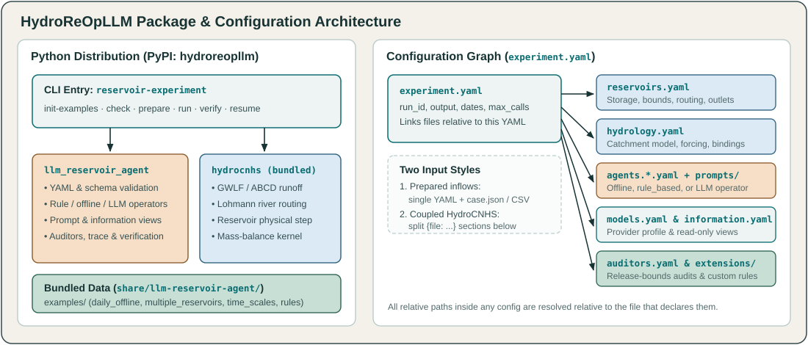

# 實驗設定檔

每項模擬都從一份頂層 `experiment.yaml` 開始，將水庫物理資料、操作員與模擬時間組合起來。自備入流建議先複製[雙水庫入門範本](../examples/template/README.zh-TW.md)，耦合集水區模擬則建議採用拆檔結構。

## 實驗設定三大組成

### 組成一：流域物理與入流

定義水庫庫容、放流上下限與河網連線（`case.json` 或 `reservoirs.yaml`），以及自備 `inflows.csv` 或 `hydrology.yaml`。

### 組成二：操作員、水情與模型

為每座受控水庫指派規則或 LLM（`agents`），並依需求掛載水情測站與預報（`information`）、模型設定（`models`）與稽核器（`auditors`）。

### 組成三：時間視窗與輸出

指定操作日期或時段（`start_date`/`end_date` 或 `start_time`/`end_time`）、呼叫上限（`max_calls`）與全新輸出資料夾（`output`）。

<figure class="figure-card">
  
  <figcaption><strong>設定檔關聯圖。</strong> 每個檔案一律從自身所在目錄解析相對路徑。</figcaption>
</figure>

## 設定版本與相對路徑規則

| `schema_version` | 入流方式 | `{file: ...}` 拆檔區段 | 適用情境 |
| --- | --- | --- | --- |
| `llm-reservoir-experiment.v1` | 自備入流 | 內嵌 | 雙水庫入門範本與 F.E. Walter 水庫案例（`inflows.csv` + `case.json`）。 |
| `llm-reservoir-experiment.v2` | 自備入流 | `models`、`agents`、`auditors`、`extensions`、`information` | 分檔管理的大型自備入流研究。 |
| `hydroops-coupled-simulation.v1` | HydroCNHS 集水區模式 | 內嵌 | 單檔式集水區與水庫耦合模擬。 |
| `hydroops-coupled-simulation.v2` | HydroCNHS 集水區模式 | `hydrology`、`models`、`agents`、`auditors`、`extensions`、`information` | 建議用於多水庫與混合流域的模組化架構。 |

- 所有路徑（`case`、`output`、`prompt_file`、`knowledge`、CSV）一律相對於**宣告該路徑的 YAML 檔案**解析。
- 每個 `{file: ...}` 參照會取代整個頂層區段，不可在同一區塊內混寫其他內嵌鍵值。

## 頂層實驗設定欄位

| 欄位 | 必填 | 用途 |
| --- | --- | --- |
| `schema_version` | 是 | 指定設定格式版本（上表四選一）。 |
| `run_id` | 是 | 唯一的實驗識別名稱，記錄於 `summary.json` 與決策日誌。 |
| `output` | 是 | 尚未使用的輸出資料夾路徑（不會覆寫既有模擬結果）。 |
| `case` | 是 | 指向 `case.json` 或 `reservoirs.yaml`（自備入流案例內含 `inflow_source.sha256`）。 |
| `start_date` / `end_date` | 逐日 | 加引號之 `YYYY-MM-DD` 雙向含括操作日期。 |
| `start_time` / `end_time` / `time` | 次日 | UTC 時間戳記（不含終點）搭配 `{simulation_step, output_step}`。 |
| `hydrology` | 耦合 | 連接 HydroCNHS 集水區模式、氣象驅動與 `inflow_bindings`。 |
| `agents` | 是 | 為每座受控水庫指派一名操作員（`rule_based`、`llm` 或 `offline`）。 |
| `models` | LLM | 具名的本機 Ollama 或雲端 LLM 設定檔（見[模型服務設定](LLM_MODULES.zh-TW.md)）。 |
| `auditors` | 否 | 放流邊界與數值範圍診斷稽核器。 |
| `extensions` | 否 | 註冊自訂 Python 規則套件（例如 `hanasaki`）。 |
| `information` | 否 | 不洩漏未來水情之測站、預報與上游水庫狀態（見[水情測站與預報](INFORMATION.zh-TW.md)）。 |
| `outcome_checks` | 否 | 河道演算後的下游控制點流量檢查（洪峰超標或低水不足）。 |
| `max_calls` | 建議 | LLM 總呼叫次數上限（離線／規則設 `0`；即時推論須 `>= llm_agents * steps`）。 |

## 設定順序與 YAML 注意事項

  
<strong>1. 識別與日期</strong><code>run_id</code>、全新 <code>output</code>、加引號日期

  
→

  
<strong>2. 入流來源</strong><code>inflows.csv</code> 或 <code>hydrology.yaml</code>

  
→

  
<strong>3. 水庫網路</strong>庫容、上下限與演算延遲

  
→

  
<strong>4. 操作員</strong>每座受控水庫 1 名操作員

  
→

  
<strong>5. 水情與模型</strong><code>models.yaml</code>、提示詞、<code>information</code>

  
→

  
<strong>6. 離線檢查</strong><code>reservoir-experiment check</code>

**常見 YAML 陷阱。** 任何區段出現重複鍵名都會被拒絕，防止設定被意外覆蓋。科學記號務必加上 `+` 或 `-`（例如 `8.0e+6` 或 `8000000.0`），否則 YAML 會將 `8.0e6` 當成純文字。

## 操作員、稽核器與下游檢查

- **操作員（`agents`）**：選用 `type: rule_based`、`type: llm` 或 `mode: offline`（見[操作規則與 LLM 設計](AGENT_DESIGN.zh-TW.md)）。
- **決策稽核器（`auditors`）**：檢查 `release_bounds`（`tolerance_cms`）或 `field_range`（`path`、`minimum`、`maximum`、`on_violation: FAIL | WARN`），不改寫流量。
- **下游流量檢查（`outcome_checks`）**：在河道演算後檢查匯流點或出口是否超過 `maximum_cms` 或低於 `minimum_cms`。
