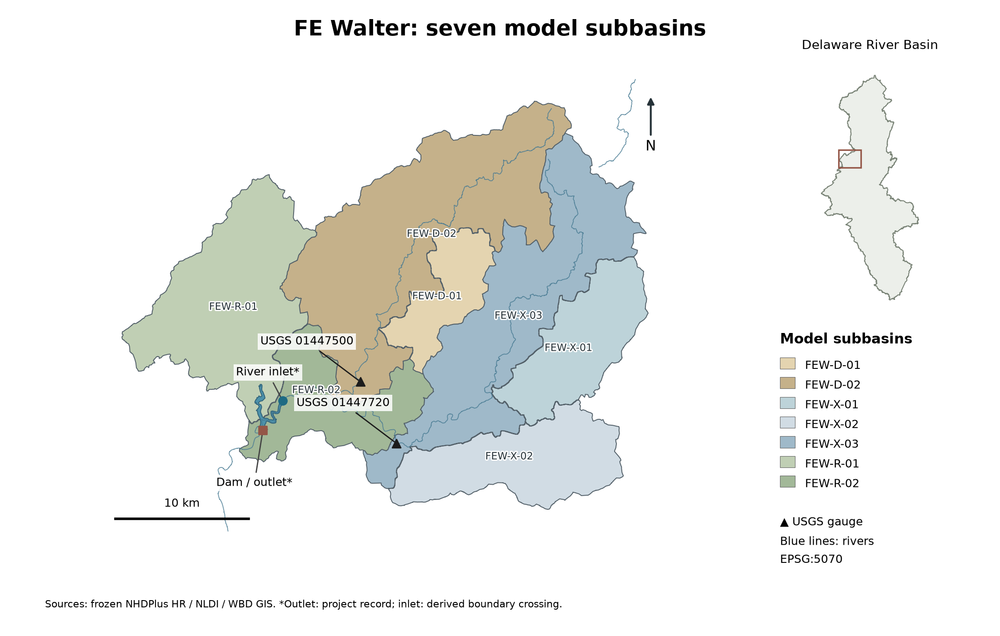

# Your first reservoir decision

This chapter reads one saved actual Ollama record for F.E. Walter Dam on
**2016-01-01**. It does not rerun the simulation or reconstruct an invented
reply. The record is bound by decision ID
`4e2006ff9c730ed33c23b8f580d2e49e1d6d8a4a643806a24ef48fe689147292`.



## 1. Information available to the decision

| Quantity | Saved value | Unit | Visibility in this preserved decision |
|---|---:|---|---|
| Decision date | 2016-01-01 | daily step | Shown to the LLM |
| Prescribed simulated inflow | 32.1253187067 | m³/s | Shown as 1,134.5 cfs |
| Beginning storage | 2,457,848.2797 | m³ | Host record only; not shown to the LLM |
| Beginning pool elevation | 1,300.00 | ft NGVD29 | Shown to the LLM |
| Feasible release upper bound | 60.5720657027 | m³/s | Host record only; not shown to the LLM |
| Previous committed history | none | — | Shown as “first simulated step” |

The daily inflow is prescribed simulation forcing. It is not a measurement or
a claim that future real-world inflow was available. The legacy date label is
anchored to UTC for reproducibility; it does not assert an instantaneous sensor
reading or current-day mean known in real time.

## 2. Complete model messages

The saved request contains both messages below. The system message was:

```text
You are the operator of a reservoir, making one release decision per day.

Reservoir information (public sources):
- Name: F.E. Walter Dam on the Lehigh River, Pennsylvania
- Location: Bear Creek Township, Luzerne County and Kidder Township, Carbon County, Pennsylvania
- Purpose: flood control, water storage, recreation
- Opened: 1961; operated by the U.S. Army Corps of Engineers
- Type: earth-fill embankment with rock shell, impounding the Lehigh River
- Dam height (foundation): 234 ft; length: 3,000 ft
- Spillway type: concrete
- Catchment area: 289 square miles
- Total capacity (publicly reported): 110,700 acre-feet
- Operation target: Your goal is to keep the water level at or near the designated normal pool elevation: 1300.0 ft N.G.V.D. in the winter (November through April) and 1370.0 ft N.G.V.D. in the summer (May through October).

Each day you will receive the current date, mean inflow,
water level at the beginning of the interval, and the previous one or two
simulated release decisions.
Flows are also stated as volumes in cubic feet over their interval, the
unit of the water balance. Decide the interval's mean release
in cfs, consistent with the reservoir's purpose. You have no operating
manual; use general reservoir-operation principles.

Physical water balance (not an operating rule):
- storage_change_cubic_feet = (inflow_cfs - release_cfs) * 86,400 * interval_days.
- A release below inflow increases storage; a release equal to inflow
  leaves storage approximately unchanged; a release above inflow decreases
  storage. Passing inflow cannot refill a reservoir below its target.

Constraints you must respect:
- Do not plan to release more water than is available (storage + inflow).
- Avoid letting storage exceed capacity (uncontrolled spill).
- Avoid abrupt interval-to-interval release changes unless conditions require them.

Respond only with JSON, with the fields in this order:
  applicable_target_ft (the operation-target water level for this interval),
  pool_position (below_target | at_target | above_target),
  intended_storage_direction (increase | hold | decrease),
  release_relation_to_inflow (below_inflow | equal_to_inflow | above_inflow),
  reasoning (1-2 sentences), release_cfs (number).
Decide the first four, then write the reasoning, then choose release_cfs.
Make release_cfs consistent with the four fields and with your reasoning.
```

The user message was:

```text
Date: 2016-01-01 (January, day 1 of the year)
1. Today's inflow: 1,134.5 cfs (= 98,020,360 cubic feet
   (= 2,250 acre-feet) over 1 days)
2. Water level at beginning of interval: 1300.00 ft NGVD29
3. Previous simulated release decisions (and what was actually released):
   None (first simulated step).
4. Number of days in this decision interval: 1

Decide the mean release for this interval (cfs).
```

The same unchanged messages are also retained in the saved
[`raw/policy_…json`](../examples/fe_walter/reference_outputs/ollama_three_day/zero_shot/raw/policy_4e2006ff9c730ed33c23b8f580d2e49e1d6d8a4a643806a24ef48fe689147292.json).
The fixed system message is also stored as
[`zeroshot_system.txt`](../prompts/fe_walter_reference/zeroshot_system.txt).

## 3. Native reply

Ollama recorded `done: true` and `done_reason: stop`. The complete model content was:

```json
{
  "applicable_target_ft": 1300.0,
  "pool_position": "at_target",
  "intended_storage_direction": "hold",
  "release_relation_to_inflow": "equal_to_inflow",
  "reasoning": "Given the target water level of 1300.0 ft and the inflow of 1134.5 cfs, a release equal to inflow is appropriate to maintain the target. This will hold the current storage level.",
  "release_cfs": 1134.5
}
```

The rationale is retained evidence. The executable request is `release_cfs`.
The reference adapter converted it exactly once to the common action:

```json
{"schema_version":"reservoir-action.v1","release_cms":32.1254629215}
```

## 4. Response checks and diagnostic audit

The adapter accepted the complete native fields, finite numeric release,
supported units and completed generation before the physical update. This is a
parser condition, not a separately persisted historical checker event. The
saved release-limits audit event recorded `PASS` for this day, meaning its
configured diagnostic criterion passed. Neither fact validates operating policy.

## 5. Host physics

The proposal did not set storage or spill. Host physics implemented controlled
release **32.1254629215 m³/s**, spill **0 m³/s**, and ending storage
**2,457,835.8196 m³**. The water-balance residual was **0 m³**. Here the requested
and implemented releases match because the request was feasible; they can differ
when physical bounds apply.

## 6. What the next day receives

After physics commits, feedback stores the actual implemented outcome. The next
step begins from 2,457,835.8196 m³ and can include the prior requested and
implemented release. It never substitutes the model's stated intention for the
physical result.

The evidence chain is distributed deliberately:

| Question | Saved evidence |
|---|---|
| What was known and proposed? | `decisions.jsonl` and `raw/policy_…json` |
| Which criterion evaluated it? | `audit.jsonl` and `raw/audit_…json` |
| What happened physically? | `physics.jsonl` and `reservoir_trajectory.csv` |
| Was feedback committed? | `backend_events.jsonl` |

Continue with [the three FE Walter examples](../examples/fe_walter/README.md).
Then adapt [inputs and YAML](USER_GUIDE.md) for your own experiment. The original
notebook remains available as an exact-byte companion:
{download}`download main.ipynb <../_notebook_downloads/main.ipynb>`.

[Previous: Installation](GETTING_STARTED.md) · [Next: FE Walter examples](../examples/fe_walter/README.md)
