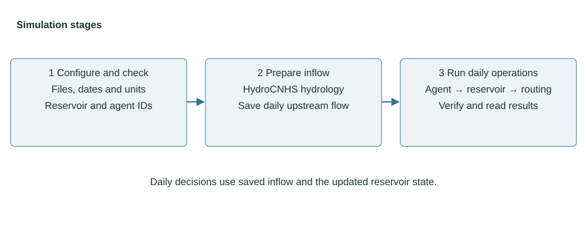

# Configuration overview

HydroReOpLLM keeps an accepted HydroCNHS model as the hydrology source and adds
explicit files for reservoir physics, operation agents, model providers, and
decision evidence. A new study follows this route:

1. Set shared dates, output, and file references in [Global settings](GLOBAL_SETTINGS.md).
2. Connect the accepted model and forcing in [Hydrology setup](HYDROLOGY_SETUP.md).
3. Define reservoir physics and the water network in [Build a simulation](BUILD_SIMULATION.md).
4. Choose Rule-based or LLM operators in [Configure agents](CONFIGURATION.md).
5. Run the checks and commands in [Run and resume](RUNNING.md).

Check the configuration files, prepare and save upstream inflow, then run daily
reservoir operations. Verify the saved records before interpreting the results.
Reservoir decisions use the saved inflow; they do not repeat or alter the
upstream hydrology calculation.



*Figure 1. Configuration, saved inflow and results connect the calculation
steps. [Editable draw.io source](figures/simulation-stages.drawio).*

## Begin with the experiment file

The [template file list](TEMPLATES.md) keeps the settings together. Start with
[experiment.yaml](../templates/coupled/experiment.yaml), shown in full below.
It points to the other files; the following chapters explain each one.

```{literalinclude} ../templates/coupled/experiment.yaml
:language: yaml
```

## Files, configuration keys, and functions

These three names describe different things:

| Term | Example | Meaning |
|---|---|---|
| File | `hydrology.yaml` | A document on disk. A path points to it. |
| Configuration key | `run_id` | A field in the displayed YAML; its value names this run. |
| Function | `load_coupled_settings()` | Python code that reads and validates configuration. |

The `hydrology.file` entry points to a separate file, rather than calling Python
code. [Hydrology](HYDROLOGY_SETUP.md) shows that file before explaining its keys.

## Input layers

| Layer | Purpose | Main files |
|---|---|---|
| Global | Run identity, operation dates, output, and section references | `experiment.yaml` |
| Hydrology | Accepted native model, complete forcing, and local flow bindings | `hydrology.yaml` plus user files |
| Reservoir network | Storage and release limits, inlets, routing, and outlets | `reservoirs.yaml` |
| Operators | One Rule-based or LLM agent per controlled reservoir | `agents.rule.yaml` or `agents.llm.yaml` |
| Shared catalogs | Model profiles, auditors, and optional information | `models.yaml`, `auditors.yaml`, `information.yaml` |
| Prompts and extensions | User messages and registered user code | `prompts/`, `extensions/` |

Every relative path starts from the file that declares it. A section reference
such as `agents: {file: agents.rule.yaml}` replaces that whole section; the
loader does not merge the external file with inline values.

## Hydrology inputs

The supported entry accepts an agent-free native GWLF or ABCD model with
Lohmann routing. The forcing table contains one row for every native model day
and weather driven unit, with these columns:

| Column | Unit | Requirement |
|---|---|---|
| `date` | `YYYY-MM-DD` | Every continuous native model day |
| `subbasin_id` | native model ID | Must match a weather driven unit |
| `precipitation_mm` | mm/day | Finite and nonnegative |
| `temperature_c` | °C | Finite |
| `pet_cm` | cm/day | Finite and nonnegative |

The adapter divides precipitation by ten before calling native HydroCNHS,
which expects precipitation in cm/day. It does not download, calibrate, or
invent hydrology. Reservoir initial storage remains an independent physical
input.

## Agent input and action

Both operation methods receive a detached `ReservoirObservation` containing
the decision time, current inflow, feasible release ceiling, reservoir state,
and explicitly selected information. An LLM returns the generic action:

```json
{"schema_version": "reservoir-action.v1", "release_cms": 5.0}
```

The number is only a format example. It is a requested mean controlled release
in m³/s. Common physics applies available water, release limits, and spill, so
requested release, implemented controlled release, and routed total outflow are
separate recorded values.

## Outputs

`prepare` writes hydrology provenance and local inflows. `run` writes the daily
operation records under `operation/`.

| Output | Contents |
|---|---|
| `inflows.csv` | Prepared incremental local flow by date and network node |
| `preparation.json`, `hydrology.json` | Hydrology interval, bindings, and source hashes |
| `operation/decisions.jsonl` | Observations, requested actions, and provenance links |
| `operation/provider_attempts.jsonl`, `operation/raw/` | LLM request and reply evidence when used |
| `operation/audit.jsonl` | Diagnostic PASS, WARN, FAIL, or UNKNOWN results |
| `operation/physics.jsonl`, `operation/reservoir_trajectory.csv` | Storage, controlled release, spill, and balance |
| `operation/network_flows.csv`, `operation/network_balance.csv` | Local and routed flows plus system accounting |
| `operation/summary.json`, `operation/experiment.json` | Completion and resolved input provenance |

`verify` checks record integrity, causal links, and water accounting. It does
not certify hydrological calibration or operation quality.
