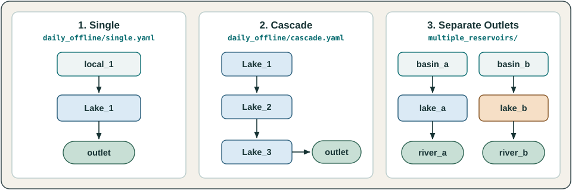

# Reservoir networks

Use [`examples/multiple_reservoirs`](../examples/multiple_reservoirs/README.md)
for a complete synthetic two-reservoir network.



- **Single (`examples/daily_offline/single.yaml`)**: one controlled reservoir (`Lake_1`) with prepared inflow `local_1` draining to `outlet`.
- **Cascade (`examples/daily_offline/cascade.yaml`)**: three series reservoirs (`Lake_1 → Lake_2 → Lake_3 → outlet`) with 1-day routing lags.
- **Separate outlets (`examples/multiple_reservoirs/`)**: two parallel HydroCNHS catchments (`basin_a`, `basin_b`) feeding `lake_a → river_a` and `lake_b → river_b` independently.

The essential invariants are:

- every reservoir key, physical `reservoir_id`, operator assignment, and inflow
  binding is unique and consistent;
- each controlled reservoir has one operator and its own decision history;
- local inflow excludes upstream water that arrives through a connection;
- outgoing fractions from one source sum to 1;
- terminal nodes exactly match `outlets`;
- routing weights are nonnegative and sum to 1.

For prepared inflows, the CSV contains every date and node using the header
`date,node,local_inflow_cms`. For native hydrology, `inflow_bindings` map model
flows to the network's inflow nodes. Downstream nodes receive only additional
local runoff; counting upstream release in both places duplicates water.

Check the default rule-based example before selecting its LLM variant:

```powershell
reservoir-experiment check examples/multiple_reservoirs/experiment.yaml
reservoir-experiment run examples/multiple_reservoirs/experiment.yaml
reservoir-experiment verify runs/independent-rivers-rule --require-offline
```

The first run creates a coupled preparation at
`runs/independent-rivers-rule/` and operation records in its `operation/`
subdirectory. Read the [results guide](RESULTS_GUIDE.md) before comparing nodes.
