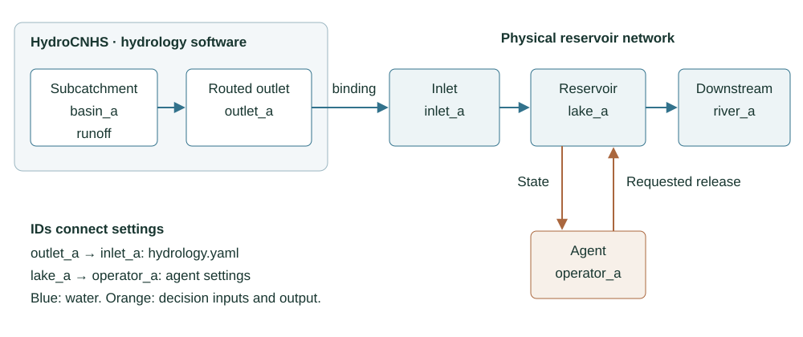

# Optional multi-reservoir configuration

Read [Build a simulation](BUILD_SIMULATION.md),
[HydroCNHS setup](HYDROLOGY_SETUP.md), and
[Configure agents](CONFIGURATION.md) before this optional case. Those chapters
define the general workflow. This page applies it to two independent water
systems: `lake_a` drains to `river_a`, and `lake_b` drains to `river_b`. The
configuration creates no water connection between them.

## Know what this fixture establishes

The synthetic weather fixture covers five days, 2020-02-27 through 2020-03-02.
The operation window covers four days, 2020-02-28 through 2020-03-02. The first
weather day initializes the hydrology model before the first reservoir decision.

The hydrological parameters are copied teaching values, and the forcing is
synthetic. The reference inflows support the rule-based baseline. This four-day
fixture checks software wiring: file references, IDs, routing, model adapters,
and evidence links. It is not a calibration or validation result and does not
establish an operating policy.

## Read every source file

| File | Role |
|---|---|
| [`experiment.yaml`](../examples/multiple_reservoirs/experiment.yaml) | Offline rule-based entry. |
| [`experiment.llm.yaml`](../examples/multiple_reservoirs/experiment.llm.yaml) | Mixed rule and LLM entry. |
| [`hydrology.yaml`](../examples/multiple_reservoirs/hydrology.yaml) | Native model, forcing, and operation inflow bindings. |
| [`model.yaml`](../examples/multiple_reservoirs/model.yaml) | Complete synthetic native HydroCNHS model. |
| [`forcing.csv`](../examples/multiple_reservoirs/forcing.csv) | Five-day synthetic weather table. |
| [`reservoirs.yaml`](../examples/multiple_reservoirs/reservoirs.yaml) | Two physical reservoirs, separate routing paths, and terminal outlets. |
| [`agents.rule.yaml`](../examples/multiple_reservoirs/agents.rule.yaml) | Two rule-based agents. |
| [`agents.llm.yaml`](../examples/multiple_reservoirs/agents.llm.yaml) | One LLM agent and one rule-based agent. |
| [`models.yaml`](../examples/multiple_reservoirs/models.yaml) | Model profile configuration and provider provenance fields. |
| [`auditors.yaml`](../examples/multiple_reservoirs/auditors.yaml) | Release-bound auditor selected by both agents. |
| [`information.yaml`](../examples/multiple_reservoirs/information.yaml) | Empty optional information catalog. |
| [`prompts/system.txt`](../examples/multiple_reservoirs/prompts/system.txt) | Explicit optional system instructions. |
| [`prompts/operator.txt`](../examples/multiple_reservoirs/prompts/operator.txt) | User message template and `$guidance` placeholder. |
| [`extensions/__init__.py`](../examples/multiple_reservoirs/extensions/__init__.py) | Local retrieval callback for `$guidance`. |
| [`knowledge/guidance.json`](../examples/multiple_reservoirs/knowledge/guidance.json) | Two local teaching documents with availability times. |
| [`statistics_a.json`](../examples/multiple_reservoirs/statistics_a.json) | Pinned synthetic rule statistics for `lake_a`. |
| [`statistics_b.json`](../examples/multiple_reservoirs/statistics_b.json) | Pinned synthetic rule statistics for `lake_b`. |
| [`reference_a.csv`](../examples/multiple_reservoirs/reference_a.csv) | Reference inflow provenance for `lake_a`. |
| [`reference_b.csv`](../examples/multiple_reservoirs/reference_b.csv) | Reference inflow provenance for `lake_b`. |

Paths inside each file are relative to that file. A referenced section replaces
the complete section; the loader does not merge it with inline values.

{download}`Download the complete example bundle <../_multiple_reservoir_downloads/hydroopslm-multiple-reservoirs.zip>`

## Read the complete rule-based configuration

The entry file selects the physical case and complete section files:

```{literalinclude} ../examples/multiple_reservoirs/experiment.yaml
:language: yaml
```

The hydrology section connects the native model and forcing to operation nodes:

```{literalinclude} ../examples/multiple_reservoirs/hydrology.yaml
:language: yaml
```

The physical case defines both reservoir paths and their separate outlets:

```{literalinclude} ../examples/multiple_reservoirs/reservoirs.yaml
:language: yaml
```

The rule catalog assigns one operator to each controlled reservoir:

```{literalinclude} ../examples/multiple_reservoirs/agents.rule.yaml
:language: yaml
```

The complete auditor and information catalogs are also part of the entry:

```{literalinclude} ../examples/multiple_reservoirs/auditors.yaml
:language: yaml
```

```{literalinclude} ../examples/multiple_reservoirs/information.yaml
:language: yaml
```

`start_date` and `end_date` select the four operation days inside the five-day
native period. Each reservoir names its own `inflow_node`. The two connections
route implemented controlled release plus spill to different terminal outlets.
Each rule agent names one reservoir and its pinned synthetic statistics.

Run the offline path from the repository root:

```powershell
reservoir-experiment check examples/multiple_reservoirs/experiment.yaml
reservoir-experiment prepare examples/multiple_reservoirs/experiment.yaml
reservoir-experiment run examples/multiple_reservoirs/experiment.yaml
reservoir-experiment verify runs/independent-rivers-rule/operation
```

`check` performs no simulation. `prepare` runs the five-day synthetic hydrology
and selects four operation boundaries. `run` advances both reservoir systems.
`verify` checks recorded source links, routing, and water accounting. None of
these checks establishes scientific adequacy or policy quality.

## Read the complete mixed configuration

The mixed entry changes the selected agent file and run identity while retaining
the same physical and hydrological fixture:

```{literalinclude} ../examples/multiple_reservoirs/experiment.llm.yaml
:language: yaml
```

Its agent catalog assigns LLM operation to `lake_a` and rule operation to
`lake_b`:

```{literalinclude} ../examples/multiple_reservoirs/agents.llm.yaml
:language: yaml
```

The complete model catalog records selectable provider and model settings:

```{literalinclude} ../examples/multiple_reservoirs/models.yaml
:language: yaml
```

Model names, provider settings, and sampling controls are configuration and
provenance. They are not results. The user template is selected by `prompt_file`;
the optional system template is selected by
`customization.system_prompt_file`. HydroReOpLLM does not add a common system
prompt.

`check` renders the declared preview for `$guidance` without executing the local
retrieval callback. A live decision calls `build_context`, which returns the
selected document IDs, source hash, query, and availability time with the value.
This fixture has no vector-database dependency.

To create new evidence, select and configure an available profile, choose a new
`run_id` and output directory, then run:

```powershell
reservoir-experiment check examples/multiple_reservoirs/experiment.llm.yaml
reservoir-experiment prepare examples/multiple_reservoirs/experiment.llm.yaml
reservoir-experiment run examples/multiple_reservoirs/experiment.llm.yaml --allow-network
reservoir-experiment verify runs/independent-rivers-mixed/operation
```

No provider call was performed to create this documentation. A live run creates
new evidence for the exact model, service, prompts, and context selected at that
time.

## Match IDs and follow the water paths

| Link | Field |
|---|---|
| Native runoff or routed outlet to operation inlet | `inflow_bindings` in `hydrology.yaml` |
| Operation inlet to reservoir | Reservoir `inflow_node` in `reservoirs.yaml` |
| Agent to reservoir | Agent `reservoir_id` |
| Reservoir to downstream node | `network.connections` in `reservoirs.yaml` |
| Terminal nodes | `network.outlets` in `reservoirs.yaml` |

For `lake_a`, `basin_a` weather enters the native model, the hydrology binding
supplies `inlet_a`, the physical case advances `lake_a`, and its connection
routes outflow to `river_a`. The `lake_b` path is parallel and ends at `river_b`.
Both river nodes declare zero added local flow; routed reservoir outflow still
reaches them. An information source can describe either river without creating a
water connection.

For reservoirs in series, connect upstream outflow to the next inlet and bind
only additional local runoff there. Parallel tributaries join at a named
junction. Independent systems retain separate outlets.



*Figure 3. Water follows the blue path from a hydrological source through an
inlet and reservoir to a downstream node. The agent receives reservoir state and
requests release through the orange information path. File IDs establish these
links; names and map positions do not.*

## Inspect the four-day outputs

Use `reservoir_trajectory.csv` to inspect requested release, implemented release,
spill, and storage for each reservoir. Use `network_flows.csv` to confirm that
`river_a` and `river_b` remain separate. For an LLM agent, join the decision
record to its prompt, provider ledger, response, audit, and physics record by
decision ID.

If a run is interrupted, preserve the partial output and use `resume` with a new
output directory. Committed decisions are skipped, and captured replies are
reused when valid. An external service may still observe an in-flight request
more than once if a crash occurs after acceptance but before the local evidence
commit.

Continue with [Results, audit, and trace](RESULTS_GUIDE.md), or open the
[advanced notebook](../tutorials/advanced.ipynb) for an offline inspection of
this configuration.
