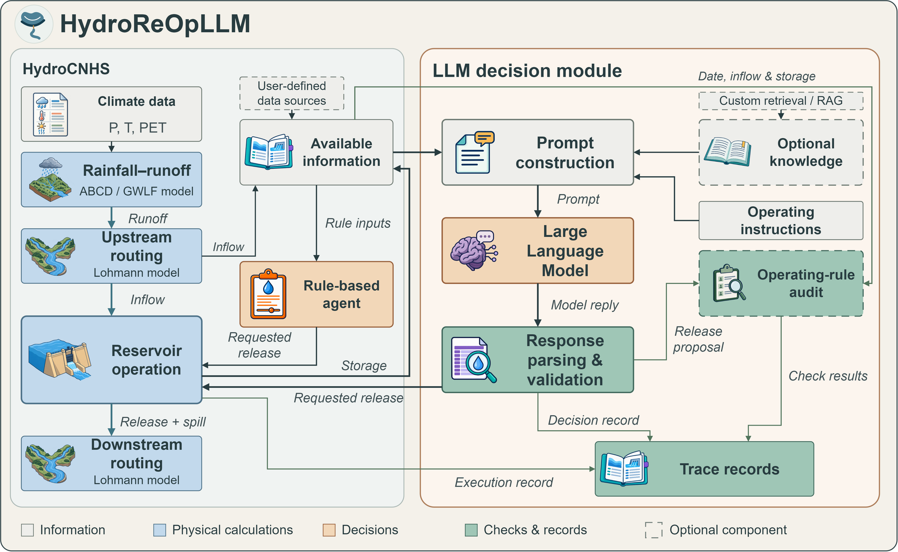

# HydroReOpLLM user manual

**HydroReOpLLM** builds on [**HydroCNHS**](https://github.com/philip928lin/HydroCNHS) to simulate watershed runoff, reservoir operations, and downstream routing using deterministic rules or LLMs.

[Install and run](GETTING_STARTED.md) · [Design agents](AGENT_DESIGN.md) · [F.E. Walter tutorial](../tutorials/README.md) · [繁體中文手冊](README.zh-TW.md)

## Four-pillar learning path

### Pillar 1: HydroCNHS foundation

Prepare local inflows or run native HydroCNHS catchments.

- [Native HydroCNHS hydrology](HYDROLOGY_SETUP.md)
- [Time scales and units](TIME_SCALES.md)
- [Experimental hourly GWLF](HOURLY_GWLF.md)

### Pillar 2: Rule & LLM agent design

Configure Hanasaki rules, custom Python curves, or LLM prompts.

- [Operator & LLM agent design](AGENT_DESIGN.md)
- [Decision-time information](INFORMATION.md)
- [Model providers](MODEL_PROVIDERS.md)

### Pillar 3: Coupling & execution

Wire multi-reservoir cascades, run simulations, and inspect balances.

- [Configuration files](CONFIGURATION.md)
- [Reservoir networks](MULTI_RESERVOIR.md)
- [Run, verify and resume](RUNNING.md)
- [Read the results](RESULTS_GUIDE.md)

### Pillar 4: Case study & reference

Reproduce the F.E. Walter study and fix common setup errors.

- [F.E. Walter Dam study](../examples/fe_walter/README.md)
- [F.E. Walter tutorial](../tutorials/README.md)
- [Troubleshooting](TROUBLESHOOTING.md)

## End-to-end architecture

<figure class="figure-card">
  
  <figcaption><strong>Figure 1.</strong> Coupled HydroCNHS–HydroReOpLLM loop: watershed inflows and reservoir state feed a rule or LLM operator, and host physics enforces outlet bounds and spill before routing downstream.</figcaption>
</figure>

## Public starting points

| Starting point | Operator & method | Network calls (`check` / `run`) | What it demonstrates |
| --- | --- | --- | --- |
| [Generic template](../examples/template/README.md) | Fixed release (`4.0` & `5.0` m³/s) | `0` / `0` | Two-reservoir cascade (`upper` → `lower` → `outlet`) with routing lags. |
| [Rule-based](../examples/fe_walter/README.md) | `type: rule_based` (`hanasaki`, α = 0.85) | `0` / `0` | Offline Hanasaki flood-control baseline on F.E. Walter (`rule_based.yaml`). |
| [Without operational knowledge](../examples/fe_walter/README.md) | `type: llm` (`seasonal_target.yaml`) | `0` / `7` (7-day) or `1,826` (full) | LLM release using only pool elevation, seasonal target, and 2-day history. |
| [With operational knowledge](../examples/fe_walter/README.md) | `type: llm` (`dkp.yaml`) | `0` / `7` (7-day) or `1,826` (full) | Same case with structured operating manual retrieval (`dkp.md`). |

**Check offline first.** `reservoir-experiment check` validates files, dates, inflows, and Day-1 prompt previews at zero model cost; live LLM calls run only with `--allow-network`.

