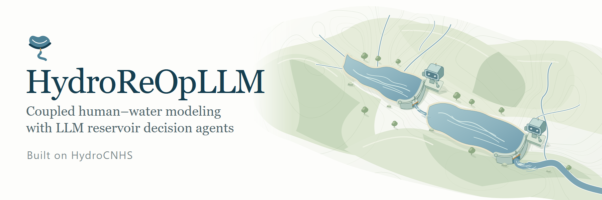

# HydroReOpLLM 工具包总览

  

**HydroReOpLLM** 扩展自 [**HydroCNHS**](https://github.com/philip928lin/HydroCNHS) 的半分布式集水区水文与水库智能体架构，让水文学家在同一套水量守恒的模拟系统中，构建并对比**规则式（Rule-based）**与 **LLM 驱动**的水库下泄调度。

[安装与 CLI 命令](GETTING_STARTED.zh-CN.md) · [操作规则与 LLM 设计](AGENT_DESIGN.zh-CN.md) · [实战教程与 Notebook](../tutorials/README.zh-CN.md) · [English](README.md) · [繁體中文](README.zh-TW.md)

## 何时适合使用 HydroReOpLLM？

- 希望在完全相同的集水区入流与河道演进条件下，公平对比 **Rule-based（Hanasaki 规则）**与 **LLM 操作员**的水库调度表现。
- 需要将真实水库运行规程（操作知识）、水文测站观测或流量预报，以不泄露未来水情的方式纳入逐日或逐时放流决策。
- 希望在单一水库或串联多水库流域中，同时验证蓄水量、受控放流、溢洪与下游河道流量的水量平衡。
- 需要可复现的离线检查、回放与断点续跑机制，避免重复消耗模型推理成本。

## 三大核心模块

### 模块一：水文与河道演进

支持直接导入子集水区区域入流 CSV，或耦合已率定的 HydroCNHS 集水区模型（`GWLF` / `ABCD` + Lohmann 演进），并以单位线将水库出流演进至下游测站。

### 模块二：操作规则与 LLM

每个受控水库可指派 Hanasaki 滞洪规则、自定义 Python 运用规线，或结合提示词、水情测站、预报与水库运行规程的 LLM 操作员。

### 模块三：物理限制与验证

共用的水库水量平衡引擎统一强制执行下泄上下限、死库容保护与满库溢洪，并提供离线 `check` 与 `verify` 核查完整水量守恒与水情时序。

## 耦合模拟运行方式

<figure class="figure-card">
  
  <figcaption><strong>图 1.</strong> HydroCNHS–HydroReOpLLM 耦合闭环：集水区入流与期初蓄水量送入水库操作规则或 LLM，经水库水量平衡引擎落实物理限制与溢洪后演进至下游河道。</figcaption>
</figure>

## 使用手册导航

### 安装与运行流程

搭建环境、了解 CLI 流程并解读输出结果。

- [安装与 CLI 命令](GETTING_STARTED.zh-CN.md)
- [实验配置文件](CONFIGURATION.zh-CN.md)
- [运行、验证与续跑](RUNNING.zh-CN.md)
- [结果解读与水量平衡](RESULTS_GUIDE.zh-CN.md)

### 集水区与水文河网

准备区域入流、配置 HydroCNHS 与多水库串联。

- [入流与 HydroCNHS 配置](HYDROLOGY_SETUP.zh-CN.md)
- [水库物理与河网串联](MULTI_RESERVOIR.zh-CN.md)
- [时间尺度与单位](TIME_SCALES.zh-CN.md)

### 水库操作决策

设计操作规则、LLM 提示词、水情输入与模型服务。

- [操作规则与 LLM 设计](AGENT_DESIGN.zh-CN.md)
- [水情测站与预报](INFORMATION.zh-CN.md)
- [模型服务配置](MODEL_PROVIDERS.zh-CN.md)

### 示例与实战教程

从单一水库到多水库串联案例，并快速排查配置问题。

- [单一水库案例（F.E. Walter）](../examples/fe_walter/README.zh-CN.md)
- [实战教程与 Notebook](../tutorials/README.zh-CN.md)
- [多水库串联案例](../examples/multi_reservoir/README.zh-CN.md)
- [常见问题与排查](TROUBLESHOOTING.zh-CN.md)

## 内置公开示例

| 示例 | 配置文件与操作方法 | 运行方式 | 示范重点 |
| --- | --- | --- | --- |
| [单一水库：Rule-based（Hanasaki 规则）](../examples/fe_walter/README.zh-CN.md) | `examples/fe_walter/rule_based.yaml`（`hanasaki`，α = 0.85） | 离线 | F.E. Walter 离线 Hanasaki 滞洪基准。 |
| [单一水库：Without operational knowledge（无操作知识）](../examples/fe_walter/README.zh-CN.md) | `examples/fe_walter/seasonal_target.yaml`（LLM） | 本地 Ollama | 仅提供水位、季节目标与两日放流历史的 LLM 调度。 |
| [单一水库：With operational knowledge（具操作知识）](../examples/fe_walter/README.zh-CN.md) | `examples/fe_walter/dkp.yaml`（LLM + `dkp.md`） | 本地 Ollama | 相同水库案例加上结构化水库运行规程检索。 |
| [多水库串联：台湾新店溪规则基准](../examples/multi_reservoir/README.zh-CN.md) | `examples/multi_reservoir/rule_based.yaml`（双库 Hanasaki） | 离线 | 仓库专属示例（未收录于论文）：10 年 HydroCNHS C&V 驱动 2025 全年双库（`feitsui` → `zhitan` → `xindian_outlet`）水量平衡基准。 |
| [多水库串联：台湾新店溪混合规则＋LLM](../examples/multi_reservoir/README.zh-CN.md) | `examples/multi_reservoir/hybrid_llm.yaml`（联合调度 LLM＋直潭 Hanasaki） | 本地 Ollama | 仓库专属示例（未收录于论文）：翡翠水库联合供水调度 LLM（`xindian_study` + 南势溪入流）结合直潭坝 Hanasaki 混合串联。 |

**先执行离线检查。** `reservoir-experiment check` 会以零模型成本验证配置文件、日期、入流与第 1 天提示词预览；仅在显式加上 `--allow-network` 时才会联网调用 LLM。

