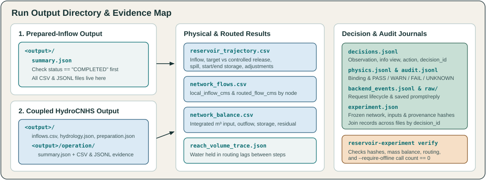

# Reading results

<div class="hero-band" markdown="1">

Check `"status": "COMPLETED"` in `summary.json` (`<output>/operation/summary.json` for coupled runs; `<output>/summary.json` for prepared inflows), then inspect storage trajectories, routed hydrographs, water balances, and decision logs.

</div>

<figure class="figure-card">
  
  <figcaption><strong>Output file map.</strong> Physical trajectory CSVs, basin water-balance tables, and step-level decision and audit logs.</figcaption>
</figure>

## Output directory layout

| File or folder | Generated by | Contents |
| --- | --- | --- |
| `<output>/inflows.csv`, `hydrology*.json` | Coupled `prepare` / `run` | Local watershed inflows (`m³/s`) and optional GWLF states/diagnostics. |
| `summary.json`, `progress.json` | All runs | Run `status`, final storages, `network_calls`, `fallback_used`, and `serving_profiles`. |
| `reservoir_trajectory.csv` | All runs | Step-by-step inflow, requested vs. implemented release, spill, and storage. |
| `network_flows.csv` | All runs | Local inflow and total routed flow at every inlet, junction, and outlet. |
| `network_balance.csv`, `reach_volume_trace.json` | All runs | Basin-wide mass balance (`m³`) and water held in channel routing lags. |
| `decisions.jsonl`, `physics.jsonl`, `audit.jsonl` | All runs | Per-step prompts, replies, physical transitions, and diagnostic checks (joined by `decision_id`). |
| `provider_attempts.jsonl`, `raw/` | LLM / traced runs | Model attempt logs and saved prompt/reply payloads. |

## Physical and routed trajectories

| File | Key columns | Hydrological meaning (`m³`, `m³/s`) |
| --- | --- | --- |
| `reservoir_trajectory.csv` | `date`/`timestamp`, `reservoir_id`, `inflow_cms`, `target_release_cms`, `controlled_release_cms`, `spill_cms`, `storage_start_m3`, `storage_end_m3`, `adjustments` | Compare **`target_release_cms`** (policy request) vs. **`controlled_release_cms`** (applied after outlet bounds and `dead_storage_m3`) and **`spill_cms`** (uncontrolled overflow above `capacity_m3`). |
| `network_flows.csv` | `date`/`timestamp`, `node`, `local_inflow_cms`, `routed_flow_cms` | Compare `routed_flow_cms` at downstream stations directly against observed streamflow hydrographs. |
| `network_balance.csv` | `local_input_m3`, `outlet_output_m3`, `reservoir_storage_change_m3`, `channel_storage_change_m3`, `system_residual_m3` | Confirms closed water balance across reservoirs and reaches (`system_residual_m3` near `0`). |
| `reach_volume_trace.json` | Reach keys & step arrays | Water temporarily traveling along multi-step routing lags. |

<div class="callout callout-info" markdown="1">

**Clipped actions vs. failures.** If an LLM requests a release outside `[minimum_release_cms, maximum_release_cms]` or below `dead_storage_m3`, the water-balance engine clips `controlled_release_cms`, records a flag in `adjustments`, and continues cleanly; the Hanasaki strict-parity profile raises `parity conflict` if limits diverge from its rules.

</div>

## Decision and diagnostic logs

- **`decisions.jsonl`**: Records exact observation state, retrieved `decision_information`, LLM/rule requested `action`, and `serving_profile` for diagnosing flood or drought decisions.
- **`audit.jsonl`**: Logs diagnostic `PASS`, `WARN`, `FAIL`, or `UNKNOWN` verdicts without altering flows.
- **`provider_attempts.jsonl` & `summary.json`**: Check `fallback_used` and `serving_profiles` to confirm which model served each step.

## Verify simulation outputs

```powershell
reservoir-experiment verify path/to/output --require-offline
```

Omit `--require-offline` for live LLM runs. `verify` checks mass balance, routing convolution, timestamp ordering, and complete logs without re-running hydrology or contacting any model server.
