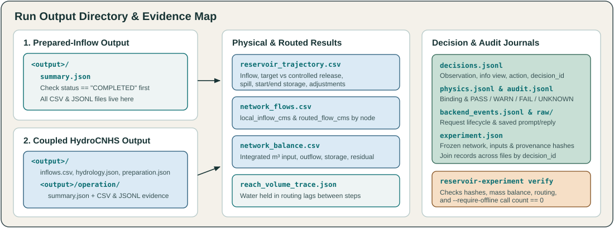

# 结果解读与水量平衡

<div class="hero-band" markdown="1">

先确认 `summary.json` 中的 `"status": "COMPLETED"`（耦合模式在 `<output>/operation/summary.json`；自备入流在 `<output>/summary.json`），再查看蓄水轨迹、演进流量过程线、水量平衡与 LLM 决策日志。

</div>

<figure class="figure-card">
  
  <figcaption><strong>输出文件关联图。</strong> 物理轨迹 CSV、流域水量平衡表与逐时间步决策／审计日志。</figcaption>
</figure>

## 输出目录结构

| 文件或目录 | 生成时机 | 内容 |
| --- | --- | --- |
| `<output>/inflows.csv`、`hydrology*.json` | 耦合 `prepare` / `run` | 集水区区域入流（`m³/s`）与可选的 GWLF 状态／诊断。 |
| `summary.json`、`progress.json` | 所有模拟 | 运行 `status`、期末蓄水量、`network_calls`、`fallback_used` 与 `serving_profiles`。 |
| `odd_llm_manifest.json` | 所有模拟 | 结构化 ODD+LLM 可复现性清单（涵盖区块 A–E 与输出文件 SHA-256 哈希）。 |
| `reservoir_trajectory.csv` | 所有模拟 | 逐时间步入流、请求放流 vs. 实际放流、溢洪与蓄水量。 |
| `network_flows.csv` | 所有模拟 | 每个入流口、汇流点与出口的区域入流及总演进流量。 |
| `network_balance.csv`、`reach_volume_trace.json` | 所有模拟 | 全流域水量平衡（`m³`）与滞留于河道演进延迟中的水量。 |
| `decisions.jsonl`、`physics.jsonl`、`audit.jsonl` | 所有模拟 | 逐时间步提示词、回复、物理转移与审计结果（以 `decision_id` 关联）。 |
| `provider_attempts.jsonl`、`raw/` | LLM／追踪模拟 | 模型调用尝试记录与保存的提示词／回复原始内容。 |

## 物理模拟轨迹与演进流量

| 文件 | 主要字段 | 水文意义（`m³`、`m³/s`） |
| --- | --- | --- |
| `reservoir_trajectory.csv` | `date`/`timestamp`、`reservoir_id`、`inflow_cms`、`target_release_cms`、`controlled_release_cms`、`spill_cms`、`storage_start_m3`、`storage_end_m3`、`adjustments` | 对比 **`target_release_cms`**（策略请求）与 **`controlled_release_cms`**（受上下限与 `dead_storage_m3` 约束后的实际下泄）及 **`spill_cms`**（超过 `capacity_m3` 的无控溢洪）。 |
| `network_flows.csv` | `date`/`timestamp`、`node`、`local_inflow_cms`、`routed_flow_cms` | 将下游测站的 `routed_flow_cms` 与实测河川流量过程线对照。 |
| `network_balance.csv` | `local_input_m3`、`outlet_output_m3`、`reservoir_storage_change_m3`、`channel_storage_change_m3`、`system_residual_m3` | 确认跨水库与河段的水量守恒（`system_residual_m3` 趋近 `0`）。 |
| `reach_volume_trace.json` | 河段键名与时间步数组 | 多步长演进延迟期间暂时滞留于河道的水量。 |

<div class="callout callout-info" markdown="1">

**下泄限幅与运行失败的区别。** 若 LLM 请求超出 `[minimum_release_cms, maximum_release_cms]` 或低于 `dead_storage_m3` 的放流量，水库水量平衡引擎会将 `controlled_release_cms` 限幅、在 `adjustments` 中记下标志并继续运行；Hanasaki 严格等价模式则会在水库物理限制与规则冲突时报错 `parity conflict`。

</div>

## 决策、审计与模型记录

- **`decisions.jsonl`**：记录确切的观测状态、读取到的 `decision_information`、LLM／规则请求的 `action` 与 `serving_profile`，可用于诊断洪水或枯水期的下泄决策原因。
- **`audit.jsonl`**：记录诊断性质的 `PASS`、`WARN`、`FAIL` 或 `UNKNOWN`，不改写流量。
- **`provider_attempts.jsonl` 与 `summary.json`**：查看 `fallback_used` 与 `serving_profiles`，确认每一步实际由哪一个模型服务生成。

## 验证模拟输出

```powershell
reservoir-experiment verify path/to/output --require-offline
```

验证实时 LLM 模拟时请省略 `--require-offline`。`verify` 会在不重跑水文、不联网模型服务器的情况下，检查水量平衡、河道卷积演进、水情时间戳与完整日志。

## ODD+LLM 可复现性报告导出

每次模拟完成后均会自动生成 `odd_llm_manifest.json`，与物理轨迹及决策日志并存。可运行以下命令，从任意输出目录导出可附于论文的 ODD+LLM Markdown 报告：

```powershell
reservoir-experiment export-odd path/to/output --markdown-out ODD_LLM_REPORT.md
```

清单与报告完整收录五项标准化可复现性区块：

- **区块 A — 认知架构（Cognitive Architecture）**：智能体类型与策略、工作记忆（`history_steps`）、长期操作知识（`dkp.md`、运用规线）、不泄露未来水情的信息配置与物理行动边界。
- **区块 B — 智能体身份与提示词（Identity）**：角色设定与人设框架、提示词模板 ID／版本、`prompt_sha256` 哈希与锁定的源文件清单。
- **区块 C — 推理配置（Inference Configuration）**：确切模型标识符、服务提供商与端点、解码超参数（`temperature`、随机种子（`seed`）、`max_tokens`、`num_ctx`、`think`）、重试／回退链；实时运行时自动捕获 Ollama 服务版本、模型快照 SHA-256 摘要与量化规格、实际观测到的云端模型解析版本／`system_fingerprint`，以及锁定的科学计算 Python 依赖版本与 HydroCNHS 运行环境版本。
- **区块 D — 行为子模型（Signature、Binding 与 Resolution）**：观测字段与 JSON 输出 Schema／解析器（`Signature`）、提示词变量与上下文／知识挂钩（`Binding`），以及重试、回退、物理限幅、溢洪与审计实测遥测（`Resolution`）。
- **区块 E — 验证与审计（Validation）**：水量平衡残差、离线 `verify` 核查状态、输出与追踪文件的 SHA-256 哈希与离线回放能力。
