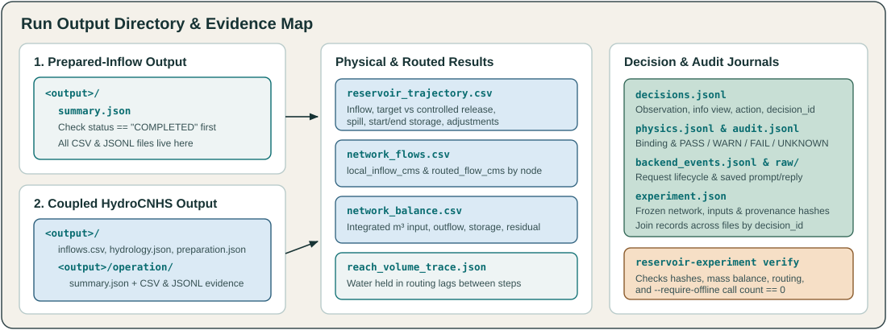

# 解讀執行結果

<div class="hero-band" markdown="1">

請先開啟 `summary.json`（耦合 HydroCNHS 模擬位於 `<output>/operation/summary.json`；既有入流模擬位於 `<output>/summary.json`），確認 `"status": "COMPLETED"`。接著再檢視 CSV 流量歷線、蓄水軌跡、水量平衡帳本以及 LLM 推理日誌。

</div>

<figure class="figure-card">
  
  <figcaption><strong>輸出檔案關聯圖。</strong> 物理軌跡 CSV、流域水量平衡表與逐時間步決策／稽核日誌之間的對應關係。</figcaption>
</figure>

## 輸出目錄結構

| 檔案或資料夾 | 產出時機 | 內容說明 |
| --- | --- | --- |
| `<output>/inflows.csv`、`hydrology*.json` | 耦合模式 `prepare` / `run` | 集水區區域入流量（`m³/s`）與選用的 GWLF 狀態及診斷紀錄。 |
| `summary.json` 與 `progress.json` | 所有模擬 | 執行 `status`、期末蓄水量、`network_calls`、`fallback_used`、`serving_profiles` 與已完成步數。 |
| `reservoir_trajectory.csv` | 所有模擬 | 逐時間步的入流量、請求放流量與實際執行放流量、溢流量及蓄水量（`m³/s`、`m³`）。 |
| `network_flows.csv` | 所有模擬 | 每個水庫入口、匯流點與流域出口的區域增量入流量及總演算流量。 |
| `network_balance.csv` 與 `reach_volume_trace.json` | 所有模擬 | 全流域質量平衡（`m³`）與滯留於河道演算延遲中的水量。 |
| `decisions.jsonl`、`physics.jsonl`、`audit.jsonl` | 所有模擬 | 逐時間步觀測值、LLM／規則提示詞與回覆、物理轉移及稽核結果（以 `decision_id` 串聯）。 |
| `provider_attempts.jsonl` 與 `raw/` | LLM／追蹤模擬 | 模型呼叫嘗試紀錄與完整保存的提示詞／回覆原始內容。 |

## 物理模擬軌跡與演算流量

| 檔案 | 主要欄位 | 水文物理意義（`m³`、`m³/s`） |
| --- | --- | --- |
| `reservoir_trajectory.csv` | `date`/`timestamp`、`reservoir_id`、`inflow_cms`、`target_release_cms`、`controlled_release_cms`、`spill_cms`、`storage_start_m3`、`storage_end_m3`、`adjustments` | 可並列比較 **`target_release_cms`**（規則或 LLM 請求的放流量）、**`controlled_release_cms`**（經 `[min, max]` 與 `dead_storage_m3` 物理限制後的實際受控放流量）以及 **`spill_cms`**（超過 `capacity_m3` 的無控制溢流量）。 |
| `network_flows.csv` | `date`/`timestamp`、`node`、`local_inflow_cms`、`routed_flow_cms` | 可直接將下游測站或出口的 `routed_flow_cms` 與實測河川流量歷線對照。 |
| `network_balance.csv` | `local_input_m3`、`outlet_output_m3`、`reservoir_storage_change_m3`、`channel_storage_change_m3`、`system_residual_m3` | 確認跨所有水庫與河段的質量守恆（`system_residual_m3` 趨近於 `0`）。 |
| `reach_volume_trace.json` | 河段鍵名與時間步陣列 | 追蹤在放流與抵達下游之間的匯流延遲期間，暫時滯留於河道中的水體體積。 |

<div class="callout callout-info" markdown="1">

**放流截幅與執行失敗的區別。** 若 LLM 請求的放流量超過放水設施容量或企圖放空至 `dead_storage_m3` 以下，物理核心會將 `controlled_release_cms` 截幅於可行範圍內、於 `adjustments` 記下調整旗標（`target_clipped_to_operating_bounds`、`controlled_release_limited_by_dead_storage`、`spill_above_capacity`）並繼續平順執行。相較之下，Hanasaki 基準模式若遇主機限制與其嚴格等價設定衝突，則會主動報錯 `parity conflict`。

</div>

## 決策、稽核與來源追蹤日誌

- **`decisions.jsonl`**：記錄確切的觀測輸入、讀取到的 `decision_information`、LLM／規則請求的 `action` 與 `serving_profile`——非常適合用來診斷 LLM 在洪水事件或枯水期間為何做出特定放流決策。
- **`audit.jsonl`**：記錄已設定稽核器（如 `release_bounds`）回報的 `PASS`、`WARN`、`FAIL` 或 `UNKNOWN`。稽核 `FAIL` 僅代表診斷性警示，不會改寫流量。
- **`provider_attempts.jsonl` 與 `summary.json`**：若有設定備援模型，請檢視 `fallback_used` 與 `serving_profiles`，以確認每一筆決策究竟是由哪一個模型產生。

## 驗證已保存的證據

```powershell
reservoir-experiment verify path/to/output --require-offline
```

驗證即時 LLM 模擬時請省略 `--require-offline`。`verify` 會在不重跑水文模擬、不聯繫任何模型伺服器的情況下，查核質量守恆、河道摺積演算、因果資訊時間戳記與完整時間步日誌。
