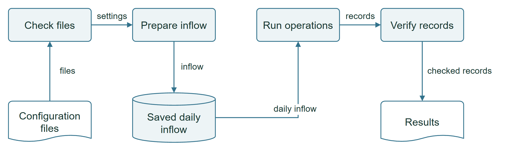

# Check, prepare, run, and verify

<div class="hero-band" markdown="1">

Every HydroReOpLLM experiment uses one consistent CLI workflow: `check` → (`prepare` for coupled HydroCNHS) → `run` → `verify` (plus `resume` if a long live run is interrupted).

</div>

<figure class="figure-card">
  
  <figcaption><strong>Simulation lifecycle.</strong> Validate settings offline, optionally inspect prepared HydroCNHS inflows, run reservoir operations, and verify water balance and decision logs.</figcaption>
</figure>

## CLI lifecycle and output layout

Run the standard three-command sequence from your repository or working root:

```powershell
reservoir-experiment check path/to/experiment.yaml
reservoir-experiment run path/to/experiment.yaml
reservoir-experiment verify path/to/output
```

| Subcommand | Purpose | Output written | Network calls |
| --- | --- | --- | --- |
| `check <config>` | Validates hydrology bindings, reservoir topology, dates, prompts, and Day-1 prompt previews. | None | `0` |
| `prepare <config>` | Coupled HydroCNHS only: runs watershed rainfall–runoff + warm-up and writes `inflows.csv`. | Preparation dir | `0` |
| `run <config> [--allow-network]` | Prepares inflows (if coupled and not yet prepared), runs operators + routing, and saves trajectories. | Fresh `<output>` | `0` unless `--allow-network` |
| `verify <output> [--require-offline]` | Audits saved water balance, routing conservation, causal timing, and trace completeness. | None | `0` |
| `resume <config> --from-run ... --output ... --run-id ...` | Replays completed steps from an interrupted run and finishes remaining steps into a new directory. | Fresh `--output` | Only for remaining steps |

Where operation files are written depends on your hydrology setup:

| Entry style | Configured `output` | Operation files (`summary.json`, CSVs) | Verify command |
| --- | --- | --- | --- |
| Coupled HydroCNHS (`v1`/`v2`) | Preparation directory (`inflows.csv`, `hydrology*.json`) | `<output>/operation/` | `reservoir-experiment verify <output>` (or `<output>/operation`) |
| Prepared inflows (`v1`/`v2`) | Operation directory | `<output>/` | `reservoir-experiment verify <output>` |

<div class="callout callout-info" markdown="1">

**Inspecting watershed inflows before operation.** Run `prepare` first if you want to plot or gauge-check `inflows.csv` before invoking an LLM. When you later run `run`, it validates and reuses that prepared `inflows.csv` automatically without re-running HydroCNHS.

</div>

## Live model calls and safety gates

Live LLM inference requires three explicit safeguards so you never trigger unintended API calls or billing:

1. **CLI permission**: Pass `--allow-network` on `reservoir-experiment run` (or `resume`).
2. **Case readiness**: Real or simulated-inflow cases (`observed_local_inflow` or `simulated_local_inflow`) must include `"live_readiness": {"ready": true}` in `case.json` / `reservoirs.yaml`. Synthetic teaching fixtures are ready without it.
3. **Call budget (`max_calls`)**: Set `max_calls` to at least `llm_agents * steps` (plus any retry/fallback headroom), or explicit `null` for uncapped runs.

## Resume an interrupted operation

If a multi-year LLM run stops mid-way due to a network outage or machine restart, keep the partial folder untouched and resume into a fresh `--output` directory with a new `--run-id`:

```powershell
reservoir-experiment resume path/to/experiment.yaml `
  --from-run path/to/partial-operation `
  --output path/to/new-operation `
  --run-id NEW_RUN_ID
```

Completed steps and saved model replies are replayed identically without re-querying the LLM; add `--allow-network` only if remaining steps need live model calls.

## Replay saved daily responses

To replay archived daily releases offline through the reservoir physics and routing engine:

```powershell
llm-reservoir-daily --case-root path/to/case-directory `
  --case case.json `
  --responses responses.json `
  --output runs/replay
reservoir-experiment verify runs/replay --require-offline
```

For the 21-run F.E. Walter benchmark reproduction, run `python examples/fe_walter/study/replay.py --output runs/walter-paper-replay` (see [F.E. Walter Dam guide](../examples/fe_walter/README.md)). Continue with [Read your results](RESULTS_GUIDE.md).
