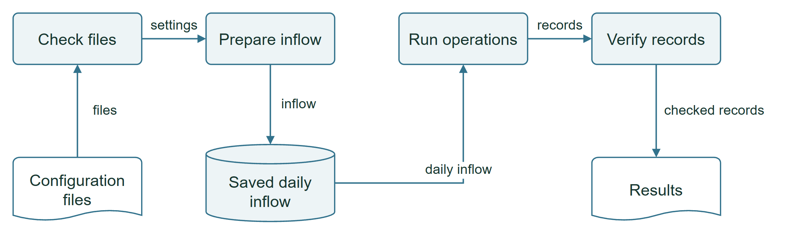

# 运行、验证与续跑

<div class="hero-band" markdown="1">

每项 HydroReOpLLM 实验均遵循同一套 CLI 流程：`check` →（耦合 HydroCNHS 专用 `prepare`）→ `run` → `verify`（以及用于断点续跑的 `resume`）。

</div>

<figure class="figure-card">
  
  <figcaption><strong>模拟生命周期。</strong> 离线验证输入、按需检查 HydroCNHS 入流、运行调度并验证水量平衡。</figcaption>
</figure>

## CLI 生命周期与输出目录结构

```powershell
reservoir-experiment check path/to/experiment.yaml
reservoir-experiment run path/to/experiment.yaml
reservoir-experiment verify path/to/output
```

| 子命令 | 用途 |
| --- | --- |
| `check <config>` | 验证水文绑定、拓扑、日期、提示词与第 1 天提示词预览。 |
| `prepare <config>` | 仅限耦合 HydroCNHS：运行集水区模型与预热期并输出 `inflows.csv`。 |
| `run <config> [--allow-network]` | 准备入流（若为耦合）、运行水库操作与演进并写入结果。 |
| `verify <output> [--require-offline]` | 核查水量守恒、河道演进、水情时间戳与完整决策日志。 |
| `resume <config> --from-run ... --output ... --run-id ...` | 回放中断运行的已完成步骤并接续跑完剩余步骤。 |

| 输入方式 | 配置文件 `output` | 操作结果位置（`summary.json`、CSV） | 验证命令 |
| --- | --- | --- | --- |
| 耦合 HydroCNHS（`v1`/`v2`） | 准备目录（`inflows.csv`、`hydrology*.json`） | `<output>/operation/` | `reservoir-experiment verify <output>` |
| 自备入流数据（`v1`/`v2`） | 操作目录 | `<output>/` | `reservoir-experiment verify <output>` |

<div class="callout callout-info" markdown="1">

**调用 LLM 前先检查入流。** 先运行 `prepare` 可提前绘图或对照实测站点检查 `inflows.csv`；之后运行 `run` 会自动复用该入流文件，无需重跑 HydroCNHS。

</div>

## 实时模型调用与安全闸门

实时 LLM 推理必须满足三项显式防护：

1. **CLI 标志**：在 `reservoir-experiment run`（或 `resume`）中传入 `--allow-network`。
2. **案例就绪声明**：实测或模拟入流案例须在 `case.json` / `reservoirs.yaml` 中声明 `"live_readiness": {"ready": true}`（合成测试案例自动就绪）。
3. **调用预算**：将 `max_calls` 设为至少 `llm_agents * steps`（含重试／回退余量）或 `null`。

## 续跑中断的水库操作

保留中断目录不动，并以新的 `--run-id` 指向全新的 `--output` 目录：

```powershell
reservoir-experiment resume path/to/experiment.yaml `
  --from-run path/to/partial-operation `
  --output path/to/new-operation `
  --run-id NEW_RUN_ID
```

已完成的步骤会直接回放，不重复请求 LLM；仅当剩余步骤需要新的模型调用时才加上 `--allow-network`。

## 离线回放逐日回复

```powershell
llm-reservoir-daily --case-root path/to/case-directory `
  --case case.json `
  --responses responses.json `
  --output runs/replay
reservoir-experiment verify runs/replay --require-offline
```

如需离线复现 F.E. Walter 论文基准，请运行 `python examples/fe_walter/study/replay.py --output runs/walter-paper-replay`（见 [F.E. Walter 水库案例](../examples/fe_walter/README.zh-CN.md)）。接下来请参阅[结果解读与水量平衡](RESULTS_GUIDE.zh-CN.md)。
