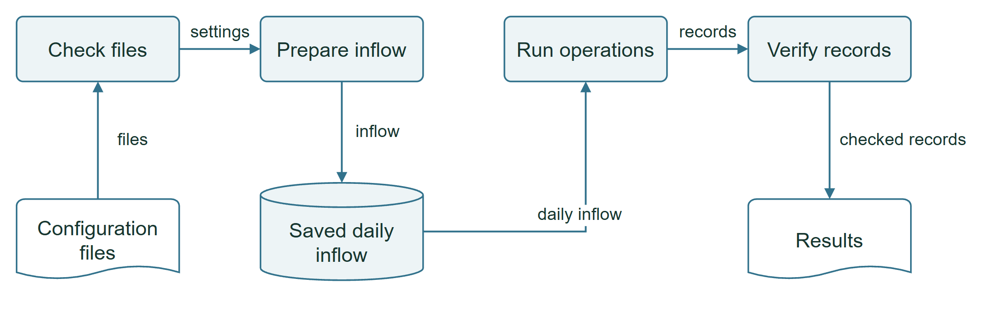

# 檢查、準備、執行與驗證

請在專案根目錄執行指令，並對 `check` 與 `run` 使用同一份設定檔。使用既有入流資料或耦合水文模型時，都可以依序執行以下三個指令。

```powershell
reservoir-experiment check path/to/experiment.yaml
reservoir-experiment run path/to/experiment.yaml
reservoir-experiment verify path/to/output
```



`check` 會載入參照檔案並驗證設定，過程中不會執行水文模擬，也不會發送模型服務請求。若想在執行**耦合**模擬前先檢視入流量，可在 `check` 與 `run` 之間插入 `reservoir-experiment prepare path/to/experiment.yaml`。該指令會執行原生水文模擬，並將鎖定版本的 `inflows.csv`、`case.json`、`experiment.yaml`、`hydrology.json` 與 `preparation.json` 寫入指定的輸出目錄。當輸出目錄尚不存在時，`run` 會自動執行上述準備步驟。若已有準備成果，則會先行驗證並重複使用，接著寫入水庫操作紀錄。`verify` 僅讀取已保存的證據，不會重新執行水文模擬或操作員。若驗收條件要求完全不得呼叫模型服務，請加上 `--require-offline`。

輸出目錄結構會依輸入模式而有所不同。

| 輸入模式 | 設定之輸出路徑 | 操作紀錄位置 | 驗證指令 |
|---|---|---|---|
| 耦合 HydroCNHS | 準備目錄 | `<output>/operation/` | `reservoir-experiment verify <output>` |
| 既有入流資料 | 操作目錄 | `<output>/` | `reservoir-experiment verify <output>` |

若要驗證隨附的耦合範例，請執行下列指令。

```powershell
reservoir-experiment verify runs/independent-rivers-rule --require-offline
```

若傳入 `runs/independent-rivers-rule/operation`，則只會驗證其操作紀錄。準備目錄唯有在 `operation/summary.json` 已建立且狀態為 `COMPLETED` 時，才算是一次已完成的執行。

## 即時模型呼叫

若要啟用即時 LLM 傳輸，必須配置 LLM 操作員，並明確加上 `reservoir-experiment run ... --allow-network` 旗標。當 `max_calls` 設為整數時，它會限制模型服務的總呼叫嘗試次數，且重試與備援嘗試都會計入該上限。非合成的物理輸入資料也必須在案例中明確宣告已就緒。`check` 通過僅代表所宣告的執行計畫有效，並不代表遠端模型可用性、憑證、計費狀態或回覆品質皆已獲確認。

<a id="resume-an-interrupted-operation"></a>

## 續跑中斷的水庫操作

請保留已中斷的輸出目錄，並指定一個尚未使用的獨立新目錄進行續跑。

```powershell
reservoir-experiment resume path/to/experiment.yaml `
  --from-run path/to/partial-operation `
  --output path/to/new-operation `
  --run-id NEW_RUN_ID
```

僅在預期要發送新的模型服務呼叫時，才加上 `--allow-network`。唯有已儲存的前段紀錄與目前設定及執行環境完全相符時，系統才會接受重複使用，且原始執行目錄會保持不變。續跑機制可重複使用已完成的決策與已擷取的回覆，但在傳輸中途被打斷的請求，其模型服務傳遞狀態與費用可能仍屬未知。

## 重播已保存的逐日回覆

若逐日案例已有現成的回覆檔案，可使用已安裝的離線重播指令。此介面供使用者匯入自行保存的回覆檔，儲存庫本身並不隨附回覆檔案。請相對於案例目錄提供兩項輸入路徑，並指定一個新的輸出目錄。

```powershell
llm-reservoir-daily --case-root path/to/case-directory `
  --case case.json `
  --responses responses.json `
  --output runs/replay
reservoir-experiment verify runs/replay --require-offline
```

對於標記為 `recorded_llm_response` 的回覆，嚴格驗證會比對已保存的來源雜湊值與決策及稽核紀錄、核對每筆原始回覆的日期與請求放流量，並要求重播期間的模型服務觀測呼叫次數為零。若您也想將原始檔案位元組與已保存的 SHA-256 摘要進行比對，請保留原始回覆檔案。

接著請繼續閱讀[檢視執行結果](RESULTS_GUIDE.zh-TW.md)。
