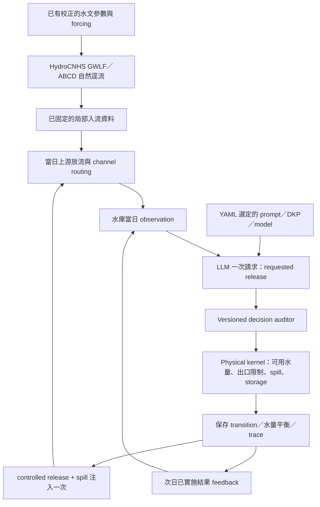

# HydroCNHS + LLM Reservoir Agent 操作手冊

本 repo 內含完整固定版本 HydroCNHS 原始碼與通用 `llm_reservoir_agent`。先用離線範例熟悉操作，再準備自己的水庫 case、prompt、知識包與 auditor。完整核心不代表所有流域、水文／水質模組或 LLM 策略均已驗收；既有驗收範圍見 [results](../results/README.md)。

## 1. 安裝與第一個實驗

建議 Python 3.12。在 repo 根目錄建立環境並安裝；這是使用者初次安裝步驟，安裝科學套件需要連線，本次開發驗收使用已有環境。

```powershell
python -m venv .venv
.venv\Scripts\Activate.ps1
python -m pip install -e . -c environment/requirements-bundled.txt
python run_experiment.py check experiments/synthetic_cascade.yaml
python run_experiment.py run experiments/synthetic_cascade.yaml
python run_experiment.py verify runs/synthetic-cascade
```

`check` 只讀設定與資料：顯示水庫／agent 對應、被動水庫數、日期、預計 LLM 請求數、hash 與 live readiness，不建立結果目錄、不連模型。`run` 的第一個範例是 4 天、3 個假想水庫、固定離線放流；網路呼叫數應為 0。`verify` 獨立檢查儲存的輸出、因果鏈、水量平衡、routing 與 audit binding；檢查失敗會回傳非零 exit code。

安裝後也可用 `reservoir-experiment check|run|verify ...`。目前 runner 需要完整 repo checkout，包括 `environment/` 與 `examples/`；請使用 editable 安裝。wheel 內含完整 Python 核心與 attribution，但單獨 wheel 不是完整 case/runtime bundle。

同一 output 已存在會拒絕覆寫；第二次實驗請更改 YAML 的 `run_id` 與 `output`。失敗時保留輸出診斷，沒有自動重試／續跑。本設定 runner 不負責重播既有 FE 五年實驗。

`requirements-bundled.txt` 固定本次實際測過的 10 個直接科學套件版本；它不是完整跨平台／傳遞依賴 lock。`requirements-hydrocnhs.txt` 保留原實驗環境紀錄，含歷史 Git 安裝來源，不用它取代本 bundled 安裝。重現研究還需固定 Python、case/forcing、prompt、模型版本與原結果依賴。

## 2. 目錄與設定責任

```text
src/hydrocnhs/             完整固定 HydroCNHS 核心（20 份檔案）
src/llm_reservoir_agent/   通用 agent、provider、physics、routing、audit、trace
third_party/hydrocnhs/    BSD 授權、來源 commit、逐檔 SHA256、上游 metadata
experiments/*.yaml        使用者的實驗與 agent 設定
cases/<case>/             流域位置、拓樸、物理參數、每日局部入流與 hash
prompts/*.txt             可版本化 prompt 模板
knowledge/*.md            每個 agent 選用的靜態 DKP／規則文件
examples/                 HydroCNHS Dam API 接入口
runs/<run_id>/            個別 run 的乾淨 trace 與輸出（Git 忽略）
results/                  既有驗收與發布結果
```

實驗 YAML 決定「誰控制哪座水庫、用哪個 prompt／模型／知識／auditor」。case JSON 決定「在哪裡、連到誰、物理限制與哪份入流」。更換區域、名稱、水庫數量或 prompt 不需要改核心；新流域自己的參數與 routing 仍需獨立來源及驗證。

### 先準備這些檔案

| 檔案 | 放什麼／在哪裡指定 |
|---|---|
| 實驗 YAML | agents、水庫對應、模型選項、日期、輸出、auditor；`experiments/*.yaml` 已逐項加註解 |
| case JSON | 水庫位置、上下游連線、物理參數、初始蓄水；YAML 的 `case` 指向它 |
| 入流 CSV | 每日局部入流；case 的 `inflow_source.path` 與 `sha256` 指向並核對它 |
| prompt TXT | 操作指示模板；每個 agent 的 `prompt` 指向它 |
| DKP／規則文字 | 自己水庫的 UTF-8 `.md`／`.txt` 文件；每個 agent 的 `knowledge` 指定 package ID 與路徑 |
| 靜態 JSON（選填） | 額外固定資料；`context_file` 指向它，或直接寫 `context` |

**如果原始 input 是 Excel**：目前 runner 不直接讀 `.xlsx`。先在 Excel 整理成 `date,node,local_inflow_cms` 三欄，再匯出不含 BOM 的 UTF-8 CSV（Excel 若在開頭加 BOM，需先移除）；日期用 `YYYY-MM-DD`、流量用 m³/s，每天每個 routing node 一列。若原始流量是 cfs，先乘 `0.028316846592` 換成 m³/s。只有一座水庫時仍使用 case 的 node ID；多庫時不可把已含上游放流的總入流當局部入流。把 CSV 路徑與新 SHA256 寫到自己的 case JSON，再執行 `check`。不要改寫原本已驗收的 Excel、CSV 或 case。

**system prompt 在哪裡**：backend 固定 system message 的 JSON 回覆契約；目前 YAML 沒有 `system_prompt` 欄位。你要修改的操作角色、目標與指示寫在 `prompt` 指向的檔案，作為 user message；DKP 另外透過 `knowledge` 加入。兩者可每個 agent 各自指定。offline 模式只是固定測試放流，不執行 prompt／DKP 的模型選擇。

## 3. YAML 完整範例

```yaml
schema_version: llm-reservoir-experiment.v1
case: ../cases/reservoir_network_fixture.json
run_id: my-cascade
output: ../runs/my-cascade
models:
  local:
    provider: ollama
    base_url: http://localhost:11434
    model: gemma4:12b
    temperature: 0.7
    max_tokens: 512
    timeout_seconds: 60
auditors:
  limits:
    type: release_bounds
    version: "1"
agents:
  upstream_operator:
    reservoir: R1
    mode: offline
    release_cms: 5
    model: local
    prompt: ../prompts/daily_release.txt
    prompt_version: "1"
    knowledge:
      operating_rules: ../knowledge/synthetic_rules.md
    context: {experiment_purpose: demonstration}
    auditors: [limits]
  middle_operator:
    reservoir: R2
    mode: offline
    release_cms: 6
    prompt: ../prompts/daily_release.txt
    auditors: [limits]
  downstream_operator:
    reservoir: R3
    mode: offline
    release_cms: 6.5
    prompt: ../prompts/daily_release.txt
    auditors: [limits]
```

`agents` 有幾個項目就有幾個 agent，無需另外設定 `n_agents`。一座 controlled reservoir 恰好對應一個 agent；被動水庫不填 agent。相同模型 profile 可以共用，但每個 agent 實例、知識、feedback、audit 狀態分開。此版本每日各庫依拓樸先後決策，沒有中央協調／agent 互相交談功能。

所有 YAML 路徑以 **YAML 所在目錄** 為基準，也可用絕對路徑；移動整個 repo 無需改寫預設相對路徑。

| 頂層設定 | 必要性／預設 | 用途 |
|---|---|---|
| `schema_version` | 必填固定值 | 設定契約版本 |
| `case` | 必填 | case JSON 路徑 |
| `case_root` | 選填 | case 資料允許根目錄；repo 內預設 repo 根，外部 bundle 預設 case 的目錄 |
| `run_id`, `output` | 必填 | 實驗 ID 與獨立結果目錄 |
| `start_date`, `end_date` | 選填、完整 case 區間 | 引號包住 `"YYYY-MM-DD"`，僅選已有連續資料；不自行補值 |
| `models` | 預設 `{}` | 可重用模型 profile 字典 |
| `agents` | 必填非空 | 以 agent ID 為 key 的設定字典 |
| `auditors` | 預設 `{}` | 可重用 versioned checker 字典 |
| `max_calls` | offline 預設 0；LLM 必填 | 全實驗請求上限，至少涵蓋 `days × LLM agent count` |

日期切片從 case 給定的初始蓄水開始，不會自動 warm up，也不接續前一個 run 的蓄水。若研究需要中途啟動，請建立新的 case，明確提供該日已驗證的初始蓄水與 routing 初始條件；保留原 case 不覆寫。

| 每個 agent 設定 | 必要性／預設 | 用途 |
|---|---|---|
| `reservoir` | 必填 | case `network.reservoirs` 的 key，須為 controlled |
| `mode` | 必填 `offline` 或 `llm` | 固定測試動作或一次模型決策 |
| `release_cms` | offline 必填；llm 禁用 | 離線請求放流 m³/s，不是 LLM fallback |
| `model` | llm 必填 | `models` 的 profile ID；offline 可指定但不會呼叫模型 |
| `prompt` | 必填 | UTF-8 模板文字檔 |
| `prompt_version` | 預設字串 `"1"` | 改 prompt 時更新版本，內容 hash 仍會保存 |
| `knowledge` | 預設 `{}` | 穩定 package ID → UTF-8 DKP／知識文字檔路徑 |
| `context` | 預設 `{}` | 靜態有限 JSON 資料，例如實驗目的／補充規則 |
| `context_file` | 選填、與 context 擇一 | 靜態 JSON 物件檔 |
| `auditors` | 預設 `[]` | 此 agent 啟用的 checker IDs；空組合為 UNKNOWN |

靜態 context 僅放在 prompt 的 `static_context` namespace，不取代模型觀測的 storage／inflow，也不會自行進入物理 solver。時變 inflow 由 case 提供。本版沒有自動天氣／入流預報、任意 CSV 作為動態 prompt 資料、RAG 或多 agent 聊天；若需要，使用公開 backend API 增加有時間戳與可用時點的資料介面，再驗證因果性。

| model profile 設定 | 必要性／預設 | 用途 |
|---|---|---|
| `provider` | 必填 | `ollama` 或 `openai_compatible` |
| `model` | 必填 | provider 已可用的模型 ID；runner 不下載／pull 模型 |
| `base_url` | 必填 | Ollama 例如 `http://localhost:11434`；compatible 例如 `https://api.openai.com/v1` |
| `temperature` | 0.7 | 有限數值 0–2； provider／特定模型須支援 |
| `max_tokens` | 512 | 正整數輸出上限；Ollama 對應 `num_predict` |
| `seed` | null | 選填整數；支援與可重現性依 provider/model，不保證相同輸出 |
| `timeout_seconds` | 60 | 單次 HTTP timeout 秒數 |
| `api_key_env` | null | API key 的環境變數名稱，不能填 key 本身 |

API 介面依 [Ollama chat](https://docs.ollama.com/api/chat) 與 [OpenAI chat reference](https://developers.openai.com/api/reference/resources/chat)。compatible 指此 chat JSON 介面，未宣稱所有 provider/model 都支援全部參數；不支援時停下保留失敗，不靜默改參數或切模型。認證值只在實際請求時讀環境，不寫入設定／request trace。

## 4. Agent 如何選擇放流

真實 `llm` mode 每天形成 **一次新請求**：固定 system JSON 契約 + agent 選定模板。模板支援四個 placeholder：

| placeholder | 實際填入 |
|---|---|
| `$agent_id` | JSON 編碼 agent ID |
| `$observation` | `observed_hydrology`（當日入流、初始 state、可行放流上限、時間／context）和 `static_context` |
| `$knowledge` | 該 agent 選定的 package ID → 完整知識文字 |
| `$previous_transition` | 上一天已保存的觀測／動作／實施物理結果，第一天 null |

模板用 Python `string.Template`；正文要寫美元符號使用 `$$`。不允許其他 placeholder、不執行模板中的程式。模型依 prompt＋DKP＋當日觀測提出 release；此接口未提供最佳化演算法，也不能保證目標達成。offline mode 直接回傳 YAML 固定數字，模型未參與選擇。

唯一接受的輸出形式是：

```json
{"schema_version":"reservoir-action.v1","release_cms":5.0}
```

數字必須非負有限值；額外欄位、Markdown、NaN、負值或錯誤 JSON 停止 run，沒有自動修補或 fallback。完整原回覆及解析結果保存在 raw trace（可解析的 provider reply）；transport 無回覆時保留例外與未完成 request 證據。



目前 YAML runner 使用已供給的局部入流，**不重新執行 GWLF／ABCD**；它執行原 HydroCNHS 的日步 Dam API 與 routing loop。上游自然逕流固定，但放流改變下游 routed flow／下游水庫 inflow，並改變本庫蓄水與下一日決策。原 GWLF／ABCD 校正參數不受 agent 修改。

Physical kernel 才能計算／限制實施放流、庫容、可用水量與 spill；一日水量平衡是 `S_end = S_start + inflow_volume - controlled_release_volume - spill_volume - evaporation - seepage`。更大的 requested release 不等於可實施，也不保證達到任何 target。audit 是診斷，FAIL 不替換動作；硬物理限制由 solver 執行。

## 5. Auditor 如何設定與延伸

YAML 有兩種 decision-stage checker：

```yaml
auditors:
  limits:
    type: release_bounds
    version: "1"
    tolerance_cms: 0
  requested_cap:
    type: field_range
    version: "1"
    path: action.release_cms
    minimum: 0
    maximum: 10
    on_violation: WARN
```

`release_bounds` 檢查 request 非負且不超過 observation 的可行上限（m³/s；允許設定非負 tolerance，預設 0）。`field_range` 取 `observation` 或 `action` 下的點分隔路徑，至少給一個有限 `minimum`／`maximum`，違規為 FAIL 或 WARN（預設 FAIL）。欄位缺失／非數字為 UNKNOWN。

例如任意 case 要評估自己提供的 target，可以定義 observation.state 下的規則；必須確認該欄位確實由當日 host 提供。static_context 並不自動變成 observation 欄位。未提供目標時不捏造 PASS；季節 DKP 解析、下游目標、post-physics target 或 joint-network checker 應由公開 `AuditSpec`／`AuditPlugin`／`AuditedBackend` Python API 延伸，YAML 不載入任意 Python。

每個 checker 保存 ID、版本、完整 rubric、rubric hash、實作 hash，並綁定同日 input/action。所有啟用 checker 必須回報，合併順序 `FAIL > UNKNOWN > WARN > PASS`；原 backend audit 保留。無 checker 時 UNKNOWN。decision auditor PASS 只表示 **配置的那幾條規則** 通過，不代表已核准真實操作策略，也不等於物理／routing 驗收。物理與 network 的驗證另外由 `verify` 執行。

## 6. 單庫、三庫與其他地區

先用單庫：[fe_walter.yaml](../experiments/fe_walter.yaml) 已提供一個 agent 的設定；`check` 可檢查短介面 fixture。新 case 只列一座水庫、一個 inflow node 與出口，YAML 只列一個 agent。多庫只增加 reservoir 和 agents，再用 `connections` 定義實際河網；沒有硬編碼庫數、座標或區域名稱。

FE Walter／Beltzville／Prompton 設定檢查：

```powershell
python run_experiment.py check experiments/fe_belt_prompton.yaml
```

此 case 有 **2 個 controlled agents + 1 座 passive Prompton**。FE Walter → Lehigh；Beltzville → Pohopoco → Lehigh；Prompton → Lackawaxen → Delaware。FE 與 Beltzville 是匯流支流，Prompton 亦在另一支流；不是三座水壩串聯。示範河段的 transfer/routing 假設與真實區域的核准參數要分開。本次保留原 7 天／31 天驗收，不重跑科學輸出。

新區域的建議 bundle：`my_case/case.json`、`inflows.csv`、`passive_rating.json`（若有）、獨立 `prompts/`、`knowledge/`、`experiment.yaml`。`case_root` 可以明示 bundle 根目錄；case loader 禁止透過相對路徑逃出該根目錄。

case 參照 [synthetic cascade](../cases/reservoir_network_fixture.json) 或 [三庫 case](../cases/fe_belt_prompton_offline/case.json)：

- `network.reservoirs`：每庫 inflow_node、physical（庫容／死庫容／起始蓄水／最小最大放流／86400 秒）、operation_mode、location/context。
- `connections`：source、target、fraction（預設 1）與非負 unit_hydrograph；使用 DAG，分支／匯流按水量加總。
- `node_locations`／各庫 location：各 case 自己提供，核心不假設固定座標。
- `inflow_source`：`path`、SHA256 與 `format: daily-node-local-cms.v1`；CSV 精確欄位 `date,node,local_inflow_cms`，逐日包含所有 routing node 的局部新增流量（無新增為 0），日期連續且無重複。
- 流量 m³/s、storage／loss m³、時間 daily；不要把已含上游放流的流量當 local inflow，避免重複加水。
- 被動出口：case 提供可追溯 rating curve 及有效庫容範圍，既有 passive solver 超出已知範圍會停下。
- 更新輸入後重新算 hash；`Get-FileHash path -Algorithm SHA256` 可取得 hash，case 中用小寫。不同輸入形成新 case／run，保留已驗收版本。

## 7. 真實模型如何啟用

[synthetic_llm.yaml](../experiments/synthetic_llm.yaml) 是未執行真實呼叫的設定範例。`check` 顯示 3 agents × 4 days = 12 預計請求、temperature 0.7。它的假想 case 可做 provider 診斷；真實 case 還必須 `live_readiness.ready: true` 且已完成其 readiness blockers。

啟用步驟：確認模型已安裝／可用 → 設定 provider/base_url/model → 每個 agent 改 `mode: llm`，指定 `model`、移除 `release_cms` → 準備該庫自己的 prompt/DKP/auditor → 設定 `max_calls` → `check` → 明確使用以下命令：

```powershell
python run_experiment.py run experiments/synthetic_llm.yaml --allow-network
```

這個命令會真的呼叫模型，只在你決定做新實驗時使用。本次開發沒有執行它。HTTP 無自動 retry；provider錯誤、輸出解析錯誤或物理錯誤即終止。不同實驗應各自記錄 provider/model 版本；temperature 與 seed 相同仍不保證完全相同回覆。

FE/Belt/Prompton case 目前 `live_readiness.ready=false`，既有缺口包括 routing／forcing 來源、Prompton 完整 rating、Beltzville 核准物理 bounds、各庫 prompt/DKP/目標 auditor、可用時點資訊與初始化等；runner 不能用 network flag 越過這些實際缺口。

## 8. 結果與 trace 怎麼看

| 輸出 | 內容 |
|---|---|
| `summary.json` | 完成狀態、各庫日數、audit counts、實際呼叫計數、balance residual、輸出 hash |
| `experiment.json` | network／入流 snapshot、provider/prompt/DKP/audit provenance、實作與固定核心 pins |
| `reservoir_trajectory.csv` | requested／implemented release、spill、storage、loss、逐庫水量平衡 |
| `network_flows.csv` | 每日各節點 local inflow 與 routed flow |
| `network_balance.csv` | 全河網入／出流、庫容和 channel storage、水量平衡 |
| `reach_volume_trace.json` | 各 routing reach 的逐日輸入、輸出與 channel storage |
| `decisions.jsonl`, `audit.jsonl` | 精簡逐日決策與 audit；共同 decision/input/config binding |
| `physics.jsonl`, `backend_events.jsonl` | 物理提交、feedback 與 backend 成功／失敗事件 |
| `raw/` | 完整 provider/prompt、auditor rubric/component、原 audit 與 payload hash |

YAML 完整設定及 source hashes 在 trace provenance 中保存。精簡 stream 不塞完整長 prompt；追查某日由 decision ID 找 raw。失敗／未知費用維持未知；不能把缺失 audit 或未完成的 request 宣稱成功。hash 支持檔案一致性，不能獨立認證全套被重寫的軌跡。

## 9. 完整 HydroCNHS 與進階整合

完整來源固定於 `fdd5097a3fcabb312c6c3739efc71da2d67c47da`；[SOURCE.json](../third_party/hydrocnhs/SOURCE.json) 列出逐檔 SHA256。包含 `Model`、`ModelBuilder`、GWLF、ABCD、Hamon PET、Lohmann routing、ABM/Dam APIs、Data_collector、Indicator、Visual、sediment、calibration、YAML/model 工具與 logging config。BSD 授權與上游作者保留。未複製舊研究目錄／GA 結果、環境或五份舊實驗性 policy extensions。

```python
import hydrocnhs
from hydrocnhs import Model, ModelBuilder
from llm_reservoir_agent import LLMReservoirAgent, LLMPolicyAdapter
from llm_reservoir_agent.auditor import AuditSpec, AuditedBackend
```

更換成 urban 或其他水文模型時，維持 observation/action/transition 契約，把該水文模型當日因果有效的局部入流與 routing 結果傳到相同 agent；physical solver 和模型本身的責任要明確選定，避免雙重更新 storage／雙重注入 outflow。這是接口擴充方向，尚未做 urban 模型驗收。

如果要在完整原 HydroCNHS forcing loop 使用 agent，`examples/llm_reservoir_abm.py` 是 Dam API 接口，`agent.py` 取得当日已 routed inlet，`policy_adapter.py` 驗證 action／提交結果。新 YAML runner 是固定局部入流的 daily 實驗入口；它沒有把任意 GWLF／ABCD forcing 自動轉成此 case。原水文模型可使用 bundled `Model` 獨立运行；此交付未重新校正或重跑既有水文實驗。

## 10. 驗收命令

在已安裝 repo 的環境可執行：

```powershell
python -m pip install -e ".[test]" -c environment/requirements-bundled.txt
python -m pytest tests/test_configured_backend.py tests/test_yaml_workflow.py -q
python -m unittest discover -s tests -v
python scripts/verify_results.py
```

mock provider 的 transport 不是實際服務驗收；離線 fixture PASS 不是操作策略已核准。改 YAML 後先 check，改核心後做相關 regression，已有科學結果用既有 hash 證據核對。

本 YAML backend 以完整文字 prompt／知識包形成一次 chat request；它不自動複製原 DKP V3.7 的檢索、工具選擇或內建 auditor 演算法。原 `DKPPolicyAdapter`、vendor 來源與已驗收軌跡持續保留；若研究要求同一原策略，使用既有 Python adapter 接入 `run_experiment`，並保留其原始 audit，不以通用範例取代原實驗。
