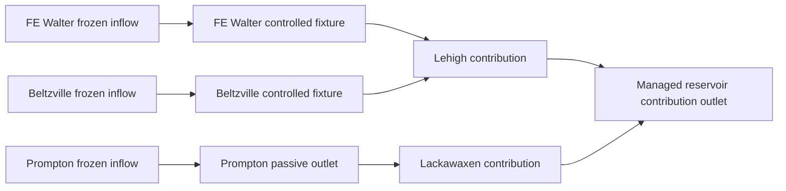

# Daily 多水庫離線測試與真實 LLM 前的驗收

本次 case 為 FE Walter、Beltzville、Prompton，2016-01-01–01-07。使用正式 Demo 凍結的 7／5／3 單元庫入口流量；不重算水文或校正。FE Walter、Beltzville 使用合成給定 actions；Prompton 使用被動出口物理。沒有真實 LLM 呼叫。

## 可重現的 case

資料包為 [cases/fe_belt_prompton_offline](../cases/fe_belt_prompton_offline/case.json)。只收錄 7 天輸入、初始狀態來源紀錄、三庫 stage-storage 曲線、Prompton 出口圖與近似取點、給定 actions 和來源 manifest。原始研究目錄與多年輸出不複製。換地區時提供另一份資料包；`--case-root` 指資料包根目錄，`--project-root` 指安裝 HydroCNHS 的 runtime checkout。

```powershell
python scripts/run_llm_daily.py --case cases/fe_belt_prompton_offline/case.json --responses cases/fe_belt_prompton_offline/responses_baseline.json --output runs/my-offline-baseline
python scripts/verify_offline_run.py runs/my-offline-baseline
```

`runs/my-offline-baseline` 必須尚未存在。CLI 只讀給定回應，不建立 provider、不重試、不隱式 resume。Python package 需安裝，或將 repo 的 `src` 加入 `PYTHONPATH`；HydroCNHS core 須符合 `environment/hydrocnhs-core.json`。

## 責任與資料介面

| 部分 | 責任與單位 |
|---|---|
| 水文 | 提供 daily 自然產流，或使用已驗收凍結流量；不由 LLM 修改校正參數 |
| HydroCNHS routing | 依 DAG 的因果順序路由各庫總出流；UH 權重非負、總和一；分流比例總和一 |
| Controlled backend | `decide(observation)` 提議 `release_cms`；隔離每庫 state、prompt/DKP identity、history；收到唯一實施結果 feedback |
| Passive outlet | `operation_mode=passive_outlet`，程式解 `S1 + Q(S1) × 86400 = S0 + Qin × 86400`，禁止外部 backend；超出已知 rating 範圍直接停止 |
| 水量 kernel | controlled/passive outlet discharge、spill、S0/S1、限制與水量平衡；只把總出流注入一次 |
| Trace／驗收 | 每個 run/reservoir/date/timestep 的因果 IDs、完整原 audit 的 hash 引用、四份 fsync journal；物理 PASS 與策略 audit 分開 |

Case 的 `date,node,local_inflow_cms` 必須是增量入流，不能包含已由上游 edge 加入的流量。庫入口的凍結流量已含上游 routing，這次不再路由同一段。`1 cfs = 0.028316846592 cms`；每日 86,400 秒。不同 case 的節點名稱、數量、位置／CRS、graph、UH、物理設定與 prompt/DKP 是資料設定，不需改通用模組。

Passive rating schema 為 `passive-storage-discharge.v1`，指定嚴格遞增 `storage_m3`、非遞減 `discharge_cms` 和 `provenance`。可在設定內提供，或透過 `passive_outlet_source: {path, sha256}` 載入。可控庫才提供 responses/backend。現有 `controlled_release_cms` 欄位在 passive case 代表物理出口 discharge，並非可操控的閘門指令；provenance 與 raw trace 明確標示 `physical/passive_outlet`。

## 本次物理適用範圍

Prompton 採 USACE 2018 WCM 內 Plate 7-2（1997，PDF 第 187 頁）圖面近似取點，以及 Table 7-2 corrected 2014 stage-storage。取點僅適用 1125–1200 ft NGVD29，不推斷 1125 以下的低流量 weir／48-inch pipe 行為。Rating domain 是計算適用範圍，不能冒充 dead storage 或 spillway；跨域會報錯，並保留失敗 trace。圖面誤差未量化，不稱為已驗證的現行 rating。

三庫初始蓄水採 2015-12-31 USACE UTC 日均值作明列 proxy，並非 2016-01-01 午夜瞬時觀測。FE 既有 capacity／release bounds 保留；Beltzville 的 curve 上端 storage 和 1000 cfs ceiling 僅為離線數值界線，尚非核准操作限制。Prompton capacity 用 1205 ft storage；rating 不涵蓋該容量時不得外插。蒸發、滲漏、湖面直接降雨及引水均為零；bucket 的 capacity overflow 是同日簡化 spill。本次沒有觸發 capacity spill。

## 下游連接與結果範圍



正式資產沒有三庫至共同測站的已驗證 downstream reaches、UH 或完整增量側向入流。Baseline 用透明零延遲 `[1]` 接線；另有一日人工延遲敏感度測試，均非校正河段。出口只表示三庫貢獻，不是完整 Delaware river discharge，也不指定未驗證的測站。河道初始在途水量為零，沒有前期 history/warmup。

FE 在 2016-01-04 的給定 release 增加 5 cms，該日出口增加約 5 cms，FE 蓄水減少 432,000 m³；另外兩庫的天然入流與實施結果不變。真正的串聯庫案例則會改變下一庫的 routed inflow，合成串聯 regression 另行驗證。

## 測試與驗收矩陣

| 檢查 | 已執行或前置條件 |
|---|---|
| 原有單庫、adapter、DKP audit、trace、native 多庫 | regression 保留；不重播多年實驗 |
| Passive solver | 線性 rating 解析解、乾庫、capacity spill、非單調／非有限輸入、上下 rating domain 停止 |
| 離線三庫 7 天 | Baseline、FE pulse、人工延遲，各 21 reservoir-days；native 與獨立卷積一致 |
| 全系統水量 | 除庫容變化外，逐日追蹤每條 edge 的已進入、已到達、尚在途水量；窗口尾端留在 channel storage |
| 通用區域／庫數 | 1／3／10 庫、改名、另一地區 CRS/location、外部 case-root、全 passive、混合 passive/controlled、branch/cascade/split/rejoin |
| 隔離／輸入 | shared backend 拒絕；缺日、重複日、負值、錯 units、未知節點、cycle、fraction/UH 不守恆、checksum mismatch 拒絕 |
| Audit／trace | 原 FAIL／WARN 保留、無 auditor 為 UNKNOWN、原 payload 留存；檔案毀損及語意毀損由獨立 verifier 拒絕 |
| 失敗處理 | backend、feedback、fsync／metadata write 失敗保留證據後停止；不補零、不重試已完成日期 |
| 真實 LLM | 未執行；先完成下列資料與實驗設計條件 |

## 真實 LLM 前仍需完成

1. 每個新 case 先確認位置、datum、單位、實體拓樸、完整增量產流覆蓋、downstream reach 參數、側向入流去重與 routing warmup。Urban 模型只替換自然產流資料或經驗收的 hydrology adapter，沿用相同 daily reservoir/routing contract。
2. 確認現行完整 passive rating、可控庫出口與季節操作界線、損失項和瞬時初始蓄水。近似曲線與數值 test ceilings 不直接成為操作依據。
3. 每庫指定 prompt/version、DKP IDs/hashes、parser/auditor version、目標、可用 forecast 時點及來源。當日全日入流是歷史模擬 forcing，不能宣稱操作開始時已知。Run 中途換 prompt／DKP 需另做版本切換與 resume 設計。
4. 先比較 given-actions 與 offline mock 的同一物理結果，再設計獨立或 joint controller。現有版本完成物理聯動，尚未實作 joint LLM controller／跨庫協商。
5. 決定 provider/model、temperature 0.7、允許 controlled reservoirs 清單、請求／重試額度、timeout、失敗隔離與停止條件。基礎請求數依 `daily days × controlled reservoirs` 計算，Prompton 不呼叫；未知成本保留未知，不靠改 session 重設。
6. 短 pilot 前固定策略指標與門檻：季節 target、最低 release 缺口、越界 request、spill、下游洪峰、audit 狀態；分開判定 execution、物理與策略驗收。上述 `live_readiness` 目前明列 false，沒有自動啟動機制。

完整數據與驗收參見 [離線結果](../results/three_reservoir_offline/RESULTS.md)。原 FE 五年 audit 711 FAIL 的診斷結論保持不變。
