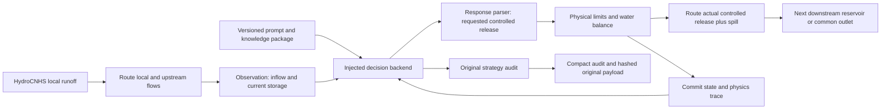

# Reservoir policies, prompts and networks

The public package is `llm_reservoir_agent`. Existing author-specific source and
the old package remain frozen reproducibility dependencies. The checkout's
historical path remains stable; new callers import the neutral package.

Each case owns its reservoir locations, river nodes, input sources, physical
parameters and policy specifications. Runtime code has no geographic routing
assumptions. Coordinates carry a case-defined CRS; links and travel times are
explicit, never inferred from geographic distance. `location`, `context` and
`policy_spec` are per-reservoir mappings; `case_id` and `node_locations` identify
the case and routing nodes. Location and case context reach each backend's
observation while host identity and loss assumptions remain protected.

Case/data bundles may live outside the runtime checkout: use `--case-root` for
the bundle root and `--project-root` for the pinned runtime checkout. Relative
network CSV and knowledge-package paths resolve from the case file; references
must remain within the specified bundle. A long daily inflow CSV has
`date,node,local_inflow_cms` columns and the format `daily-node-local-cms.v1`.
`inflow_source` declares its path, SHA256 and format; `knowledge_packages` maps
IDs to document paths and SHA256. The loader verifies both before execution.
Inline daily inflows are allowed only for explicitly synthetic fixtures.
Supplied knowledge content is model context, not execution instructions.

## Boundaries and daily causality

HydroCNHS owns catchment hydrology and channel routing. These short tests supply
fixed **local incremental** natural inflows instead of rerunning GWLF. The
network routes upstream implemented controlled release plus spill, then adds
the downstream node's local inflow. Supplying already routed total downstream
inflow as local inflow would double count water and is outside this contract.

Each reservoir has its own physical configuration, storage, backend and trace
identity. `LLMReservoirAgent.act()` returns total outflow once per timestep;
HydroCNHS injects it once. The kernel enforces available water, dead storage,
controlled-release bounds and capacity spill. In m³ and m³/s:

`S_end = S_start + (Q_in - Q_controlled - Q_spill) * 86400`

The current kernel assumes zero evaporation, seepage and other losses. It uses
same-day capacity spill rather than an outlet rating curve. Physical validation
and a reported strategy-audit failure are distinct outcomes.

Physical records are flushed and fsynced before backend feedback. Decision or
feedback failures stop execution with no implicit retry. A failed feedback still
leaves that reservoir's completed physical record available. A partially
completed network day is explicitly represented by per-reservoir progress.
Output directories are exclusive; this new runner has no resume facility.
Backends receive detached observations; the journal retains the original host
snapshot even if a backend mutates its input. Wrappers declare their immediate
`state_owner` and optional multiple `state_owners`; both execution entrypoints
reject shared backend or auditor objects before constructing a model or creating outputs.

## Interchangeable policy design

`PromptSpec` identifies a strategy, version and template SHA256, plus knowledge
package IDs and content hashes. `PromptStrategy.build(observation)` produces a
`PromptRequest` with messages and metadata. `ResponseParser.parse(response)`
produces the strict release action. `Auditor.audit(...)` returns its original
audit mapping. These are protocols for supplied implementations; constructing
a provider or selecting its model/temperature belongs to the backend.

Knowledge packages may be DKP documents or other explicitly identified local
sources. A change to the prompt, knowledge document, parser or audit rubric gets
its own identity/version. Changing prompt text must not change physics or
silently replace the original DKP auditor. `DKPPolicyAdapter` preserves the
V3.7 policy's emitted audit and single original log call through composition;
it does not recalculate or reinterpret whether the policy passed its rules.

Backends expose `describe()` or `provenance` containing prompt_strategy_id,
prompt_version, prompt_sha256, knowledge_package_ids, knowledge_package_sha256,
response_parser_id and auditor_id. Missing values stay null. These identities
are saved per decision; request IDs are recorded only when supplied, and absent
network counters remain unknown. The offline response CLI explicitly reports
zero network calls, while response provenance labels supplied data without
claiming it was generated by a live model.

The current runner snapshots provenance at start; one backend uses one strategy
identity per run. A dynamically changing prompt strategy requires a separate
per-decision metadata implementation before it is supported.

`AuditedBackend` composes reservoir-local `AuditPlugin` instances with versioned
`AuditSpec` rubrics around any supplied backend. The original emitted audit is
preserved, and every enabled check participates in conservative aggregation.
Rules and provenance are pinned; changing them requires a separate experiment.
Decision/input bindings, component evidence and failure records are independently
checkable. Legacy records remain unchanged. See [auditor plugins](auditor_plugins.md)
for the API, aggregation, ownership and verification limits.

## Network input contract

`llm-reservoir-network.v1` includes `start_date`, `reservoirs`, `connections`,
optional `junctions` and a common `outlet`. Each reservoir entry defines one
`inflow_node` and a `physical` mapping. Every day supplies
`{"date": "YYYY-MM-DD", "local_inflow_cms": {"I1": 10, "I2": 1, "Outlet": 0}}`.
All routing nodes must be explicit, including zero-flow nodes. Links form a DAG;
outgoing fractions sum to one. Duplicate links, cycles and shared stateful
backend/policy instances are rejected before any decisions.

Each connection specifies source, target, fraction and a nonnegative discrete
unit hydrograph whose weights sum to one. `[1]` is same-day identity routing;
`[0, 1]` delays the upstream contribution by one day. The pinned HydroCNHS core
requires an internal trailing-zero sentinel, which the adapter adds. Every
node is checked against an independent convolution. Water remaining in delayed
channels beyond the final day is not exported as reservoir storage or included
in a claimed whole-network storage balance.

Native identifiers use equal-length internal aliases to avoid the pinned core's
substring-based catchment-name check (`I1` versus `I10`). Public names, reservoir
IDs and alias mapping remain visible in outputs. The accepted core is unchanged.
Zero-local-flow routing relays preserve split fractions and travel times while
avoiding the core's direct catchment-parent restriction. For split/rejoin graphs,
its parser may repeat upstream nodes. The adapter verifies the complete node set
and uses a validated topological order for that diagnosed duplication before
any policy call. Original sequence, normalization flag and relays are reported.

## Trace and audit contract

- `decisions.jsonl`: normalized observations/actions and prompt provenance.
- `physics.jsonl`: implemented release, spill, storage, balance and adjustments.
- `audit.jsonl`: original reported status, reasons, citations/hits and raw hash reference.
- `backend_events.jsonl`: decision/feedback lifecycle with causal IDs and errors.
- `raw/`: complete original audit and explicitly supplied raw reply payloads.
- `experiment.json`, `progress.json`, `summary.json`: input/runtime/implementation
  hashes, per-reservoir progress, durable counts and output hashes.
- `reservoir_trajectory.csv`, `network_flows.csv`: physical trajectories and local/routed flows.

Each event has run_id, reservoir_id, timestep, timestamp and decision_id. A local
decision_id is not a fabricated provider request ID. Original audit PASS/WARN/FAIL
is retained; a missing audit is UNKNOWN. COMPLETE execution cannot certify a
strategy. An I/O failure propagates and distinguishes observed complete rows
from fsync-confirmed durable rows.

## Three real reservoirs and joint policies

FE Walter, Beltzville and Prompton are branch reservoirs, not a three-dam
cascade. The synthetic cascade verifies downstream **reservoir** inflow changes;
the branch fixture verifies a shared downstream confluence. These fixtures are
not a completed real three-reservoir model or an accepted operating experiment.
Real links, incremental inflows and travel-time parameters must be assembled
from the existing accepted basin model. Prompton needs passive ungated outlet
hydraulics; giving it unrestricted controlled LLM release would be hypothetical.

The implemented network uses separate decision backends coupled through physics
and routing. A future joint LLM controller needs a versioned network observation,
causal timing/forecast rules and a complete reservoir-action batch. It should
own shared planning history while per-reservoir adapters own physical state;
the current isolation rule must be extended explicitly for this coordinator.
This proposed joint strategy is separate from today's connected-network tests.
