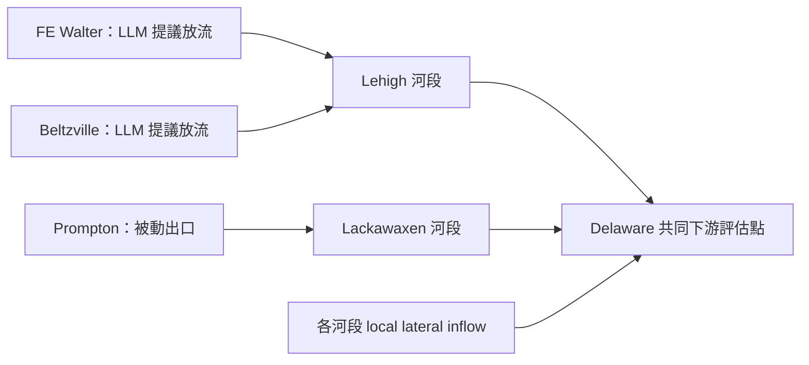

# FE Walter／Beltzville／Prompton daily 聯測計畫

已完成三庫 2016-01-01–01-07 離線接線、被動出口及水量驗收；使用凍結入流與合成 actions。下游只表示三庫放流貢獻；現有來源未提供校正的共同測站 reaches／側向入流。完整實作、限制與真實 LLM 前的測試條件見 [離線驗收與後續規劃](offline_pre_live_acceptance.md)。共同 LLM controller 與 urban 水文尚未執行。既有參數、C&V、凍結入流與五年 FE Walter 結果保留不變。

## 河網與決策範圍



圖為連接關係；共同評估點、河段分段、local lateral 節點與旅行時間須由 case 的 GIS／routing 資料定義。FE Walter、Beltzville 位於 Lehigh 支流，Prompton 位於 Lackawaxen 支流。改變某库放流會改變它的下游與共同評估點；在此拓樸下，其餘兩庫的自然入流不會因此改變。合成串聯測試中「下一庫入流改變」的結果僅適用有上游水庫的河網。

第一版用兩個獨立 LLM backend 控制 FE Walter、Beltzville，由 HydroCNHS 河網完成物理連動。Prompton 為 ungated outlet，需 `Q_out = f(storage, elevation, outlet geometry)` 的被動物理模型；不給 LLM 任意 release 權限。各水庫的 state 與歷史不可共用。

共同決策是後續比較組：另行實作 controller，同時取得兩個可控水庫與下游目標、一次產生可對應各 reservoir ID 的 action。它與目前獨立 backend 是不同決策設計，不能將現有技術驗收稱為共同決策已完成。

## 現有資料與待補項目

資料來源是正式 Demo [commit 8d59dcac2f9d06fe16030f68826b425d492c9529](https://github.com/WenyuChiou/HydroCNHS-Delaware-Demo/tree/8d59dcac2f9d06fe16030f68826b425d492c9529)，以下路徑相對於其 `results/current/four_reservoir_hydrocnhs_native/`。本 repo 沒有複製整個 Demo。

| 資料 | 狀態與用途 |
|---|---|
| `tables/daily_simulated_reservoir_inflow_1991_2025.csv.gz` | FE Walter 7、Beltzville 5、Prompton 3 個上游單元；2016–2020 各 1,827 天完整。取既有值，不重算水文 |
| `models/fe_walter.yaml`、`beltzville.yaml`、`prompton.yaml` | 保留已接受 GWLF／Lohmann 參數與初始水文狀態；目前是各庫上游 aggregation model |
| `tables/routing_parameters.csv` | 已接受的庫上游 routing；不直接宣稱是庫以下河段的已驗證參數 |
| `inputs/model_subbasin_inputs.csv`、`gis/four_reservoir_semidistributed.gpkg`、`gis/DATA_DICTIONARY.csv` | 位置、單元與河網來源；匯入前對照最终 model IDs／版本，不能只憑座標推導連接 |
| `sources/usace_storage_daily.csv.gz` | 有三庫蓄水觀測，但資料為 UTC 日均值、有缺日；不能當成起始瞬時蓄水或物理容量 |
| 既有 WCM／stage-storage 診斷成果 | 需逐庫核對版本、datum、單位與適用期。Prompton 2013／2014 曲線差異須保留；stage-storage 不等於 outlet rating |
| 庫以下河段 UH、local lateral inflow、共同評估點 | 尚未組成並驗收真實聯合 case；先核對覆蓋範圍與 source manifest |
| Prompton passive outlet／spillway rating | 目前 HydroCNHS hydrology YAML 的 ABM 為空，沒有這項物理；需整理既有官方來源與實作驗收 |
| FE Walter／Beltzville outlet capacity、季節目標、損失項與初始蓄水 | 分別建立有來源的操作設定；水文校正不能證明操作參數正確 |

凍結入流檔 SHA256：`3b7fe10f96c6148248f9f0ddc221e66a0d7b39faaab81c302e2881642c7b00b8`；原始 CSV header 為 `date,reservoir,simulated_inflow_cfs,upstream_subbasin_count,model`，FE Walter／Beltzville／Prompton 2016–2020 的 logical lines 分別是 21917–23743／9133–10959／34701–36527。

蓄水觀測檔 SHA256：`4bc50a9fe0e5105982b5db6b1c19d38c28a46494ce2ffaac74692b2b9cc763ab`。Prompton 2015-12-31 的 3,809.33 acre-feet 是日均觀測，可作有標記的近似初始狀態候選；精確 S0 需要起始時刻的瞬時資料與日期／時區對齊。原五年 FE Walter 的 1992.61 acre-feet 假設不改寫，真實聯測若採不同初始狀態另建 case version。

## 通用 case 與資料介面

每個實驗自有資料包，位置以 `--case-root` 指定；runtime 以 `--project-root` 指定。水庫名稱與地理位置只放在 case，通用 package 不綁定本流域。

```text
cases/<case_id>/
  case.json                 # version、period、CRS、nodes、edges、reservoirs、outlet
  inputs/local_inflow.csv    # date,node,local_inflow_cms + SHA256
  knowledge/<reservoir_id>/  # 有版本與雜湊的 DKP／規則
  responses/                # 第一階段的給定離線 actions
  source_manifest.json      # 原始來源、日期、單位、處理方式與假設
```

`case.json` 用現有 network case schema；具體欄位以 [case loader](../src/llm_reservoir_agent/case.py)、[三庫離線資料包](../cases/fe_belt_prompton_offline/case.json) 為準。被動出口 schema 與來源／適用範圍見 [離線驗收](offline_pre_live_acceptance.md)。

每庫設定 reservoir ID、inflow／outlet node、location／CRS、初始 storage、physical limits、backend identity、prompt template/version、DKP hashes 與 audit version。不同 prompt／DKP 各自在啟動時固定；現有介面支援不同實驗／水庫的策略，run 中途動態換 prompt 尚未支援。

凍結 reservoir inflow 已經過其上游 Lohmann routing，把它作為庫入口的外部入流，不再通過同一段上游 UH。庫以下 routing 使用另外明確標記的 reaches。Mainstem local lateral inflow 必須是增量、排除已計入三庫的集水區；不能把包含上游貢獻的 gauge total flow 當成 local flow 再加一次。所有輸入嚴格對齊日期；`1 cfs = 0.028316846592 m³/s`，每日秒數 86,400。

## 分工與輸出

| 部分 | 責任 |
|---|---|
| HydroCNHS | 自然產流／既有凍結入流、河網順序、UH routing、支流合流與下游流量 |
| LLM／prompt／DKP | 依當日可取得 observation 提議 controlled release，保留理由及原 audit；不自行更新物理 storage |
| 水庫物理程式 | 可用水量與容量／出口限制、被動放流、spill、storage 更新、水量平衡；實施放流可能與 LLM request 不同 |
| Host／trace | 每日每庫只注入一次 controlled release＋spill，保存來源與程式 hashes、causal IDs 及執行狀態 |

通用物理核仍為 daily、零蒸發／滲漏 bucket；新增 monotone storage-discharge 的被動 outlet solver、逐 reach 在途水量與全系統 balance。Prompton 圖面 rating 近似及人工 transfer UH 只用於離線技術驗收，不能冒充已驗證水壩操作或校正河道 hydraulics。

沿用 `decisions.jsonl`、`physics.jsonl`、`audit.jsonl`、`backend_events.jsonl`，每筆包含 case／run／reservoir／date／timestep／causal reference。Raw reply／audit payload 用 hash 引用放在 `raw/`，便於查閱且保留完整稽核。保存 requested、controlled、spill、total、S_start／S_end、限制、residual、routed inflow／outlet；FAIL 保留 FAIL，缺少 auditor 為 UNKNOWN。Backend 或 feedback 錯誤保留已完成的物理紀錄後停止，不暗中降級、補零或重試。

## 建議執行順序與驗收

| 步驟 | 執行範圍 | 完成條件 |
|---|---|---|
| 1. 組裝資料 | 三庫各 1,827 天來源清單、河網、物理與 DKP；不跑 LLM | 無日期缺漏／重複，IDs／CRS／units 一致，source hashes 可核對；缺漏物理與下游資料先明列 |
| 2. 離線聯測 | 暫定 2016-01-01–01-07；给定 actions，Prompton passive | 各庫因果連續、上下限及水量平衡通過，routing 獨立卷積一致，spill 注入一次；完整 trace 與原 audit 可追溯 |
| 3. 影響檢查 | 同一輸入／初始状态，僅改 FE Walter 或 Beltzville 的給定 request | 該庫蓄水與其 downstream flow 改變；另外兩庫自然入流維持原值，出口變化遵守 UH 延遲與增量水量守恆 |
| 4. 真實 LLM pilot | 下一次另行核准後，暫定 2016-01-01–01-30 daily，temperature 0.7 | 獨立兩 backend，基礎 60 次請求，重試另計並先明定上限；技術驗收與策略 audit 分開，冬季短窗不代表全年表現 |
| 5. 延長與決策比較 | Pilot 後才決定五年及 independent／joint controller 比較 | 相同自然入流、物理、初始狀態與目標；另有執行預算、失敗處理與 resume 驗收。五年獨立雙 LLM 的基礎請求量為 3,654 次，Prompton 不呼叫 LLM |

Routing 檢查使用配置 UH 的獨立卷積，逐節點比對 native routed flow。對遲滯河段保存／核對尚在傳輸的水量，不能只用同日輸入减輸出判斷總系統水量平衡。物理容許誤差先採目前介面 `1e-6 m³ + 1e-12 * volume_scale`，若新 kernel 需要不同數值容許範圍，須在跑模型前記錄原因與測試。

策略另評估季節目標偏差與達成日數、最低放流缺口、越界 request／實施量、spill、共同下游洪峰與限制違反、各庫水量分配，以及 audit PASS／WARN／FAIL／UNKNOWN。先固定目標與門檻，再比較結果；技術 PASS 不改寫策略 FAIL。原五年實驗僅作有明確初始狀態、prompt 與 routing 差異的診斷參照。

離線 steps 1–3 已完成限定範圍測試；尚缺校正下游與完整操作物理資料，詳見 [真實 LLM 前的條件](offline_pre_live_acceptance.md)。Pilot 尚未啟動。
