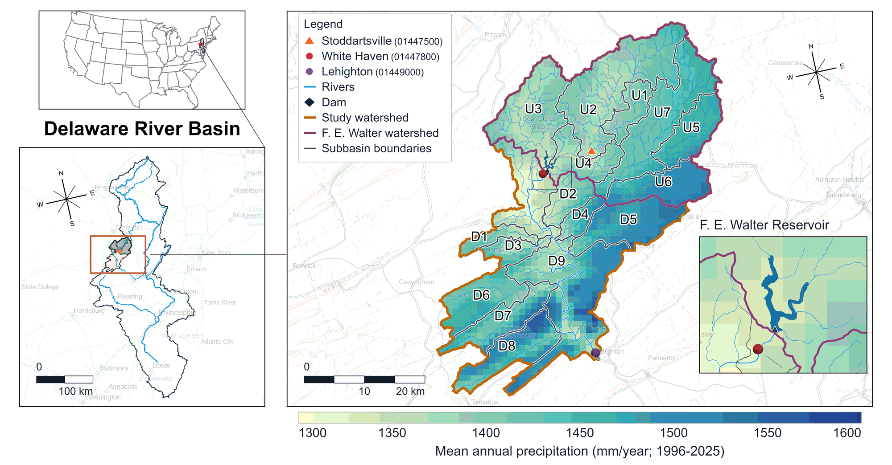
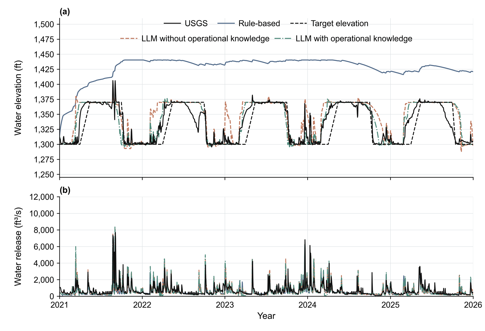
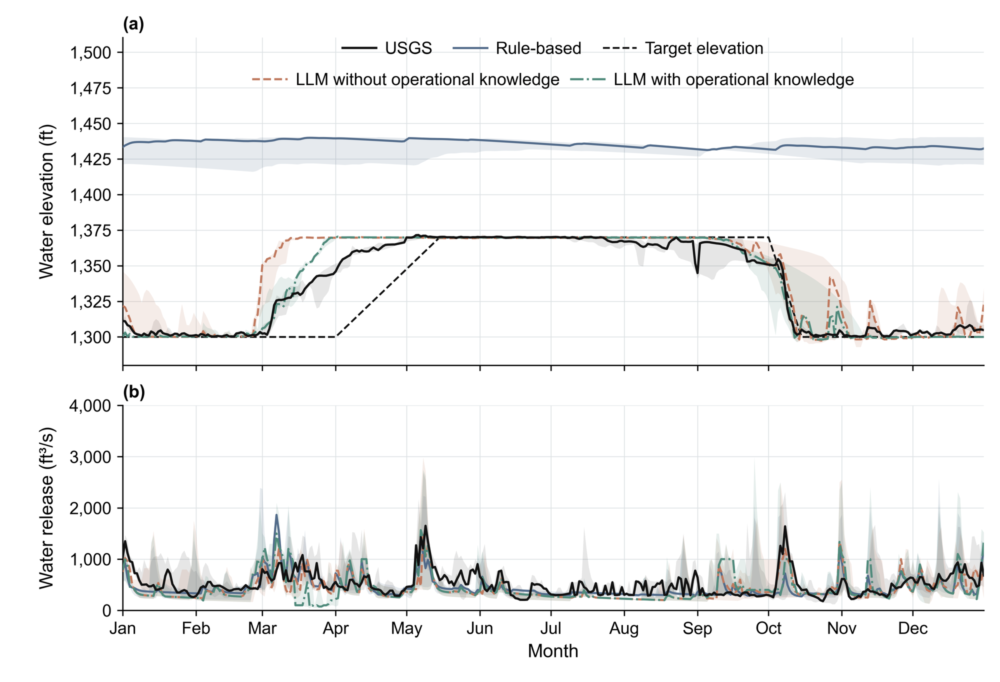

# F.E. Walter Dam case study

<div class="hero-band" markdown="1">

This benchmark evaluates **F.E. Walter Dam** (Lehigh River basin, Pennsylvania) over **January 1, 2021 – December 31, 2025** (`1,826` daily steps) under three operating paradigms on the same HydroCNHS physical and downstream routing system: the deterministic **Hanasaki** rule, an LLM **Without operational knowledge** (Seasonal Target), and an LLM **With operational knowledge** (Decision Knowledge Package, DKP).

</div>

## Study area and benchmark design

<figure class="figure-card">
  
  <figcaption><strong>Figure 2.</strong> F.E. Walter Dam study basin and downstream routing network connecting reservoir outflow to USGS <code>01447800</code> (White Haven near-dam proxy) and USGS <code>01449000</code> (Lehighton downstream gauge).</figcaption>
</figure>

<div class="panel-grid panel-grid-3" markdown="1">
<div class="panel-card" markdown="1">

### Condition 1: Rule-based (Hanasaki)

- **Config**: [`rule_based.yaml`](rule_based.yaml)
- **Operator**: `strategy: hanasaki` (`HanasakiBackend`, α = 0.85) with [1996–2015 inflow statistics](rule_statistics.json) and [rule case](rule_case.json).
- **Network calls**: `0` (offline deterministic rule).

</div>
<div class="panel-card" markdown="1">

### Condition 2: Seasonal Target (No DKP)

- **Config**: [`seasonal_target.yaml`](seasonal_target.yaml)
- **Operator**: `gemma4:12b` (`study_method: seasonal_target`) using only elevation–storage state, seasonal pool target, and 2-step feedback.
- **Prompts**: [System](prompts/seasonal_target.system.txt) · [Day 1 User](prompts/seasonal_target.user.txt).

</div>
<div class="panel-card" markdown="1">

### Condition 3: Decision Knowledge Package (DKP)

- **Config**: [`dkp.yaml`](dkp.yaml)
- **Operator**: `gemma4:12b` (`study_method: dkp`) retrieving structured rules from [`dkp.md`](dkp.md) and citing `rules_applied` in JSON.
- **Prompts**: [System](prompts/dkp.system.txt) · [Day 1 User](prompts/dkp.user.txt).

</div>
</div>

## Configuration files and prompt inspection

All three configurations share the 2021–2025 simulated local inflows ([`inflows.csv`](inflows.csv)) and start on a 7-day tutorial window (`2021-01-01` to `2021-01-07`) before scaling to `--full` (`1,826` days). Both LLM conditions share [`case.json`](case.json), [`study/elevation_storage.csv`](study/elevation_storage.csv), [`study/response_schemas.json`](study/response_schemas.json), and [`study/formatter.py`](study/formatter.py), which renders each day's pool level (`ft NGVD29`), inflow (`cfs`), and two prior committed transitions.

Check all three configurations offline (`0` calls) with:

```sh
reservoir-experiment check examples/fe_walter/rule_based.yaml
reservoir-experiment check examples/fe_walter/seasonal_target.yaml
reservoir-experiment check examples/fe_walter/dkp.yaml
```

For an interactive step-by-step walkthrough of prompt design, unit conversion, and the 7-day baseline run, see the [F.E. Walter tutorial](../../tutorials/README.md) and [Operator & LLM agent design](../../docs/AGENT_DESIGN.md).

## Daily and seasonal performance (2021–2025)

<figure class="figure-card">
  
  <figcaption><strong>Figure 3.</strong> Daily 2021–2025 trajectories comparing USGS observations against the deterministic Hanasaki baseline, Without operational knowledge (Seasonal Target), and With operational knowledge (DKP) across 10 seeds.</figcaption>
</figure>

<figure class="figure-card">
  
  <figcaption><strong>Figure 4.</strong> Multi-year annual cycle across the three study conditions, showing how DKP operational rules recover seasonal storage transitions (spring refill to 1,370 ft NGVD29 and autumn drawdown to 1,300 ft NGVD29) relative to unguided or rule-only baselines.</figcaption>
</figure>

Across all 21 archived runs (`1` Hanasaki + `10` Seasonal Target seeds + `10` DKP seeds) evaluated against USGS gauges (`01447780` reservoir level, `01447800` near-dam release proxy, `01449000` Lehighton downstream flow; exact per-run targets in [`study/expected_scores.csv`](study/expected_scores.csv)):

| Condition | Runs | Reservoir level KGE (median) | Reservoir level NSE (median) | Reservoir level RMSE (median) | Water release KGE (median) | Downstream flow KGE (median) |
| --- | --- | --- | --- | --- | --- | --- |
| Rule-based (Hanasaki, α = 0.85) | `1` | `0.077` | — | `96.21 ft` | `0.640` | `0.815` |
| Without operational knowledge (Seasonal Target) | `10` | `0.806` | `0.514` | `20.85 ft` | `0.688` | `0.830` |
| With operational knowledge (DKP) | `10` | `0.858` | `0.711` | `16.07 ft` | `0.618` | `0.832` |

## Reproduce the reported scores offline

Replay all 21 archived daily release series (`study/archived_releases.csv` + Hanasaki baseline) through the host physics and routing engine at **zero** model calls and verify exact KGE and RMSE parity:

```sh
python examples/fe_walter/study/replay.py --output runs/walter-paper-replay
```

Inspect `runs/walter-paper-replay/scores.csv` for all 63 `(condition, seed, quantity)` evaluations and `water_level_medians` printed to stdout.

## Make new runs with the study model

Live LLM reproduction uses **Ollama 0.40.6** and verifies the pinned `gemma4:12b` manifest ([`study/ollama-manifest.json`](study/ollama-manifest.json), ~7.6 GB download) before and after inference ([`study/model.py`](study/model.py), [`study/run.py`](study/run.py)):

```sh
python examples/fe_walter/study/model.py .walter-ollama
```

Start the dedicated Ollama server in a separate terminal:

<div class="panel-grid panel-grid-2" markdown="1">
<div class="panel-card" markdown="1">

### Windows PowerShell

```powershell
$env:OLLAMA_MODELS = (Resolve-Path .walter-ollama).Path
$env:OLLAMA_HOST = "127.0.0.1:11446"
ollama serve
```

</div>
<div class="panel-card" markdown="1">

### macOS or Linux

```sh
OLLAMA_MODELS="$PWD/.walter-ollama" OLLAMA_HOST=127.0.0.1:11446 ollama serve
```

</div>
</div>

Run the 7-day tutorial window first or pass `--full` for all `1,826` days (use a fresh `--output` for each `--seed 1..10`):

```sh
python examples/fe_walter/study/run.py rule_based --full --output runs/walter-rule
python examples/fe_walter/study/run.py seasonal_target --full --seed 3 --ollama-port 11446 --output runs/walter-without-s3 --allow-network
python examples/fe_walter/study/run.py dkp --full --seed 3 --ollama-port 11446 --output runs/walter-with-s3 --allow-network
```

Because GPU/CPU floating-point inference varies across platforms, use the offline `replay.py` workflow above to reproduce the published scores bit-for-bit. Inspect outputs with [Read your results](../../docs/RESULTS_GUIDE.md).
