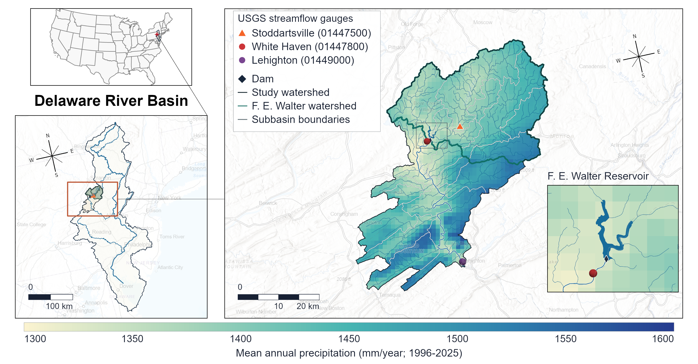
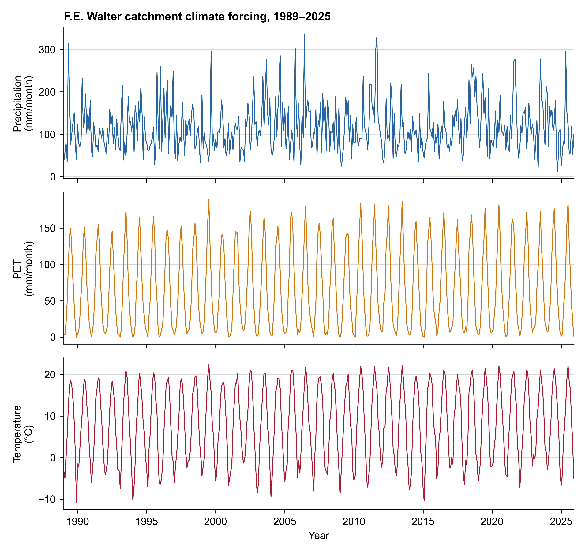

# F.E. Walter Reservoir research example

[English](README.md) | [繁體中文](README.zh-TW.md)

This case connects accepted HydroCNHS hydrology to one controlled reservoir and
compares **Rule-based**, **LLM without additional operating knowledge**, and **LLM with additional operating knowledge** decisions. Start with the [maintained tutorial](../../tutorials/README.md).

## Site and study scope

F.E. Walter Dam is near White Haven, Pennsylvania, at the confluence of the
Lehigh River and Bear Creek. The U.S. Army Corps of Engineers operates it for
flood-risk management and recreation, with seasonal releases that can also
support downstream boating and fishing [[1]](#fe-walter-ref-1).

The study area includes both downstream gauges, White Haven and Lehighton. The [existing downstream comparison](downstream/README.md) evaluates White Haven; the extension to Lehighton is being designed.

Map downloads: [PDF](../../docs/figures/fe-walter-catchment.pdf), [SVG](../../docs/figures/fe-walter-catchment.svg), and [editable ArcGIS project](../../data/figures/manual_map/fe-walter-arcgis-source.zip).

```{figure-md} fe-walter-study-area
:class: study-area-figure



**Figure 1. Study area in the Lehigh River basin, Pennsylvania, USA.** The study
watershed (black outline) drains to the USGS streamflow gauge at Lehighton (01449000).
Within it, the F. E. Walter watershed (teal outline) drains to F. E. Walter Dam. The
part of the study watershed outside the F. E. Walter watershed contributes runoff to the
Lehigh River and its tributaries between the dam and Lehighton. Stoddartsville
(01447500) is upstream of the reservoir; White Haven (01447800) is downstream of the
dam. The inset shows the reservoir, dam, and White Haven gauge. Internal boundaries
delineate subbasins. Shading shows Daymet [[2]](#fe-walter-ref-2) mean annual
precipitation for 1996–2025 (mm/year).[^map-sources]
```

[^map-sources]: Esri, CGIAR, USGS, data.pa.gov, TomTom, Garmin, SafeGraph,
    METI/NASA, EPA, NPS, USDA, USFWS, New Jersey Office of GIS, FAO, and NOAA.

## Climate and hydrology

The accepted forcing contains daily precipitation, temperature, and PET for
seven contributing units from 1989 through 2025. Precipitation and minimum and
maximum temperature come from Daymet V4 R1 [[2]](#fe-walter-ref-2); nClimGrid-Daily fills
the documented December 31 entries in leap years [[3]](#fe-walter-ref-3). The chart sums
area-weighted daily precipitation and saved PET within each month and averages
area-weighted daily mean temperature. This is display aggregation only: saved
PET is converted from cm to mm, without recalculation or weather resampling.

HydroCNHS computes daily Hamon PET as implemented in the native source
[[4]](#fe-walter-ref-4):

$$
\mathrm{PET}=\left(\frac{D}{12}\right)^2\exp\left(\frac{T}{16}\right)
\quad \text{mm day}^{-1},
$$

where $D$ is daylight duration (hours), calculated from latitude and day of year,
and $T$ is daily mean
temperature (°C); the implementation sets PET to zero when $T\leq0$ °C and
stores the result in cm/day. PET drives the catchment runoff model together with
precipitation and temperature. It is not subtracted as direct reservoir
evaporation in this case, whose reservoir losses are set to zero.

The seven units total 750.811 km². Calibration fits hydrological
parameters against observed flow, whereas validation freezes those parameters
and evaluates a separate period. Here, 1990–2010 is the calibration period and
2011–2020 is the validation period at USGS 01447500 [[5]](#fe-walter-ref-5). That gauge
covers two units; the other five are not independently gauge-validated. See
[hydrology, parameters, and calibration/validation](hydrology.md) for periods,
metrics, parameters, and the 2021–2025 simulation using those same parameters.

Downloads: [monthly CSV](hydrology_data/climate/fe_walter_climate_monthly_1989_2025.csv),
[source and aggregation record](hydrology_data/climate/provenance.json),
[SVG](hydrology_data/climate/fe_walter_climate_1989_2025.svg) and
[PDF](hydrology_data/climate/fe_walter_climate_1989_2025.pdf).

```{figure-md} fe-walter-climate-forcing
:class: climate-figure



**Figure 2.** Area-weighted monthly climate inputs, 1989–2025. Precipitation and
PET are monthly totals (mm/month); temperature is the monthly mean (°C).
```

## Reservoir experiment

The operation experiment selects 2016 inflow from the accepted continuous
hydrology. Changing the operator does not change or recalibrate hydrology. For a
daily interval, shared physics applies

$$
S_{t+1}=S_t+\left(Q_{\mathrm{in},t}-Q_{\mathrm{rel},t}-Q_{\mathrm{spill},t}\right)\Delta t,
$$

where $S$ is storage (m³), $Q_{\mathrm{in}}$ is hydrological inflow,
$Q_{\mathrm{rel}}$ is implemented controlled release, $Q_{\mathrm{spill}}$ is
spill (all m³/s), and $\Delta t=86{,}400$ s. Direct precipitation, reservoir
evaporation, seepage, and withdrawals are zero in this reduced case. The operator
proposes release; common physics enforces feasibility, updates storage and spill,
and routes total outflow with `UH=[1.0]`.

The methods share hydrology and reservoir physics. The rule method receives
registered rule parameters and inflow statistics; the available-information LLM
receives the daily state, seasonal instructions, and short history; the retrieved-
knowledge LLM receives those inputs plus selected local guidance. The
[versioned seasonal criteria](seasonal_pool_criteria.json) are study settings,
not an official annual schedule. Saved results still use the previous prompts;
see [results](results.md) and the separate [prompt review](prompt_review.md).

## Seasonal pool levels

The study uses a winter target of 1300 ft, checked within 1297–1303 ft on
November 1–March 14. The summer upper limit is 1370 ft on May 10–October 14;
it is not a fixed summer level or a lower bound. The remaining transition
windows are defined in [seasonal_pool_criteria.json](seasonal_pool_criteria.json).
These criteria record operating performance; they do not change model decisions.

## References

(fe-walter-ref-1)=
[1] U.S. Army Corps of Engineers, Philadelphia District.
[Francis E. Walter Dam](https://www.nap.usace.army.mil/Missions/Civil-Works/Francis-E-Walter-Dam/).

(fe-walter-ref-2)=
[2] Thornton, M. M., et al. (2022).
[Daymet: Daily Surface Weather Data on a 1-km Grid for North America, Version 4 R1](https://doi.org/10.3334/ORNLDAAC/2129).

(fe-walter-ref-3)=
[3] NOAA National Centers for Environmental Information.
[nClimGrid-Daily](https://www.ncei.noaa.gov/products/land-based-station/nclimgrid-daily).

(fe-walter-ref-4)=
[4] HydroCNHS.
[Native Hamon PET implementation](../../src/hydrocnhs/rainfall_runoff_model/pet_hamon.py),
following Hamon (1961), [*Estimating Potential Evapotranspiration*](https://doi.org/10.1061/JYCEAJ.0000599).

(fe-walter-ref-5)=
[5] U.S. Geological Survey.
[USGS 01447500, Lehigh River at Stoddartsville, Pennsylvania](https://waterdata.usgs.gov/monitoring-location/USGS-01447500/).
