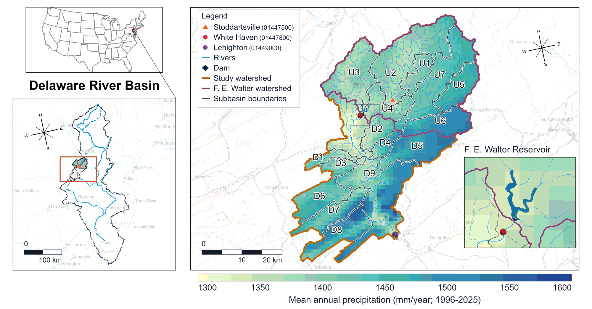
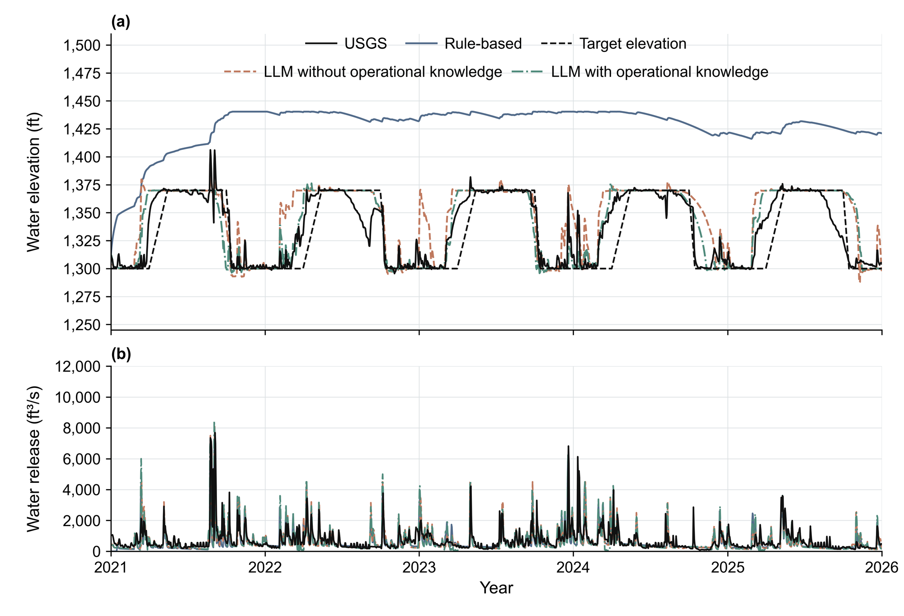
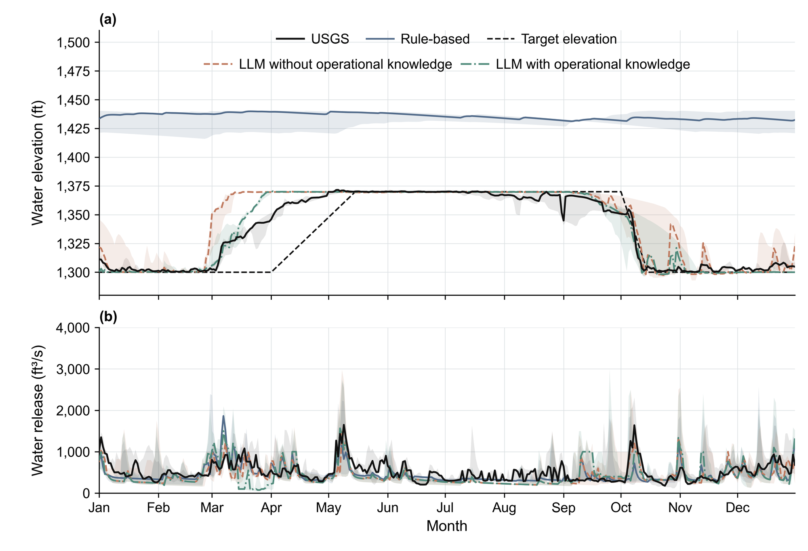

# F.E. Walter 水库案例

<div class="hero-band" markdown="1">

本基准测试于 **2021 年 1 月 1 日 – 2025 年 12 月 31 日**在相同的 HydroCNHS 演进系统上评估 **F.E. Walter Dam**（宾夕法尼亚州 Lehigh River 流域）的三种操作条件：**Rule-based（Hanasaki 规则）**、**Without operational knowledge（无操作知识）** 与 **With operational knowledge（具操作知识）**。

</div>

## 研究区域与基准设计

<figure class="figure-card">
  
  <figcaption><strong>图 2.</strong> F.E. Walter Dam 流域与下游河道演进网络，连接水库出流至 USGS <code>01447800</code>（White Haven）与 USGS <code>01449000</code>（Lehighton）。</figcaption>
</figure>

<div class="panel-grid panel-grid-3" markdown="1">
<div class="panel-card" markdown="1">

### 情境一：Rule-based（Hanasaki 规则）

- **配置文件**：[`rule_based.yaml`](rule_based.yaml)
- **方法**：Hanasaki 防洪规则（`strategy: hanasaki`，α = 0.85），使用 [1996–2015 年入流统计](rule_statistics.json)与[规则物理案例](rule_case.json)（离线运行）。

</div>
<div class="panel-card" markdown="1">

### 情境二：Without operational knowledge（无操作知识）

- **配置文件**：[`seasonal_target.yaml`](seasonal_target.yaml)
- **方法**：`gemma4:12b`，仅提供水库水位、季节目标水位与前两日下泄历史。
- **提示词**：[System](prompts/seasonal_target.system.txt) · [第 1 天 User 示例](prompts/seasonal_target.user.txt)。

</div>
<div class="panel-card" markdown="1">

### 情境三：With operational knowledge（具操作知识）

- **配置文件**：[`dkp.yaml`](dkp.yaml)
- **方法**：`gemma4:12b`，从 [`dkp.md`](dkp.md) 检索结构化操作规则，并于 JSON 中引用 `rules_applied`。
- **提示词**：[System](prompts/dkp.system.txt) · [第 1 天 User 示例](prompts/dkp.user.txt)。

</div>
</div>

## 配置文件与提示词查看

三种条件共用 2021–2025 年模拟区域入流（[`inflows.csv`](inflows.csv)），默认先跑 7 天教学窗口（`2021-01-01`–`2021-01-07`），加上 `--full` 即可运行 2021–2025 全期。两组 LLM 条件使用 [`case.json`](case.json)（含死库容与最小下泄约束）搭配 [`study/elevation_storage.csv`](study/elevation_storage.csv)、[`study/response_schemas.json`](study/response_schemas.json) 与 [`study/formatter.py`](study/formatter.py)（由程序动态将水位、流量与两日下泄历史格式化为 `ft NGVD29` 与 `cfs`/`acre-ft`；`.user.txt` 为只读的第 1 天输出示例）。**Rule-based** 基准则使用有效蓄水坐标（下限 `0.0`）的 [`rule_case.json`](rule_case.json)，以严格对齐未截断的 Hanasaki 公式。

离线检查全部三份配置文件：

```sh
reservoir-experiment check examples/fe_walter/rule_based.yaml
reservoir-experiment check examples/fe_walter/seasonal_target.yaml
reservoir-experiment check examples/fe_walter/dkp.yaml
```

可搭配[交互式 Notebook 教程](../../tutorials/README.zh-CN.md)与[操作规则与 LLM 设计](../../docs/AGENT_DESIGN.zh-CN.md)逐步操作 2021 全年回放与设计流程。

## 日尺度与季节尺度表现（2021–2025）

<figure class="figure-card">
  
  <figcaption><strong>图 3.</strong> 2021–2025 年逐日水位、下泄流量与下游流量对照，比较 USGS 观测值与 Rule-based、Without operational knowledge 及 With operational knowledge 模拟表现。</figcaption>
</figure>

<figure class="figure-card">
  
  <figcaption><strong>图 4.</strong> 三种条件的多年平均季节周期，显示 With operational knowledge 相较于 Without operational knowledge 与 Rule-based，能更准确复现春季回蓄（1,370 ft NGVD29）与秋季消落（1,300 ft NGVD29）。</figcaption>
</figure>

2021–2025 年相对于 USGS `01447780`（库水位）、`01447800`（下泄流量）与 `01449000`（下游流量）的评估分数（[`study/expected_scores.csv`](study/expected_scores.csv)；LLM 条件列为中位数）：

| 研究条件 | 水库水位 KGE（中位数） | 水库水位 NSE（中位数） | 水库水位 RMSE（中位数） | 水库下泄流量 KGE（中位数） | 下游流量 KGE（中位数） |
| --- | --- | --- | --- | --- | --- |
| Rule-based（Hanasaki，α = 0.85） | `0.077` | — | `96.21 ft` | `0.640` | `0.815` |
| Without operational knowledge | `0.806` | `0.514` | `20.85 ft` | `0.688` | `0.830` |
| With operational knowledge | `0.858` | `0.711` | `16.07 ft` | `0.618` | `0.832` |

## 离线复现论文分数

通过水库水量平衡引擎与河道演进离线回放论文归档逐日下泄序列（`study/archived_releases.csv` + Rule-based 基准）：

```sh
python examples/fe_walter/study/replay.py --output runs/walter-paper-replay
```

各测站的 KGE、NSE 与 RMSE 评估指标会输出至 `runs/walter-paper-replay/scores.csv`。

## 使用研究模型进行新的推理运行

实时 LLM 复现采用 **Ollama 0.40.6**，并通过 [`study/model.py`](study/model.py) 下载锁定的 `gemma4:12b` 环境（约 7.6 GB）：

```sh
python examples/fe_walter/study/model.py .walter-ollama
```

在另一个终端启动专用 Ollama 服务器：

<div class="panel-grid panel-grid-2" markdown="1">
<div class="panel-card" markdown="1">

### Windows PowerShell

```powershell
$env:OLLAMA_MODELS = (Resolve-Path .walter-ollama).Path
$env:OLLAMA_HOST = "127.0.0.1:11446"
ollama serve
```

</div>
<div class="panel-card" markdown="1">

### macOS 或 Linux

```sh
OLLAMA_MODELS="$PWD/.walter-ollama" OLLAMA_HOST=127.0.0.1:11446 ollama serve
```

</div>
</div>

可先跑 7 天教学窗口，或加上 `--full` 运行 2021–2025 全期（每次模拟请指定全新 `--output` 目录）：

```sh
python examples/fe_walter/study/run.py rule_based --full --output runs/walter-rule
python examples/fe_walter/study/run.py seasonal_target --full --seed 3 --ollama-port 11446 --output runs/walter-without-s3 --allow-network
python examples/fe_walter/study/run.py dkp --full --seed 3 --ollama-port 11446 --output runs/walter-with-s3 --allow-network
```

因不同硬件平台的浮点推理可能略有差异，若要完全一致地复现已发表分数，请使用上方的 `replay.py`。输出解读请见[结果解读与水量平衡](../../docs/RESULTS_GUIDE.zh-CN.md)。
