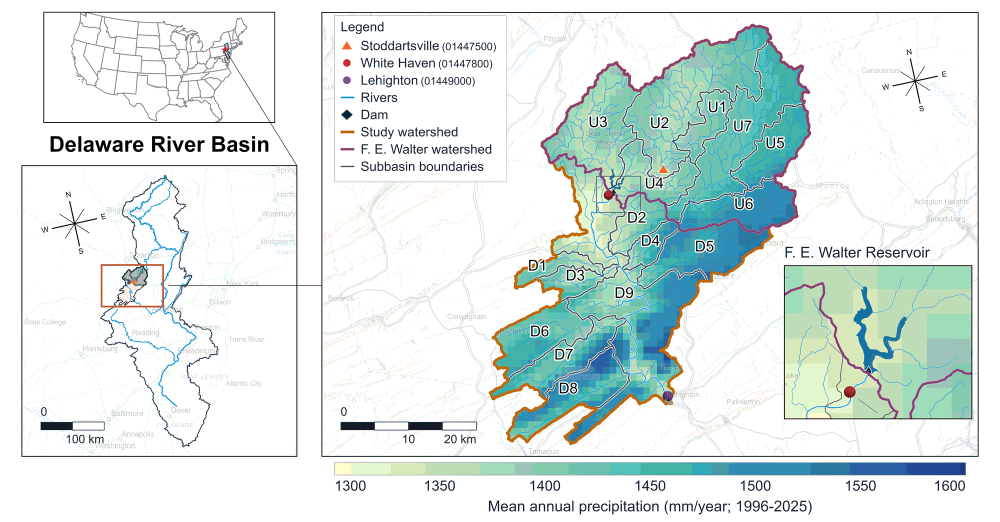
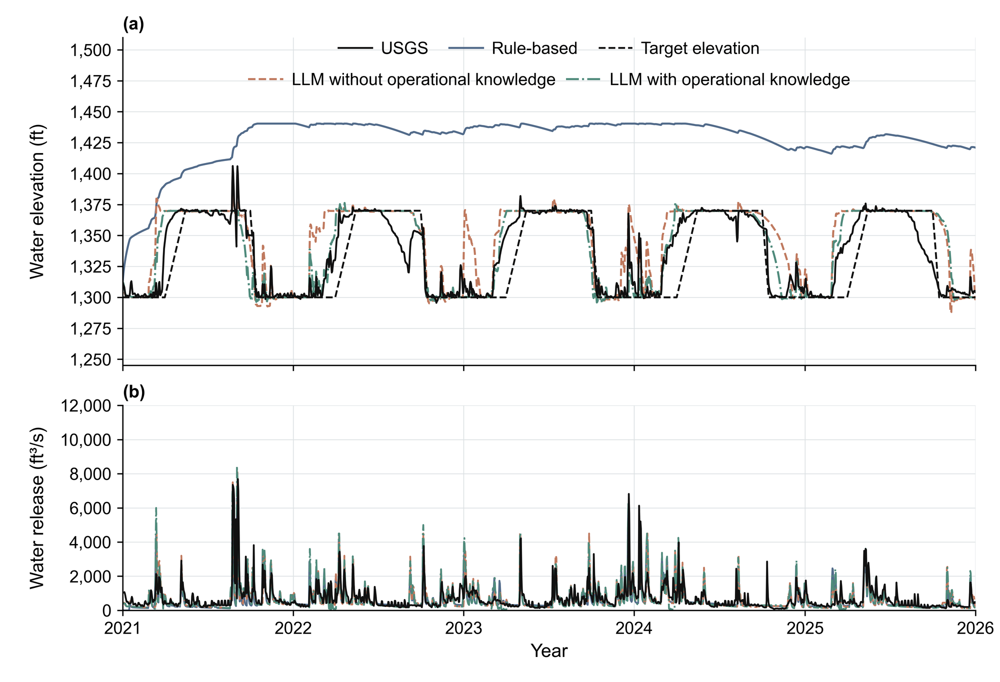
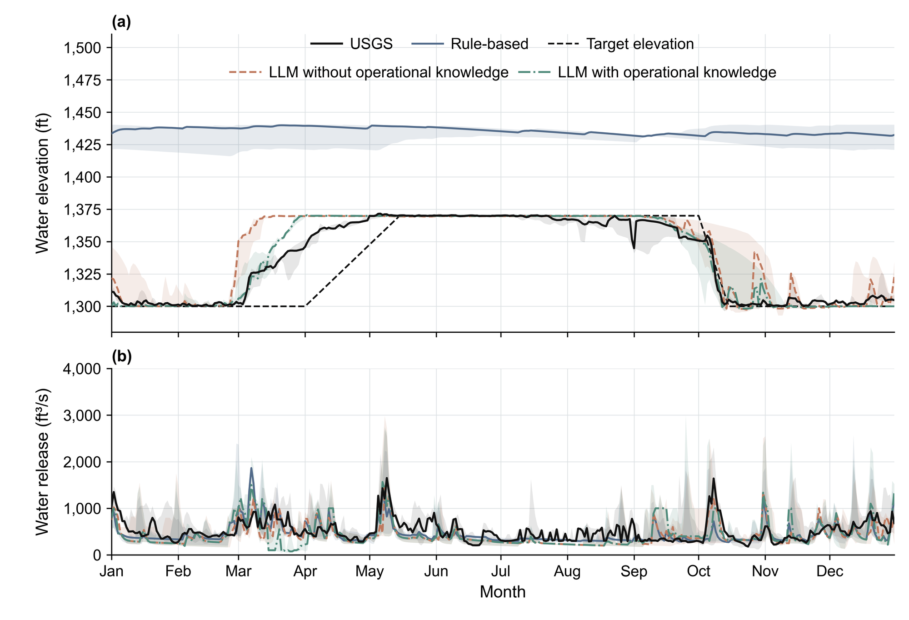

# F.E. Walter Dam 案例研究

<div class="hero-band" markdown="1">

本基準測試在 **2021 年 1 月 1 日至 2025 年 12 月 31 日**（共 `1,826` 個日時間步）期間，於同一套 HydroCNHS 物理與下游河道演算系統上，評估 **F.E. Walter Dam**（賓夕法尼亞州 Lehigh River 流域）的三種操作策略：決定性 **Hanasaki** 規則、**無操作知識（Without operational knowledge）**之 LLM（Seasonal Target），以及**含操作知識（With operational knowledge）**之 LLM（決策知識包，DKP）。

</div>

## 研究區域與基準設計

<figure class="figure-card">
  
  <figcaption><strong>圖 2.</strong> F.E. Walter Dam 研究流域與下游河道演算網路，將水庫出流串接至 USGS <code>01447800</code>（White Haven 壩下代理測站）與 USGS <code>01449000</code>（Lehighton 下游測站）。</figcaption>
</figure>

<div class="panel-grid panel-grid-3" markdown="1">
<div class="panel-card" markdown="1">

### 情境一：規則式（Hanasaki）

- **設定檔**：[`rule_based.yaml`](rule_based.yaml)
- **操作員**：`strategy: hanasaki`（α = 0.85），由 [1996–2015 年參考入流統計](rule_statistics.json)與[規則物理案例](rule_case.json)驅動。
- **網路呼叫**：`0` 次（離線決定性規則）。

</div>
<div class="panel-card" markdown="1">

### 情境二：季節目標（Seasonal Target，無 DKP）

- **設定檔**：[`seasonal_target.yaml`](seasonal_target.yaml)
- **操作員**：`gemma4:12b`（`study_method: seasonal_target`），僅提供水庫水位、季節目標水位與前兩日放流歷史。
- **提示詞**：[System prompt](prompts/seasonal_target.system.txt) · [第 1 天 User prompt](prompts/seasonal_target.user.txt)。

</div>
<div class="panel-card" markdown="1">

### 情境三：決策知識包（DKP）

- **設定檔**：[`dkp.yaml`](dkp.yaml)
- **操作員**：`gemma4:12b`（`study_method: dkp`），從 [`dkp.md`](dkp.md) 檢索結構化操作規則，並於 JSON 回覆中標註 `rules_applied`。
- **提示詞**：[System prompt](prompts/dkp.system.txt) · [第 1 天 User prompt](prompts/dkp.user.txt)。

</div>
</div>

## 設定檔與提示詞檢視

三組設定共用 2021–2025 年模擬區域入流量（[`inflows.csv`](inflows.csv)），預設先執行七天教學視窗（`2021-01-01` 至 `2021-01-07`），加上 `--full` 即可執行完整 `1,826` 天。兩組 LLM 條件共用 [`case.json`](case.json)、[`study/elevation_storage.csv`](study/elevation_storage.csv)、[`study/response_schemas.json`](study/response_schemas.json) 與 [`study/formatter.py`](study/formatter.py)，負責將 `storage_m3` 換算為水位（`ft NGVD29`）、將入流換算為 `cfs` 與 `acre-ft`，並顯示前兩天的請求放流與實際執行放流量。

於離線狀態（`0` 次呼叫）檢查全部三份設定檔：

```sh
reservoir-experiment check examples/fe_walter/rule_based.yaml
reservoir-experiment check examples/fe_walter/seasonal_target.yaml
reservoir-experiment check examples/fe_walter/dkp.yaml
```

若想跟著逐步教學了解提示詞設計、單位換算與七天基準執行，請參閱 [F.E. Walter 教學](../../tutorials/README.zh-TW.md)與[操作員與 LLM 代理人設計](../../docs/AGENT_DESIGN.zh-TW.md)。

## 日尺度與季節尺度表現（2021–2025）

<figure class="figure-card">
  
  <figcaption><strong>圖 3.</strong> 2021–2025 年逐日流量歷線與水庫水位比較，呈現 USGS 實測觀測值與 Hanasaki 規則基準、無操作知識（Seasonal Target）及含操作知識（DKP）各自 10 組隨機種子模擬之對照。</figcaption>
</figure>

<figure class="figure-card">
  
  <figcaption><strong>圖 4.</strong> 三種研究條件的多年平均季節週期，顯示 DKP 操作規則如何相較於無指引的 Seasonal Target 或純 Hanasaki 規則基準，重現春季回蓄至 1,370 ft NGVD29 與秋季洩降至 1,300 ft NGVD29 的季節蓄水轉換。</figcaption>
</figure>

針對全部 21 組封存模擬（`1` 組 Hanasaki + `10` 組 Seasonal Target seed + `10` 組 DKP seed）相對於 USGS 測站觀測資料（`01447780` 水庫水位、`01447800` 壩下代理放流量、`01449000` Lehighton 下游流量；各組逐筆分數見 [`study/expected_scores.csv`](study/expected_scores.csv)）之評估表現如下：

| 研究條件 | 模擬組數 | 水庫水位 KGE（中位數） | 水庫水位 NSE（中位數） | 水庫水位 RMSE（中位數） | 水庫放流量 KGE（中位數） | 下游流量 KGE（中位數） |
| --- | --- | --- | --- | --- | --- | --- |
| Rule-based（Hanasaki，α = 0.85） | `1` | `0.077` | — | `96.21 ft` | `0.640` | `0.815` |
| Without operational knowledge（Seasonal Target） | `10` | `0.806` | `0.514` | `20.85 ft` | `0.688` | `0.830` |
| With operational knowledge（DKP） | `10` | `0.858` | `0.711` | `16.07 ft` | `0.618` | `0.832` |

## 離線重現論文分數

以**零次** LLM 成本，透過水庫水量平衡與河道演算模式重播全部 21 組封存逐日放流序列（`study/archived_releases.csv` + Hanasaki 基準），並驗證精確的 KGE 與 RMSE 一致性：

```sh
python examples/fe_walter/study/replay.py --output runs/walter-paper-replay
```

檢視 `runs/walter-paper-replay/scores.csv` 即可取得全數 63 筆 `(condition, seed, quantity)` 評估結果，並於終端機查看輸出的 `water_level_medians`。

## 使用研究模型進行新的推論執行

即時 LLM 重現採用 **Ollama 0.40.6**，並於推論前後確認 `gemma4:12b` 環境設定（[`study/model.py`](study/model.py)，下載約 7.6 GB；見 [`study/run.py`](study/run.py)）：

```sh
python examples/fe_walter/study/model.py .walter-ollama
```

在另一個終端機啟動專用 Ollama 伺服器：

<div class="panel-grid panel-grid-2" markdown="1">
<div class="panel-card" markdown="1">

### Windows PowerShell

```powershell
$env:OLLAMA_MODELS = (Resolve-Path .walter-ollama).Path
$env:OLLAMA_HOST = "127.0.0.1:11446"
ollama serve
```

</div>
<div class="panel-card" markdown="1">

### macOS 或 Linux

```sh
OLLAMA_MODELS="$PWD/.walter-ollama" OLLAMA_HOST=127.0.0.1:11446 ollama serve
```

</div>
</div>

可先執行七天教學視窗，或加上 `--full` 執行完整 `1,826` 天（每個 `--seed 1..10` 請指定全新的 `--output` 目錄）：

```sh
python examples/fe_walter/study/run.py rule_based --full --output runs/walter-rule
python examples/fe_walter/study/run.py seasonal_target --full --seed 3 --ollama-port 11446 --output runs/walter-without-s3 --allow-network
python examples/fe_walter/study/run.py dkp --full --seed 3 --ollama-port 11446 --output runs/walter-with-s3 --allow-network
```

由於不同 GPU 與平台的浮點推論結果可能略有差異，若要完全一致地重現已發表分數，請使用上方的離線 `replay.py` 工作流程。輸出結果解讀請參閱[解讀執行結果](../../docs/RESULTS_GUIDE.zh-TW.md)。
