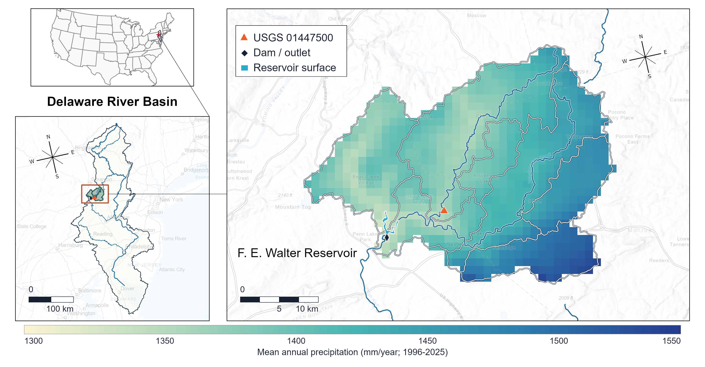

# F.E. Walter 案例

[English](README.md) | [繁體中文](README.zh-TW.md)

完成[建立通用模擬](../../docs/BUILD_SIMULATION.zh-TW.md)後，再使用這個研究案例。
本案例把同一份已確認的 HydroCNHS 水文邊界與同一個水庫物理模型，套用到三種操作
方法：規則範例、使用可用資訊的 LLM，以及使用檢索知識的 LLM。三種方法共用物理
計算，因此差異可追溯到決策輸入與邏輯，而不是不同的水量計算。

目前設定的逐步操作見
[F.E. Walter：設定水庫 agent](../../tutorials/fe_walter.md)。

## 地點與研究範圍

F.E. Walter Dam 位於 Pennsylvania 州 White Haven 附近、Lehigh River 與 Bear
Creek 交會處，橫跨 Carbon 與 Luzerne counties。水壩建於 1961 年。官方核定用途為
**Flood Risk Management** 與 **Recreation**。在蓄水量與防洪優先順序允許時，放流也
支援下游泛舟與釣魚。資料來源為 U.S. Army Corps of Engineers 的
[專案頁](https://www.nap.usace.army.mil/Missions/Civil-Works/Francis-E-Walter-Dam/)、
[重新評估研究](https://www.nap.usace.army.mil/Missions/Factsheets/Fact-Sheet-Article-View/Article/490871/francis-e-walter-dam-re-evaluation-study/)，以及
[流量管理計畫與時程](https://www.nap.usace.army.mil/Missions/Civil-Works/Francis-E-Walter-Dam/Flow-Management-Plan-Schedule/)。

```{figure-md} fe-walter-study-area-zh-tw
:class: study-area-figure



**圖 1。** 模式子集水區、水壩、測站與 1996–2025 年平均年降水量。
青色 polygon 表示水庫水面，菱形表示水壩／出口。
七個實際模式貢獻單元合計 **750.811 km²**；這是模式集水區面積，不是官方水庫水面
或專案土地面積。原生模型中另有 1 ha 的人工匯總出口，此面積不計入上述總和。
**資料來源：** Esri、CGIAR、USGS、data.pa.gov、TomTom、Garmin、SafeGraph、
METI/NASA、EPA、NPS、USDA、USFWS、New Jersey Office of GIS、FAO、NOAA。
```

## 已接受的水文邊界

上游採半分佈式模型。七個地理子集水區各自保留氣象、面積、緯度、土地與土壤屬性、
河長。GWLF 計算產流，Lohmann routing 將水送達壩址。操作實驗使用產生的每日入口
流量；更換 operator 不會重新校正水文。

| 資料或期間 | 本案例用途 |
|---|---|
| 每日氣象 | Daymet V4 R1 降水、最低溫與最高溫，依 polygon overlap 加權 |
| 有紀錄的氣象補值 | nClimGrid-Daily 僅補 leap year 的 12 月 31 日，不作一般缺值填補 |
| PET | 由日平均溫與子集水區緯度計算 HydroCNHS Hamon PET |
| 土地覆蓋 | NLCD 2021，以 60 m 彙整，並假設整段歷史模擬期間固定不變 |
| 土壤 | SSURGO polygons 與 NRCS Soil Data Access 屬性；未使用 gSSURGO raster |
| 原生連續期間 | 1989–2025；1989 為暖機期 |
| 校正／驗證 | 1990–2010／2011–2020，測站 USGS 01447500 |
| 前推期間 | 2021–2025；屬前推模擬，不是新增測站驗證 |

USGS 01447500 涵蓋七區中的兩區；其餘五區不是各自有測站的獨立驗證單元。
已接受的資料與指標見[水文、參數與 C&V](hydrology.zh-TW.md)。建立及校正其他流域時，
使用 [HydroCNHS 官方手冊](https://cylin928.github.io/HydroCNHS/)與
[HydroCNHS 設定](../../docs/HYDROLOGY_SETUP.md)；本頁不重複原生建模與校正流程。

## 共用物理假設

| 項目 | 設定與解釋 |
|---|---|
| 水庫 | 一座受控 F.E. Walter 水庫與一個決策單元 |
| 入流 | 凍結的每日 HydroCNHS 模擬入口流量，m³/s |
| 初始蓄水 | 2,457,848.279729185 m³（1,992.61 acre-ft）；整合假設，不是 2016 年 1 月觀測值 |
| 水庫損失 | 水庫核心中的直接降水、蒸發、滲漏與取水皆為零 |
| 下游 routing | Identity unit hydrograph，`UH=[1.0]`；介面假設，不是已校正旅行時間 |
| 物理計算 | 更新一次蓄水；實施控制放流加 spill，只注入下游 routing 一次 |

LLM 不會提供集水區入流，也不負責水量計算。共用物理核心對所有方法套用可用水量與
放流限制，計算蓄水與 spill，再將實施出流送往下游。

## 區分水文輸入與 LLM 每日可見資訊

| 資訊 | 水文／物理用途 | LLM 用途 |
|---|---|---|
| Daymet 氣象、PET、土地、土壤、HydroCNHS 參數 | 產生已接受的每日入口流量 | 不會自動提供給 LLM |
| 日期、入口流量、當日起始水位及最多兩筆已完成決策 | 描述當日操作狀態 | 納入每日訊息；本例不顯示另外的蓄水體積欄位 |
| 季節操作目標 | 不改變水文 | 明確納入目前兩種 LLM 方法 |
| 檢索操作指引 | 不改變水文或物理 | 只有檢索知識方法使用 |
| 提議放流 | 依物理狀態與限制檢查 | 由選定規則或 LLM 方法產生 |

這個區隔避免把水文輸入當成未說明的模型知識。保存的訊息與 trace 顯示每個每日 LLM
決策實際可使用的內容。

## 從目前 2016 設定開始

目前維護的對照使用 `gemma4:12b`、temperature 0.7 與明確的 v2 入口檔：

| 方法輸入 | 檔案 |
|---|---|
| 使用可用資訊的 LLM | [`coupled/current/llm_available.yaml`](coupled/current/llm_available.yaml) |
| 使用檢索知識的 LLM | [`coupled/current/llm_knowledge.yaml`](coupled/current/llm_knowledge.yaml) |
| 共用模型 profile | [`coupled/current/models.yaml`](coupled/current/models.yaml) |
| 規則範例 | [規則式操作](benchmark/README.zh-TW.md) |

舊 Gemma 3 檔案保持原樣，作為保存輸入；不能用它們宣稱重現目前 Gemma 4 對照。
確切檔案、指令、成功檢查與輸出位置見[設定教學](../../tutorials/fe_walter.md)。

## 季節水位

目前案例使用四個**研究自訂**的水位合規窗口，單位為 ft N.G.V.D.。目前兩種 prompt
使用相同窗口；這些設定不是官方逐年操作時程。

| 季節 | 日期，含首尾日 | 水位檢查 |
|---|---|---|
| 冬季維持 | 11 月 1 日–3 月 14 日 | 1297–1303 ft，接近 1300 ft 保育水位 |
| 春季蓄水 | 3 月 15 日–5 月 9 日 | 1300–1370 ft |
| 夏季 | 5 月 10 日–10 月 14 日 | 不高於 1370 ft；此檢查不設下限 |
| 秋季降水位 | 10 月 15 日–10 月 31 日 | 1300–1370 ft，且水位下降 |

3/15、5/10、10/15 歸入後一季；水位上下限均包含端點。
[季節規格](seasonal_pool_criteria.json)保存日期、區間與共同英文指令：冬季維持
1300 ft 附近，春季在水文條件允許時向 1370 ft 蓄水，夏季不超過 1370 ft，秋季從
10/15 開始降水位，朝 11/1 回到 1300 ft。

### 檢查保存的水位序列

```sh
python examples/fe_walter/check_pool_levels.py examples/fe_walter/reference_outputs/long_term_dkp/plotted_daily.csv --output runs/fe-walter-seasonal-pool-v1.csv
```

在 repo 根目錄使用新的輸出檔名執行。程式另存包含輸入與規格 hash 的 CSV，拒絕覆寫
既有檔案；不執行模型、模擬或策略 audit。

保存的 `pool_elevation_start_ft` 是每日起始 snapshot，不代表日內最高或日末合規。
秋季「下降」表示低於前一個連續日；持平會判 `FAIL`，包含已到 1300 ft。缺少或非
有限水位，以及缺少秋季前一日紀錄時判 `UNKNOWN`；觀察到超出區間仍判 `FAIL`。
不額外加入數值容差。原版 decision audits 保留原有目標邏輯。上述歷史序列並非使用
修訂 prompt 產生。

## 透過共用物理比較方法

| 方法 | 決策來源 | 方法專用輸入 |
|---|---|---|
| [規則式操作](benchmark/README.zh-TW.md) | Hanasaki-based 每日防洪範例 | 規則參數與歷史統計 |
| [使用可用資訊的 LLM](zero_shot/README.zh-TW.md) | 案例指令與每日狀態 | 目前 Gemma 4 profile 與明確案例 prompt |
| [使用檢索知識的 LLM](dkp/README.zh-TW.md) | 相同介面加上檢索指引 | 目前 Gemma 4 profile、prompt 與知識來源 |

規則參考 [Hanasaki et al. (2006)](https://doi.org/10.1016/j.jhydrol.2005.11.011)
與 [Abeshu et al. (2023), Section 2.3.3](https://gmd.copernicus.org/articles/16/5449/2023/)
的防洪公式。它是已註冊的案例規則，不是 HydroCNHS 原生操作政策。
[每日耦合章節](coupling.zh-TW.md)說明三種方法如何通過相同水庫物理與下游 routing。

## 查看結果

目前與歷史結果應分開閱讀。先讀英文
[最新 Gemma 4 對照](coupled/README.md#verified-2016-results)。
[歷史結果與決策紀錄](results.zh-TW.md)保存較早的 2020 教學與 2016–2020 研究。

| 保存證據 | 期間與模型 | 用途 |
|---|---|---|
| 目前原版程式／框架對照 | 2016-01-01–12-31；每套引擎、每種 LLM 方法各 366 日；`gemma4:12b`、temperature 0.7 | 水位、控制放流、季節合規與相同回覆工程檢查 |
| 較早三方法全年範例 | 2016-01-01–12-31；每種方法 366 日；LLM 使用 `gemma3:4b`、temperature 0.7 | 保存較早設定，與目前對照分開 |
| 歷史三日教學 | 2016-01-01–01-03；LLM 使用 `gemma3:4b`、temperature 0.7 | 保存教學 snapshot 與原始 audit verdict；不是目前首次執行路徑 |
| 一年結果教學 | 2020-01-01–12-31；歷史檢索知識紀錄中的 366 日 | 季節操作與個別決策 |
| 歷史檢索知識實驗 | 2016-01-01–2020-12-31；`gemma4:12b`、temperature 0.7 | 完整 1,827 日軌跡與決策行為 |

五年紀錄屬歷史檢索知識實驗；沒有提供配對的五年規則式或可用資訊軌跡。三日教學
與歷史實驗的模型版本、程式來源不同。三日季節 YAML 已完成 offline check 但未重跑；
保存 exchanges 保留原始指令與 verdicts。

[主 notebook](../../tutorials/main.ipynb)保存歷史三日教學；
[進階 notebook](../../tutorials/advanced.ipynb)說明多水庫。
