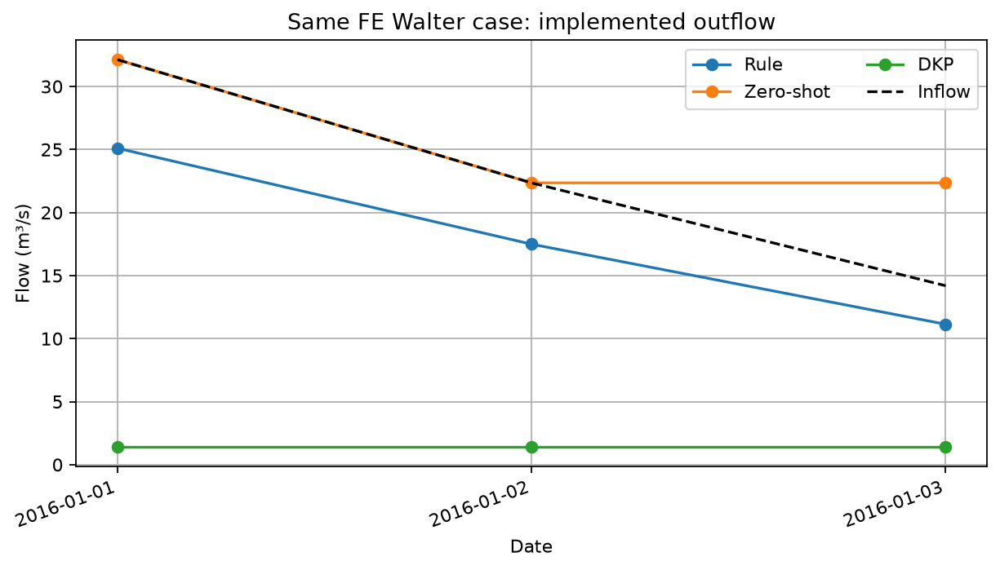

# F.E. Walter：規則式基準

[English](README.md) | [繁體中文](README.zh-TW.md) · [三個範例](../README.zh-TW.md)

這個自訂的每日防洪規則透過原生 HydroCNHS Dam API 提出 release 請求。它依據
[Hanasaki et al. (2006)](https://doi.org/10.1016/j.jhydrol.2005.11.011)及
[Abeshu et al. (2023), Section 2.3.3](https://gmd.copernicus.org/articles/16/5449/2023/)
的防洪公式。此規則由 HydroOpsLM 加入，不是 HydroCNHS 的內建策略。

## 1. 準備輸入

查看[每日入流](../../../cases/fe_walter_reference/inflows.csv)與
[水庫案例](../../../cases/fe_walter_reference/case.json)。

| 設定 | 共用示範條件 |
|---|---|
| 日期 | 2016-01-01 至 2016-01-03，每日步長 |
| 入流 | 固定的模擬入流，m³/s |
| 初始蓄水 | 2,457,848.279729185 m³ (1,992.61 acre-ft) |
| 損失 | 零 |
| 下游 routing | Identity unit hydrograph，`UH=[1.0]` |

初始蓄水與 identity routing 是整合假設，不是現地驗證。這個有界 Ollama
診斷不會取消原始案例的 readiness gate。讀取保存的範例不會啟動模型。

## 2. 設定 YAML

開啟 [experiment.hydroopslm.offline.yaml](experiment.hydroopslm.offline.yaml)。
YAML 選用 `strategy: benchmark`、`mode: offline`、`purpose: flood_control`
與 `max_calls: 0`，並使用示範期以前的
[固定 1996–2015 統計資料](../../../data/benchmark/fe_walter_statistics.json)。
它不需要模型或 prompt。

若要建立新執行，請在原檔旁複製一份：

```powershell
Copy-Item examples/fe_walter/benchmark/experiment.hydroopslm.offline.yaml examples/fe_walter/benchmark/my-run.yaml
```

在 `my-run.yaml` 中設定 `run_id: fe-walter-benchmark-my-run` 與
`output: ../../../runs/fe-walter-benchmark-my-run`。第一次示範請保留其他設定。
不得重複使用現有的輸出資料夾。

## 3. 檢查 prompt 或規則

此規則比較容量與平均年入流體積。大型水庫提出 `k × mean inflow`；較小的水庫
則將它與目前入流混合。環境流量下限是平均入流的 10%。係數
`k = starting storage / (0.85 × capacity)` 會在第一個步驟及每個操作年度邊界
更新，而不是每日更新。準備好的 climatology 選用五月。此規則沒有季節性目標
controller。詳見[來源與調整](#來源與調整)。

## 4. 檢查

從 repository 資料夾驗證複製的設定：

```powershell
python run_experiment.py check examples/fe_walter/benchmark/my-run.yaml
```

此命令檢查設定，不會進行 inference 或模型請求。

## 5. 執行

[保存的三日結果](../../../results/fe_walter_tutorial_benchmark_2016_01/)已可使用。
只有在確定要啟動新 simulation 時，才執行以下命令：

```powershell
python run_experiment.py run examples/fe_walter/benchmark/my-run.yaml
```

此基準是決定性的，不會提出模型請求。

## 6. 驗證

驗證現有的保存結果，不重跑 simulation：

```powershell
python run_experiment.py verify results/fe_walter_tutorial_benchmark_2016_01 --require-offline
```

完成新執行後，改用 `runs/fe-walter-benchmark-my-run`。驗證會檢查執行證據，
不能證明操作策略良好。

## 7. 閱讀結果與 audit/trace

在 `reservoir_trajectory.csv` 中查看 requested release、實際執行的 controlled
release、spill 與 ending storage。總出流是 controlled release 加 spill，且只會
進入 routing 一次。次日歷史使用實際執行的 release。

| 日期 | 入流 (m³/s) | 請求值 (m³/s) | 執行值 (m³/s) | Spill (m³/s) | 期末蓄水 (m³) |
|---|---:|---:|---:|---:|---:|
| 2016-01-01 | 32.125319 | 25.098588 | 25.098588 | 0.000000 | 3,064,957.78 |
| 2016-01-02 | 22.353047 | 17.490024 | 17.490024 | 0.000000 | 3,485,122.95 |
| 2016-01-03 | 14.193931 | 11.137442 | 11.137442 | 0.000000 | 3,749,203.61 |



此圖比較共用的三日示範條件，並非策略績效評估。上表呈現此方法保存的軌跡；
保存的 CSV 保留完整精度。

此基準在 release-bounds auditor 下保留 **3 PASS**。這套檢查與 LLM 操作 audit
不同，因此不能用計數排名方法。

檢查保存的決策：

```powershell
python tutorials/inspect_decision_flow.py results/fe_walter_tutorial_benchmark_2016_01 --require-offline
```

`decisions.jsonl`、`raw/`、`audit.jsonl`、`physics.jsonl` 與
`backend_events.jsonl` 會將資訊與提案連結至檢查及執行。Notebook 將紀錄的
checker 結果與目前的 contract recheck 分開呈現。Inspector 不會提出模型請求。
詳見[結果與疑難排解](../../../docs/RESULTS_GUIDE.md)。

[查看主教學](../../../tutorials/main.ipynb) ·
[模組參考](../../../docs/LLM_MODULES.md) ·
[多座水庫](../../../tutorials/advanced.ipynb)

## 來源與調整

Hanasaki, N., Kanae, S., and Oki, T. (2006). “A reservoir operation scheme for
global river routing models.” *Journal of Hydrology*, 327, 22–41.
[DOI](https://doi.org/10.1016/j.jhydrol.2005.11.011).

Abeshu, G. W., et al. (2023). “Enhancing the representation of water management
in global hydrological models.” *Geoscientific Model Development*, 16, 5449–5472.
[Section 2.3.3](https://gmd.copernicus.org/articles/16/5449/2023/).

此自訂策略將每月防洪公式調整為每日步長。它把
[來源決策函式](https://github.com/DasanikBD/Delaware-Reservoir-LLM/blob/6c3dc532d712af55db1f4a1d8e018c86249ce7a8/benchmark_release.py)
固定在 commit `6c3dc532d712af55db1f4a1d8e018c86249ce7a8`（函式 hash `c11a81…`）。
該函式不同於為 LLM prompt 與 audit 相容性保留、未變更的 V3.7 vendor source。
只有決策函式經過調整；所有方法皆使用 HydroOpsLM simulation driver。
[來源與 162-vector 比較紀錄](../../../results/technical_note_offline/README.md)
保存來源身分與數值比較。
