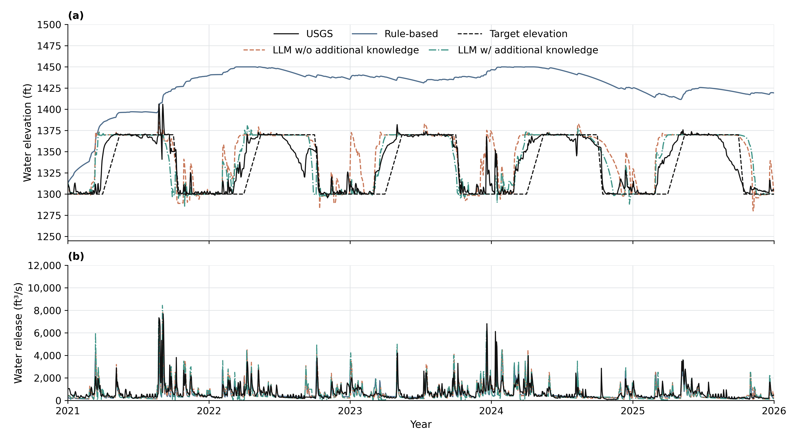
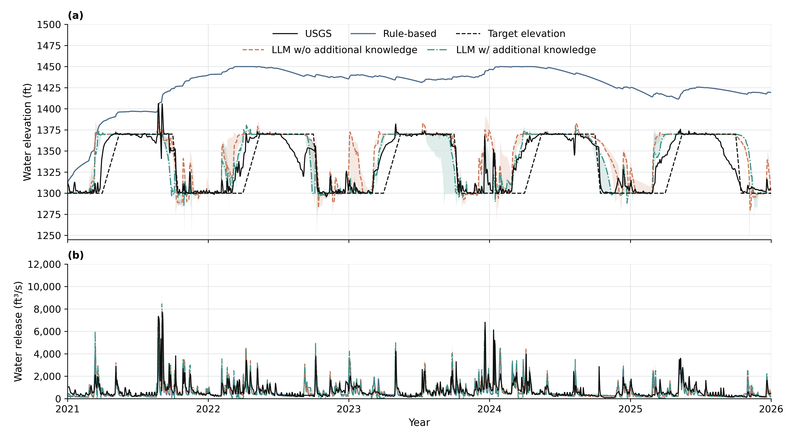
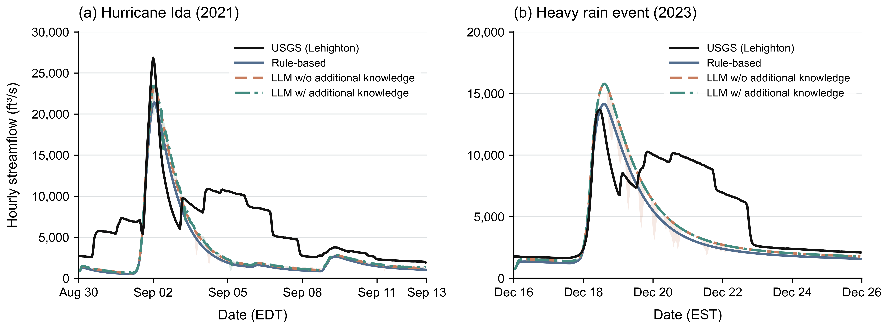

# Completed F.E. Walter comparisons

These figures show the completed Daily 2021–2025 comparison and the completed
Hourly event comparison. The Daily with-knowledge results use the 29–30 October
2026 refresh. Each LLM scenario has **three accepted seeds**; later runs are not
included here. The figures and score exports were copied from accepted results,
without a new model call, hydrological simulation or calibration.

## Daily water elevation and release, 2021–2025

The two panels show (a) water elevation and (b) total reservoir outflow
(controlled release plus spill). Each LLM line is the per-date median of three
runs. The 1,826 Daily decisions cover 1 January 2021 through 31 December 2025;
they are not folded into an annual cycle. The end-of-2025 state is plotted at
the 1 January 2026 boundary, without adding a decision. Pool observations are
daily means. The release observation is the USGS 01447800 White Haven near-dam
proxy, not an independent direct measurement of gate release.

The dashed target elevation is the original **illustrative seasonal display
reference**, not the Hanasaki comparator's actual control target or an official
operating schedule. All seven runs share initial storage 4,337,390.926410141 m³.
This completed research campaign has its own pinned configuration; the separate
[executable Rule-based lesson](../operation/README.md) retains its own inputs and
initialization and must not be relabeled as the producer of these results.

[High-resolution PNG](daily_2021_2025.png) · [PDF](daily_2021_2025.pdf) ·
[SVG](daily_2021_2025.svg) · [Plotted values](daily_chart_data.csv) ·
[Target reference](daily_target_reference.csv)

The companion version below shows the pointwise **minimum–maximum range across
three runs**. This is neither an across-year IQR nor a confidence interval.
Rule-based operation has one deterministic run and no synthetic uncertainty band.

[PNG with ranges](daily_2021_2025_range.png) · [PDF](daily_2021_2025_range.pdf) ·
[SVG](daily_2021_2025_range.svg) · [Range values](daily_run_range.csv)

## Daily performance against observations

**Table 3. Daily simulation performance against observations, 2021–2025.**

| Agent type | Reservoir level KGE | Reservoir level NSE | Water release KGE | Water release NSE | Downstream flow KGE | Downstream flow NSE |
|---|---:|---:|---:|---:|---:|---:|
| Rule-based | 0.092 | -9.560 | 0.622 | 0.364 | 0.802 | 0.722 |
| LLM | 0.818 | 0.534 | 0.692 | 0.387 | 0.830 | 0.723 |
| LLM+K | 0.832 | 0.657 | 0.626 | 0.209 | 0.833 | 0.691 |

Here LLM means **LLM w/o additional knowledge** and LLM+K means **LLM w/
additional knowledge**. Each LLM row is the arithmetic mean of metrics computed
separately for its three seeds; it is not a metric computed from the median
line. All 1,826 date pairs are retained. Release is total reservoir outflow
compared with the unchanged White Haven observation proxy. Downstream flow
refers to Lehighton. These definitions differ from the separate retained
Rule-only lesson's primary-score masks and routed-station metric definitions.

[Table PNG](table3_daily_simulation_performance.png) ·
[Table PDF](table3_daily_simulation_performance.pdf) ·
[Summary CSV](table3_summary.csv) · [Per-seed metrics](table3_metrics_per_seed.csv)

## Hourly downstream event comparison

Panel A is Hurricane Ida: **30 August 2021 04:00 UTC to 13 September 2021
04:00 UTC**, end exclusive, 336 hourly decisions. Panel B is the 2023 rain event:
**16 December 2023 05:00 UTC to 26 December 2023 05:00 UTC**, end exclusive,
240 hourly decisions. Both scenarios include all three accepted seeds. These
are native Hourly results, not Daily values drawn on an hourly axis. The shared
reference prehistory and numerical routing tail are outside the decision and
plot windows. Each strategy's own controlled release plus spill is routed to
Lehighton; observed White Haven flow is not substituted for strategy output.

[High-resolution PNG](hourly_events_AB.png) · [PDF](hourly_events_AB.pdf) ·
[SVG](hourly_events_AB.svg) · [Plotted values](hourly_chart_data.csv)

Similar downstream curves do not demonstrate equivalent reservoir behavior or
improved operating skill. Common downstream runoff and similar release choices
can conceal differences. Missing control-station observations remain a limitation
of the knowledge-dependent decisions. The Hourly C&V and events are retrospective;
the event comparison is not a blind independent flood forecast.

The [file inventory](provenance.json) records original accepted source identities
and SHA256 for each copied plot and numeric export. Full raw decisions, reasons,
requests, responses and failure history remain in the experiment handover archive.

[Daily workflow](../../../docs/DAILY_WORKFLOW.md) · [Historical 2016 results](../results.md)
