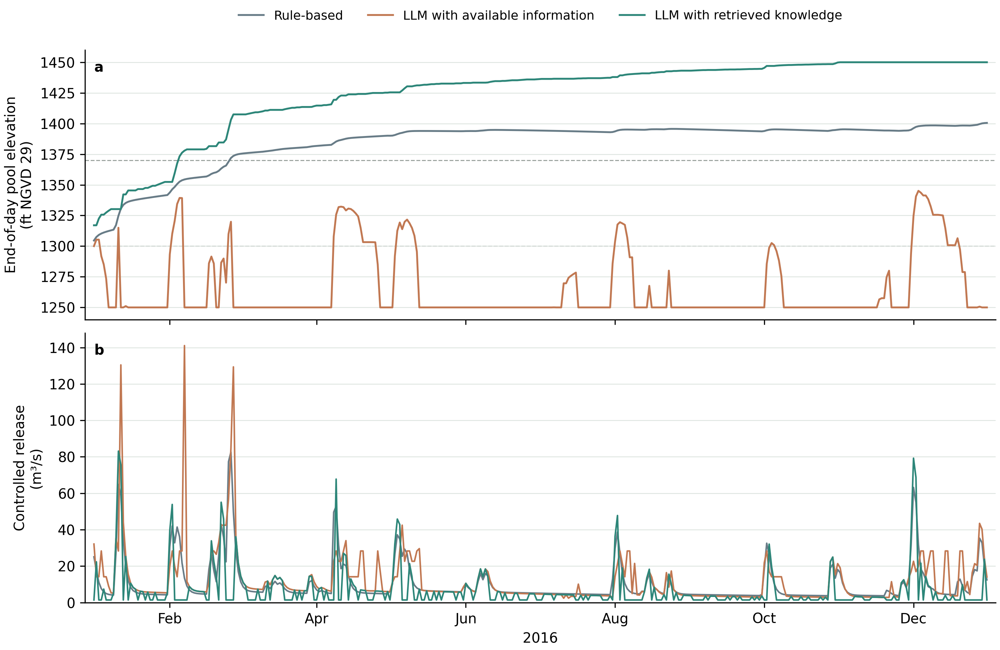

# F.E. Walter weather-to-operation example

This directory connects the accepted F.E. Walter hydrology and complete weather
record to the shared reservoir physics and daily native routing. It is a teaching
configuration. The identity downstream unit hydrograph is not calibrated travel
time, and the initial storage is an explicit assumption.

The rule-based configuration has been checked for all 366 days of 2016. The
prepared inflow matches the existing annual input byte for byte. Execution and
water balance verification do not establish acceptable reservoir performance.

## Files

| File | Role |
|---|---|
| [`reservoirs.json`](reservoirs.json) | `reservoir-physical-case.v1`: F.E. Walter physics and operation network |
| [`rule.yaml`](rule.yaml) | Rule-based baseline using the example Hanasaki module; no model request |
| [`llm_available.yaml`](llm_available.yaml) | LLM operation with available information |
| [`llm_knowledge.yaml`](llm_knowledge.yaml) | LLM operation with retrieved operating knowledge |
| [Available-information prompt](../prompts/zeroshot_seasonal_v1_system.txt) | Native system message with the approved seasonal-target edit |
| [Retrieved-knowledge prompt](../prompts/dkp_seasonal_v1_system.txt) | Native operating-knowledge system message with the same target edit |
| [Case extension](../extensions/) | Case-owned prompt formatting, response parsing, profile/history and audit |

Both LLM files register the case-owned `reference_v3_7` extension because this
example reproduces the F.E. Walter teaching interface. The available-information
configuration uses its `zeroshot` machine ID. The operating-knowledge
configuration uses its `dkp` machine ID and the existing vendor knowledge file.
The case extension preserves Anik's message, schema and retrieval behavior through
the shared configured backend. The framework handles provider calls, retries,
records, physics and routing; the original standalone code is an offline test
oracle. Those IDs are case provenance, not generic method names. For another basin, use
the general `type: llm` example in
[Weather and inflow inputs](../../../docs/WEATHER_INPUTS.md#a-generic-configured-llm-simulation).

## Read the configuration

The rule YAML is the complete weather-to-operation setup:

```{literalinclude} rule.yaml
:language: yaml
```

| Section | What you change |
|---|---|
| `hydrology` | Accepted native model, complete weather and local-flow bindings |
| `case` | Reservoir physics, initial storage and downstream network |
| `start_date`, `end_date` | Operation period within the hydrology record |
| `agents` | Decision method and its rule parameters or prompt/model |
| `auditors` | Diagnostic checks enabled by the selected agent |
| `run_id`, `output` | Separate identity and output for each experiment |

## Hydrology and binding

All three configurations use:

- [`fe_walter_hydrology.yaml`](../../../data/accepted/fe_walter_hydrology.yaml),
  the accepted native model;
- `fe_walter_forcing_1989_2025.csv.gz`, the complete daily weather table;
- the full 1989–2025 native period for initialization and routing history; and
- the operation window 2016-01-01 through 2016-12-31.

`FEW_INFLOW` receives the routed native aggregation outlet. `Downstream` has
explicit zero lateral flow. After the reservoir decision, the operation network
routes implemented release plus spill to `Downstream` once.

## Run the rule-based method

```powershell
reservoir-experiment check examples/fe_walter/coupled/rule.yaml
reservoir-experiment prepare examples/fe_walter/coupled/rule.yaml
reservoir-experiment run examples/fe_walter/coupled/rule.yaml
reservoir-experiment verify runs/fe-walter-coupled-rule/operation
```

`prepare` runs hydrology over the full accepted period and selects the 366
operation days. It makes zero model requests.

## Run an LLM method

Choose one configuration and review its model settings and method-specific prompt first:

```powershell
reservoir-experiment check examples/fe_walter/coupled/llm_available.yaml
reservoir-experiment prepare examples/fe_walter/coupled/llm_available.yaml
reservoir-experiment run examples/fe_walter/coupled/llm_available.yaml --allow-network
reservoir-experiment verify runs/fe-walter-coupled-llm_available/operation
```

For retrieved operating knowledge, substitute `llm_knowledge.yaml` and its output
directory. Both configurations set `max_calls: null`, meaning no total call cap,
and `max_attempts: 2`, meaning at most two attempts for one daily decision.
Both explicitly set `num_ctx: 16384`, `think: false`, and `keep_alive: 30m`.
They use `consultation_mode: daily` and `response_validation: policy`, so every
day is requested and the original policy parser checks its required fields.

## Reuse the prepared hydrology

When comparing methods, copy the next YAML to a new run ID and output and add a
verified preparation to its `hydrology` section:

```yaml
hydrology:
  prepared_from: ../../../runs/fe-walter-coupled-rule
```

Keep the accepted model, weather, dates, bindings and runtime unchanged. The new
preparation pins and copies the existing inlet series without rerunning hydrology.
Each operation method still starts a separate reservoir history from the same
physical initial state.

## Completed 2016 demonstration

All three methods completed **366 daily reservoir decisions**. The LLM records
are a preserved diagnostic variant from the original pinned runner at commit
`5ee498e`, using the same
prepared inflow that the new weather entry reproduced byte for byte. They were
not requested again through the new entry. Its 732 requests used the former
shared custom prompt, omitted the current provider controls, and suppressed the
native `missing_inputs` field. The saved tables, raw records, history and figure
remain immutable evidence, but they are not a run of the current reproduction
configuration.



The upper panel shows end-of-day pool elevation; the lower panel shows
implemented controlled release. Dashed levels mark 1300 and 1370 ft. Spill and
total downstream outflow remain in the [daily table](outputs/daily.csv).
These are single realizations for teaching, not a controlled method ranking.

| Method | Completed days | Model requests | Operation audit PASS / FAIL |
|---|---:|---:|---:|
| Rule-based | 366 | 0 | 366 / 0 |
| LLM with available information | 366 | 366 | 12 / 354 |
| LLM with retrieved knowledge | 366 | 366 | 0 / 366 |

Execution and water-balance verification passed for all three runs. Operation
audit FAIL is a separate diagnostic; it neither stopped the loop nor replaced
an LLM decision. The counts above are the recorded operating audits, not a
seasonal pool-compliance score. The [run summary](outputs/summary.json) retains
their verdicts and source hashes. The original failed partial attempt remains
in the [earlier annual record](../annual/README.md).

Recreate the figure from the selected daily table, without simulation or model requests:

```powershell
python examples/fe_walter/coupled/plot_results.py --output my-figures
```

The [plotting script](plot_results.py) creates PNG, SVG and PDF in a new directory.

### Follow an actual reply into the next day

These are the complete model replies for 1 January 2016.

<details>
<summary>LLM with available information · saved reply</summary>

```{literalinclude} outputs/llm_available_reply.txt
:language: text
```

</details>

<details>
<summary>LLM with retrieved knowledge · saved reply</summary>

```{literalinclude} outputs/llm_knowledge_reply.txt
:language: text
```

</details>

Download either [available-information decision](outputs/llm_available_decision.json)
or [operating-knowledge decision](outputs/llm_knowledge_decision.json). Each joins
the observation, complete raw policy trace and audits, implemented physics and
the next day's observation. Requested release can differ from implemented
release; downstream routing receives controlled release plus spill.

## Inspect one day

For each day, follow this chain in `OUTPUT/operation`:

1. prepared `FEW_INFLOW` enters the agent observation;
2. the rule or LLM requests controlled release;
3. physics records implemented controlled release, spill and ending storage;
4. native routing receives total outflow at `Downstream`; and
5. the next day uses committed ending storage and implemented-release history.

Use `decisions.jsonl`, `audit.jsonl`, `physics.jsonl`,
`reservoir_trajectory.csv` and the routing/balance records together. A completed
and verified run does not by itself show that the operating policy is acceptable.

If an operation stops, resume into a new output:

```powershell
reservoir-experiment resume examples/fe_walter/coupled/llm_available.yaml `
  --from-run runs/fe-walter-coupled-llm_available/operation `
  --output runs/fe-walter-coupled-llm_available-resumed `
  --run-id fe-walter-coupled-llm-available-resumed `
  --allow-network
```

Read [Build a weather-to-operation simulation](../../../docs/BUILD_SIMULATION.md)
for the generic workflow and [Code structure](../../../docs/CODE_STRUCTURE.md) for
module responsibilities.
