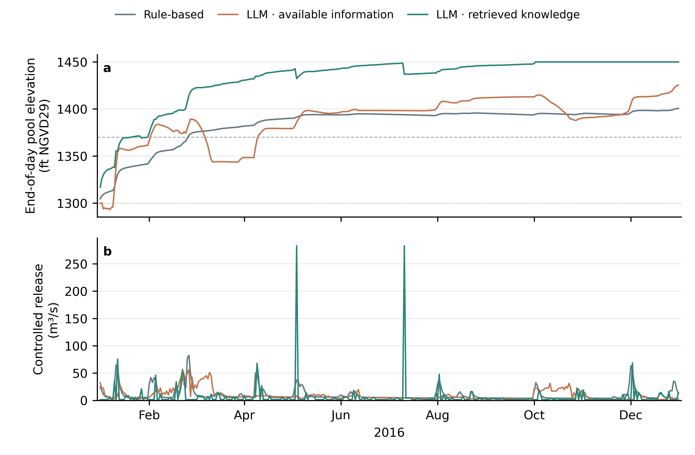

# F.E. Walter weather-to-operation example

This directory connects the accepted F.E. Walter hydrology and complete weather
record to the shared reservoir physics and daily native routing. It is a teaching
configuration. The identity downstream unit hydrograph is not calibrated travel
time, and the initial storage is an explicit assumption.

Start with [the FE Walter tutorial](../../../tutorials/fe_walter.md) for a file-by-file
walkthrough of the experiment, model settings, prompts, reservoir IDs and code.

The current 2016 section below distinguishes completed operation, actual provider
attempts, numerical verification and diagnostic operating audits. Its curated
files use `outputs/2016/`. The earlier diagnostic demonstration remains separate
and unchanged. Execution and water balance verification do not establish
acceptable reservoir performance.

## Files

| File | Role |
|---|---|
| [`experiment.yaml`](experiment.yaml) | Canonical v2 entry, selecting the rule baseline |
| [`reservoirs.json`](reservoirs.json) | `reservoir-physical-case.v1`: F.E. Walter physics and operation network |
| [`rule.yaml`](rule.yaml) | Alternative entry for the same rule identity/output; do not run both into that directory |
| [`llm_available.yaml`](llm_available.yaml) | LLM operation with available information |
| [`llm_knowledge.yaml`](llm_knowledge.yaml) | LLM operation with retrieved operating knowledge |
| [`hydrology.yaml`](hydrology.yaml) | Shared accepted native model, forcing and inlet bindings |
| [`models.yaml`](models.yaml) | Shared explicit Ollama model profile |
| [`agents.rule.yaml`](agents.rule.yaml) | Rule operator and its Hanasaki parameters |
| [`agents.llm_available.yaml`](agents.llm_available.yaml) | Available-information operator and case settings |
| [`agents.llm_knowledge.yaml`](agents.llm_knowledge.yaml) | Retrieved-knowledge operator and case settings |
| [`auditors.yaml`](auditors.yaml) | Shared diagnostic check catalog |
| [Available-information prompt](../prompts/zeroshot_seasonal_v1_system.txt) | Native system message with the approved seasonal-target edit |
| [Retrieved-knowledge prompt](../prompts/dkp_seasonal_v2_system.txt) | Native operating-knowledge system message with the same target edit and Anik V3.7 response behavior |
| [Case extension](../extensions/) | Case-owned prompt formatting, response parsing, profile/history and audit |

Both LLM files register the case-owned `reference_v3_7` extension because this
example reproduces the F.E. Walter teaching interface. The available-information
configuration uses its `zeroshot` machine ID. The operating-knowledge
configuration uses its `dkp` machine ID and the existing vendor knowledge file.
The case extension preserves Anik's message, schema and retrieval behavior through
the shared configured backend. The framework handles provider calls, retries,
records, physics and routing; the original standalone code is an offline test
oracle. Those IDs are case provenance, not generic method names. For another basin, use
the general `type: llm` example in
[Weather and inflow inputs](../../../docs/WEATHER_INPUTS.md#a-generic-configured-llm-simulation).

## Read the configuration

The v2 entries select sibling files with section references such as
`agents: {file: agents.rule.yaml}`. Global run settings belong in the entry;
hydrology and physical coupling belong in `hydrology.yaml`/`reservoirs.json`;
method behavior belongs in the selected agent file. Paths are relative to the
file that declares them. The [canonical tutorial](../../../tutorials/fe_walter.md)
includes the actual maintained files and explains their parameters.

## Hydrology and binding

All three configurations use:

- [`fe_walter_hydrology.yaml`](../../../data/accepted/fe_walter_hydrology.yaml),
  the accepted native model;
- `fe_walter_forcing_1989_2025.csv.gz`, the complete daily weather table;
- the full 1989–2025 native period for initialization and routing history; and
- the operation window 2016-01-01 through 2016-12-31.

`FEW_INFLOW` receives the routed native aggregation outlet. `Downstream` has
explicit zero lateral flow. After the reservoir decision, the operation network
routes implemented release plus spill to `Downstream` once.

## Run the rule-based method

```powershell
reservoir-experiment check examples/fe_walter/coupled/experiment.yaml
reservoir-experiment prepare examples/fe_walter/coupled/experiment.yaml
reservoir-experiment run examples/fe_walter/coupled/experiment.yaml
reservoir-experiment verify runs/fe-walter-coupled-rule/operation
```

`prepare` runs hydrology over the full accepted period and selects the 366
operation days. It makes zero model requests.

## Run an LLM method

Choose one configuration and review its model settings and method-specific prompt first:

```powershell
reservoir-experiment check examples/fe_walter/coupled/llm_available.yaml
reservoir-experiment prepare examples/fe_walter/coupled/llm_available.yaml
reservoir-experiment run examples/fe_walter/coupled/llm_available.yaml --allow-network
reservoir-experiment verify runs/fe-walter-coupled-llm_available/operation
```

For retrieved operating knowledge, substitute `llm_knowledge.yaml` and its output
directory. Both configurations set `max_calls: null`, meaning no total call cap,
and `max_attempts: 2`, meaning at most two attempts for one daily decision.
Both explicitly set `num_ctx: 16384`, `think: false`, and `keep_alive: 30m`.
They use `consultation_mode: daily` and `response_validation: policy`, so every
day is requested and the original policy parser checks its required fields.
Both omit the availability-ceiling line. The retrieved-knowledge method also
omits `missing_inputs` and the missing-information fallback from its system
prompt, response schema and retrieval; its reply has the eight configured fields
documented in the tutorial. No provider fallback is selected.

## Reuse the prepared hydrology

When comparing methods, copy the next entry to a new run ID/output. Copy
`hydrology.yaml` to a sibling `hydrology.reused.yaml`, retain its existing fields,
and add this field at the root of that copied section file:

```yaml
prepared_from: ../../../runs/fe-walter-coupled-rule
```

Point only the new entry's `hydrology` at `{file: hydrology.reused.yaml}`.
Keep the accepted model, weather, dates, bindings and runtime unchanged. The new
preparation pins and copies the existing inlet series without rerunning hydrology.
Each operation method still starts a separate reservoir history from the same
physical initial state.

## Engineering parity with Anik

The [annual E2E test](../../../tests/test_anik_annual_e2e.py) runs the production
coupled entry and the original Anik simulator independently for both LLM methods.
It replays the same accepted 2016 inlet series and fixed synthetic replies, with
the confirmed seasonal targets. It compares all 366 system/user messages and
response schemas per method, bounded decisions, controlled release, spill,
storage, next-day history and the identity-routed downstream outlet. The upstream
hydrology is replayed at its boundary; this test does not recalibrate or rerun it.
The [audit parity tests](../../../tests/test_anik_audit_parity.py) separately compare
the diagnostic findings with the original Anik checks. Audits never replace a
release or request another answer because a seasonal goal was missed.

Replaying the **previously saved releases** through the original Anik water balance
also reproduces the prior high-water trajectories: maximum differences are below
`0.000001 m³` in storage and `0.000003 ft` in pool elevation across both methods.
This isolates the water-balance implementation; it does not establish that the
old prompts were correct or that the corrected real LLM will meet its targets.
The corrected configuration has not been sent to a real model.

## Verified 2016 results

> **Configuration confirmed; corrected-case LLM rerun pending.** All five source
> attachments are intended Anik V3.7 inputs and are byte-equal to the retained
> vendor copies. The saved outputs below are completed execution under a prior
> diagnostic configuration: its DKP method incorrectly used
> `dkp_no_missing_inputs: false`. They remain execution and water-accounting
> evidence, not results or operating-quality acceptance for the corrected case.
> The saved samples, replies, table and plot have not been replaced.


These saved runs used the prior split configuration and separate native system
messages. All three methods cover **366 unique daily decisions**, from 1 January
through 31 December 2016.



The upper panel shows end-of-day pool elevation in ft N.G.V.D.; the lower panel
shows implemented controlled release in m³/s. Requested release and spill remain
separate in the [daily table](outputs/2016/daily.csv). These are single
realizations with shared inflow and initial storage, not a method ranking.

| Method | Unique completed days | Actual provider attempts across the recovery chain | Operation audit PASS / FAIL | Saved-file verification |
|---|---:|---:|---:|---|
| Rule-based | 366 | 0 | 366 / 0 | PASS |
| LLM with available information | 366 | 369 | 52 / 314 | PASS |
| LLM with retrieved knowledge | **366** | **368** | **0 / 366** | **PASS** |

The available-information chain contains 366 successful responses and three
timeouts. Its resumed output reports 358 new provider calls; the original
attempt contributes 11, making **369 actual attempts**. Recovery preserved
the first eight committed days and reposted **zero** committed days.
The retrieved-knowledge chain contains 366 successful replies and two timeouts:
3 original attempts plus 365 new calls, for **368 actual attempts**. It preserves
the original committed day and reposts none.
Do not treat a resumed output's call count as the full-chain count.

The maximum verified reservoir/system balance residual is
**7.217750 × 10⁻⁹ m³** for the rule and **1.315493 × 10⁻⁸ m³** for the
available-information run. Both have **0 m³/s** maximum routing difference.
Retrieved-knowledge balance and routing checks are
**2.922025e-08 m³ maximum reservoir/system balance residual and 0 m³/s routing difference**.

Operation audit FAIL remains a diagnostic result. It did not replace a decision
or request another sample. These counts are not a seasonal pool-compliance score
or acceptance of operating quality. `operating_strategy_accepted` remains `null`.
The displayed trajectories exceed the study seasonal pool bands; successful
execution does not establish successful seasonal control.
For example, on November 1 the saved available-information trajectory begins at
**1390.859083 ft**, with **19.1142168 m³/s** inflow and **8.4950541 m³/s**
implemented controlled release. The saved retrieved-knowledge trajectory begins
at **1450.0000027 ft**, with **19.1142168 m³/s** inflow and
**19.1138717 m³/s** implemented controlled release. Both are above the
confirmed 1297–1303 ft winter band. The audit evaluates that goal; it does not
force an LLM release or resample after a seasonal FAIL.
Read the [export summary](outputs/2016/summary.json) and
[source/output hashes](outputs/2016/pins.json) with the trajectories.

### Model settings, interruptions and measured resources

Both LLM methods retain `gemma3:4b`, `temperature: 0.7`, `max_tokens: 2048`,
`num_ctx: 16384`, `think: false` and `keep_alive: 30m`. Requests use a
120-second timeout, at most two attempts per decision and a two-second retry
delay. `max_calls: null` removes the total call cap. No model fallback is selected.

The recorded Ollama version is `0.40.4`; the model is `gemma3:4b` (`Q4_K_M`).
Initial timeouts occurred while the GPU was shared with other work. After the
read-only service check showed no loaded model, the available-information run
resumed with the same recorded settings. The retrieved-knowledge run also resumed
without changing its settings or repeating its committed day. The failed attempts and original run
remain preserved; recovery did not restart the completed eight-day prefix.

The host runs Windows 11 with 16 logical CPUs and an NVIDIA GeForce RTX 4080
SUPER (16 GB; the monitor reports 16,376 MiB). Inference runs in the external
Ollama process. CPU times below measure the Python client, not the inference
server. GPU samples describe the whole system, including other work.

| Recorded operation interval | Elapsed seconds | Client user / system CPU seconds | Raw output bytes |
|---|---:|---:|---:|
| Rule | 7.520 | 1.984 / 1.984 | 20,634,458 |
| Available information: original interrupted attempt | 741.890 | 1.438 / 0.750 | 1,342,457 |
| Available information: resumed attempt | 1,169.425 | 10.547 / 5.781 | 52,572,264 |
| Retrieved knowledge: full chain | **2,220.054** | **11.266 / 7.188** | **100,084,886** |

The available-information elapsed intervals total **1,911.315 seconds**.
This sum excludes the wait between attempts and the earlier hydrology
preparation. The resumed output contains the reconstructed full trajectory;
retained-directory byte counts include reconstructed records, not unique data
volume. The retrieved-knowledge row sums its original and resumed intervals
(343.321 + 1,876.733 seconds) and both retained directories. These measurements do not establish per-model CPU/GPU efficiency.

### Inspect the current 15 June decisions

The replies below are formatted from the saved JSON for readability. The decision
downloads retain the recorded response strings and their source hashes.

<details>
<summary>Available information · saved 15 June reply</summary>

```{literalinclude} outputs/2016/llm_available_reply.txt
:language: json
```

</details>

<details>
<summary>Retrieved knowledge · saved 15 June reply</summary>

```{literalinclude} outputs/2016/llm_knowledge_reply.txt
:language: json
```

</details>

Download the [available-information sample](outputs/2016/llm_available_decision.json)
or [retrieved-knowledge sample](outputs/2016/llm_knowledge_decision.json).
Each sample selects **15 June 2016** and contains:

| Field | Read it for |
|---|---|
| `messages`, `raw_response` | The actual request messages and successful saved model reply. |
| `response_schema`, `parsed_action` | The recorded response contract and case-parser output, when present. |
| `audit_execution`, `audit` | Audit execution metadata and the diagnostic verdict, separate from response validation. |
| `action` | Normalized requested controlled release in m³/s. |
| `transition` | Implemented controlled release, spill, total outflow, ending storage and water balance. |

Raw `release_cfs` is converted and bounds-clipped before the normalized action.
Physics then applies water availability and computes spill. The next decision
uses committed ending storage and implemented total outflow in its two-entry
history. These saved samples do not include the next day's observation;
the joined January examples below belong to the historical diagnostic.

The repository keeps the daily CSV, summary, pins, plots and these two selected
samples. Full raw run directories remain outside Git. Download the
[SVG](outputs/2016/pool_release.svg) or [PDF](outputs/2016/pool_release.pdf) for
the annual result figure.

### Export only completed, verified saved runs

From the repository root in the installed project environment, replace the
uppercase arguments with the three completed operation directories and a
**new** export directory:

```powershell
python -m examples.fe_walter.coupled.export_year --rule RULE_RUN --available AVAILABLE_RUN --knowledge KNOWLEDGE_RUN --year 2016 --output NEW_DIR
```

The exporter verifies saved records and common physical inputs before creating
the daily table, selected samples, plots and hashes. It makes no model request
or hydrological simulation. It refuses an existing output directory. Publish
the verified export as `outputs/2016/`; do not substitute fixture QA output.

<a id="completed-2016-demonstration"></a>

## Historical 2016 diagnostic (preserved)

<details>
<summary>Read the earlier diagnostic results and exchanges</summary>

The historical diagnostic demonstration completed **366 daily reservoir decisions**
for each method. The LLM records
are a preserved diagnostic variant from the original pinned runner at commit
`5ee498e`, using the same
prepared inflow that the new weather entry reproduced byte for byte. They were
not requested again through the new entry. Its 732 requests used the former
shared custom prompt, omitted the current provider controls, and suppressed the
native `missing_inputs` field. The saved tables, raw records, history and figure
remain immutable evidence, but they are not a run of the current reproduction
configuration.


The upper panel shows end-of-day pool elevation; the lower panel shows
implemented controlled release. Dashed levels mark 1300 and 1370 ft. Spill and
total downstream outflow remain in the [daily table](outputs/daily.csv).
These are single realizations for teaching, not a controlled method ranking.

| Method | Completed days | Model requests | Operation audit PASS / FAIL |
|---|---:|---:|---:|
| Rule-based | 366 | 0 | 366 / 0 |
| LLM with available information | 366 | 366 | 12 / 354 |
| LLM with retrieved knowledge | 366 | 366 | 0 / 366 |

Execution and water-balance verification passed for all three runs. Operation
audit FAIL is a separate diagnostic; it neither stopped the loop nor replaced
an LLM decision. The counts above are the recorded operating audits, not a
seasonal pool-compliance score. The [run summary](outputs/summary.json) retains
their verdicts and source hashes. The original failed partial attempt remains
in the [earlier annual record](../annual/README.md).

Recreate the figure from the selected daily table, without simulation or model requests:

```powershell
python examples/fe_walter/coupled/plot_results.py --output my-figures
```

The [plotting script](plot_results.py) creates PNG, SVG and PDF in a new directory.

### Follow an actual reply into the next day

These are the complete model replies for 1 January 2016.

<details>
<summary>LLM with available information · saved reply</summary>

```{literalinclude} outputs/llm_available_reply.txt
:language: text
```

</details>

<details>
<summary>LLM with retrieved knowledge · saved reply</summary>

```{literalinclude} outputs/llm_knowledge_reply.txt
:language: text
```

</details>

Download either [available-information decision](outputs/llm_available_decision.json)
or [operating-knowledge decision](outputs/llm_knowledge_decision.json). Each joins
the observation, complete raw policy trace and audits, implemented physics and
the next day's observation. Requested release can differ from implemented
release; downstream routing receives controlled release plus spill.

</details>

## Inspect one day

For each day, follow this chain in `OUTPUT/operation`:

1. prepared `FEW_INFLOW` enters the agent observation;
2. the rule or LLM requests controlled release;
3. physics records implemented controlled release, spill and ending storage;
4. native routing receives total outflow at `Downstream`; and
5. the next day uses committed ending storage and up to two entries of requested
   release and implemented **total outflow**, including spill, in FE history.

Use `decisions.jsonl`, `audit.jsonl`, `physics.jsonl`,
`reservoir_trajectory.csv` and the routing/balance records together. A completed
and verified run does not by itself show that the operating policy is acceptable.

If an operation stops, resume into a new output:

```powershell
reservoir-experiment resume examples/fe_walter/coupled/llm_available.yaml `
  --from-run runs/fe-walter-coupled-llm_available/operation `
  --output runs/fe-walter-coupled-llm_available-resumed `
  --run-id fe-walter-coupled-llm-available-resumed `
  --allow-network
```

Read [Build a weather-to-operation simulation](../../../docs/BUILD_SIMULATION.md)
for the generic workflow and [Code structure](../../../docs/CODE_STRUCTURE.md) for
module responsibilities.
