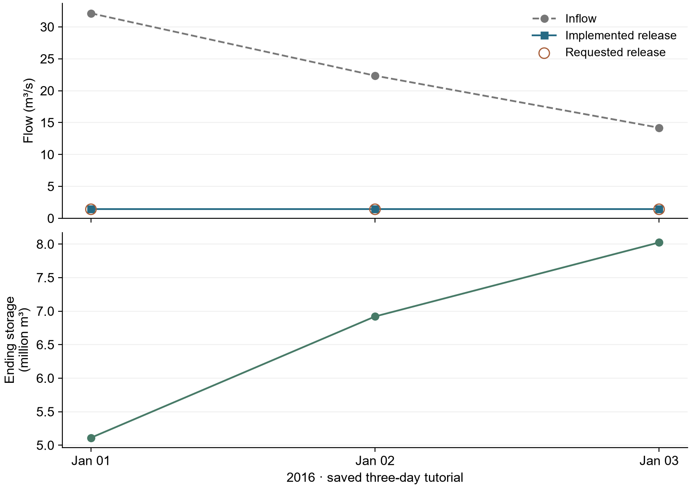

# F.E. Walter: LLM operation with retrieved knowledge

> Historical reference: this page preserves earlier settings and saved decisions.
> Start new work from the [current FE Walter tutorial](../../../tutorials/fe_walter.md)
> and read the [current annual results](../results.md).


[English](README.md) | [繁體中文](README.zh-TW.md) · [FE Walter case](../README.md)

This method adds conditionally retrieved, source-bound operating knowledge to
the same LLM interface used by the available-information method. The difference
is the information supplied to the model; it does not imply better policy performance.

Shared input and physical assumptions are defined in the [common case setup](../README.md#reservoir-experiment).

First review [the case hydrology](../hydrology.md) and [the coupled daily workflow](../coupling.md).
This method uses the same daily Dam/routing loop with precomputed inflow; the operation run does not recalculate GWLF.
Each implemented operation advances storage; LLM methods retain implemented release history.

**Optional three-day seasonal case:** use the [seasonal YAML](experiment.seasonal.ollama.yaml)
and [seasonal prompt](../prompts/reference/dkp_seasonal_v1_system.txt).
Read the [shared windows and pool checks](../README.md#seasonal-pool-levels).
This separate three-day seasonal YAML has not been rerun. Saved exchanges on
this page retain their original instructions and audit verdicts. See the
[current 2016 coupled results](../results.md) for
the maintained annual configuration.

## 1. Configure the method

Use local Ollama **gemma3:4b**, temperature **0.7**.
This tutorial covers three daily steps, one controlled reservoir and one independent
agent: at most three requests, with no retries.

[Full settings and commands are at the end](#files-and-commands). Use a new run ID and output location for a new simulation.

## 2. Understand the operation method

Read the [system prompt](../prompts/reference/dkp_system.txt)
and [builder reading preview](prompt_preview.txt). The preview is not the saved
model reply. The [complete saved day-one record](../../../examples/fe_walter/reference_outputs/ollama_three_day/dkp/raw/policy_87d975aee46dea6d4818b1f090efec8cc79b1e29a0fc31132d62799f2f3741b6.json)
contains the actual rendered prompt, retrieved excerpts, response schema and
full Ollama reply. The system template is fixed. The host tracks starting storage and converts it
to pool elevation; the rendered model message exposes the current pool elevation,
inflow and implemented release history, but not the numeric storage state. Editing
the preview does not change execution.

<details>
<summary>Exact saved day-one model exchange (expand)</summary>

**System message**

````text
You are the water control manager operating F.E. Walter Dam on the Lehigh River, Pennsylvania,
making one release decision per day.

Reservoir information (public sources):
- Name: F.E. Walter Dam on the Lehigh River, Pennsylvania
- Location: Bear Creek Township, Luzerne County and Kidder Township, Carbon County, Pennsylvania
- Purpose: flood control, water storage, recreation
- Opened: 1961; operated by the U.S. Army Corps of Engineers
- Type: earth-fill embankment with rock shell, impounding the Lehigh River
- Dam height (foundation): 234 ft; length: 3,000 ft
- Spillway type: concrete
- Catchment area: 289 square miles
- Total capacity (publicly reported): 110,700 acre-feet
- Operation target: Your goal is to keep the water level at or near the designated normal pool elevation: 1300.0 ft N.G.V.D. in the winter (November through April) and 1370.0 ft N.G.V.D. in the summer (May through October).

From the reservoir's water control manual:
- Storage at spillway crest (el. 1450.0 ft): 109,878 acre-feet
- Maximum allowable release: 10,000 cfs
- Minimum required release: 50 cfs

Your operating knowledge comes from the reservoir's Decision
Knowledge Package (DKP), extracted from the project's official
water control manual. Each day, the sections of the DKP most
relevant to the current conditions are retrieved and provided to
you together with the system state. Base your decision on those
retrieved DKP excerpts: apply their operating zones, decision
rules, release constraints, rating tables, and seasonal guidance.
This model represents the reservoir only: storage, inflow and release.
Apply the storage, inflow, seasonal and release-limit rules.
Do not invent an observation or rule.

How to apply the DKP in this simulation:
- Storage-to-elevation conversion is physical preprocessing and the current
  pool elevation may be supplied. Apply the shared operation target stated
  in the reservoir information; do not derive a different target from the DKP.
- Compare the current pool with that target yourself; no precomputed
  above-target or below-target interpretation is supplied.
- Gate-position rate limits are not discharge-rate limits. Do not convert
  them to cfs per hour without the required gate-rating information.
- Exhibit D's numerical recreation calendar is explicitly specific to 2014.
  In every other year, apply only the structural recreation constraints
  stated by the DKP and identify the annual calendar as unavailable; do not
  transfer the 2014 weekday, weekend, event-date, or numeric release schedule.
- No recommended release, target-tracking controller output, or precomputed
  above/below-target label is supplied. Select the release independently
  from the retrieved DKP rules and the raw state values.
- If the DKP does not provide a unique numeric release for the available
  inputs, do not invent an official formula. Choose the most defensible
  action allowed by the retrieved rules and explain it in the reasoning.
- No external reduced-domain release rule is supplied in this run.
- Use store_toward_target or draw_toward_target only when the selected
  release actually changes storage in that direction. Use pass_inflow only
  when the selected release is approximately equal to inflow.
- During seasonal refill, report store_toward_target; during seasonal
  drawdown, report draw_toward_target. Reserve recreation_plan for an
  applicable dated recreation-release instruction whose calendar is known.

Physical water balance (not an operating rule):
- storage_change_cubic_feet = (inflow_cfs - release_cfs) * 86,400 * interval_days.
- A release below inflow increases storage; a release equal to inflow
  leaves storage approximately unchanged; a release above inflow decreases
  storage. Passing inflow cannot refill a reservoir below its target.

Reduced-model hard constraints on your answer:
- Release between 50 and 10,000 cfs.
- Do not plan to release more water than is available (storage + inflow).
- Follow the DKP's rate-of-change rules.
- The 50-10,000 cfs bounds cannot represent the WCM's declared-drought
  43-cfs exception or its conditional post-flood >10,000-cfs exception;
  identify those conditions as outside the reduced-model scope.

Before answering, check that the proposed release changes storage in the
direction claimed by the reasoning. Respond only with JSON, with the
fields in this order:
  applicable_target_ft (the operation-target water level for this interval),
  pool_position (below_target | at_target | above_target),
  intended_storage_direction (increase | hold | decrease),
  release_relation_to_inflow (below_inflow | equal_to_inflow | above_inflow),
  operating_mode, rules_applied,
  reasoning, release_cfs (number).
Decide the first four, then write the reasoning, then choose release_cfs.
Make release_cfs consistent with the four fields and with your reasoning.
In rules_applied, copy the exact heading of every retrieved DKP section
used; do not invent rule identifiers.
````

**User message**

````text
Date: 2016-01-01 (January, day 1 of the year)
1. Today's inflow: 1,134.5 cfs (= 98,020,360 cubic feet (= 2,250 acre-feet) over 1 days)
2. Water level at beginning of interval: 1300.00 ft NGVD29
3. Previous simulated release decisions (and what was actually released):
   None (first simulated step).
4. Number of days in this decision interval: 1
5. Release limits for this interval (water control manual): 50-10,000 cfs (= 4,320,000-864,000,000 cubic feet over 1 days)

Retrieved DKP sections relevant to current conditions:

--- DKP excerpt 1: R-RELEASE (composite per-timestep decision; WCM Table 7-1 Parts A and B; §7-01, §7-03, §7-05) ---
```pseudo
plan = R-PLAN(pool_elevation, stages, season)

active_min = R-MINFC       if plan in {C, D} or impounding_for_flood_emergency   # 100 cfs
           | R-MINDROUGHT  if drbc_drought_declared                              #  43 cfs
           | R-MINNORM                                                           #  50 cfs

CASE plan OF
  A:  release = inflow_cfs, holding pool at or near target_pool_ft;
        obligations = Minimum Release Schedule + Water Quality Release Schedule (R-TEMP)

  B:  release_combined = MaxReleaseSchedule_Rising(stages)      # §2.4.5 — MOST RESTRICTIVE gage governs
        release_walter  = R-BALANCE(release_combined, pct_fc_storage_used,
                                    beltzville_state.pct_fc_storage_used)
        summer: defer to Exhibit D Recreation Plan (NOT SUPPLIED)
        apply R-FILLING whenever pool exceeds any previously attained elevation

  C:  release = active_min                                       # store all inflow at BOTH projects
        on stages_trend == falling_after_peak, switch to MaxReleaseSchedule_Falling (§2.4.5)

  D:  release = pass inflow (hourly or finer), gates incrementally to full open;
        once outlet capacity exceeded, HOLD full open until pool < EL_SPILLWAY;
        then outflow = inflow until MaxReleaseSchedule_Rising (Plan B) can be resumed

release = clip(release, lower = active_min,
                        upper = min( Q_CHANNEL_CAP,            # conditional — see R-ATSITE
                                     outlet_capacity(pool_elevation),
                                     R-DOWNSTREAM limit ) )

subject to R-ROC (gate-position limits, NOT a discharge-rate limit)

IF pool_elevation > EL_SPILLWAY:
    total_outflow = release + spillway_discharge(pool_elevation)   # uncontrolled, §2.4.3
```

--- DKP excerpt 2: R-MINNORM, R-MINFC, R-MINDROUGHT (Minimum Release Schedule; WCM Table 7-1 Part B; §7-01, §7-05,c,3, §8-04) ---
```pseudo
Flows maintained at the reservoir OUTFLOW gaging station (White Haven for Walter):

   Regulation purpose                     Walter (cfs)   Beltzville (cfs)
   1. Flood control regulation (storing)      100              35     -> R-MINFC
   2. Normal regulation                        50              35     -> R-MINNORM
   3. Drought warning and drought               43              15     -> R-MINDROUGHT

Precedence: R-MINFC applies whenever storing under Plans C/D; R-MINDROUGHT relaxes
R-MINNORM under a declared DRBC drought warning or emergency; R-MINNORM otherwise.
The 50 cfs is a Commonwealth of Pennsylvania Fish Commission requirement set to protect
downstream brook trout habitat (Table 7-1 Part B).
```

--- DKP excerpt 3: R-ATSITE (maximum release; WCM §4-09, §7-02a, §7-05,c,1, Table 7-2 notes 1–2) ---
```pseudo
release ≤ 10,000 cfs  "during non-spillway flow conditions ... should not be exceeded IF POSSIBLE"
   equivalently: stage_WhiteHaven ≤ 8.4 ft (Table 7-1 Part B note 5)
release ≤ outlet_capacity(pool_elevation)   [≈17,000 cfs at EL_SPILLWAY]

EXCEPTION (Table 7-2 note 1): during FALLING stages after a peak, releases in excess of
10,000 cfs MAY be considered, provided the release — combined with Beltzville's — does not
cause any key Lehigh station to exceed max(event_peak_stage, flood stage), whichever governs.
CONFIRMED BY RECORD: the WY1996 maximum discharge of 11,452 cfs (Table 8-1, 29 Jan 1996)
exceeds 10,000 cfs -- the exception is exercised in practice, not merely permitted.
=> the 10,000 cfs cap is a CONDITIONAL constraint, not a physical invariant.
```

--- DKP excerpt 4: R-ZONE (seasonal rule curve — the normal operating target; WCM §7-01, Plate 7-2) ---
```pseudo
target_pool_ft = 1300.0   # winter normal pool
Storage for recreation begins on/about 1 April; target date mid-May to reach 1370.0;
1370.0 is held and drawn on to make releases through mid-October; thereafter any
remaining water is released and the pool returns to 1300.0.

RATIONALE (§3-05,b,2(b)): 1370 is "the limit imposed to keep adequate flood control space
available since this volume can be quickly evacuated in advance of an oncoming storm event."

=> Recreation storage is ALWAYS subordinate and pre-releasable; it is NOT protected storage.
```

The simulated year is 2016. Check the year of every dated DKP instruction before applying it.
Apply these DKP rules to decide the mean release for this interval (cfs).
````

**Native assistant reply**

````json
{"applicable_target_ft": 1300.00, "pool_position": "at_target", "intended_storage_direction": "hold", "release_relation_to_inflow": "equal_to_inflow", "operating_mode": "minimum_release", "rules_applied": ["R-RELEASE", "R-MINNORM", "R-ZONE"], "reasoning": "Today is January 1st, and the operation target is 1300.0 ft. The DKP excerpt 2 states that R-MINNORM is applied unless a drought warning is declared. Since there is no drought warning declared, we apply R-MINNORM which specifies a minimum release of 50 cfs. The DKP excerpt 4 dictates that the target pool is 1300.0 ft and we are holding the pool at this level, so the release is equal to the inflow. The inflow is 1134.5 cfs. Therefore, the release should be 50 cfs plus 1134.5 cfs = 1139.5 cfs. However, the DKP excerpt 3 states that the maximum release is 10000 cfs. Since 1139.5 cfs < 10000 cfs, we will apply R-MINNORM. The release will be 50 cfs.", "release_cfs": 50}
````

</details>

The [DKP document](../knowledge/DKP_FEWalter_Dam_v1.2.md) supplies
applicable excerpts. The trace preserves the retrieval and its source.

Follow **info → rendered prompt → full reply → operation proposal → response
checks → actual release → next-day information** in the
[main tutorial](../../../tutorials/main.ipynb). It displays complete saved prompts
and replies, including the rationale; release is not the only response field.

## 3. Run the simulation

1. **Check** the dates, reservoirs, units and planned requests. This makes no model request.
2. **Run** local Ollama only when starting a new simulation. Reading saved results makes no request.
3. **Verify** saved trajectories, water balance and execution evidence. This does not certify a passing policy audit.

[Open the execution and verification commands](#files-and-commands).

## 4. Inspect saved decisions



The saved trajectory records requested release, implemented controlled
release, spill and ending storage. Total outflow is controlled release plus spill
and enters routing once. Next-day history uses implemented release.

| Date | Inflow (m³/s) | Requested (m³/s) | Implemented (m³/s) | Spill (m³/s) | Ending storage (m³) |
|---|---:|---:|---:|---:|---:|
| 2016-01-01 | 32.125319 | 1.415842 | 1.415842 | 0.000000 | 5,111,147.04 |
| 2016-01-02 | 22.353047 | 1.415842 | 1.415842 | 0.000000 | 6,920,121.54 |
| 2016-01-03 | 14.193931 | 1.415842 | 1.415842 | 0.000000 | 8,024,148.43 |

### A recorded decision: 2016-01-01

Follow the supplied values, complete model reply, checks and executed result. Everything below comes from saved records; no new model request is needed.

| Information | Value |
|---|---:|
| Inflow (m³/s) | 32.125319 |
| Starting pool elevation (ft NGVD29) | 1300.000000 |
| Host starting storage (m³) | 2,457,848.28 |

The prompt exposes pool elevation; numeric storage remains with the host and is absent from this version’s model message.

**Complete raw assistant reply**

```json
{"applicable_target_ft": 1300.00, "pool_position": "at_target", "intended_storage_direction": "hold", "release_relation_to_inflow": "equal_to_inflow", "operating_mode": "minimum_release", "rules_applied": ["R-RELEASE", "R-MINNORM", "R-ZONE"], "reasoning": "Today is January 1st, and the operation target is 1300.0 ft. The DKP excerpt 2 states that R-MINNORM is applied unless a drought warning is declared. Since there is no drought warning declared, we apply R-MINNORM which specifies a minimum release of 50 cfs. The DKP excerpt 4 dictates that the target pool is 1300.0 ft and we are holding the pool at this level, so the release is equal to the inflow. The inflow is 1134.5 cfs. Therefore, the release should be 50 cfs plus 1134.5 cfs = 1139.5 cfs. However, the DKP excerpt 3 states that the maximum release is 10000 cfs. Since 1139.5 cfs < 10000 cfs, we will apply R-MINNORM. The release will be 50 cfs.", "release_cfs": 50}
```

**Response checks and operation audit**

| Check | Rule / saved evidence | Result |
|---|---|---|
| Complete generation | `done: true`, `done_reason: stop` | **COMPLETE** |
| Reply format | JSON, required target / direction / rationale / release fields; required fields are defined in the linked raw record | **RECORDED REPLY** |
| Normalized action | Current recheck of finite, nonnegative `release_cms`; not a historical checker event | **PASS** |
| Feasible release bound | Saved named `release_limits` auditor | **PASS** |
| Operating consistency | Target / pool, release–inflow relation, intended storage direction and applicable rules | **FAIL** |

Saved audit reasons:

- `release_relation_to_inflow 'equal_to_inflow' contradicts release 50.0 vs inflow 1,134.5 cfs`
- `intended_storage_direction 'hold' contradicts the water balance (storage will increase)`

**Implemented operation and water balance**

| Outcome | Value |
|---|---:|
| Requested release (m³/s) | 1.415842 |
| Implemented release (m³/s) | 1.415842 |
| Spill (m³/s) | 0.000000 |
| Ending storage (m³) | 5,111,147.036945 |
| Balance residual (m³) | 0.000000 |

Audit FAIL is an operating diagnosis; this saved run did not replace the release because of it. Storage changed by **2,653,298.76 m³**. Implemented release plus spill enters routing once; the next daily history uses the implemented value.

[Full prompt and response](../../../examples/fe_walter/reference_outputs/ollama_three_day/dkp/raw/policy_87d975aee46dea6d4818b1f090efec8cc79b1e29a0fc31132d62799f2f3741b6.json) · [Raw audit](../../../examples/fe_walter/reference_outputs/ollama_three_day/dkp/raw/audit_87d975aee46dea6d4818b1f090efec8cc79b1e29a0fc31132d62799f2f3741b6.json) · [Execution records](../../../examples/fe_walter/reference_outputs/ollama_three_day/dkp/physics.jsonl)


[Historical 2016–2020 results and decision records](../results_history.md)

The table shows this method's saved three-day trajectory, not a policy-performance
assessment. Downloads retain full precision. The linked five-year results belong
to a separate retrieved-knowledge experiment, not a five-year comparison of all three methods.

The saved operating audit retains **0 PASS / 3 FAIL**.
Its strategy acceptance remains unset. A valid reply and feasible release do not
imply a passing operating audit.

[View the main tutorial](../../../tutorials/main.ipynb) ·
[Module reference](../../../docs/LLM_MODULES.md) ·
[Multiple reservoirs](../../../tutorials/advanced.ipynb)

## Files and commands

<details>
<summary>Expand settings, file locations and commands</summary>

Open [experiment.ollama.yaml](experiment.ollama.yaml). The YAML selects local Ollama `gemma3:4b`, **temperature 0.7**, daily steps,
**at most three requests**, and **no retries**. Each controlled reservoir is
assigned one independent agent; this case has one.

<details>
<summary>Current equivalent configuration (expand)</summary>

```yaml
# User-requested three-day local Ollama diagnostic; check performs no provider call.
schema_version: llm-reservoir-experiment.v1
case: ../../../cases/fe_walter_ollama_demo/case.json
start_date: "2016-01-01"
end_date: "2016-01-03"
run_id: hydroopslm-fe-walter-dkp-ollama-gemma3-4b-20261012
output: ../../../runs/hydroopslm-fe-walter-dkp-ollama-gemma3-4b-20261012
max_calls: 3
models:
  reservoir_model:
    provider: ollama
    model: gemma3:4b
    base_url: http://localhost:11434
    temperature: 0.7
    max_tokens: 2048
    seed: null
    timeout_seconds: 120
    api_key_env: null
auditors:
  release_limits:
    type: release_bounds
    version: "1"
agents:
  fe_operator:
    reservoir_id: FEWalter
    type: llm
    model_profile: reservoir_model
    customization:
      backend: reference_v3_7
      parameters:
        reference:
          profile: fe_walter
          method: dkp
          system_prompt: ../prompts/reference/dkp_system.txt
          system_prompt_mode: original
          dkp: ../knowledge/DKP_FEWalter_Dam_v1.2.md
          prompt_storage: false
          hide_availability_line: true
          dkp_no_missing_inputs: true
          zeroshot_knowledge: target
    auditors: [release_limits]

extensions:
  reference_v3_7: ../extensions/__init__.py
```

</details>

For a new run, copy it beside its original:

```powershell
Copy-Item examples/fe_walter/dkp/experiment.ollama.yaml examples/fe_walter/dkp/my-run.yaml
```

In `my-run.yaml`, set `run_id: fe-walter-dkp-my-run` and
`output: ../../../runs/fe-walter-dkp-my-run`. Keep the remaining settings for this first
demonstration. An existing output folder must not be reused.

The `dkp` directory and provenance value are historical machine IDs kept
unchanged for reproducibility. In the preserved implementation, DKP names the
document-knowledge-prompting workflow and its pinned retrieval contract.

### Check the configuration

Validate your copied configuration from the repository folder:

```powershell
python run_experiment.py check examples/fe_walter/dkp/my-run.yaml
```

This checks the configuration without inference or a model request.
Expect three daily steps, one agent, `planned_llm_calls: 3`, `max_calls: 3`,
and no calls during `check`.

### Execute a new run

The [saved three-day result](../../../examples/fe_walter/reference_outputs/ollama_three_day/dkp/) is already available.
Only execute the following if you intend to start a new simulation:

```powershell
python run_experiment.py run examples/fe_walter/dkp/my-run.yaml --allow-network
```

Ollama must already be running with `gemma3:4b` available. `--allow-network`
permits the configured local model requests. This example has a three-request
limit and no automatic retries. An invalid reply stops before release is applied.

### Verify saved outputs

Verify the existing saved result without rerunning its simulation:

```powershell
python run_experiment.py verify examples/fe_walter/reference_outputs/ollama_three_day/dkp
```

After your new run, use `runs/fe-walter-dkp-my-run` instead. Verification checks execution
evidence; it does not establish that the operating policy is good.

Inspect the saved decision:

```powershell
python tutorials/inspect_decision_flow.py examples/fe_walter/reference_outputs/ollama_three_day/dkp
```

`decisions.jsonl`, `raw/`, `audit.jsonl`, `physics.jsonl` and `backend_events.jsonl`
link the information and proposal to checks and execution. The notebook separates
the recorded checker result from a current contract recheck. The inspector makes
no model request. See [results and troubleshooting](../../../docs/RESULTS_GUIDE.md).

</details>
