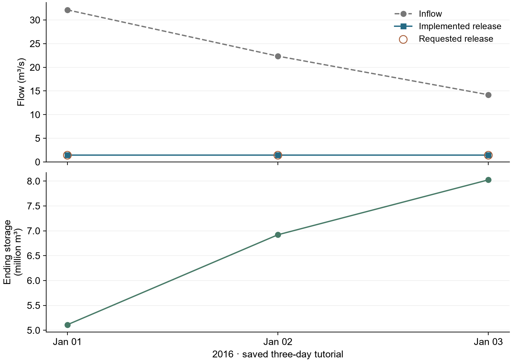

# F.E. Walter：使用檢索知識的 LLM 操作

> 歷史參考：本頁保存較早設定與決策紀錄。新的研究請從[最新版 FE Walter 教學](../../../tutorials/fe_walter.md)開始，
> 並查看[目前全年結果](../results.zh-TW.md)。


[English](README.md) | [繁體中文](README.zh-TW.md) · [FE Walter 案例](../README.zh-TW.md)

此方法在使用可用資訊的方法所用的相同 LLM 介面上，加入依條件檢索、與來源綁定
的操作知識。兩者的差別是提供給模型的資訊；這不代表策略績效更好。

共用 input 與物理假設請先看[共用案例設定](../README.zh-TW.md)。

先確認[本案例水文設定](../hydrology.zh-TW.md)與[每日耦合流程](../coupling.zh-TW.md)。
此方法接在相同每日 Dam／routing 迴圈，使用預先模擬入流；操作執行不重算 GWLF。
每次實際操作更新蓄水；LLM 方法保留實際放流歷史。

**選用三日季節案例：**使用[季節 YAML](experiment.seasonal.ollama.yaml)與
[季節 prompt](../prompts/retrieved_knowledge.txt)。
[共用窗口與水位檢查](../README.zh-TW.md#季節水位)說明日期與判定。
這份獨立三日季節 YAML 尚未重跑；本頁保存的完整交換仍保留原始指令與 audit 判定。
目前維護的全年設定，請見英文[2016 年耦合結果](../results.md)。

## 1. 設定操作方法

使用本機 Ollama **gemma3:4b**，temperature **0.7**。
此教學涵蓋三個每日步驟、一座受控水庫及一個獨立 agent；最多三次請求，不重試。

[完整設定與命令列於頁末](#dkp-files-and-commands)。新執行須使用新的識別碼與輸出位置。

## 2. 了解操作方法

閱讀 [system prompt](../../../archive/fe_walter/prompts/retrieved_original.txt)與
[builder 閱讀預覽](prompt_preview.txt)。此預覽不是保存的模型回覆。
[完整的第一日保存紀錄](../../../examples/fe_walter/reference_outputs/ollama_three_day/dkp/raw/policy_87d975aee46dea6d4818b1f090efec8cc79b1e29a0fc31132d62799f2f3741b6.json)
包含實際 rendered prompt、檢索摘錄、response schema 與完整 Ollama 回覆。
System template 固定不變。Host 會追蹤起始 storage 並轉換成 pool elevation；
rendered model message 會顯示目前 pool elevation、inflow 與實際執行的 release
歷史，但不顯示數值 storage state。編輯預覽不會改變執行內容。

<details>
<summary>保存的完整第一日 model exchange（展開）</summary>

**System message**

````text
You are the water control manager operating F.E. Walter Dam on the Lehigh River, Pennsylvania,
making one release decision per day.

Reservoir information (public sources):
- Name: F.E. Walter Dam on the Lehigh River, Pennsylvania
- Location: Bear Creek Township, Luzerne County and Kidder Township, Carbon County, Pennsylvania
- Purpose: flood control, water storage, recreation
- Opened: 1961; operated by the U.S. Army Corps of Engineers
- Type: earth-fill embankment with rock shell, impounding the Lehigh River
- Dam height (foundation): 234 ft; length: 3,000 ft
- Spillway type: concrete
- Catchment area: 289 square miles
- Total capacity (publicly reported): 110,700 acre-feet
- Operation target: Your goal is to keep the water level at or near the designated normal pool elevation: 1300.0 ft N.G.V.D. in the winter (November through April) and 1370.0 ft N.G.V.D. in the summer (May through October).

From the reservoir's water control manual:
- Storage at spillway crest (el. 1450.0 ft): 109,878 acre-feet
- Maximum allowable release: 10,000 cfs
- Minimum required release: 50 cfs

Your operating knowledge comes from the reservoir's Decision
Knowledge Package (DKP), extracted from the project's official
water control manual. Each day, the sections of the DKP most
relevant to the current conditions are retrieved and provided to
you together with the system state. Base your decision on those
retrieved DKP excerpts: apply their operating zones, decision
rules, release constraints, rating tables, and seasonal guidance.
This model represents the reservoir only: storage, inflow and release.
Apply the storage, inflow, seasonal and release-limit rules.
Do not invent an observation or rule.

How to apply the DKP in this simulation:
- Storage-to-elevation conversion is physical preprocessing and the current
  pool elevation may be supplied. Apply the shared operation target stated
  in the reservoir information; do not derive a different target from the DKP.
- Compare the current pool with that target yourself; no precomputed
  above-target or below-target interpretation is supplied.
- Gate-position rate limits are not discharge-rate limits. Do not convert
  them to cfs per hour without the required gate-rating information.
- Exhibit D's numerical recreation calendar is explicitly specific to 2014.
  In every other year, apply only the structural recreation constraints
  stated by the DKP and identify the annual calendar as unavailable; do not
  transfer the 2014 weekday, weekend, event-date, or numeric release schedule.
- No recommended release, target-tracking controller output, or precomputed
  above/below-target label is supplied. Select the release independently
  from the retrieved DKP rules and the raw state values.
- If the DKP does not provide a unique numeric release for the available
  inputs, do not invent an official formula. Choose the most defensible
  action allowed by the retrieved rules and explain it in the reasoning.
- No external reduced-domain release rule is supplied in this run.
- Use store_toward_target or draw_toward_target only when the selected
  release actually changes storage in that direction. Use pass_inflow only
  when the selected release is approximately equal to inflow.
- During seasonal refill, report store_toward_target; during seasonal
  drawdown, report draw_toward_target. Reserve recreation_plan for an
  applicable dated recreation-release instruction whose calendar is known.

Physical water balance (not an operating rule):
- storage_change_cubic_feet = (inflow_cfs - release_cfs) * 86,400 * interval_days.
- A release below inflow increases storage; a release equal to inflow
  leaves storage approximately unchanged; a release above inflow decreases
  storage. Passing inflow cannot refill a reservoir below its target.

Reduced-model hard constraints on your answer:
- Release between 50 and 10,000 cfs.
- Do not plan to release more water than is available (storage + inflow).
- Follow the DKP's rate-of-change rules.
- The 50-10,000 cfs bounds cannot represent the WCM's declared-drought
  43-cfs exception or its conditional post-flood >10,000-cfs exception;
  identify those conditions as outside the reduced-model scope.

Before answering, check that the proposed release changes storage in the
direction claimed by the reasoning. Respond only with JSON, with the
fields in this order:
  applicable_target_ft (the operation-target water level for this interval),
  pool_position (below_target | at_target | above_target),
  intended_storage_direction (increase | hold | decrease),
  release_relation_to_inflow (below_inflow | equal_to_inflow | above_inflow),
  operating_mode, rules_applied,
  reasoning, release_cfs (number).
Decide the first four, then write the reasoning, then choose release_cfs.
Make release_cfs consistent with the four fields and with your reasoning.
In rules_applied, copy the exact heading of every retrieved DKP section
used; do not invent rule identifiers.
````

**User message**

````text
Date: 2016-01-01 (January, day 1 of the year)
1. Today's inflow: 1,134.5 cfs (= 98,020,360 cubic feet (= 2,250 acre-feet) over 1 days)
2. Water level at beginning of interval: 1300.00 ft NGVD29
3. Previous simulated release decisions (and what was actually released):
   None (first simulated step).
4. Number of days in this decision interval: 1
5. Release limits for this interval (water control manual): 50-10,000 cfs (= 4,320,000-864,000,000 cubic feet over 1 days)

Retrieved DKP sections relevant to current conditions:

--- DKP excerpt 1: R-RELEASE (composite per-timestep decision; WCM Table 7-1 Parts A and B; §7-01, §7-03, §7-05) ---
```pseudo
plan = R-PLAN(pool_elevation, stages, season)

active_min = R-MINFC       if plan in {C, D} or impounding_for_flood_emergency   # 100 cfs
           | R-MINDROUGHT  if drbc_drought_declared                              #  43 cfs
           | R-MINNORM                                                           #  50 cfs

CASE plan OF
  A:  release = inflow_cfs, holding pool at or near target_pool_ft;
        obligations = Minimum Release Schedule + Water Quality Release Schedule (R-TEMP)

  B:  release_combined = MaxReleaseSchedule_Rising(stages)      # §2.4.5 — MOST RESTRICTIVE gage governs
        release_walter  = R-BALANCE(release_combined, pct_fc_storage_used,
                                    beltzville_state.pct_fc_storage_used)
        summer: defer to Exhibit D Recreation Plan (NOT SUPPLIED)
        apply R-FILLING whenever pool exceeds any previously attained elevation

  C:  release = active_min                                       # store all inflow at BOTH projects
        on stages_trend == falling_after_peak, switch to MaxReleaseSchedule_Falling (§2.4.5)

  D:  release = pass inflow (hourly or finer), gates incrementally to full open;
        once outlet capacity exceeded, HOLD full open until pool < EL_SPILLWAY;
        then outflow = inflow until MaxReleaseSchedule_Rising (Plan B) can be resumed

release = clip(release, lower = active_min,
                        upper = min( Q_CHANNEL_CAP,            # conditional — see R-ATSITE
                                     outlet_capacity(pool_elevation),
                                     R-DOWNSTREAM limit ) )

subject to R-ROC (gate-position limits, NOT a discharge-rate limit)

IF pool_elevation > EL_SPILLWAY:
    total_outflow = release + spillway_discharge(pool_elevation)   # uncontrolled, §2.4.3
```

--- DKP excerpt 2: R-MINNORM, R-MINFC, R-MINDROUGHT (Minimum Release Schedule; WCM Table 7-1 Part B; §7-01, §7-05,c,3, §8-04) ---
```pseudo
Flows maintained at the reservoir OUTFLOW gaging station (White Haven for Walter):

   Regulation purpose                     Walter (cfs)   Beltzville (cfs)
   1. Flood control regulation (storing)      100              35     -> R-MINFC
   2. Normal regulation                        50              35     -> R-MINNORM
   3. Drought warning and drought               43              15     -> R-MINDROUGHT

Precedence: R-MINFC applies whenever storing under Plans C/D; R-MINDROUGHT relaxes
R-MINNORM under a declared DRBC drought warning or emergency; R-MINNORM otherwise.
The 50 cfs is a Commonwealth of Pennsylvania Fish Commission requirement set to protect
downstream brook trout habitat (Table 7-1 Part B).
```

--- DKP excerpt 3: R-ATSITE (maximum release; WCM §4-09, §7-02a, §7-05,c,1, Table 7-2 notes 1–2) ---
```pseudo
release ≤ 10,000 cfs  "during non-spillway flow conditions ... should not be exceeded IF POSSIBLE"
   equivalently: stage_WhiteHaven ≤ 8.4 ft (Table 7-1 Part B note 5)
release ≤ outlet_capacity(pool_elevation)   [≈17,000 cfs at EL_SPILLWAY]

EXCEPTION (Table 7-2 note 1): during FALLING stages after a peak, releases in excess of
10,000 cfs MAY be considered, provided the release — combined with Beltzville's — does not
cause any key Lehigh station to exceed max(event_peak_stage, flood stage), whichever governs.
CONFIRMED BY RECORD: the WY1996 maximum discharge of 11,452 cfs (Table 8-1, 29 Jan 1996)
exceeds 10,000 cfs -- the exception is exercised in practice, not merely permitted.
=> the 10,000 cfs cap is a CONDITIONAL constraint, not a physical invariant.
```

--- DKP excerpt 4: R-ZONE (seasonal rule curve — the normal operating target; WCM §7-01, Plate 7-2) ---
```pseudo
target_pool_ft = 1300.0   # winter normal pool
Storage for recreation begins on/about 1 April; target date mid-May to reach 1370.0;
1370.0 is held and drawn on to make releases through mid-October; thereafter any
remaining water is released and the pool returns to 1300.0.

RATIONALE (§3-05,b,2(b)): 1370 is "the limit imposed to keep adequate flood control space
available since this volume can be quickly evacuated in advance of an oncoming storm event."

=> Recreation storage is ALWAYS subordinate and pre-releasable; it is NOT protected storage.
```

The simulated year is 2016. Check the year of every dated DKP instruction before applying it.
Apply these DKP rules to decide the mean release for this interval (cfs).
````

**Native assistant reply**

````json
{"applicable_target_ft": 1300.00, "pool_position": "at_target", "intended_storage_direction": "hold", "release_relation_to_inflow": "equal_to_inflow", "operating_mode": "minimum_release", "rules_applied": ["R-RELEASE", "R-MINNORM", "R-ZONE"], "reasoning": "Today is January 1st, and the operation target is 1300.0 ft. The DKP excerpt 2 states that R-MINNORM is applied unless a drought warning is declared. Since there is no drought warning declared, we apply R-MINNORM which specifies a minimum release of 50 cfs. The DKP excerpt 4 dictates that the target pool is 1300.0 ft and we are holding the pool at this level, so the release is equal to the inflow. The inflow is 1134.5 cfs. Therefore, the release should be 50 cfs plus 1134.5 cfs = 1139.5 cfs. However, the DKP excerpt 3 states that the maximum release is 10000 cfs. Since 1139.5 cfs < 10000 cfs, we will apply R-MINNORM. The release will be 50 cfs.", "release_cfs": 50}
````

</details>

[DKP 文件](../knowledge/operating_rules.md)提供適用的摘錄。
Trace 會保存檢索結果及其來源。

在[主教學](../../../tutorials/main.ipynb)中依序查看 **info → rendered prompt →
full reply → operation proposal → response checks → actual release → next-day
information**。Notebook 會顯示完整的保存 prompt 與回覆，包括 rationale；
release 不是唯一的回覆欄位。

## 3. 執行模擬

1. **檢查設定**：確認期間、水庫、單位與預計請求數；此步驟不呼叫模型。
2. **執行**：只在你要新增模擬時呼叫本機 Ollama；查看現有結果不會提出請求。
3. **驗證**：檢查保存的軌跡、水量平衡與執行證據；這不代表策略 audit 通過。

[查看執行與驗證命令](#dkp-files-and-commands)。

## 4. 查看保存決策



保存的軌跡會列出 requested release、實際執行的 controlled
release、spill 與 ending storage。總出流是 controlled release 加 spill，且只會
進入 routing 一次。次日歷史使用實際執行的 release。

| 日期 | 入流 (m³/s) | 請求值 (m³/s) | 執行值 (m³/s) | Spill (m³/s) | 期末蓄水 (m³) |
|---|---:|---:|---:|---:|---:|
| 2016-01-01 | 32.125319 | 1.415842 | 1.415842 | 0.000000 | 5,111,147.04 |
| 2016-01-02 | 22.353047 | 1.415842 | 1.415842 | 0.000000 | 6,920,121.54 |
| 2016-01-03 | 14.193931 | 1.415842 | 1.415842 | 0.000000 | 8,024,148.43 |

### 一個實際決策：2016-01-01

依序查看模型收到的數值、完整回覆、檢查與執行結果。以下全部來自已保存的紀錄，沒有新增模型請求。

| 資訊 | 值 |
|---|---:|
| 入流 (m³/s) | 32.125319 |
| 期初水位 (ft NGVD29) | 1300.000000 |
| Host 期初蓄水 (m³) | 2,457,848.28 |

Prompt 顯示水位；數值蓄水保留於 host，並未送入此版本的模型文字。

**完整的原始 assistant 回覆**

```json
{"applicable_target_ft": 1300.00, "pool_position": "at_target", "intended_storage_direction": "hold", "release_relation_to_inflow": "equal_to_inflow", "operating_mode": "minimum_release", "rules_applied": ["R-RELEASE", "R-MINNORM", "R-ZONE"], "reasoning": "Today is January 1st, and the operation target is 1300.0 ft. The DKP excerpt 2 states that R-MINNORM is applied unless a drought warning is declared. Since there is no drought warning declared, we apply R-MINNORM which specifies a minimum release of 50 cfs. The DKP excerpt 4 dictates that the target pool is 1300.0 ft and we are holding the pool at this level, so the release is equal to the inflow. The inflow is 1134.5 cfs. Therefore, the release should be 50 cfs plus 1134.5 cfs = 1139.5 cfs. However, the DKP excerpt 3 states that the maximum release is 10000 cfs. Since 1139.5 cfs < 10000 cfs, we will apply R-MINNORM. The release will be 50 cfs.", "release_cfs": 50}
```

**格式檢查與操作 audit**

| 檢查 | 規則／保存證據 | 判定 |
|---|---|---|
| 完成回覆 | `done: true`, `done_reason: stop` | **COMPLETE** |
| 回覆格式 | JSON, required target / direction / rationale / release fields; 必要欄位見連結的原始 schema | **RECORDED REPLY** |
| 正規化 action | 本次重新檢查有限、非負的 `release_cms`；不是歷史 checker event | **PASS** |
| 放流可行範圍 | 具名 `release_limits` auditor 的保存結果 | **PASS** |
| 操作一致性 | 目標／水位、放流與入流關係、預期蓄水方向及適用規則 | **FAIL** |

保存的 audit 原因：

- `release_relation_to_inflow 'equal_to_inflow' contradicts release 50.0 vs inflow 1,134.5 cfs`
- `intended_storage_direction 'hold' contradicts the water balance (storage will increase)`

**實際執行與水量平衡**

| 結果 | 值 |
|---|---:|
| 請求放流 (m³/s) | 1.415842 |
| 實際受控放流 (m³/s) | 1.415842 |
| 溢流 (m³/s) | 0.000000 |
| 期末蓄水 (m³) | 5,111,147.036945 |
| 水量平衡殘差 (m³) | 0.000000 |

Audit FAIL 是操作診斷；本次保存的執行未因此替換放流。 蓄水變化為 **2,653,298.76 m³**。實際放流加 spill 只注入 routing 一次，下一日歷史使用已執行值。

[完整 prompt／回覆](../../../examples/fe_walter/reference_outputs/ollama_three_day/dkp/raw/policy_87d975aee46dea6d4818b1f090efec8cc79b1e29a0fc31132d62799f2f3741b6.json) · [原始 audit](../../../examples/fe_walter/reference_outputs/ollama_three_day/dkp/raw/audit_87d975aee46dea6d4818b1f090efec8cc79b1e29a0fc31132d62799f2f3741b6.json) · [執行紀錄](../../../examples/fe_walter/reference_outputs/ollama_three_day/dkp/physics.jsonl)


[完整 2016–2020 結果與決策紀錄](../results_history.zh-TW.md)

上表呈現此方法的三日保存結果，並非策略績效評估；下載資料保留完整精度。
連結的五年結果屬另一份知識檢索實驗，並非三種方法的五年比較。

保存的操作 audit 保留 **0 PASS / 3 FAIL**，strategy acceptance 仍未設定。
有效回覆與可執行的 release 不代表操作 audit 必定通過。

[查看主教學](../../../tutorials/main.ipynb) ·
[模組參考](../../../docs/LLM_MODULES.md) ·
[多座水庫](../../../tutorials/advanced.ipynb)

(dkp-files-and-commands)=
## 檔案與執行命令

<details>
<summary>展開設定、檔案位置與命令</summary>

開啟 [experiment.ollama.yaml](experiment.ollama.yaml)。YAML 選用本機 Ollama
`gemma3:4b`、**temperature 0.7**、每日步長、**最多三次請求**，且**不重試**。
每座受控水庫都分配一個獨立 agent；此案例只有一座。

<details>
<summary>目前等價設定（展開）</summary>

```yaml
# User-requested three-day local Ollama diagnostic; check performs no provider call.
schema_version: llm-reservoir-experiment.v1
case: ../../../cases/fe_walter_ollama_demo/case.json
start_date: "2016-01-01"
end_date: "2016-01-03"
run_id: hydroopslm-fe-walter-dkp-ollama-gemma3-4b-20261012
output: ../../../runs/hydroopslm-fe-walter-dkp-ollama-gemma3-4b-20261012
max_calls: 3
models:
  reservoir_model:
    provider: ollama
    model: gemma3:4b
    base_url: http://localhost:11434
    temperature: 0.7
    max_tokens: 2048
    seed: null
    timeout_seconds: 120
    api_key_env: null
auditors:
  release_limits:
    type: release_bounds
    version: "1"
agents:
  fe_operator:
    reservoir_id: FEWalter
    type: llm
    model_profile: reservoir_model
    customization:
      backend: reference_v3_7
      parameters:
        reference:
          profile: fe_walter
          method: dkp
          system_prompt: ../../../archive/fe_walter/prompts/retrieved_original.txt
          system_prompt_mode: original
          dkp: ../knowledge/operating_rules.md
          prompt_storage: false
          hide_availability_line: true
          dkp_no_missing_inputs: true
          zeroshot_knowledge: target
    auditors: [release_limits]

extensions:
  reference_v3_7: ../extensions/__init__.py
```

</details>

若要建立新執行，請在原檔旁複製一份：

```powershell
Copy-Item examples/fe_walter/dkp/experiment.ollama.yaml examples/fe_walter/dkp/my-run.yaml
```

在 `my-run.yaml` 中設定 `run_id: fe-walter-dkp-my-run` 與
`output: ../../../runs/fe-walter-dkp-my-run`。第一次示範請保留其他設定。
不得重複使用現有的輸出資料夾。

`dkp` 目錄與 provenance 值是為重現性保留、不作變更的歷史機器 ID。在保存的
實作中，DKP 指 document-knowledge-prompting workflow 及其固定的 retrieval contract。

### 檢查設定

從 repository 資料夾驗證複製的設定：

```powershell
python run_experiment.py check examples/fe_walter/dkp/my-run.yaml
```

此命令檢查設定，不會進行 inference 或模型請求。
預期結果是三個每日步驟、一個 agent、`planned_llm_calls: 3`、
`max_calls: 3`，且 `check` 本身不提出請求。

### 執行新的實驗

[保存的三日結果](../../../examples/fe_walter/reference_outputs/ollama_three_day/dkp/)已可使用。
只有在確定要啟動新 simulation 時，才執行以下命令：

```powershell
python run_experiment.py run examples/fe_walter/dkp/my-run.yaml --allow-network
```

Ollama 必須已在執行，且可使用 `gemma3:4b`。`--allow-network` 允許設定的本機
模型請求。此範例最多提出三次請求，不會自動重試。無效回覆會在套用 release
之前停止。

### 驗證保存輸出

驗證現有的保存結果，不重跑 simulation：

```powershell
python run_experiment.py verify examples/fe_walter/reference_outputs/ollama_three_day/dkp
```

完成新執行後，改用 `runs/fe-walter-dkp-my-run`。驗證會檢查執行證據，
不能證明操作策略良好。

檢查保存的決策：

```powershell
python tutorials/inspect_decision_flow.py examples/fe_walter/reference_outputs/ollama_three_day/dkp
```

`decisions.jsonl`、`raw/`、`audit.jsonl`、`physics.jsonl` 與
`backend_events.jsonl` 會將資訊與提案連結至檢查及執行。Notebook 將紀錄的
checker 結果與目前的 contract recheck 分開呈現。Inspector 不會提出模型請求。
詳見[結果與疑難排解](../../../docs/RESULTS_GUIDE.md)。

</details>
