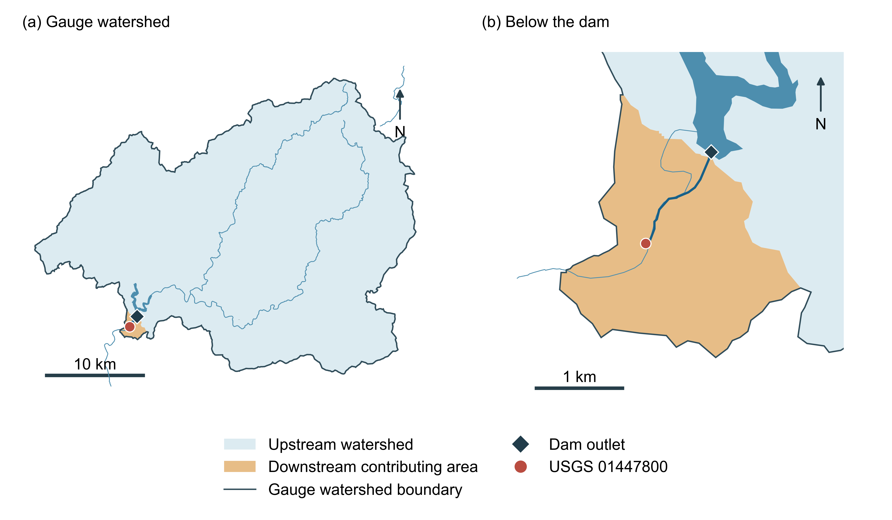
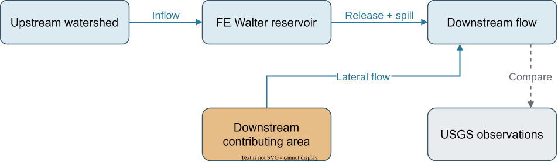

# Saved 2016 flow at White Haven

[English](README.md) | [繁體中文](README.zh-TW.md)

This extension compares flow at [USGS 01447800](https://waterdata.usgs.gov/monitoring-location/USGS-01447800/),
just below FE Walter, with the three saved 2016 operation methods. The comparison
holds their actual releases fixed. The observations are used only for evaluation.
Open the [tutorial notebook](../../../tutorials/main.ipynb) to read the saved outputs.

The [downstream calibration and validation reference](validation.md) describes
the separate White Haven–Lehighton hydrology test. The parameters and scores
below belong to this saved 2016 comparison.

## Watershed and water connections

The **gauge watershed** is the full area draining to the selected river-network
outlet. It contains the **upstream watershed**, whose runoff enters the reservoir,
and the **downstream contributing area**, whose runoff joins the river below the dam.

The old seven-unit GIS already covers the gauge watershed: 750.811 km².
A new [NLDI basin](https://api.water.usgs.gov/docs/nldi/basin/) request for the dam's
river reach gives 746.471 km², leaving approximately 4.341 km² below that boundary.
Most of this area is inside the old FEW-R-02 unit. Adding its runoff at the gauge
while retaining it in the reservoir inlet would count it twice in a new coupled run.
The generated configurations therefore separate these contributions.

These polygons use complete NHDPlusV2 catchments. The local catchments remain
unsplit at the exact dam and gauge coordinates. The map is a documented network
approximation; a finer delineation is needed before claiming an exact dam boundary.



**Figure 1.** The complete gauge watershed (750.811 km²) contains the upstream
watershed and the orange downstream contributing area (approximately 4.341 km²).
Panel (b) enlarges the dam and USGS station. Boundaries come from NLDI; river and
reservoir context comes from the retained project GIS. [SVG](../../../tests/fixtures/fe_walter_history/downstream_outputs/watershed.svg)
and [PDF](../../../tests/fixtures/fe_walter_history/downstream_outputs/watershed.pdf) retain editable text.

## From saved release to gauge flow

All flows below are daily means in m³/s. The gauge flow is

$$
Q_g(t)=\sum_{k=0}^{K-1}h_k\,[R(t-k)+S(t-k)]+Q_{\mathrm{lateral},g}(t),
\qquad \sum_k h_k=1,
$$

where $R$ is implemented controlled release, $S$ is spill, $h_k$ is the channel
unit hydrograph, and $Q_{\mathrm{lateral},g}$ is lateral runoff after its own
catchment routing. The lateral term enters at the gauge and passes through its
catchment routing once. The channel carries reservoir outflow over a measured
network distance of approximately 1.398 km.

HydroCNHS supplies the native GWLF runoff and Lohmann routing functions. The
lateral pieces inherit their original units' saved climate and parameters, with
area changed to the measured polygon intersection. Soil and snow initialization
begins in 1989. The channel inherits the upstream velocity and diffusion parameters;
its application here remains a transfer assumption, without a new fit to USGS.
The raw native kernel and the bounded removal of floating-point noise are saved
in [routing.json](../../../tests/fixtures/fe_walter_history/downstream_outputs/routing.json).



**Figure 2.** Water connections for the separated boundaries. Solid blue arrows
carry water; the dashed comparison uses independent observations. In the present
comparison, the reservoir supplies saved releases.

## Read the comparison

The USGS file contains 366 approved daily means for 2016, with no missing values.
The first 20 simulation days assume an initially empty channel; they remain in
the figure and CSV but are excluded from the 346 paired evaluation days.
The full convolution tail after December 31 is retained in a separate CSV.

| Method | Paired days | NSE | KGE (2009) | Relative volume bias |
|---|---:|---:|---:|---:|
| Rule-based | 346 | −0.006 | 0.547 | −2.73% |
| LLM without operational knowledge | 346 | −0.812 | 0.233 | +13.06% |
| LLM with operational knowledge | 346 | −0.792 | 0.250 | +11.45% |

These scores describe agreement with the historically operated river. They combine
hydrology, transferred routing and differences in reservoir decisions; they cannot
isolate any one component or establish the best operating policy.

The saved decisions used an inlet aggregated over the old gauge watershed.
Their downstream curves are consequently **conditional on those historical
releases**. The boundary-corrected coupled LLM trajectories remain future work.
The old results and physical inputs retain their original bytes.

## Files and reproduction

| File | What to inspect |
|---|---|
| [observations.csv](inputs/observations.csv) | USGS dates, discharge in cfs and m³/s, approval and qualifier fields. |
| [source_manifest.json](inputs/source_manifest.json) | Official URLs, raw-response hashes and accepted input hashes. |
| [partition.json](../../../tests/fixtures/fe_walter_history/downstream_outputs/partition.json) | Area allocated upstream and downstream for each original unit. |
| [daily.csv](../../../tests/fixtures/fe_walter_history/downstream_outputs/daily.csv) | Each method's boundary, routed reservoir, lateral and total gauge flows; observations and eligibility. |
| [routing_tail.csv](../../../tests/fixtures/fe_walter_history/downstream_outputs/routing_tail.csv) | Water arriving after the comparison period. |
| [report.json](../../../tests/fixtures/fe_walter_history/downstream_outputs/report.json) | Full metrics, volume ledgers, method status and assumptions. |
| [prepare.py](prepare.py) / [plot.py](plot.py) | Offline preparation and the shared plotting functions. |

From a source checkout, install the optional GIS dependencies once:

```bash
python -m pip install -e ".[gis]"
```

Choose a new output directory. Preparation computes only the two transferred
lateral runoff series and downstream routing; it makes no model request and runs
no reservoir decisions. Plotting reads saved values only.

```bash
python examples/fe_walter/downstream/prepare.py --output runs/fe-walter-downstream
python examples/fe_walter/downstream/plot.py runs/fe-walter-downstream
```

`corrected_inputs/` contains separate native model, forcing, hydrology, reservoir
and experiment files. Their split boundaries use the existing coupled entry;
LLM live readiness remains false pending the boundary and routing acceptance.
These generated files support the next experiment without replacing saved runs.
