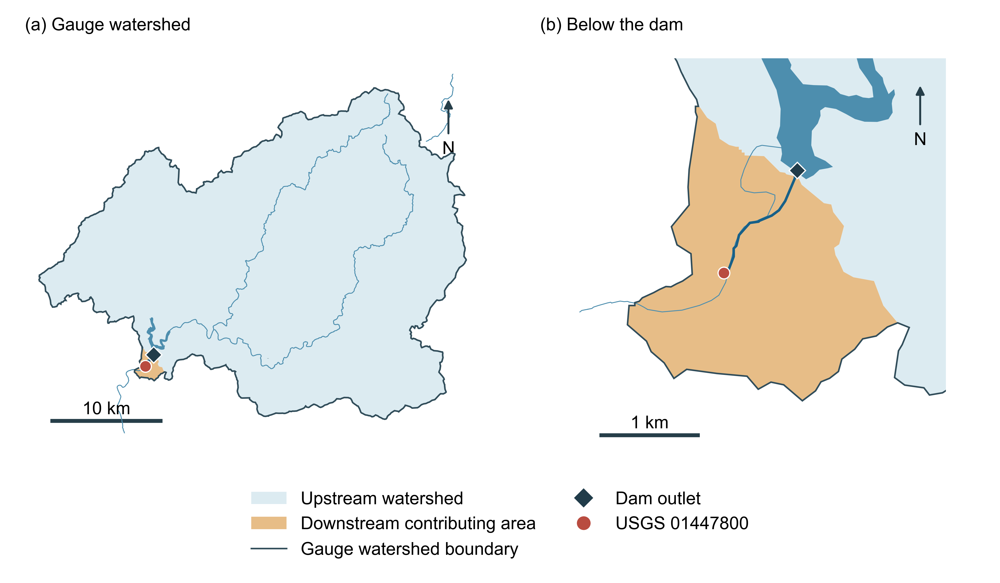
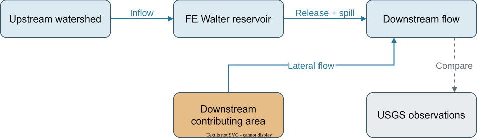

# USGS 01447800 的下游流量

[English](README.md) | [繁體中文](README.zh-TW.md)

這項延伸將 FE Walter 三種方法保存的 2016 年實際出水，傳遞到緊鄰壩下的
[USGS 01447800](https://waterdata.usgs.gov/monitoring-location/USGS-01447800/)，再與觀測比較。
放流決策保持原樣；觀測只用於結果評估。[教學 Notebook](../../../tutorials/main.ipynb) 可直接讀取保存的輸出。

## 集水區與水流連接

**測站集水區**是流向選定河網出口的完整區域，其中包括水先進入水庫的
**上游集水區**，以及逕流在壩下加入河道的**下游貢獻區域**。

舊七單元 GIS 已涵蓋測站集水區，面積為 750.811 km²。新取得的
[NLDI 集水區](https://api.water.usgs.gov/docs/nldi/basin/)顯示，壩所在河段上游約為
746.471 km²，兩者差集約 4.341 km²，主要落在舊 FEW-R-02 單元內。
新耦合設定會將這部分逕流移至壩下加入，避免同時算進水庫入流與下游入流。

目前邊界使用完整 NHDPlusV2 集水單元，尚未依壩口與測站的精確位置切開所在單元。
因此地圖呈現有來源紀錄的河網近似範圍；精確壩口邊界仍需更細的地形劃分。



**圖 1。** 完整測站集水區（750.811 km²）包含上游集水區與橘色的下游貢獻區域
（約 4.341 km²）；(b) 放大壩口及 USGS 測站。邊界來自 NLDI，河流與水庫背景
沿用專案 GIS。[SVG](outputs/watershed.svg) 與 [PDF](outputs/watershed.pdf) 保留可編輯文字。

## 從保存放流計算測站流量

以下流量均為日平均值，單位 m³/s：

$$
Q_g(t)=\sum_{k=0}^{K-1}h_k\,[R(t-k)+S(t-k)]+Q_{\mathrm{lateral},g}(t),
\qquad \sum_k h_k=1.
$$

$R$ 是實際控制放流，$S$ 是溢流，$h_k$ 是河道單位歷線，
$Q_{\mathrm{lateral},g}$ 是已完成自身集水區 routing、到達測站的側向入流。
水庫出水經約 1.398 km 的河網路徑傳遞；側向水量在測站加入，自身的集水區 routing 只計一次。

逕流與 routing 使用 HydroCNHS 原生 GWLF、Lohmann 函數。新增部分沿用母單元
保存的氣象與參數，只將面積改為幾何交集值，並從 1989 年初始化土壤與積雪。
河道流速及擴散參數由上游移用，尚未重新對 USGS 校準。
[routing.json](outputs/routing.json) 保存原始 kernel 與有界限的浮點尾差處理。



**圖 2。** 邊界分開後的水流連接。藍色實線傳遞水量；虛線表示與獨立觀測比較。
本次水庫端使用保存的放流。[可編輯 draw.io 原檔](../../../docs/figures/downstream-workflow.drawio)。

## 如何解讀結果

USGS 資料包含 2016 年 366 筆已核准的日平均流量，沒有缺值。前 20 天使用明示的
空河道初始狀態，仍保留於圖與 CSV，但不納入 346 天的配對指標。
12 月 31 日後才到達的河道尾端水量另存 CSV。

| 方法 | 配對天數 | NSE | KGE（2009） | 相對水量偏差 |
|---|---:|---:|---:|---:|
| Rule-based | 346 | −0.006 | 0.547 | −2.73% |
| 未提供額外操作知識的 LLM | 346 | −0.812 | 0.233 | +13.06% |
| 提供額外操作知識的 LLM | 346 | −0.792 | 0.250 | +11.45% |

這些指標描述與歷史實際操作下河川流量的接近程度，包含水文、routing 移用與
操作決策差異的共同影響，無法單獨判定哪個環節的誤差，也無法據此判定最佳操作方法。

保存決策當時使用涵蓋整個測站集水區的舊入流，因此本次曲線是**固定這批歷史放流後的
條件式比較**。修正邊界後的完整耦合 LLM 軌跡仍待執行；舊結果與實體輸入保留原貌。

## 檔案與重製

| 檔案 | 閱讀重點 |
|---|---|
| [observations.csv](inputs/observations.csv) | USGS 日期、cfs／m³/s 流量、核准狀態及品質旗標。 |
| [source_manifest.json](inputs/source_manifest.json) | 官方網址、原始回應雜湊、既有輸入雜湊。 |
| [partition.json](outputs/partition.json) | 每個舊單元分配至上游與壩下的面積。 |
| [daily.csv](outputs/daily.csv) | 各方法壩口、routing 後水庫、側向及測站總流量，另含觀測與評估資格。 |
| [routing_tail.csv](outputs/routing_tail.csv) | 比較期間結束後才到達的水量。 |
| [report.json](outputs/report.json) | 完整指標、水量帳、方法狀態與假設。 |
| [prepare.py](prepare.py) / [plot.py](plot.py) | 離線準備與共用繪圖函數。 |

在原始碼 checkout 中安裝選用 GIS 相依套件：

```bash
python -m pip install -e ".[gis]"
```

選擇新的輸出目錄。準備指令只計算兩個移用參數的側向逕流序列與下游 routing，
沒有模型請求或水庫決策；繪圖指令只讀保存值。

```bash
python examples/fe_walter/downstream/prepare.py --output runs/fe-walter-downstream
python examples/fe_walter/downstream/plot.py runs/fe-walter-downstream
```

`corrected_inputs/` 另存原生模型、氣象、水文、水庫與實驗設定，透過現有正式入口
連接分開的邊界。邊界及 routing 驗收前，LLM live readiness 維持 false。
這些新檔案供下一個實驗使用，不覆寫保存的執行結果。
