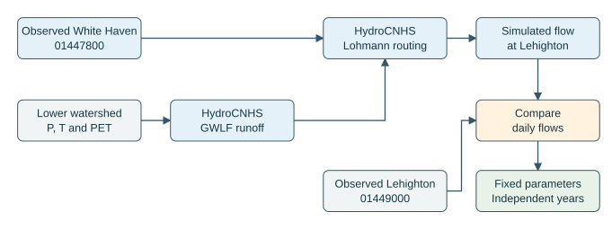
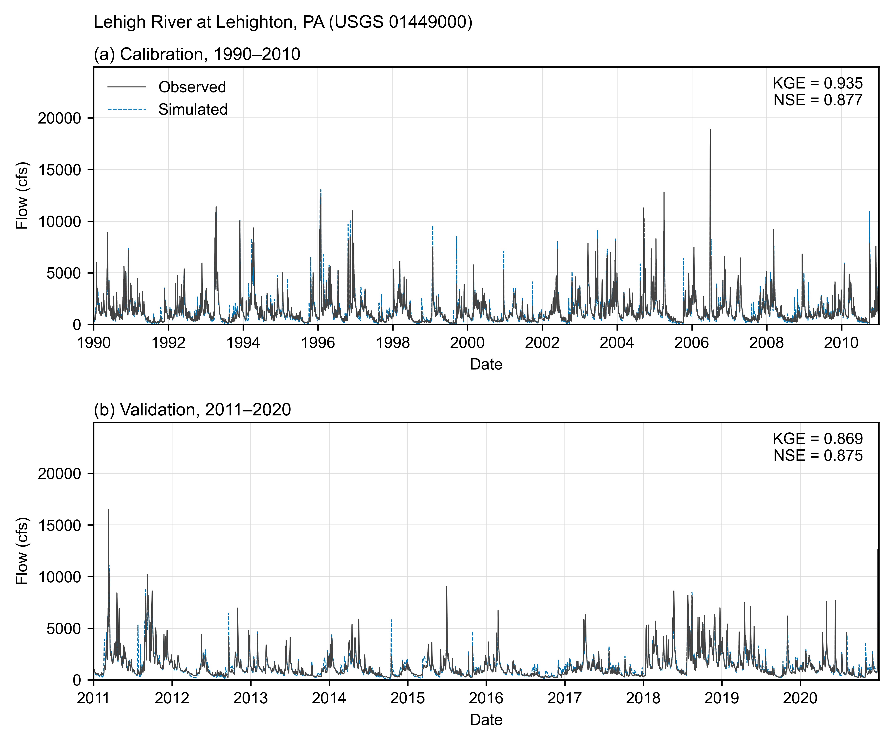

# Check the downstream hydrology

[English](validation.md) | [繁體中文](validation.zh-TW.md)

This workflow tests the watershed and river between **White Haven (USGS 01447800)** and **Lehighton (USGS 01449000)**. It supplies observed White Haven discharge to HydroCNHS, adds runoff from the intervening subcatchments, and compares the routed flow with Lehighton observations. The accepted upstream calibration remains available in the [hydrology reference](../hydrology.md).

Follow the executable steps in {download}`the downstream validation notebook <../../../tutorials/downstream_validation.ipynb>`. Install the geometry dependencies from the repository root with `python -m pip install -e ".[gis]" -c environment/requirements-bundled.txt`. Keep study inputs and run directories outside the repository.

## What the workflow does

1. Preserve daily discharge, station identifiers, units and USGS quality flags.
2. Check the lower subcatchments, weather, native model and contributing flow paths.
3. Check transferred parameters with a fixed parameter run, or calibrate the new lower model using the calibration years.
4. Freeze the selected parameters and evaluate the independent validation years.
5. Retain daily results and input hashes for the later reservoir-operation comparison.

The calibration search stops at the end of 2010. Validation observations do not enter its objective. The later operation evaluation supplies simulated flow at White Haven in place of its observations. That flow includes reservoir outflow and runoff entering the short reach between the dam and White Haven.

| Stage | Period | Use |
|---|---|---|
| Warm-up | 1989 | Initialize watershed and river states; omit from scores |
| Calibration | 1990–2010 | Select lower-watershed parameters using observed upstream flow |
| Validation | 2011–2020 | Evaluate the same parameters on independent years |
| Later operation evaluation | 2021–2025 | Compare the three operators with common, fixed hydrology |

*Figure 1. White Haven observations supply the upstream boundary. HydroCNHS adds intervening runoff and routes the combined flow to Lehighton. The comparison uses separate calibration and validation years. [Editable draw.io source](../../../docs/figures/downstream-validation.drawio).*

## Files to prepare

Start with the complete [validation configuration](validation.yaml) and [calibration settings](calibration.yaml). The notebook displays both files and explains where to fill their paths. Empty input references and parameter groups identify preparation that remains to be done.

| File | Contents |
|---|---|
| `observations.csv` | `date,station_id,flow_cfs,qualifiers`; both gauges, with original daily date labels |
| `source_manifest.json` and `usgs_daily.json` | Source URL, raw response, units, dates and matching SHA256 hashes |
| Native lower model | GWLF subcatchments and Lohmann connections from White Haven to Lehighton |
| Weather CSV or CSV.gz | `date,subbasin_id,precipitation_mm,temperature_c,pet_cm`; every day and weather-driven unit |
| Partition JSON | Gauge basin polygons and lower subcatchments in EPSG:5070, matching native unit IDs and areas |
| Calibration settings | Explicit parameter targets, scientific bounds, population and generation settings |

The partition describes **Lehighton basin minus White Haven basin**. Its JSON contains `crs`, `upstream_gauge`, `downstream_gauge`, `upstream_basin`, `downstream_basin`, `subbasins`, and `outlet_precision`. Basin values are GeoJSON geometries; `subbasins` is a list of GeoJSON Features whose `properties.subbasin_id` matches the native model. Each lower unit and the observed boundary must contribute exactly once. The check retains the precision statement for the gauge divides.

Each calibration parameter group declares `name`, `mode`, `bounds` and `paths`. A `set` group assigns one common value to its listed native `Pars` targets. A `scale` group multiplies each target's initial value. Its optional `clip: [minimum, maximum]` then limits the resulting values to that physical range. Bounds and target groups should follow the prepared physical attributes and the documented hydrological assumptions. The accepted upper model is preserved separately.

The search maximizes KGE (2009). Its roulette selector receives the positive score `1 / (2 - KGE)`, which preserves KGE ordering even when KGE is negative. Candidate records retain both values; native optimizer summaries report the transformed selection score. Final calibration and validation reports retain the original KGE.

## Parameterization and regionalization

The new lower model has nine local runoff units covering **774.404 km²**. Each unit retains its own area, latitude, weather and flow-path length. Daymet supplies daily precipitation and temperature; Hamon supplies potential evapotranspiration. The 1989–2020 forcing contains 105,192 unit-days. The source records identify the eight leap-year December 31 supplements separately.

Land cover and soil supply the initial spatial differences. NLCD 2021 class fractions and NRCS soil hydrologic-group fractions determine a composite curve number, $CN_i$. Upper-100-cm soil available water storage, $AWS_i$ in mm, determines the initial root-zone capacity. The common calibration multipliers give

$$
\begin{aligned}
CN2_i &= \operatorname{clip}(m_{CN2}CN_i,25,100),\\
Ur_i &= \operatorname{clip}(m_{Ur}\tfrac{AWS_i}{10},1,15)\;\mathrm{cm}.
\end{aligned}
$$

Here, `clip` limits a value to the stated interval. Regionalization means applying common coefficients to local physical attributes: nine units can have different `CN2` and `Ur` while sharing the same two multipliers. Values reaching a clipping limit can become equal across several units. The remaining seven GWLF and four Lohmann parameters are shared. The search therefore adjusts **13 parameter groups**, with local areas and mapped paths fixed.

The transferred reference uses the accepted upper model's coefficients. The lower calibration starts from the local physical attributes and searches the declared bounds. Three fixed seeds use a population of 40 and a maximum generation setting of 30. The transferred reference and the three returned solutions are compared using calibration KGE; the selected model is frozen before validation scoring. This lower objective is KGE alone; the earlier upper calibration retains its original composite objective.

Each local flow is routed along its complete mapped path to the Lehighton aggregation outlet; observed White Haven flow follows its own approximately 55.4 km channel path. White Haven uses channel velocity and diffusion; local runoff also uses the catchment routing parameters. This single-outlet representation uses full path lengths in place of explicit intermediate junction nodes. The native results are checked against independent convolution, including water arriving after the comparison period.

NLCD 2021 is held fixed throughout the historical period. The soil averages use valid returned records. Hydrologic groups are available for 85.6–98.6% of the returned soil area; water-storage values cover 97.4–99.7%. Missing soil attributes remain documented in the source records. Lehighton observations constrain the combined runoff and routing; individual tributary parameters retain the common-parameter assumption.

## Execution and outputs

The notebook gives the full commands for three explicit actions:

| Action | Calculation | New outputs |
|---|---|---|
| `check` | Read and validate inputs | `preflight.json`; exit code 2 identifies missing preparation |
| `run` | Run the native lower model with fixed parameters | `preflight.json`, `daily.csv`, `report.json` |
| `calibrate` | Native GA search on calibration years, then fixed-parameter C&V run | The above, plus `candidate_evaluations.jsonl`, `calibration.json`, `calibrated_model.yaml` and native optimizer records |

`daily.csv` reports discharge in **cfs**, with both observation flags and the downstream eligibility mask. `report.json` uses the existing flow evaluator: MAE/RMSE/bias in m³/s, relative volume bias, NSE and KGE (2009). Undefined metrics retain a reason. A completed run reports execution and scores; research acceptance requires interpreting those results.

USGS estimated records carrying `A,e` are included by the supplied policy and counted separately. Change the quality policy explicitly when performing a sensitivity check. An unavailable or excluded upstream boundary day stops the native run; the workflow applies no interpolation. Missing downstream observations remain visible in the score counts.

## Saved calibration and validation results

The completed native search recorded **3,630 parameter evaluations** across three fixed seeds. Model `seed-314159` was selected using calibration KGE alone, with the transferred model included as a reference. Its parameters were frozen before validation scoring. Both periods use continuous states from the 1989 initialization; 2021–2025 remains reserved for the operation comparison.

| Parameter model | Period | Paired days | KGE (2009) | NSE | Volume bias |
|---|---|---:|---:|---:|---:|
| Transferred parameters | Calibration | 7,670 | 0.896 | 0.798 | -0.65% |
| Transferred parameters | Validation | 3,653 | 0.849 | 0.783 | -1.48% |
| Selected lower calibration | Calibration | 7,670 | 0.935 | 0.877 | +1.87% |
| Selected lower calibration | Validation | 3,653 | 0.869 | 0.875 | +2.99% |

Positive volume bias indicates simulated flow exceeds observed flow. These are watershed/routing scores under an observed White Haven boundary. Completion of the configured search documents the evaluated budget; the saved {download}`search progress (SVG) <outputs/hydrology_validation/calibration_progress.svg>` and {download}`PDF <outputs/hydrology_validation/calibration_progress.pdf>` allow its progress to be inspected.

Download the {download}`daily flow data <outputs/hydrology_validation/daily.csv>`, {download}`nine-unit parameter table <outputs/hydrology_validation/regionalization.csv>`, {download}`model-selection table <outputs/hydrology_validation/model_selection.csv>`, and {download}`source and metric summary <outputs/hydrology_validation/summary.json>`. The figure is available as {download}`PDF <outputs/hydrology_validation/hydrology_validation.pdf>`, {download}`editable SVG <outputs/hydrology_validation/hydrology_validation.svg>`, and {download}`600 dpi PNG <outputs/hydrology_validation/hydrology_validation.png>`. Full inputs, candidate records, native model files and failure evidence remain in the external research archive.

*Figure 2. Daily discharge at Lehigh River at Lehighton, PA (USGS 01449000): (a, top) calibration, 1990–2010; (b, bottom) independent validation, 2011–2020. Lehigh River at White Haven, PA (USGS 01447800) supplies the observed upstream boundary in both periods. Both panels use the same discharge scale in cfs; the 1989 warm-up is omitted.*

This observation-boundary test evaluates the combined intervening runoff and routing. Its results help interpret the later Hanasaki/LLM comparison. Separate tributary observations would provide additional constraints on individual subcatchments.

The setup follows the upstream-to-downstream evaluation approach described in the [USACE HEC-HMS Applications Guide](https://www.hec.usace.army.mil/software/hec-Hms/documentation/HEC-HMS_Applications_Guide_20231107.pdf); calibration and independent validation follow the [USACE calibration procedure](https://www.hec.usace.army.mil/confluence/hmsdocs/hmstrm/calibration/summary-of-the-calibration-procedure).
