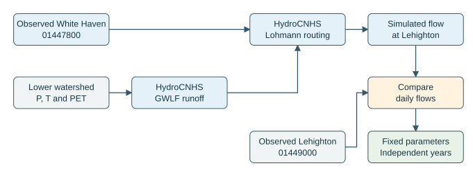
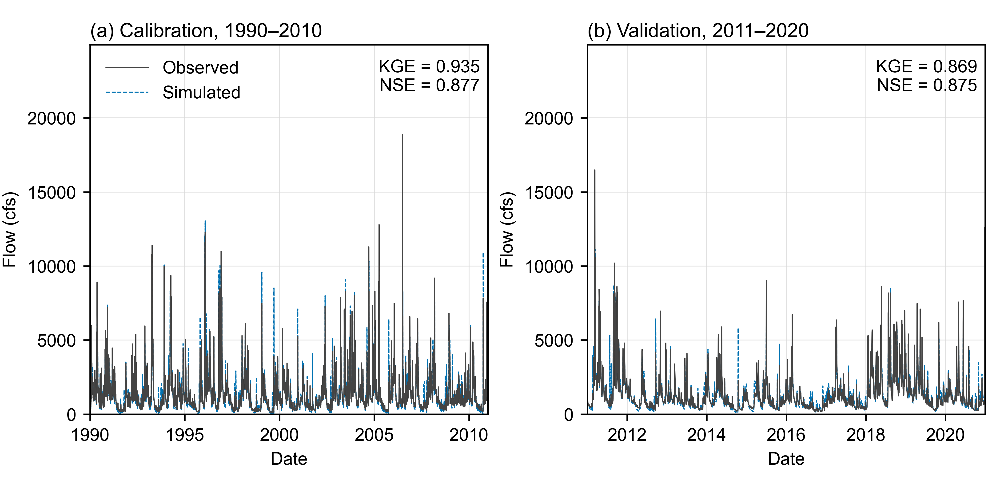

# 檢查下游水文

[English](validation.md) | [繁體中文](validation.zh-TW.md)

本流程檢查 White Haven（USGS 01447800）到 Lehighton（USGS 01449000）之間的集水區與河道。先將 White Haven 的實測流量交給 HydroCNHS，加入兩站間各子集水區的逕流，再將傳遞至 Lehighton 的模擬流量與觀測比較。原先上游的校準紀錄保留於[水文技術參考](../hydrology.zh-TW.md)。

請依照 {download}`下游驗證 notebook <../../../tutorials/downstream_validation.ipynb>` 執行。先從 repository 根目錄執行 `python -m pip install -e ".[gis]" -c environment/requirements-bundled.txt`，安裝圖形檢查所需套件。研究資料與每次執行的輸出目錄放在 repository 外。

## 流程做哪些事

1. 保存逐日流量、測站編號、單位及 USGS 品質旗標。
2. 檢查下游分區、氣象、原生模型及水流連接。
3. 先檢查移用參數的表現，或使用校準期間調整新增下游模型的參數。
4. 固定選定參數，再檢查獨立的驗證期間。
5. 保留逐日結果與輸入雜湊，供後續水庫操作比較使用。

參數搜尋的模擬只到 2010 年底，驗證期觀測不參與其評分。後續操作比較時，再改用 White Haven 的模擬流量作為上游邊界；其中包含水庫出流，以及壩址至 White Haven 這段河道的區間逕流。

| 階段 | 期間 | 用途 |
|---|---|---|
| 暖機 | 1989 | 初始化集水區與河道狀態；不計入評分 |
| 校準 | 1990–2010 | 以實測上游流量為邊界，選定下游水文參數 |
| 驗證 | 2011–2020 | 使用同一套參數，檢查另一段年份 |
| 後續操作比較 | 2021–2025 | 三種操作方法共用固定水文設定 |

*圖 1．以 White Haven 觀測作為上游邊界，HydroCNHS 加入區間逕流並傳遞至 Lehighton；校準與驗證採用不同年份。[可編輯 draw.io 原稿](../../../docs/figures/downstream-validation.drawio)。*

## 需要準備的檔案

從完整的[驗證設定](validation.yaml)與[校準設定](calibration.yaml)開始。Notebook 會展示兩個檔案並解釋路徑填法。尚未填入的輸入及參數群組，代表仍需完成的準備。

| 檔案 | 內容 |
|---|---|
| `observations.csv` | `date,station_id,flow_cfs,qualifiers`；兩個測站，保留原始逐日日期 |
| `source_manifest.json` 與 `usgs_daily.json` | 來源網址、原始回應、單位、期間與相符的 SHA256 |
| 下游原生模型 | GWLF 子集水區及 White Haven 至 Lehighton 的 Lohmann 連接 |
| 氣象 CSV 或 CSV.gz | `date,subbasin_id,precipitation_mm,temperature_c,pet_cm`；涵蓋每個模擬日期及氣象驅動分區 |
| 分區 JSON | EPSG:5070 的兩站集水區與下游分區圖形，ID 及面積與原生模型一致 |
| 校準設定 | 明列參數目標、科學依據的範圍、族群大小及世代設定 |

分區範圍為 **Lehighton 集水區扣除 White Haven 集水區**。JSON 包含 `crs`、`upstream_gauge`、`downstream_gauge`、`upstream_basin`、`downstream_basin`、`subbasins` 與 `outlet_precision`。兩個 basin 欄位採用 GeoJSON geometry；`subbasins` 為 GeoJSON Feature 清單，各項的 `properties.subbasin_id` 對應原生模型。每個下游分區與實測邊界都只貢獻一次水量，檢查結果也保留測站分界的精度說明。

各校準群組設定 `name`、`mode`、`bounds` 與 `paths`。`set` 將同一數值填入列出的原生 `Pars` 欄位；`scale` 將各欄位的初始值乘上共同係數，再以選用的 `clip: [minimum, maximum]` 將結果限制於指定物理範圍。參數範圍與群組依已準備的物理屬性及水文假設決定。原先接受的上游模型另行保留。

搜尋以最大化 KGE（2009）為目標。輪盤選擇使用正值 `1 / (2 - KGE)`；即使 KGE 為負值，仍保留其優劣順序。各候選紀錄同時保留兩個值；原生搜尋摘要顯示轉換後的選擇分數，最終校準及驗證報告則保留原始 KGE。

## 參數化與區域化

新增下游模型包含九個產流分區，合計 **774.404 km²**。各區保留自己的面積、緯度、氣象與河道路徑長度。逐日降雨及溫度來自 Daymet，潛在蒸發散使用 Hamon 方法計算。1989–2020 年的氣象資料共 105,192 個「分區－日期」組合，來源紀錄另外標示八個閏年 12 月 31 日的補充資料。

土地覆蓋與土壤提供初始空間差異。NLCD 2021 各類土地覆蓋比例與 NRCS 土壤水文群比例決定綜合曲線數 $CN_i$；上層 100 cm 土壤的可用儲水量 $AWS_i$（mm）決定初始根區容量。共同校準係數給出

$$
\begin{aligned}
CN2_i &= \operatorname{clip}(m_{CN2}CN_i,25,100),\\
Ur_i &= \operatorname{clip}(m_{Ur}\tfrac{AWS_i}{10},1,15)\;\mathrm{cm}.
\end{aligned}
$$

`clip` 會將數值限制於指定區間。這裡的區域化是將共同係數套用到各區物理屬性：九區共用兩個係數，`CN2` 與 `Ur` 可隨各區屬性不同；達到截限時，多個分區也可能具有相同值。其餘七個 GWLF 與四個 Lohmann 參數採共同值，因此搜尋共有 **13 個參數群組**；分區面積與已量測的河道路徑保持固定。

參數移用的參考模型使用已接受上游模型的係數；新增下游校準則從各區物理屬性出發，在明列範圍內搜尋。三個固定隨機種子各使用 40 個個體，最大世代設定為 30。程式依校準 KGE 比較參考模型及三個搜尋結果，先固定選定模型，再計算驗證分數。下游此次以 KGE 為單一目標；上游既有校準保留原本的綜合目標。

各區產流沿完整路徑傳遞到 Lehighton 的匯流出口；White Haven 實測流量另沿約 55.4 km 的河道路徑傳遞。White Haven 使用河道流速與擴散參數，各區產流另包含集水區匯流參數。這項單一匯流出口的設定，使用各區到出口的整段路徑概括中間河段。原生輸出會與獨立卷積核對，並納入比較期間之後才抵達的水量。

歷史期間固定使用 NLCD 2021。土壤平均值依回傳資料中的有效紀錄計算：回傳土壤面積中，85.6–98.6% 具有有效水文群，97.4–99.7% 具有有效儲水屬性；缺少屬性的部分保留於來源紀錄。Lehighton 觀測約束整體產流與 routing，個別支流參數仍採用共同參數假設。

## 執行與輸出

Notebook 提供三種明確動作的完整命令：

| 動作 | 計算 | 新輸出 |
|---|---|---|
| `check` | 讀取及檢查輸入 | `preflight.json`；退出碼 2 表示仍有準備缺項 |
| `run` | 固定參數執行下游原生模型 | `preflight.json`、`daily.csv`、`report.json` |
| `calibrate` | 原生 GA 只搜尋校準年份，再固定參數執行 C&V | 上述檔案，加上 `candidate_evaluations.jsonl`、`calibration.json`、`calibrated_model.yaml` 與原生搜尋紀錄 |

`daily.csv` 的流量以 **cfs** 表示，保留兩站觀測旗標及下游資料的納入標記。`report.json` 沿用既有流量評估函數：MAE、RMSE 及偏差使用 m³/s，另列相對水量偏差、NSE 與 KGE（2009）。無法計算的指標保留原因。完成執行會回報計算與分數；研究驗收還需解讀這些結果。

預設納入帶有 `A,e` 的 USGS 估計值，並分別統計其數量。敏感度檢查時可明確修改品質政策。上游邊界若有缺日或被政策排除，程式會停止原生計算，不做插值；下游缺測仍會出現在評分筆數中。

## 保存的校準與驗證結果

三個固定隨機種子的原生搜尋共完成 **3,630 次參數評估**。程式將參數移用模型列為參考，依校準 KGE 選出 `seed-314159`，先固定其參數，再計算驗證分數。兩段期間皆延續 1989 年初始化後的狀態；2021–2025 年保留給後續操作比較。

| 參數模型 | 期間 | 配對日期 | KGE（2009） | NSE | 水量偏差 |
|---|---|---:|---:|---:|---:|
| 上游參數移用 | 校準 | 7,670 | 0.896 | 0.798 | -0.65% |
| 上游參數移用 | 驗證 | 3,653 | 0.849 | 0.783 | -1.48% |
| 選定下游校準 | 校準 | 7,670 | 0.935 | 0.877 | +1.87% |
| 選定下游校準 | 驗證 | 3,653 | 0.869 | 0.875 | +2.99% |

正的水量偏差表示模擬流量超過實測流量。這些分數反映使用 White Haven 實測上游邊界時的產流與 routing 表現。完成指定搜尋代表已執行該評估範圍，可另下載搜尋進度 SVG 與 PDF 檢視進展。

可下載{download}`逐日流量 <../../../tests/fixtures/fe_walter_history/downstream_outputs/hydrology_validation/daily.csv>`、{download}`九區參數表 <../../../tests/fixtures/fe_walter_history/downstream_outputs/hydrology_validation/regionalization.csv>`、{download}`模型選擇表 <../../../tests/fixtures/fe_walter_history/downstream_outputs/hydrology_validation/model_selection.csv>`及{download}`來源與指標摘要 <../../../tests/fixtures/fe_walter_history/downstream_outputs/hydrology_validation/summary.json>`。圖檔提供 PDF、可編輯 SVG 與 600 dpi PNG。完整輸入、候選參數、原生模型及失敗證據保留於 repository 外的研究紀錄。

*圖 2．Lehighton（USGS 01449000）逐日流量：(a) 1990–2010 年校準；(b) 2011–2020 年獨立驗證。兩段期間皆以 White Haven（USGS 01447800）實測流量作為上游邊界。流量單位為 cfs，1989 年暖機期間不列入圖中。*

這項檢驗支持兩站間逕流與 routing 的整體表現，協助解讀後續 Hanasaki／LLM 的比較。若取得支流觀測，可進一步約束個別子集水區。

此設定參考 [USACE HEC-HMS Applications Guide](https://www.hec.usace.army.mil/software/hec-Hms/documentation/HEC-HMS_Applications_Guide_20231107.pdf) 的上游至下游檢查方式；校準及獨立驗證參考 [USACE 校準程序](https://www.hec.usace.army.mil/confluence/hmsdocs/hmstrm/calibration/summary-of-the-calibration-procedure)。
