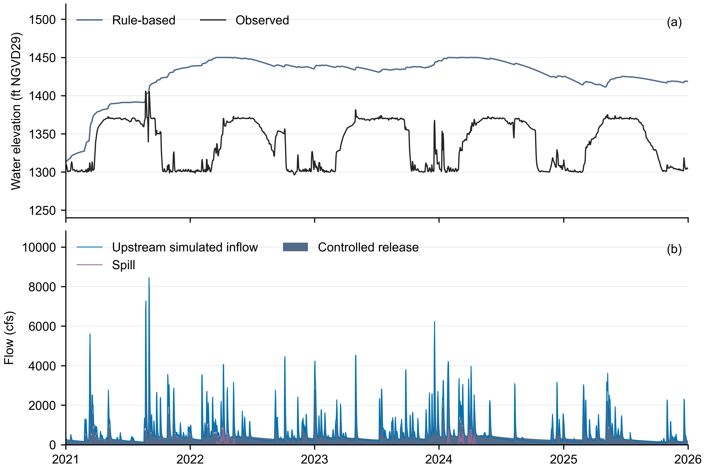
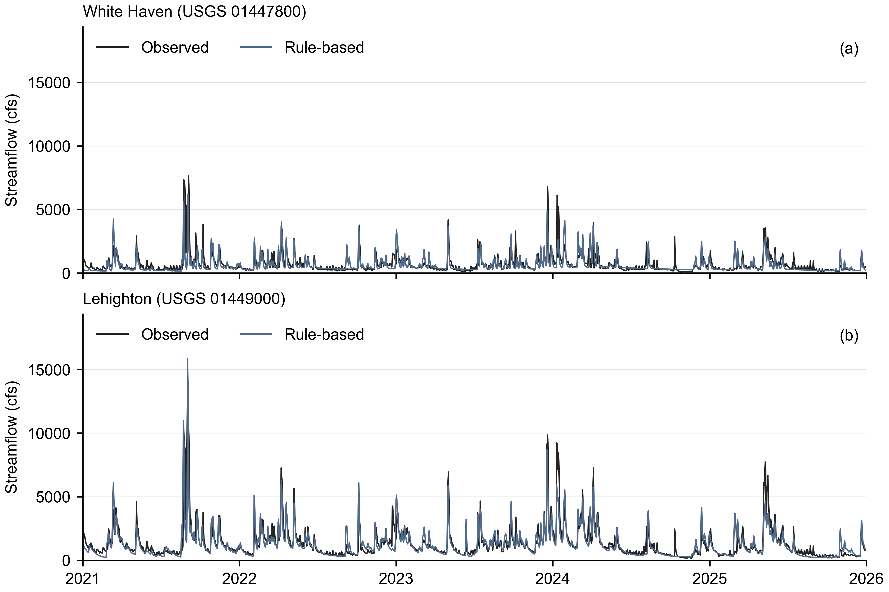

# F.E. Walter prepared operation, 2021–2025

[English](README.md) | [繁體中文](README.zh-TW.md)

Open the [five-year tutorial](../../../tutorials/operation.ipynb) for the complete
settings and a read-only walkthrough. This folder contains a prepared common case,
one completed 1,826-day Rule-based baseline, and two LLM methods that have not been
executed: **LLM without additional operating knowledge** and **LLM with additional
operating knowledge**.

The prepared-operation schema is `llm-reservoir-experiment.v2`. It reads the frozen
daily hydrology boundaries in `inflows.csv`; the accepted coupled stage already
simulated 1989–2025 upstream and local runoff and routing.

## Inputs and settings

| File | Purpose | Units or status | Required |
|---|---|---|---|
| [experiment.yaml](experiment.yaml) | Rule-based five-year entry | Inclusive daily dates | Yes |
| [llm_available.yaml](llm_available.yaml) / [llm_knowledge.yaml](llm_knowledge.yaml) | Prepared LLM entries | Not executed | One per future LLM method |
| [case.json](case.json) | Shared reservoir and downstream network | Storage m³; release m³/s | Yes |
| [inflows.csv](inflows.csv) | Frozen upstream and local daily inflows | `local_inflow_cms`, m³/s | Yes |
| [agents.rule.yaml](agents.rule.yaml) | Generic Hanasaki comparator | `alpha: 0.85` | Yes for the baseline |
| [initialization.json](initialization.json) | Prior-year coefficient seed and common physical start | Storage m³ | Yes for the baseline |
| [hydrology/model.yaml](hydrology/model.yaml), [hydrology/hydrology.yaml](hydrology/hydrology.yaml), [hydrology/forcing.csv.gz](hydrology/forcing.csv.gz) | Frozen hydrology provenance and reproducibility inputs | Precipitation mm, temperature °C, PET cm | Provenance; not rerun by this lesson |
| [provenance.json](provenance.json) | Hashes, periods, warmup, and readiness boundary | 21 primary-score warmup days | Yes |

All methods share the 2021-01-01 physical storage of 4,287,715.370246947 m³.
The Rule-based coefficient uses 21,914,228.648262143 m³ on 2020-05-01,
`k = 0.19022285020658533`, then refreshes from simulated beginning-of-day storage
each May 1.

## Saved baseline

| Evidence | Download | Meaning |
|---|---|---|
| Reservoir daily values | [CSV](outputs/reservoir_daily.csv) | 1,826 dates; elevation ft NGVD29 and flow cfs |
| Downstream daily values | [CSV](outputs/streamflow_daily.csv) | White Haven and Lehighton simulated and observed daily mean flow, cfs |
| Reservoir figure | [PNG](outputs/reservoir_operations.png) · [SVG](outputs/reservoir_operations.svg) · [PDF](outputs/reservoir_operations.pdf) | Observed and simulated elevation, controlled release, inflow, and spill |
| Downstream figure | [PNG](outputs/downstream_streamflow.png) · [SVG](outputs/downstream_streamflow.svg) · [PDF](outputs/downstream_streamflow.pdf) | Saved streamflow at both stations |
| Scores and checks | [summary.json](outputs/summary.json) | Metrics, mass balance, masks, alpha sensitivity, and limitations |

The retained `alpha: 0.85` comparator has water-elevation MAE 88.61 ft. A
non-adopted candidate (`alpha = 0.3413084211`) reduced that MAE to 57.75 ft, but
worsened downstream scores and requested unavailable water on 329 days. It remains
sensitivity evidence rather than the F.E. Walter operating choice.

The reservoir figure uses end-of-local-day USACE storage converted to elevation.
Daily controlled release excludes spill; upstream simulated inflow and spill are
shown separately. The station figure uses daily mean flow. All values cover
2021-01-01 through 2025-12-31 without smoothing or interpolation.

*Figure 1. Daily water elevation (ft NGVD29) and flow (cfs), 2021–2025. The blue
line is upstream simulated inflow. Observation is the USACE storage-derived elevation.*

*Figure 2. Simulated and observed daily mean streamflow (cfs) at White Haven
(USGS 01447800) and Lehighton (USGS 01449000), 2021–2025.*

Primary flow scores exclude the first 21 routing days. White Haven additionally
excludes 126 provisional observation records; the daily exports and plots retain
all dates. The 135,532,852.34 m³ capacity is an approximate conversion of the
1,450 ft flood-control pool. The 49.34 m³ inactive/dead storage floor is not
independently confirmed, and reservoir evaporation and seepage are zero here.
The lower hydrology completed calibration (1990–2010) and independent validation
(2011–2020). This case retains the selected `seed-314159` runoff and routing
parameters; validation KGE is 0.869 and NSE is 0.875. The offline preflight checks
their identity and reports the common five-year inputs ready for comparison.
See the [C&V reference](../downstream/validation.md) for the observed White Haven
boundary used in that test. The short dam-to-White Haven reach and its small local
catchments retain transferred parameters; individual tributaries were not separately
validated. The notebook reads saved evidence, and the two LLM methods remain unexecuted.

The retained generic coefficient follows [Hanasaki et al. (2006), Eq. 3](https://doi.org/10.1016/j.jhydrol.2005.11.011).
