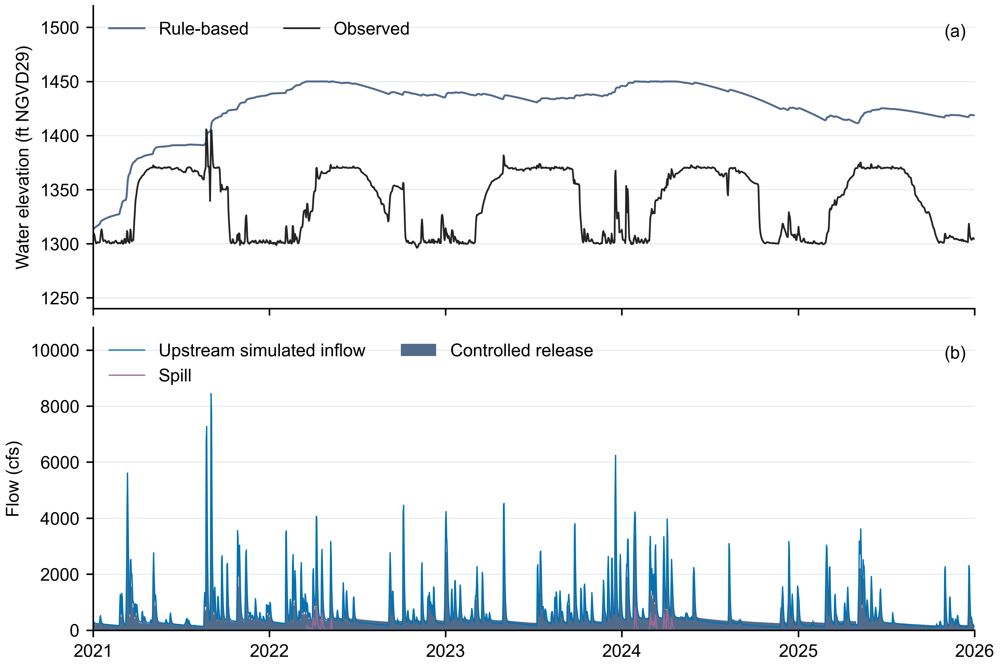
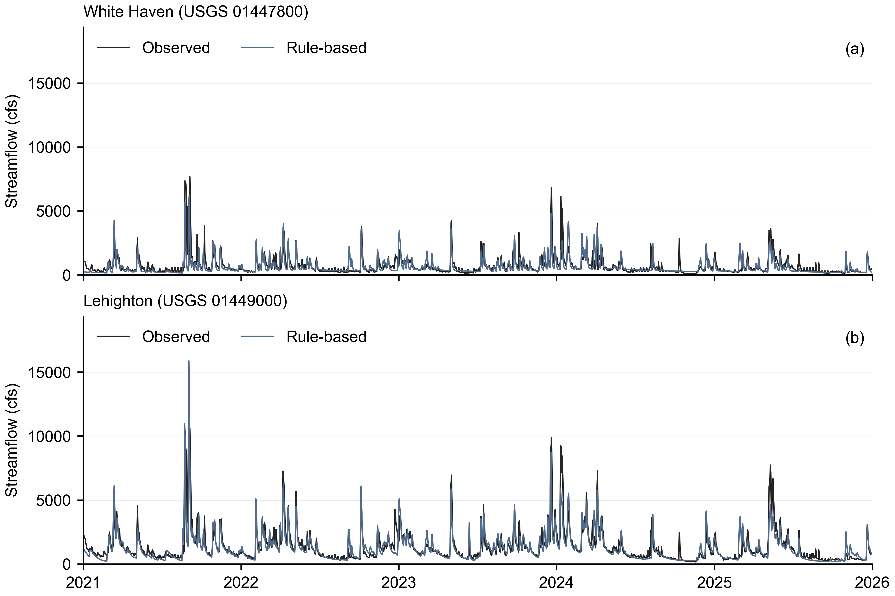

# F.E. Walter 已準備操作案例，2021–2025

[English](README.md) | [繁體中文](README.zh-TW.md)

請開啟[五年教學](../../../tutorials/operation.ipynb)閱讀完整設定與唯讀操作說明。
此資料夾包含一個共用案例、一份已完成的 1,826 日規則基準，以及兩種尚未執行的
LLM 方法：**無額外操作知識的 LLM**與**含額外操作知識的 LLM**。

已準備操作使用 `llm-reservoir-experiment.v2`，直接讀取 `inflows.csv` 的凍結每日
水文邊界。已接受的耦合階段先前已模擬 1989–2025 上游與區間逕流及河道路由。

## 輸入與設定

| 檔案 | 用途 | 單位或狀態 | 是否必要 |
|---|---|---|---|
| [experiment.yaml](experiment.yaml) | 規則法五年入口 | 起訖日皆納入的每日資料 | 是 |
| [llm_available.yaml](llm_available.yaml) / [llm_knowledge.yaml](llm_knowledge.yaml) | 已準備的 LLM 入口 | 尚未執行 | 未來各 LLM 方法擇一 |
| [case.json](case.json) | 共用水庫與下游網路 | 蓄水量 m³；放流 m³/s | 是 |
| [inflows.csv](inflows.csv) | 凍結的上游與區間每日入流 | `local_inflow_cms`，m³/s | 是 |
| [agents.rule.yaml](agents.rule.yaml) | 通用 Hanasaki 比較基準 | `alpha: 0.85` | 基準需要 |
| [initialization.json](initialization.json) | 前一操作年係數種子與共用物理初始狀態 | 蓄水量 m³ | 基準需要 |
| [hydrology/model.yaml](hydrology/model.yaml)、[hydrology/hydrology.yaml](hydrology/hydrology.yaml)、[hydrology/forcing.csv.gz](hydrology/forcing.csv.gz) | 凍結水文來源與重現輸入 | 降水 mm、溫度 °C、PET cm | 來源證據；本教學不重跑 |
| [provenance.json](provenance.json) | 雜湊、期間、暖機與就緒邊界 | 主要評分排除前 21 日 | 是 |

三種方法共用 2021-01-01 的物理蓄水量 4,287,715.370246947 m³。規則法係數以
2020-05-01 的 21,914,228.648262143 m³ 得到 `k = 0.19022285020658533`；之後
每年 5 月 1 日以各方法模擬的當日初始蓄水量更新。

## 保存的基準證據

| 證據 | 下載 | 內容 |
|---|---|---|
| 水庫每日值 | [CSV](outputs/reservoir_daily.csv) | 1,826 日；高程 ft NGVD29、流量 cfs |
| 下游每日值 | [CSV](outputs/streamflow_daily.csv) | White Haven 與 Lehighton 模擬及觀測日平均流量，cfs |
| 水庫圖 | [PNG](outputs/reservoir_operations.png) · [SVG](outputs/reservoir_operations.svg) · [PDF](outputs/reservoir_operations.pdf) | 觀測與模擬高程、控制放流、入流與溢流 |
| 下游圖 | [PNG](outputs/downstream_streamflow.png) · [SVG](outputs/downstream_streamflow.svg) · [PDF](outputs/downstream_streamflow.pdf) | 兩站保存的河川流量 |
| 分數與檢查 | [summary.json](outputs/summary.json) | 指標、質量平衡、遮罩、alpha 敏感度與限制 |

保留的 `alpha: 0.85` 比較基準之水位 MAE 為 88.61 ft。未採用候選值
`alpha = 0.3413084211` 將 MAE 降至 57.75 ft，但下游流量分數較差，且有
329 日要求超出可用水量，因此只保留為敏感度證據，並非 F.E. Walter 最佳操作值。

水庫圖以 USACE 當地日末儲量換算觀測水位。逐日控制放流不含溢流，圖中分別顯示
上游模擬入流與溢流；測站圖使用日平均流量。期間為 2021-01-01 至 2025-12-31，
保存值未平滑或插補。

*圖 1。2021–2025 年逐日水位（ft NGVD29）與流量（cfs）。藍線為上游模擬入流，
觀測水位由 USACE 儲量換算。*

*圖 2。2021–2025 年 White Haven（USGS 01447800）與 Lehighton（USGS 01449000）
模擬及觀測日平均流量（cfs）。*

主要流量評分排除最初 21 個路由日；White Haven 另排除 126 筆暫定觀測紀錄，
每日匯出與圖仍保留所有日期。135,532,852.34 m³ 容量約略換算自 1,450 ft
防洪池；49.34 m³ 非活動／死蓄水下限尚未獨立確認，本固定比較中的蒸發與滲漏為零。
下游水文已完成 1990–2010 校正與 2011–2020 獨立驗證。本案例保留選定的
`seed-314159` 逕流與路由參數；驗證 KGE 為 0.869、NSE 為 0.875。離線檢查會
核對參數來源，並確認五年比較的共用輸入已備妥。[C&V 參考](../downstream/validation.zh-TW.md)
說明當時使用 White Haven 觀測流量作為上游邊界。壩口至 White Haven 的短河段與
小面積區間仍移用上游參數，各支流也沒有個別測站驗證。Notebook 僅讀取保存證據，
兩個 LLM 方法仍尚未執行。

保留的通用係數依據 [Hanasaki et al. (2006), Eq. 3](https://doi.org/10.1016/j.jhydrol.2005.11.011)。
