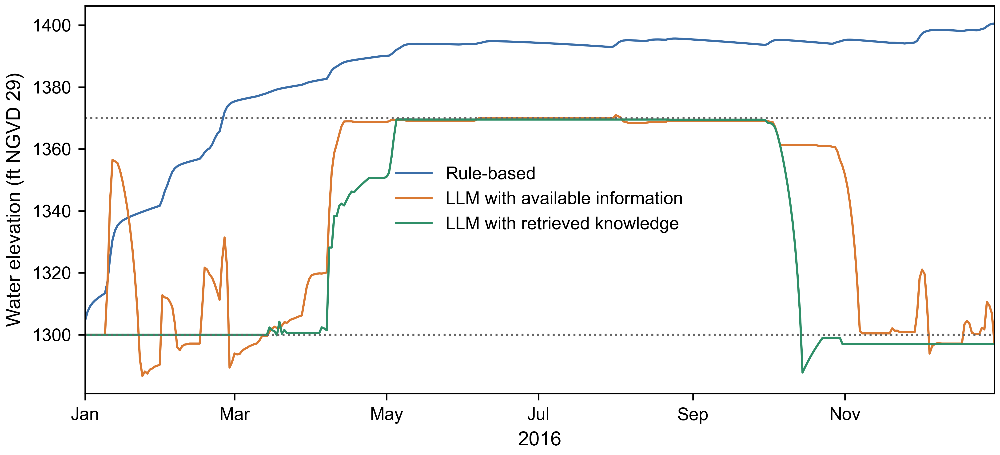
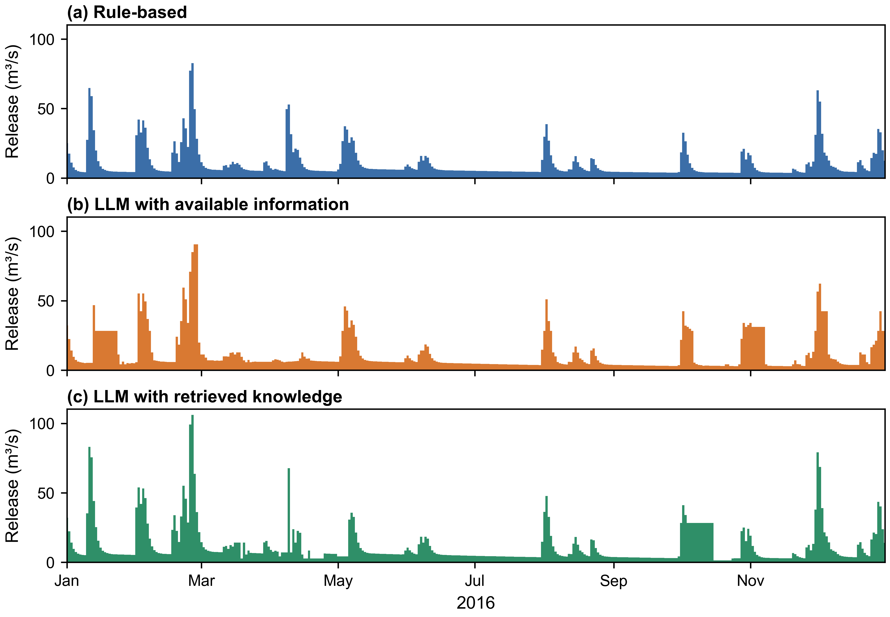

# Current F.E. Walter teaching results

The maintained comparison uses three saved 2016 trajectories: **Rule-based**,
**LLM with available information**, and **LLM with retrieved knowledge**. All
three use the same accepted daily inflow and initial physical state.

## Water elevation

**Figure 1.** Saved end-of-day water elevation during 2016. Dotted guides at
1300 and 1370 ft N.G.V.D. orient the study-defined seasonal windows; they do not
represent a complete official operating schedule.

## Controlled release

**Figure 2.** Daily controlled release in 2016, in m³/s: (a) Rule-based,
(b) LLM with available information, and (c) LLM with retrieved knowledge.
Panels share date and release scales; bars exclude spill.

The combined teaching table contains 366 unique ordered dates per method. The
builder checked matching inflow within 1e-10 m³/s for CSV serialization, the
shared initial storage of 2,457,848.279729185 m³, and units before combining.
It performed no interpolation, model request, hydrology run, or reservoir
simulation.

Downloads: [combined CSV](coupled/outputs/current_tutorial/daily.csv),
[provenance](coupled/outputs/current_tutorial/provenance.json),
[elevation SVG](coupled/outputs/current_tutorial/daily_water_elevation.svg),
[elevation PDF](coupled/outputs/current_tutorial/daily_water_elevation.pdf),
[release SVG](coupled/outputs/current_tutorial/controlled_release_daily.svg), and
[release PDF](coupled/outputs/current_tutorial/controlled_release_daily.pdf).

These trajectories support a saved-method comparison, not a general method
ranking. Completion and mass balance do not establish acceptable operation.
Read the [engine comparison](engine_comparison.md) for implementation evidence
and [`results_history.md`](results_history.md) for older experiments.
