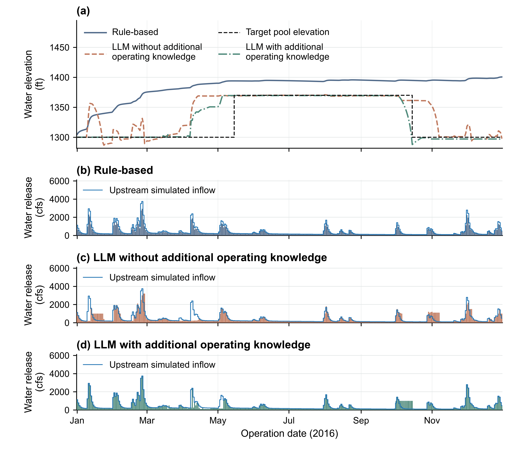
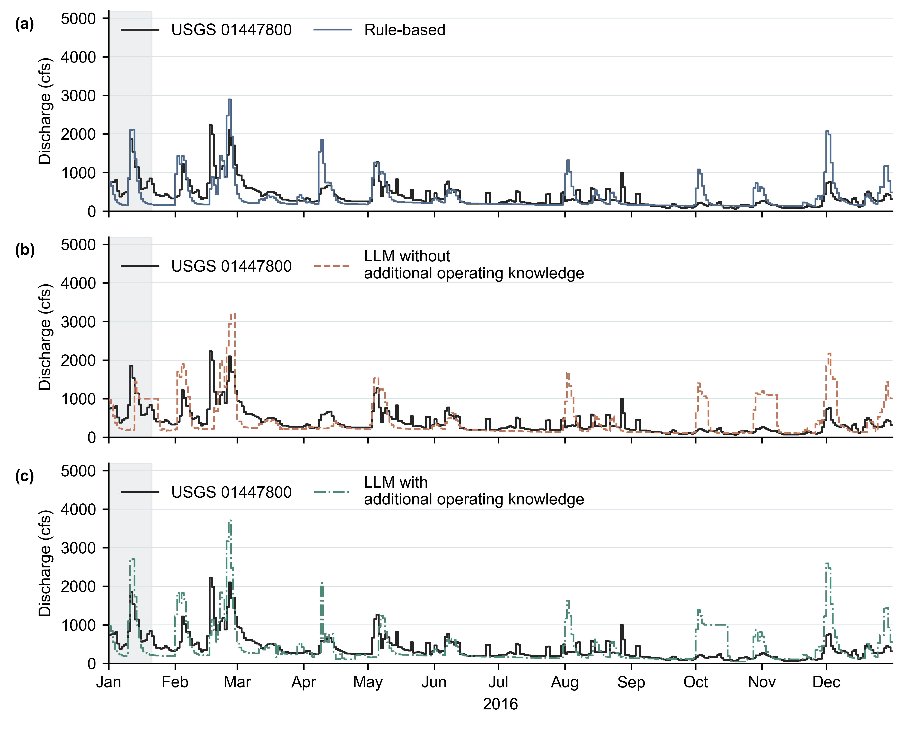

# FE Walter：水位與控制放流

[English](results.md) | [繁體中文](results.zh-TW.md)

比較同一 FE Walter 案例的三種方法：**Rule-based**、**未提供額外操作知識的 LLM**、
**提供額外操作知識的 LLM**。期間為 2016-01-01 至 2016-12-31，共 366 天。
下圖使用舊 prompt 產生的框架結果，尚未加入新的當日季節資訊，沒有新增模型請求。
[10 月原文對照](prompt_review.md)把歷史請求與擬修改提示分開展示。

## 水庫操作

Rule-based 使用 Hanasaki 規則，決策公式沒有讀取冬夏目標水位。
2016 年累積放流為 3.28717 億 m³，兩個 LLM 情境分別為 3.80617 與 3.80684 億 m³；
少放的水留在水庫中，因此水位較高。詳見[水量診斷](engine_comparison.md#reading-the-rule-based-trajectory)。

檢索知識情境在 10 月 12–14 日的回覆中，提前套用 10 月 15–31 日的退水窗口。
持續放流使水位在 **10 月 15 日降至 1287.8 ft**。這是已保存的決策行為；
季節 audit 會記錄問題，不會改寫放流。詳見[決策證據](engine_comparison.md#reading-the-retrieved-knowledge-trajectory)。

水位是當日日末的狀態，放水量則是當日的操作值。蓄水量也受入流與溢流影響，
見[水量平衡](README.zh-TW.md#水庫實驗)。冬季檢查範圍為 11 月 1 日至
3 月 14 日的 1297–1303 ft；夏季上限適用於 5 月 10 日至 10 月 14 日。
這些研究準則不會改寫放流決策。

目標水位參考線（**Target pool elevation**）依 [R-ZONE](knowledge/operating_rules.md)，冬季目標為 1300 ft、夏季上限為
1370 ft，於 5 月 15 日與 10 月 15 日垂直切換。這兩個月中標記用來概括季節目標，
不代表實際水位瞬間跳升或下降。保存的操作設定與 audit 窗口保持原樣。
圖中流量採 cfs，來源 CSV 保留原始 m³/s。

[完整精度每日資料](../../tests/fixtures/fe_walter_history/coupled_outputs/current_tutorial/daily.csv) ·
[來源紀錄](../../tests/fixtures/fe_walter_history/coupled_outputs/current_tutorial/provenance.json) ·
[合併圖 SVG](../../tests/fixtures/fe_walter_history/coupled_outputs/current_tutorial/reservoir_operations.svg) ·
[合併圖 PDF](../../tests/fixtures/fe_walter_history/coupled_outputs/current_tutorial/reservoir_operations.pdf)

次要的單圖下載：[水位 PDF](../../tests/fixtures/fe_walter_history/coupled_outputs/current_tutorial/daily_water_elevation.pdf) ·
[放流 PDF](../../tests/fixtures/fe_walter_history/coupled_outputs/current_tutorial/controlled_release_daily.pdf)

資料由已保存的 Rule-based 年度結果及兩個最新框架 LLM 結果整理而成。
每種方法都有 366 個依序排列且不重複的日期；整理前已核對共同入流
（CSV 序列化容差 1e-10 m³/s）、初始蓄水 2,457,848.279729185 m³ 與單位，沒有插值或新增模擬。
模型參數保存在 [models.yaml](coupled/models.yaml)。水位目標未達屬於操作結果，
不等於模型請求或水量計算失敗。這些軌跡用於比較本次保存的方法結果，不能推論一般性的優劣排名；
完成執行與水量守恆也不代表操作已達標。

較早五年研究與原始紀錄保存在[歷史參考](results_history.zh-TW.md)。

*圖 1。2016 年保存的操作結果。(a) 日末水位（ft NGVD29）與目標水位參考線（Target pool elevation）：
冬季目標 1300 ft、夏季上限 1370 ft，於 5 月 15 日與 10 月 15 日垂直切換。
(b–d) 實際放水量（cfs），
不含溢流。藍線為上游模擬入流，與放流共用刻度；放流柱低於藍線時蓄水增加，
高於藍線時蓄水減少。各圖共用操作日期。*

## 下游測站流量

[下游延伸](downstream/README.zh-TW.md)將各方法保存的實際控制放流加上溢流，
傳遞至 USGS 01447800，再加入移用參數所得的側向逕流。黑線為 366 筆已核准
USGS 日平均觀測。這是固定保存放流後的條件式比較：原始水庫入流包含整個測站
集水區，修正邊界後的完整耦合操作仍是另一個實驗。
[研究區域圖](README.zh-TW.md#地點與研究範圍)標示 White Haven 與 Lehighton；此處保存的比較涵蓋 White Haven。

下載：[逐日分量與觀測](../../tests/fixtures/fe_walter_history/downstream_outputs/daily.csv)、
[完整評估紀錄](../../tests/fixtures/fe_walter_history/downstream_outputs/report.json)、
詳細指標與邊界假設保留於下游參考。

**圖 2。** 2016 年條件式下游流量（cfs）。各方法分開與相同 USGS 觀測比較，
曲線保留日平均值。灰色標示前 20 天使用假定河道初始狀態的期間；其餘 346 天
納入配對指標。三圖共用日期及流量刻度，觀測只用於結果評估。
