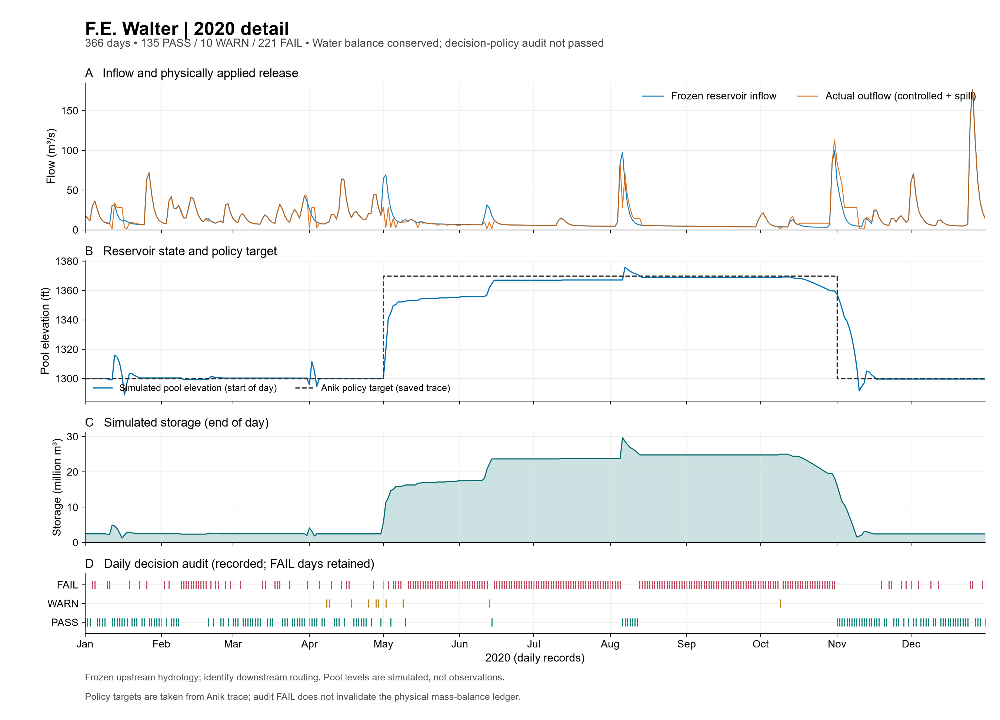
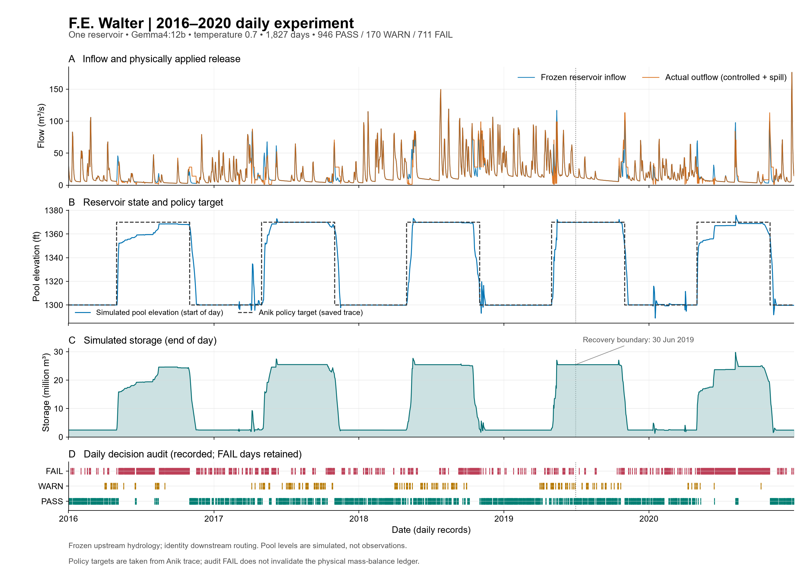
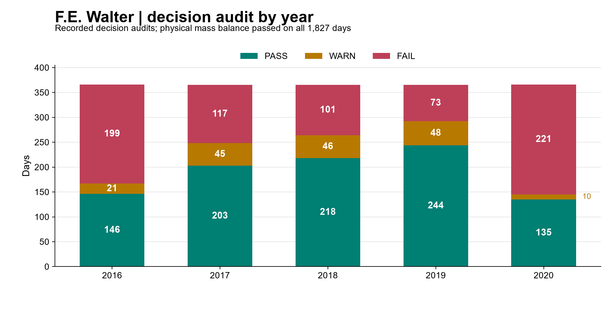

# Historical FE Walter evidence

This archive preserves earlier five-year and short-run evidence. For the current three-method tutorial, read [2016 results](results.md).


This chapter uses the **complete 2016–2020 retrieved-knowledge experiment**: 1,827 daily steps, one FE Walter reservoir, local Ollama `gemma4:12b`, temperature **0.7**.
The figures and daily tables are copied from the accepted historical record; no simulation or model request was repeated.

## One year of daily operation — 2020

Use this full year to follow seasonal reservoir behaviour: **2020-01-01–12-31, 366 daily steps**.
It is an excerpt of the saved retrieved-knowledge experiment below, using `gemma4:12b`, temperature **0.7**.
January storage and release history continue from December 2019; this is not a new run initialized in January 2020.



| Recorded check | 2020 result |
|---|---:|
| Daily records | 366 |
| Operation audit | 135 PASS / 10 WARN / 221 FAIL |
| Maximum saved daily water-balance residual | 0 m³ |

This chapter preserves the older one-method 2016–2020 study and the separate
three-day rule/available-information tutorial records. For the maintained configuration's
annual evidence, see the [current 2016 coupled results](results.md).

## Full daily trajectory



Read the panels from top to bottom: **inflow and actual outflow → pool elevation and target → ending storage → operation audit**.
Pool elevation is measured at the **start** of the simulated day; storage is recorded at its **end**.
The seasonal target is saved operating guidance, not an independently verified annual management plan.

| Recorded check | Result |
|---|---:|
| Daily records | 1,827; 2016-01-01–2020-12-31 |
| Operation audit | 946 PASS / 170 WARN / 711 FAIL |
| Maximum saved daily water-balance residual | 0 m³ |
| Spill days | 0 |
| Ending storage | 2,426,260.491603742 m³ |
| Operating-strategy acceptance | FAIL |

The trajectory completed and its daily water accounting passed. The operating policy failed acceptance; those verdicts remain visible.
Numerical completion and operating-strategy acceptance answer different questions.

{download}`Daily table, full precision <../../_case_downloads/dkp_2016_2020/plotted_daily.csv>` ·
{download}`Original physical ledger <../../_case_downloads/dkp_2016_2020/trajectory.csv>` ·
{download}`Figure PDF <../../_case_downloads/dkp_2016_2020/fe_walter_2016_2020_daily.pdf>` ·
{download}`Editable figure SVG <../../_case_downloads/dkp_2016_2020/fe_walter_2016_2020_daily.svg>`

## Connect a decision to its physical effect

Two days show why the implemented action matters. Both occur below the saved summer target of 1,370 ft.

| Date | Inflow (m³/s) | Requested / implemented controlled release (m³/s) | Storage change (m³) | Audit |
|---|---:|---:|---:|---|
| 2020-05-02 | 69.451591 | 2.831685 / 2.831685 | +5,755,959.92 | WARN |
| 2020-06-15 | 12.183530 | 12.184739 / 12.184739 | −104.52 | FAIL |

On May 2, release below inflow builds storage. On June 15, release approximately equal to inflow holds storage near its current level.
The June reply calls 1,367.06 ft “at target”. The configured audit records that this contradicts the 1,370 ft target, and that passing inflow cannot refill a below-target reservoir.

### Follow June 15 from information to next-day state

1. **Available information:** date, daily inflow, starting pool elevation and previously implemented releases.
2. **Prompt:** fixed operating instructions plus the rendered information and retrieved operating guidance.
3. **Operation proposal:** target, pool position, intended storage direction, release relation, operating mode, cited rules, rationale and requested release.
4. **Response checks:** a parsed reply proceeds to physical execution; operating audit remains separate.
5. **Actual operation:** controlled release 12.1847392641 m³/s, zero spill, and ending storage 23,695,577.3604956 m³.
6. **Next day:** that ending storage becomes starting storage; history uses the implemented release.

The fixed [system prompt](prompts/reference/dkp_system.txt) matches the hash in this saved trace.
Expand the complete messages below to see exactly what the model received and returned.

<details>
<summary>Complete rendered user prompt, including retrieved guidance</summary>

`````text
Date: 2020-06-15 (June, day 167 of the year)
1. Today's inflow: 430.3 cfs (= 37,174,229 cubic feet (= 853 acre-feet) over 1 days)
2. Water level at beginning of interval: 1367.06 ft NGVD29
3. Previous simulated release decisions (and what was actually released):
   2020-06-13: decided 350.0 cfs; actually released 350.0 cfs (= 30,240,000 cubic feet (= 694 acre-feet) over 1 days)
   2020-06-14: decided 50.0 cfs; actually released 50.0 cfs (= 4,320,000 cubic feet (= 99 acre-feet) over 1 days)
4. Number of days in this decision interval: 1
5. Release limits for this interval (water control manual): 50-10,000 cfs (= 4,320,000-864,000,000 cubic feet over 1 days)

Retrieved DKP sections relevant to current conditions:

--- DKP excerpt 1: R-RELEASE (composite per-timestep decision; WCM Table 7-1 Parts A and B; §7-01, §7-03, §7-05) ---
```pseudo
plan = R-PLAN(pool_elevation, stages, season)

active_min = R-MINFC       if plan in {C, D} or impounding_for_flood_emergency   # 100 cfs
           | R-MINDROUGHT  if drbc_drought_declared                              #  43 cfs
           | R-MINNORM                                                           #  50 cfs

CASE plan OF
  A:  release = inflow_cfs, holding pool at or near target_pool_ft;
        obligations = Minimum Release Schedule + Water Quality Release Schedule (R-TEMP)

  B:  release_combined = MaxReleaseSchedule_Rising(stages)      # §2.4.5 — MOST RESTRICTIVE gage governs
        release_walter  = R-BALANCE(release_combined, pct_fc_storage_used,
                                    beltzville_state.pct_fc_storage_used)
        summer: defer to Exhibit D Recreation Plan (NOT SUPPLIED)
        apply R-FILLING whenever pool exceeds any previously attained elevation

  C:  release = active_min                                       # store all inflow at BOTH projects
        on stages_trend == falling_after_peak, switch to MaxReleaseSchedule_Falling (§2.4.5)

  D:  release = pass inflow (hourly or finer), gates incrementally to full open;
        once outlet capacity exceeded, HOLD full open until pool < EL_SPILLWAY;
        then outflow = inflow until MaxReleaseSchedule_Rising (Plan B) can be resumed

release = clip(release, lower = active_min,
                        upper = min( Q_CHANNEL_CAP,            # conditional — see R-ATSITE
                                     outlet_capacity(pool_elevation),
                                     R-DOWNSTREAM limit ) )

subject to R-ROC (gate-position limits, NOT a discharge-rate limit)

IF pool_elevation > EL_SPILLWAY:
    total_outflow = release + spillway_discharge(pool_elevation)   # uncontrolled, §2.4.3
```

--- DKP excerpt 2: R-MINNORM, R-MINFC, R-MINDROUGHT (Minimum Release Schedule; WCM Table 7-1 Part B; §7-01, §7-05,c,3, §8-04) ---
```pseudo
Flows maintained at the reservoir OUTFLOW gaging station (White Haven for Walter):

   Regulation purpose                     Walter (cfs)   Beltzville (cfs)
   1. Flood control regulation (storing)      100              35     -> R-MINFC
   2. Normal regulation                        50              35     -> R-MINNORM
   3. Drought warning and drought               43              15     -> R-MINDROUGHT

Precedence: R-MINFC applies whenever storing under Plans C/D; R-MINDROUGHT relaxes
R-MINNORM under a declared DRBC drought warning or emergency; R-MINNORM otherwise.
The 50 cfs is a Commonwealth of Pennsylvania Fish Commission requirement set to protect
downstream brook trout habitat (Table 7-1 Part B).
```

--- DKP excerpt 3: R-ATSITE (maximum release; WCM §4-09, §7-02a, §7-05,c,1, Table 7-2 notes 1–2) ---
```pseudo
release ≤ 10,000 cfs  "during non-spillway flow conditions ... should not be exceeded IF POSSIBLE"
   equivalently: stage_WhiteHaven ≤ 8.4 ft (Table 7-1 Part B note 5)
release ≤ outlet_capacity(pool_elevation)   [≈17,000 cfs at EL_SPILLWAY]

EXCEPTION (Table 7-2 note 1): during FALLING stages after a peak, releases in excess of
10,000 cfs MAY be considered, provided the release — combined with Beltzville's — does not
cause any key Lehigh station to exceed max(event_peak_stage, flood stage), whichever governs.
CONFIRMED BY RECORD: the WY1996 maximum discharge of 11,452 cfs (Table 8-1, 29 Jan 1996)
exceeds 10,000 cfs -- the exception is exercised in practice, not merely permitted.
=> the 10,000 cfs cap is a CONDITIONAL constraint, not a physical invariant.
```

--- DKP excerpt 4: R-ZONE (seasonal rule curve — the normal operating target; WCM §7-01, Plate 7-2) ---
```pseudo
target_pool_ft = 1300.0   # winter normal pool
Storage for recreation begins on/about 1 April; target date mid-May to reach 1370.0;
1370.0 is held and drawn on to make releases through mid-October; thereafter any
remaining water is released and the pool returns to 1300.0.

RATIONALE (§3-05,b,2(b)): 1370 is "the limit imposed to keep adequate flood control space
available since this volume can be quickly evacuated in advance of an oncoming storm event."

=> Recreation storage is ALWAYS subordinate and pre-releasable; it is NOT protected storage.
```

--- DKP excerpt 5: R-RECREATION (whitewater and in-lake recreation; WCM §3-05,b,2, §7-06, §8-03) ---
```pseudo
CURRENT PLAN (2014, Exhibit D — NOT SUPPLIED): ~26 whitewater releases spread across the
season, plus fishing / fisheries-augmentation releases every day no whitewater is planned,
subject to hydrologic availability.

LEGACY PROGRAM (documented, superseded 2005+): five weekend events / seven days per year;
storage began the Monday two weeks before each event; release 144 cfs during storage
(or inflow, if lower) until pool reached 1309.0; if 1309.0 reached early, pass inflow;
event releases 500–750 cfs; cancellation evaluated by DRBC during drought warnings.

Recreation storage is evacuable at any time for flood control (§8-03,b).
In-lake boating/fishing impeded above EL_BOAT_LIMIT (1306.0).
```

The simulated year is 2020. Check the year of every dated DKP instruction before applying it.
Apply these DKP rules to decide the mean release for this interval (cfs).
`````

</details>

<details>
<summary>Complete native model reply</summary>

`````json
{
  "applicable_target_ft": 1370.0,
  "pool_position": "at_target",
  "intended_storage_direction": "hold",
  "release_relation_to_inflow": "equal_to_inflow",
  "operating_mode": "pass_inflow",
  "rules_applied": [
    "R-RELEASE",
    "R-MINNORM",
    "R-ATSITE",
    "R-ZONE",
    "R-RECREATION"
  ],
  "reasoning": "The current date is June 15, which falls within the summer season (May to October). The target pool elevation for this period is 1370.0 ft NGVD. The current pool elevation is 1367.06 ft, which is effectively at the target level (within a standard margin of error for 'at_target'). According to R-RELEASE Plan A, the goal is to hold the pool at or near the target. Since the current pool is at the target, the objective is to balance the inflow. The current inflow is 430.3 cfs. To maintain the current level (hold), the release should equal the inflow. The release of 430.3 cfs is well within the R-MINNORM (50 cfs) and R-ATSITE (10,000 cfs) constraints. Because the release equals the inflow, the storage direction is 'hold' and the relation is 'equal_to_inflow'.",
  "release_cfs": 430.3
}
`````

</details>

{download}`Complete June 15 trace <../../_case_downloads/dkp_2016_2020/trace_2020-06-15.json>` ·
{download}`June 15 physical transition <../../_case_downloads/dkp_2016_2020/operation_2020-06-15.json>` ·
{download}`May 2 trace <../../_case_downloads/dkp_2016_2020/trace_2020-05-02.json>`

## Read the audit over the full period



FAIL means a configured operating criterion failed; it does not mean the water-balance calculation stopped.
Audit messages and rationale are part of the evidence, including contradictory classifications or incomplete operating guidance.
[The generic audit and trace chapter](../../docs/RESULTS_GUIDE.md) explains files, verdicts and debugging.

## Evidence and comparison scope

This historical run used the pinned legacy integration and `gemma4:12b`.
The three-method tutorial uses January 1–3 and `gemma3:4b` for its LLM methods.
Those short records explain the interfaces; they do not form a five-year performance comparison with this trajectory.

Upstream inflow is frozen semi-distributed GWLF/Lohmann output. Downstream routing is an identity fixture.
Native routing postconditions were retained for the resumed 551-day suffix; the original 1,276-day prefix did not save the final native outlet arrays.
Initial storage and zero reservoir losses are documented assumptions.

The original 13 failed requests and one interrupted request with unknown outcome remain in the historical record. Unknown request costs stay unknown.

{download}`Data and source hashes <../../_case_downloads/dkp_2016_2020/source_manifest.json>` ·
{download}`Annual summary <../../_case_downloads/dkp_2016_2020/annual_summary.csv>`
