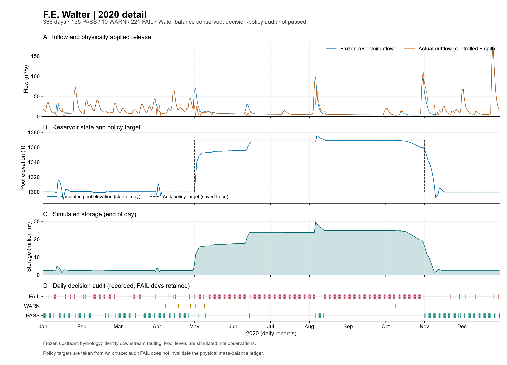
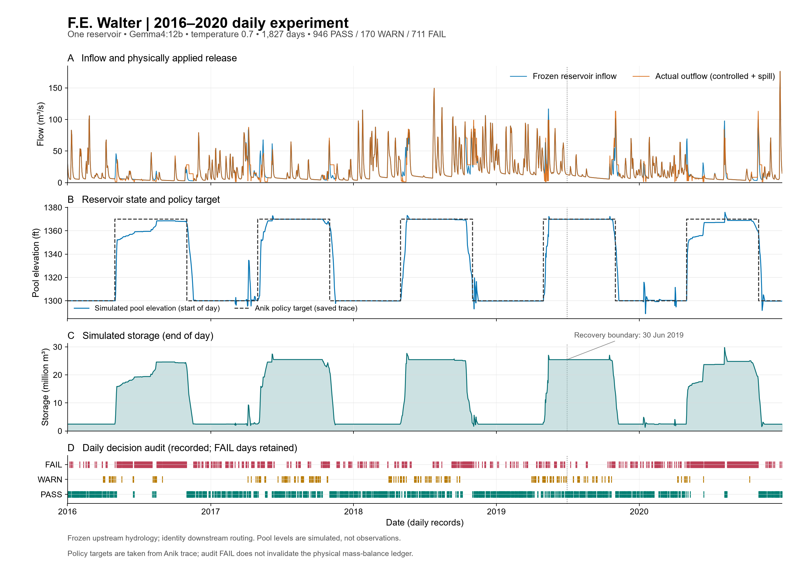
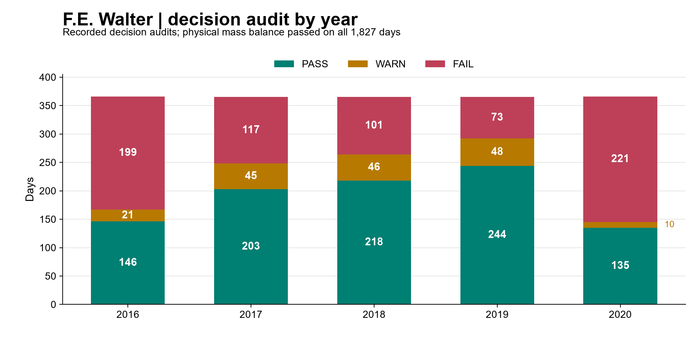

# FE Walter 歷史證據

本頁保存較早五年與短期研究紀錄。最新版三方法教學見[2016 結果](results.zh-TW.md)。


本章使用**完整 2016–2020 檢索知識實驗**：1,827 個每日步長、一座 FE Walter 水庫、本機 Ollama `gemma4:12b`、temperature **0.7**。
圖表與每日資料直接複製已接受的歷史紀錄，沒有重跑模擬或呼叫模型。

## 一年每日操作：2020

以完整一年閱讀季節性水庫行為：**2020-01-01–12-31，共 366 個每日步長**。
這是下方已保存檢索知識實驗的節錄，使用 `gemma4:12b`、temperature **0.7**。
一月蓄水與放流歷史承接 2019 年十二月，並非重新設定初始狀態的 2020 年新實驗。



| 保存的檢查 | 2020 結果 |
|---|---:|
| 每日紀錄 | 366 |
| 操作 audit | 135 PASS / 10 WARN / 221 FAIL |
| 保存的每日最大水量平衡殘差 | 0 m³ |

本章保留較早的單一方法 2016–2020 研究，以及規則式／可用資訊方法的三日教學紀錄。
目前維護設定的全年證據，請見英文[2016 年耦合結果](results.md)。

## 完整每日軌跡



依序閱讀**入流與實際出流 → 水位與目標 → 期末蓄水 → 操作 audit**。
水位是模擬**日初**值，蓄水是**日末**值。季節目標來自保存的操作指引，不是獨立驗證的年度管理計畫。

| 保存的檢查 | 結果 |
|---|---:|
| 每日紀錄 | 1,827；2016-01-01–2020-12-31 |
| 操作 audit | 946 PASS / 170 WARN / 711 FAIL |
| 保存的每日最大水量平衡殘差 | 0 m³ |
| Spill 天數 | 0 |
| 最終蓄水 | 2,426,260.491603742 m³ |
| 操作策略驗收 | FAIL |

軌跡已完成，每日水量收支通過；操作策略未通過驗收，原判定完整保留。
數值完成與操作策略驗收回答不同問題。

{download}`完整精度每日表 <../../_case_downloads/dkp_2016_2020/plotted_daily.csv>` ·
{download}`原始物理帳本 <../../_case_downloads/dkp_2016_2020/trajectory.csv>` ·
{download}`圖表 PDF <../../_case_downloads/dkp_2016_2020/fe_walter_2016_2020_daily.pdf>` ·
{download}`可編輯 SVG <../../_case_downloads/dkp_2016_2020/fe_walter_2016_2020_daily.svg>`

## 連結決策與物理效果

以下兩日都低於保存的夏季目標 1,370 ft，可用來理解實際動作的影響。

| 日期 | 入流 (m³/s) | 請求／實際受控放流 (m³/s) | 蓄水變化 (m³) | Audit |
|---|---:|---:|---:|---|
| 2020-05-02 | 69.451591 | 2.831685 / 2.831685 | +5,755,959.92 | WARN |
| 2020-06-15 | 12.183530 | 12.184739 / 12.184739 | −104.52 | FAIL |

5 月 2 日放流低於入流，因此增加蓄水。6 月 15 日放流約等於入流，因此蓄水大致維持原位。
6 月回覆把 1,367.06 ft 分類為「at target」。設定的 audit 記錄這與 1,370 ft 目標不符，且直接通過入流無法補滿低於目標的水庫。

### 追查 6 月 15 日：資訊到下一日狀態

1. **Available information：**日期、每日入流、日初水位及過去實際放流。
2. **Prompt：**固定操作指令，加上渲染資訊與檢索操作指引。
3. **Operation proposal：**目標、水位位置、蓄水方向、放流關係、操作模式、引用規則、理由與請求放流。
4. **回覆檢查：**解析後的回覆進入物理執行；操作 audit 另行保存。
5. **實際操作：**受控放流 12.1847392641 m³/s、spill 為零、期末蓄水 23,695,577.3604956 m³。
6. **下一日：**期末蓄水成為日初蓄水；歷史使用實際放流。

固定 [system prompt](../../archive/fe_walter/prompts/README.md) 與保存 trace 的 hash 相符。
展開下方完整訊息，查看模型實際收到與回傳的內容。

<details>
<summary>完整渲染 user prompt，含檢索指引</summary>

`````text
Date: 2020-06-15 (June, day 167 of the year)
1. Today's inflow: 430.3 cfs (= 37,174,229 cubic feet (= 853 acre-feet) over 1 days)
2. Water level at beginning of interval: 1367.06 ft NGVD29
3. Previous simulated release decisions (and what was actually released):
   2020-06-13: decided 350.0 cfs; actually released 350.0 cfs (= 30,240,000 cubic feet (= 694 acre-feet) over 1 days)
   2020-06-14: decided 50.0 cfs; actually released 50.0 cfs (= 4,320,000 cubic feet (= 99 acre-feet) over 1 days)
4. Number of days in this decision interval: 1
5. Release limits for this interval (water control manual): 50-10,000 cfs (= 4,320,000-864,000,000 cubic feet over 1 days)

Retrieved DKP sections relevant to current conditions:

--- DKP excerpt 1: R-RELEASE (composite per-timestep decision; WCM Table 7-1 Parts A and B; §7-01, §7-03, §7-05) ---
```pseudo
plan = R-PLAN(pool_elevation, stages, season)

active_min = R-MINFC       if plan in {C, D} or impounding_for_flood_emergency   # 100 cfs
           | R-MINDROUGHT  if drbc_drought_declared                              #  43 cfs
           | R-MINNORM                                                           #  50 cfs

CASE plan OF
  A:  release = inflow_cfs, holding pool at or near target_pool_ft;
        obligations = Minimum Release Schedule + Water Quality Release Schedule (R-TEMP)

  B:  release_combined = MaxReleaseSchedule_Rising(stages)      # §2.4.5 — MOST RESTRICTIVE gage governs
        release_walter  = R-BALANCE(release_combined, pct_fc_storage_used,
                                    beltzville_state.pct_fc_storage_used)
        summer: defer to Exhibit D Recreation Plan (NOT SUPPLIED)
        apply R-FILLING whenever pool exceeds any previously attained elevation

  C:  release = active_min                                       # store all inflow at BOTH projects
        on stages_trend == falling_after_peak, switch to MaxReleaseSchedule_Falling (§2.4.5)

  D:  release = pass inflow (hourly or finer), gates incrementally to full open;
        once outlet capacity exceeded, HOLD full open until pool < EL_SPILLWAY;
        then outflow = inflow until MaxReleaseSchedule_Rising (Plan B) can be resumed

release = clip(release, lower = active_min,
                        upper = min( Q_CHANNEL_CAP,            # conditional — see R-ATSITE
                                     outlet_capacity(pool_elevation),
                                     R-DOWNSTREAM limit ) )

subject to R-ROC (gate-position limits, NOT a discharge-rate limit)

IF pool_elevation > EL_SPILLWAY:
    total_outflow = release + spillway_discharge(pool_elevation)   # uncontrolled, §2.4.3
```

--- DKP excerpt 2: R-MINNORM, R-MINFC, R-MINDROUGHT (Minimum Release Schedule; WCM Table 7-1 Part B; §7-01, §7-05,c,3, §8-04) ---
```pseudo
Flows maintained at the reservoir OUTFLOW gaging station (White Haven for Walter):

   Regulation purpose                     Walter (cfs)   Beltzville (cfs)
   1. Flood control regulation (storing)      100              35     -> R-MINFC
   2. Normal regulation                        50              35     -> R-MINNORM
   3. Drought warning and drought               43              15     -> R-MINDROUGHT

Precedence: R-MINFC applies whenever storing under Plans C/D; R-MINDROUGHT relaxes
R-MINNORM under a declared DRBC drought warning or emergency; R-MINNORM otherwise.
The 50 cfs is a Commonwealth of Pennsylvania Fish Commission requirement set to protect
downstream brook trout habitat (Table 7-1 Part B).
```

--- DKP excerpt 3: R-ATSITE (maximum release; WCM §4-09, §7-02a, §7-05,c,1, Table 7-2 notes 1–2) ---
```pseudo
release ≤ 10,000 cfs  "during non-spillway flow conditions ... should not be exceeded IF POSSIBLE"
   equivalently: stage_WhiteHaven ≤ 8.4 ft (Table 7-1 Part B note 5)
release ≤ outlet_capacity(pool_elevation)   [≈17,000 cfs at EL_SPILLWAY]

EXCEPTION (Table 7-2 note 1): during FALLING stages after a peak, releases in excess of
10,000 cfs MAY be considered, provided the release — combined with Beltzville's — does not
cause any key Lehigh station to exceed max(event_peak_stage, flood stage), whichever governs.
CONFIRMED BY RECORD: the WY1996 maximum discharge of 11,452 cfs (Table 8-1, 29 Jan 1996)
exceeds 10,000 cfs -- the exception is exercised in practice, not merely permitted.
=> the 10,000 cfs cap is a CONDITIONAL constraint, not a physical invariant.
```

--- DKP excerpt 4: R-ZONE (seasonal rule curve — the normal operating target; WCM §7-01, Plate 7-2) ---
```pseudo
target_pool_ft = 1300.0   # winter normal pool
Storage for recreation begins on/about 1 April; target date mid-May to reach 1370.0;
1370.0 is held and drawn on to make releases through mid-October; thereafter any
remaining water is released and the pool returns to 1300.0.

RATIONALE (§3-05,b,2(b)): 1370 is "the limit imposed to keep adequate flood control space
available since this volume can be quickly evacuated in advance of an oncoming storm event."

=> Recreation storage is ALWAYS subordinate and pre-releasable; it is NOT protected storage.
```

--- DKP excerpt 5: R-RECREATION (whitewater and in-lake recreation; WCM §3-05,b,2, §7-06, §8-03) ---
```pseudo
CURRENT PLAN (2014, Exhibit D — NOT SUPPLIED): ~26 whitewater releases spread across the
season, plus fishing / fisheries-augmentation releases every day no whitewater is planned,
subject to hydrologic availability.

LEGACY PROGRAM (documented, superseded 2005+): five weekend events / seven days per year;
storage began the Monday two weeks before each event; release 144 cfs during storage
(or inflow, if lower) until pool reached 1309.0; if 1309.0 reached early, pass inflow;
event releases 500–750 cfs; cancellation evaluated by DRBC during drought warnings.

Recreation storage is evacuable at any time for flood control (§8-03,b).
In-lake boating/fishing impeded above EL_BOAT_LIMIT (1306.0).
```

The simulated year is 2020. Check the year of every dated DKP instruction before applying it.
Apply these DKP rules to decide the mean release for this interval (cfs).
`````

</details>

<details>
<summary>完整原生模型回覆</summary>

`````json
{
  "applicable_target_ft": 1370.0,
  "pool_position": "at_target",
  "intended_storage_direction": "hold",
  "release_relation_to_inflow": "equal_to_inflow",
  "operating_mode": "pass_inflow",
  "rules_applied": [
    "R-RELEASE",
    "R-MINNORM",
    "R-ATSITE",
    "R-ZONE",
    "R-RECREATION"
  ],
  "reasoning": "The current date is June 15, which falls within the summer season (May to October). The target pool elevation for this period is 1370.0 ft NGVD. The current pool elevation is 1367.06 ft, which is effectively at the target level (within a standard margin of error for 'at_target'). According to R-RELEASE Plan A, the goal is to hold the pool at or near the target. Since the current pool is at the target, the objective is to balance the inflow. The current inflow is 430.3 cfs. To maintain the current level (hold), the release should equal the inflow. The release of 430.3 cfs is well within the R-MINNORM (50 cfs) and R-ATSITE (10,000 cfs) constraints. Because the release equals the inflow, the storage direction is 'hold' and the relation is 'equal_to_inflow'.",
  "release_cfs": 430.3
}
`````

</details>

{download}`完整 6 月 15 日 trace <../../_case_downloads/dkp_2016_2020/trace_2020-06-15.json>` ·
{download}`6 月 15 日物理轉移 <../../_case_downloads/dkp_2016_2020/operation_2020-06-15.json>` ·
{download}`5 月 2 日 trace <../../_case_downloads/dkp_2016_2020/trace_2020-05-02.json>`

## 全期間 audit



FAIL 表示設定的操作準則未通過，不是水量平衡計算中止。
Audit 訊息與 rationale 都是證據，包括互相矛盾的分類或不完整的操作指引。
[通用 audit 與 trace 章節](../../docs/RESULTS_GUIDE.md)說明檔案、判定及偵錯。

## 證據與比較範圍

歷史實驗使用固定來源的舊整合版本與 `gemma4:12b`；三方法教學使用一月 1–3 日，LLM 模型為 `gemma3:4b`。
短紀錄用來解釋介面，不能與本軌跡當作五年策略比較。

上游入流是凍結的半分佈式 GWLF／Lohmann 輸出，下游 routing 是 identity fixture。
原生 routing 的執行後檢查保存於續跑的 551 日；原 1,276 日沒有保存最後的原生出口陣列。
初始蓄水與零水庫損失是明載的假設。

原 13 次失敗請求，以及一次結果未知的中斷請求，均保留在歷史紀錄；未知費用仍維持未知。

{download}`資料與來源 hashes <../../_case_downloads/dkp_2016_2020/source_manifest.json>` ·
{download}`年度摘要 <../../_case_downloads/dkp_2016_2020/annual_summary.csv>`
