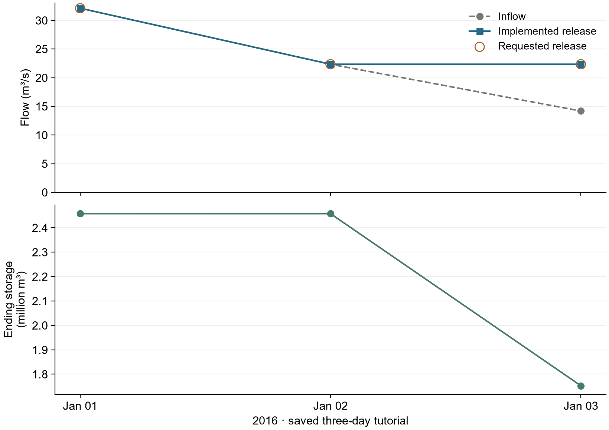

# F.E. Walter: LLM operation with available information

> Historical reference: this page preserves earlier settings and saved decisions.
> Start new work from the [current FE Walter tutorial](../../../tutorials/fe_walter.md)
> and read the [current annual results](../results.md).


[English](README.md) | [繁體中文](README.zh-TW.md) · [FE Walter case](../README.md)

This method supplies operating instructions and available reservoir information
to the LLM. It does not retrieve knowledge excerpts. The example uses local
Ollama; the walkthrough reads saved replies before showing how to start a new run.

Shared input and physical assumptions are defined in the [common case setup](../README.md#common-case-setup).

First review [the case hydrology](../hydrology.md) and [the coupled daily workflow](../coupling.md).
This method uses the same daily Dam/routing loop with precomputed inflow; the operation run does not recalculate GWLF.
Each implemented operation advances storage; LLM methods retain implemented release history.

**Optional three-day seasonal case:** use the [seasonal YAML](experiment.seasonal.ollama.yaml)
and [seasonal prompt](../prompts/reference/zeroshot_seasonal_v1_system.txt).
Read the [shared windows and pool checks](../README.md#seasonal-pool-levels).
This separate three-day seasonal YAML has not been rerun. Saved exchanges on
this page retain their original instructions and audit verdicts. See the
[current 2016 coupled results](../results.md) for
the maintained annual configuration.

## 1. Configure the method

Use local Ollama **gemma3:4b**, temperature **0.7**.
This tutorial covers three daily steps, one controlled reservoir and one independent
agent: at most three requests, with no retries.

[Full settings and commands are at the end](#files-and-commands). Use a new run ID and output location for a new simulation.

## 2. Understand the operation method

Read the [system prompt](../prompts/reference/zeroshot_system.txt)
and [builder reading preview](prompt_preview.txt). The preview is not the saved
model reply. The [complete saved day-one record](../../../examples/fe_walter/reference_outputs/ollama_three_day/zero_shot/raw/policy_4e2006ff9c730ed33c23b8f580d2e49e1d6d8a4a643806a24ef48fe689147292.json)
contains the actual rendered user prompt, response schema and full Ollama reply.
The system template is fixed. The host tracks starting storage and converts it
to pool elevation; the rendered model message exposes the current pool elevation,
inflow and implemented release history, but not the numeric storage state. Editing
the preview does not change execution.

<details>
<summary>Exact saved day-one model exchange (expand)</summary>

**System message**

````text
You are the operator of a reservoir, making one release decision per day.

Reservoir information (public sources):
- Name: F.E. Walter Dam on the Lehigh River, Pennsylvania
- Location: Bear Creek Township, Luzerne County and Kidder Township, Carbon County, Pennsylvania
- Purpose: flood control, water storage, recreation
- Opened: 1961; operated by the U.S. Army Corps of Engineers
- Type: earth-fill embankment with rock shell, impounding the Lehigh River
- Dam height (foundation): 234 ft; length: 3,000 ft
- Spillway type: concrete
- Catchment area: 289 square miles
- Total capacity (publicly reported): 110,700 acre-feet
- Operation target: Your goal is to keep the water level at or near the designated normal pool elevation: 1300.0 ft N.G.V.D. in the winter (November through April) and 1370.0 ft N.G.V.D. in the summer (May through October).

Each day you will receive the current date, mean inflow,
water level at the beginning of the interval, and the previous one or two
simulated release decisions.
Flows are also stated as volumes in cubic feet over their interval, the
unit of the water balance. Decide the interval's mean release
in cfs, consistent with the reservoir's purpose. You have no operating
manual; use general reservoir-operation principles.

Physical water balance (not an operating rule):
- storage_change_cubic_feet = (inflow_cfs - release_cfs) * 86,400 * interval_days.
- A release below inflow increases storage; a release equal to inflow
  leaves storage approximately unchanged; a release above inflow decreases
  storage. Passing inflow cannot refill a reservoir below its target.

Constraints you must respect:
- Do not plan to release more water than is available (storage + inflow).
- Avoid letting storage exceed capacity (uncontrolled spill).
- Avoid abrupt interval-to-interval release changes unless conditions require them.

Respond only with JSON, with the fields in this order:
  applicable_target_ft (the operation-target water level for this interval),
  pool_position (below_target | at_target | above_target),
  intended_storage_direction (increase | hold | decrease),
  release_relation_to_inflow (below_inflow | equal_to_inflow | above_inflow),
  reasoning (1-2 sentences), release_cfs (number).
Decide the first four, then write the reasoning, then choose release_cfs.
Make release_cfs consistent with the four fields and with your reasoning.
````

**User message**

````text
Date: 2016-01-01 (January, day 1 of the year)
1. Today's inflow: 1,134.5 cfs (= 98,020,360 cubic feet (= 2,250 acre-feet) over 1 days)
2. Water level at beginning of interval: 1300.00 ft NGVD29
3. Previous simulated release decisions (and what was actually released):
   None (first simulated step).
4. Number of days in this decision interval: 1

Decide the mean release for this interval (cfs).
````

**Native assistant reply**

````json
{"applicable_target_ft": 1300.00, "pool_position": "at_target", "intended_storage_direction": "hold", "release_relation_to_inflow": "equal_to_inflow", "reasoning": "Given the target water level of 1300.0 ft and the inflow of 1134.5 cfs, a release equal to inflow is appropriate to maintain the target. This will hold the current storage level.", "release_cfs": 1134.5}
````

</details>

Follow **info → rendered prompt → full reply → operation proposal → response
checks → actual release → next-day information** in the
[main tutorial](../../../tutorials/main.ipynb). It displays complete saved prompts
and replies, including the rationale; release is not the only response field.

## 3. Run the simulation

1. **Check** the dates, reservoirs, units and planned requests. This makes no model request.
2. **Run** local Ollama only when starting a new simulation. Reading saved results makes no request.
3. **Verify** saved trajectories, water balance and execution evidence. This does not certify a passing policy audit.

[Open the execution and verification commands](#files-and-commands).

## 4. Inspect saved decisions



The saved trajectory records requested release, implemented controlled
release, spill and ending storage. Total outflow is controlled release plus spill
and enters routing once. Next-day history uses implemented release.

| Date | Inflow (m³/s) | Requested (m³/s) | Implemented (m³/s) | Spill (m³/s) | Ending storage (m³) |
|---|---:|---:|---:|---:|---:|
| 2016-01-01 | 32.125319 | 32.125463 | 32.125463 | 0.000000 | 2,457,835.82 |
| 2016-01-02 | 22.353047 | 22.353319 | 22.353319 | 0.000000 | 2,457,812.34 |
| 2016-01-03 | 14.193931 | 22.353319 | 22.353319 | 0.000000 | 1,752,841.25 |

### A recorded decision: 2016-01-03

Follow the supplied values, complete model reply, checks and executed result. Everything below comes from saved records; no new model request is needed.

| Information | Value |
|---|---:|
| Inflow (m³/s) | 14.193931 |
| Starting pool elevation (ft NGVD29) | 1299.999706 |
| Host starting storage (m³) | 2,457,812.34 |

The prompt exposes pool elevation; numeric storage remains with the host and is absent from this version’s model message.

**Complete raw assistant reply**

```json
{
  "applicable_target_ft": 1300.00,
  "pool_position": "at_target",
  "intended_storage_direction": "hold",
  "release_relation_to_inflow": "equal_to_inflow",
  "reasoning": "The water level is already at the target and inflow is relatively high. Maintaining the current release rate will help to hold the pool elevation steady and account for the incoming water. ",
  "release_cfs": 789.4
}
```

**Response checks and operation audit**

| Check | Rule / saved evidence | Result |
|---|---|---|
| Complete generation | `done: true`, `done_reason: stop` | **COMPLETE** |
| Reply format | JSON, required target / direction / rationale / release fields; required fields are defined in the linked raw record | **RECORDED REPLY** |
| Normalized action | Current recheck of finite, nonnegative `release_cms`; not a historical checker event | **PASS** |
| Feasible release bound | Saved named `release_limits` auditor | **PASS** |
| Operating consistency | Target / pool, release–inflow relation, intended storage direction and applicable rules | **FAIL** |

Saved audit reasons:

- `release_relation_to_inflow 'equal_to_inflow' contradicts release 789.4 vs inflow 501.3 cfs`
- `intended_storage_direction 'hold' contradicts the water balance (storage will decrease)`

**Implemented operation and water balance**

| Outcome | Value |
|---|---:|
| Requested release (m³/s) | 22.353319 |
| Implemented release (m³/s) | 22.353319 |
| Spill (m³/s) | 0.000000 |
| Ending storage (m³) | 1,752,841.246484 |
| Balance residual (m³) | 0.000000 |

Audit FAIL is an operating diagnosis; this saved run did not replace the release because of it. Storage changed by **-704,971.09 m³**. Implemented release plus spill enters routing once; the next daily history uses the implemented value.

[Full prompt and response](../../../examples/fe_walter/reference_outputs/ollama_three_day/zero_shot/raw/policy_b32bc5738ff8f890b5950aab3f5203ab31c224527ff6be8b3f5daf50bdb3dcc5.json) · [Raw audit](../../../examples/fe_walter/reference_outputs/ollama_three_day/zero_shot/raw/audit_b32bc5738ff8f890b5950aab3f5203ab31c224527ff6be8b3f5daf50bdb3dcc5.json) · [Execution records](../../../examples/fe_walter/reference_outputs/ollama_three_day/zero_shot/physics.jsonl)


[Historical 2016–2020 results and decision records](../results_history.md)

The table shows this method's saved three-day trajectory, not a policy-performance
assessment. Downloads retain full precision. The linked five-year results belong
to a separate retrieved-knowledge experiment, not a five-year comparison of all three methods.

The saved operating audit retains **2 PASS / 1 FAIL**.
Its strategy acceptance remains unset. A valid reply and feasible release do not
imply a passing operating audit.

[View the main tutorial](../../../tutorials/main.ipynb) ·
[Module reference](../../../docs/LLM_MODULES.md) ·
[Multiple reservoirs](../../../tutorials/advanced.ipynb)

## Files and commands

<details>
<summary>Expand settings, file locations and commands</summary>

Open [experiment.ollama.yaml](experiment.ollama.yaml). The YAML selects local Ollama `gemma3:4b`, **temperature 0.7**, daily steps,
**at most three requests**, and **no retries**. Each controlled reservoir is
assigned one independent agent; this case has one.

<details>
<summary>Current equivalent configuration (expand)</summary>

```yaml
# User-requested three-day local Ollama diagnostic; check performs no provider call.
schema_version: llm-reservoir-experiment.v1
case: ../../../cases/fe_walter_ollama_demo/case.json
start_date: "2016-01-01"
end_date: "2016-01-03"
run_id: hydroopslm-fe-walter-zero-shot-ollama-gemma3-4b-20261012
output: ../../../runs/hydroopslm-fe-walter-zero-shot-ollama-gemma3-4b-20261012
max_calls: 3
models:
  reservoir_model:
    provider: ollama
    model: gemma3:4b
    base_url: http://localhost:11434
    temperature: 0.7
    max_tokens: 2048
    seed: null
    timeout_seconds: 120
    api_key_env: null
auditors:
  release_limits:
    type: release_bounds
    version: "1"
agents:
  fe_operator:
    reservoir_id: FEWalter
    type: llm
    model_profile: reservoir_model
    customization:
      backend: reference_v3_7
      parameters:
        reference:
          profile: fe_walter
          method: zeroshot
          system_prompt: ../prompts/reference/zeroshot_system.txt
          system_prompt_mode: original
          prompt_storage: false
          hide_availability_line: true
          dkp_no_missing_inputs: true
          zeroshot_knowledge: target
    auditors: [release_limits]

extensions:
  reference_v3_7: ../extensions/__init__.py
```

</details>

For a new run, copy it beside its original:

```powershell
Copy-Item examples/fe_walter/zero_shot/experiment.ollama.yaml examples/fe_walter/zero_shot/my-run.yaml
```

In `my-run.yaml`, set `run_id: fe-walter-zero-shot-my-run` and
`output: ../../../runs/fe-walter-zero-shot-my-run`. Keep the remaining settings for this first
demonstration. An existing output folder must not be reused.

The `zero_shot` directory and provenance value are historical machine IDs kept
unchanged for reproducibility. They are not the public method title.

### Check the configuration

Validate your copied configuration from the repository folder:

```powershell
python run_experiment.py check examples/fe_walter/zero_shot/my-run.yaml
```

This checks the configuration without inference or a model request.
Expect three daily steps, one agent, `planned_llm_calls: 3`, `max_calls: 3`,
and no calls during `check`.

### Execute a new run

The [saved three-day result](../../../examples/fe_walter/reference_outputs/ollama_three_day/zero_shot/) is already available.
Only execute the following if you intend to start a new simulation:

```powershell
python run_experiment.py run examples/fe_walter/zero_shot/my-run.yaml --allow-network
```

Ollama must already be running with `gemma3:4b` available. `--allow-network`
permits the configured local model requests. This example has a three-request
limit and no automatic retries. An invalid reply stops before release is applied.

### Verify saved outputs

Verify the existing saved result without rerunning its simulation:

```powershell
python run_experiment.py verify examples/fe_walter/reference_outputs/ollama_three_day/zero_shot
```

After your new run, use `runs/fe-walter-zero-shot-my-run` instead. Verification checks execution
evidence; it does not establish that the operating policy is good.

Inspect the saved decision:

```powershell
python tutorials/inspect_decision_flow.py examples/fe_walter/reference_outputs/ollama_three_day/zero_shot
```

`decisions.jsonl`, `raw/`, `audit.jsonl`, `physics.jsonl` and `backend_events.jsonl`
link the information and proposal to checks and execution. The notebook separates
the recorded checker result from a current contract recheck. The inspector makes
no model request. See [results and troubleshooting](../../../docs/RESULTS_GUIDE.md).

</details>
